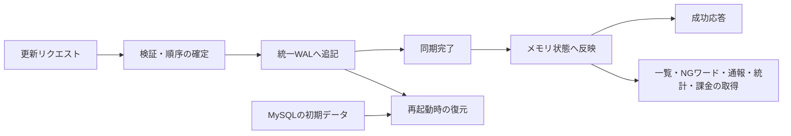

# Codex conversation

- Session: 01a0f6c8-3418-74c2-a37c-73b33cc83f7a

<!-- codex-hook-format: 7; tool results omitted -->

---

## USER

$isucon-agent 現在のボトルネックを分析してください

## ASSISTANT

`isucon-agent`スキルで、最新のfinalized RUNを基準に、保存済み計測と現行コードを照合します。まず成果物の欠損と計測時間窓を確認し、ボトルネックの根拠を絞ります。

## TOOL

```sh
pwd; rg --files -g 'AGENTS.md' -g 'Taskfile*.yml' -g 'run.json' -g 'sources.yaml' -g 'SKILL.md' -g '*README*' docs tools .agents | head -100
```

## TOOL

```sh
cat .agents/skills/isucon-agent/SKILL.md
```

## TOOL

```sh
git status --short; cat AGENTS.md; sed -n '1,230p' Taskfile.yml
```

## TOOL

```sh
cat docs/measurement/README.md; cat tools/analysis/sources.yaml; rg --files tools/analysis docs/conversation docs/official | head -100
```

## TOOL

```sh
rg --files -uu | rg '(^|/)(run\.json|.*\.duckdb)$|^results/|^runs/' | head -100; rg -n 'artifacts-run|^  q:|query|RUN|finalize' Taskfile.yml Taskfile.contest.yml
```

## TOOL

```sh
sed -n '820,868p' Taskfile.yml; cat tools/analysis/queries/bottleneck-evidence.sql; cat tools/analysis/queries/bottleneck-profile.sql; rg --files -uu runs | rg 'run.json$' | sort | tail -10; cat runs/scores.tsv; git log -5 --oneline
```

## TOOL

```sh
cat tools/analysis/schema/bottleneck.sql; cat tools/analysis/schema/semantic.sql
```

## TOOL

```sh
task q -- "select * from bottleneck_run_health order by run_id desc limit 3; select * from bottleneck_bench_summary where run_id='20261001-171503'; select * from bottleneck_capacity_summary where run_id='20261001-171503'; select * from bottleneck_consumers where run_id='20261001-171503' order by resource_kind,demand_rank;"
```

## TOOL

```sh
task artifacts-run RUN=runs/20261001-171503; head -90 runs/20261001-171503/run.json; rg --files webapp/go; git show --stat 47bc1c5; tail -70 runs/20261001-171503/bench.log
```

## ASSISTANT

最新RUNは `20261001-171503`（315,736点）で、必須成果物と負荷区間の計測は揃っています。60秒間のCPU需要は入口の `isucon-1` が最も高く、アプリ・DBには余力があります。入口でのnginx・DNSの競合と、アプリ内の待ちを照合して、どちらが処理量を制限しているか確認します。

## TOOL

```sh
task q -- "select host,samples,cpu_count,round(idle_mean_pct,2) idle_pct,round(iowait_mean_pct,2) iowait_pct,cpu_busy_ge80_samples,run_queue_over_cpu_samples,blocked_samples,round(cpu_pressure_some_avg10_mean,2) psi_cpu from bottleneck_host_saturation_summary where run_id='20261001-171503'; select source,host,entity,metric,round(mean_value,3) mean,round(max_value,3) max,round(window_total,3) total from bottleneck_state_audit where run_id='20261001-171503' and source in ('mysql','sql_pool'); select response_time_rank,method,route,requests,round(response_time_sum_seconds,2) sum_s,round(response_time_avg_ms,2) avg_ms,round(p99_ms,2) p99_ms,status_4xx,status_5xx from bottleneck_endpoint_ranking where run_id='20261001-171503' and response_time_rank<=15; select source,left(query_fingerprint,210) query,calls,round(sum_time_seconds,2) sum_s,round(avg_time_ms,3) avg_ms,rows_examined,lock_time_seconds from query_cost where run_id='20261001-171503' and source='digest' order by sum_time_seconds desc limit 15;"
```

## TOOL

```sh
task q -- "select * from bottleneck_profile_metadata where run_id='20261001-171503'; select function,round(flat_wall_seconds,2) flat_s,round(cumulative_wall_seconds,2) cum_s from bottleneck_profile_functions where run_id='20261001-171503' order by cumulative_wall_seconds desc limit 35; describe pprof_metadata; describe pprof_functions; describe bench_error_classification;"
```

## TOOL

```sh
rg --files nginx webapp/pdns tools/contest | head -70; cat nginx/nginx.conf; cat nginx/conf.d/*.conf; sed -n '1,220p' webapp/go/post_wal.go; cat tools/contest/analysis-schema/bench-errors-semantic.sql; rg -n 'missing|finalized|started_at|ended_at' runs/20261001-171503/run.json
```

## TOOL

```sh
task q -- "select duration_seconds,total_wall_seconds,sample_count,interpretation from bottleneck_profile_metadata where run_id='20261001-171503'; select function,round(flat_wall_seconds,2) flat_s,round(cumulative_wall_seconds,2) cum_s from bottleneck_profile_functions where run_id='20261001-171503' and (cumulative_rank<=25 or regexp_matches(function,'postStore|postWriter|fdatasync|syncPost|bcrypt|DNS|Barrier')) order by cumulative_wall_seconds desc limit 45; select source,profile_type,sample_type,duration_seconds,total_value,to_timestamp(time_unix_nano/1e9) started_at from pprof_metadata where run_id='20261001-171503'; select function,round(flat_value,3) flat_s,round(cumulative_value,3) cum_s from pprof_functions where run_id='20261001-171503' and profile_type='cpu' and sample_type='cpu' order by cumulative_value desc limit 22;"
```

## TOOL

```sh
cat nginx/sites-enabled/isupipe.conf; rg --files pdns systemd | head -50; rg -n 'Sync|writeBatch|Barrier|batch|ticker|Commit' webapp/go/post_store.go webapp/go/post_wal.go webapp/go/post_projector.go webapp/go/mutation_barriers.go; sed -n '1,230p' webapp/go/dns_control.go; cat docs/preallocated-wal.md; rg -n 'DNS|名前解決|スコア|永続|禁止|予約' docs/official/specification.md docs/official/isupipe.md | head -70
```

## TOOL

```sh
task q -- "select source,entity,metric,round(mean_value,3) mean,round(max_value,3) max,round(window_total,3) total from window_metrics where run_id='20261001-171503' and (regexp_matches(metric,'wal|post|sync|barrier|project|dns|net_|write_|io_util') and entity not like 'loop%'); select function,round(flat_value,3) flat_s,round(cumulative_value,3) cum_s from pprof_functions where run_id='20261001-171503' and profile_type='go-cpu' and sample_type='cpu' order by cumulative_value desc limit 20; select function,round(cumulative_wall_seconds,2) cum_s from bottleneck_profile_functions where run_id='20261001-171503' and regexp_matches(function,'main\.|database/sql.*Commit') order by cumulative_wall_seconds desc limit 30;"
```

## TOOL

```sh
rg --files -uu runs/20261001-171503; cat webapp/go/measurement.go; cat webapp/go/post_store.go; sed -n '240,400p' webapp/go/dns_control.go; rg --files | rg 'pdns|systemd'; sed -n '1,100p' docs/official/specification.md; head -8 runs/20261001-171503/isucon-3-sql-pool-metrics.tsv; rg -n 'worker_connections|too many|failed|error' runs/20261001-171503/isucon-1-nginx-error.log | head -12
```

## TOOL

```sh
task q -- "with s as (select run_id,ts,max(value) filter(where metric='wal_records_total') records,max(value) filter(where metric='wal_syncs_total') syncs,max(value) filter(where metric='wal_sync_ns_total') sync_ns from metrics join load_windows using(run_id) where source='sql_pool' and ts>=started_at and ts<ended_at and run_id in ('20261001-134339','20261001-171503') group by run_id,ts), d as (select run_id,date_diff('millisecond',min(ts),max(ts))/1000.0 seconds,arg_max(records,ts)-arg_min(records,ts) records,arg_max(syncs,ts)-arg_min(syncs,ts) syncs,(arg_max(sync_ns,ts)-arg_min(sync_ns,ts))/1e9 sync_seconds from s group by run_id) select *,round(records/seconds,2) posts_per_s,round(sync_seconds*1000/syncs,3) sync_ms,round(records/syncs,3) records_per_sync,round(sync_seconds/seconds,3) sync_busy from d; select run_id,host,round(demand_core_seconds,2) demand_s,round(capacity_core_seconds,2) capacity_s from resource_demand where run_id in ('20261001-134339','20261001-171503') and resource_kind='host' order by run_id,host; select run_id,host,entity,metric,round(mean_value,2) mean,round(max_value,2) max from window_metrics where run_id='20261001-171503' and source='disk' and entity='nvme0n1' and metric in ('io_util_pct','avg_queue_size','write_await_ms','read_await_ms','write_iops','read_iops'); select caller,callee,round(wall_seconds,2) wall_s from bottleneck_profile_edges where run_id='20261001-171503' and regexp_matches(caller,'main\.(.*applyBarrier|.*submit|.*syncPosts|registerHandler|updateDNS|.*projectFrameBatch)') order by wall_seconds desc limit 25;"
```

## TOOL

```sh
task q -- "select run_id,scenario,successes,failures from isupipe_scenario_counts where run_id in ('20261001-134339','20261001-171503') order by run_id,scenario; select method,route,sum(requests) requests,round(sum(response_time_sum_seconds),3) sum_s,round(sum(response_time_sum_seconds)*1000/sum(requests),3) avg_ms,sum(status_4xx) s4xx,sum(status_5xx) s5xx from http_traffic_series where run_id='20261001-171503' and in_load_window group by method,route order by sum_s desc limit 12; select left(message,280) from bench_errors e where run_id='20261001-171503' and not contains(message,'context canceled') limit 8;"
```

## TOOL

```sh
cat etc/hosts/isucon-1/powerdns/pdns.conf; cat etc/hosts/isucon-2/mysql/mysql.conf.d/mysqld.cnf; sed -n '1,170p' webapp/go/post_projector.go; cat webapp/go/mutation_barriers.go; sed -n '1,190p' webapp/go/mutations.go; rg -n 'Commit|BeginTxx|updateDNS|slots|reservation' webapp/go/user_handler.go webapp/go/livestream_handler.go webapp/go/livecomment_handler.go; cat docs/official/cautionary_note.md | head -120
```

## ASSISTANT

入口のCPU競合に加え、登録時のDNS更新と、投稿・モデレーションの永続化待ちが残っています。直前RUNとの比較では視聴完了数が1,462→1,622に増えています。WAL同期の改善量を同じ時間窓で集計し、次に狙うべき待ちを整理しています。予約枠不足による400応答は、処理遅延と分けて評価します。

## TOOL

```sh
task q -- "with s as (select run_id,ts,max(value) filter(where metric='wal_records_total') records,max(value) filter(where metric='wal_syncs_total') syncs,max(value) filter(where metric='wal_sync_ns_total') sync_ns from metrics join load_windows using(run_id) where source='sql_pool' and ts>=started_at and ts<ended_at and run_id in ('20261001-134339','20261001-171503') group by run_id,ts), d as (select run_id,date_diff('millisecond',min(ts),max(ts))/1000.0 as span_s,arg_max(records,ts)-arg_min(records,ts) records,arg_max(syncs,ts)-arg_min(syncs,ts) syncs,(arg_max(sync_ns,ts)-arg_min(sync_ns,ts))/1e9 sync_seconds from s group by run_id) select *,round(records/span_s,2) posts_per_s,round(sync_seconds*1000/syncs,3) sync_ms,round(records/syncs,3) records_per_sync,round(sync_seconds/span_s,3) sync_busy from d; select run_id,host,round(demand_core_seconds,2) demand_s,round(capacity_core_seconds,2) capacity_s from resource_demand where run_id in ('20261001-134339','20261001-171503') and resource_kind='host' order by run_id,host; select host,entity,metric,round(mean_value,2) mean,round(max_value,2) max from window_metrics where run_id='20261001-171503' and source='disk' and entity='nvme0n1' and metric in ('io_util_pct','avg_queue_size','write_await_ms','read_await_ms','write_iops','read_iops'); select caller,callee,round(wall_seconds,2) wall_s from bottleneck_profile_edges where run_id='20261001-171503' and regexp_matches(caller,'main\.(.*applyBarrier|.*submit|.*syncPosts|registerHandler|updateDNS|.*projectFrameBatch)') order by wall_seconds desc limit 15;"
```

## TOOL

```sh
task q -- "with t as (select floor(load_offset_seconds/10)*10 offset_s,sum(requests) requests,sum(response_time_sum_seconds) rt_s,sum(status_4xx) s4xx,sum(status_5xx) s5xx from http_traffic_series where run_id='20261001-171503' and in_load_window group by 1), c as (select floor(date_diff('millisecond',started_at,ts)/10000.0)*10 offset_s,host,round(avg(value),2) cpu_pct from metrics join load_windows using(run_id) where run_id='20261001-171503' and source='proc' and metric='cpu_busy_pct' and ts>=started_at and ts<ended_at group by 1,2) select t.offset_s,requests,round(rt_s*1000/requests,3) avg_ms,s4xx,s5xx,max(cpu_pct) filter(where host='isucon-1') cpu1,max(cpu_pct) filter(where host='isucon-2') cpu2,max(cpu_pct) filter(where host='isucon-3') cpu3 from t join c using(offset_s) group by all order by 1; select query_fingerprint,calls,sum_time_seconds from query_cost where run_id='20261001-171503' and source='digest' and regexp_matches(query_fingerprint,'COMMIT|ROLLBACK|post_wal_state'); select count(*) n,min(occurred_at) first_at,max(occurred_at) last_at from isupipe_bench_lines join load_windows using(run_id) where run_id='20261001-171503' and occurred_at>=started_at and occurred_at<ended_at and contains(line,'expected:400, actual:201');"
```

## TOOL

```sh
sed -n '132,176p' webapp/go/mutations.go; sed -n '175,245p' webapp/go/livestream_handler.go; sed -n '90,173p' webapp/go/user_handler.go; sed -n '421,542p' webapp/go/post_wal.go; rg -n 'innodb_flush|sync_binlog|log_bin|durab' etc/mysql* etc/hosts tools/contest/deployments.yaml; rg -n 'DNS|永続|サブドメイン|キャッシュ|変更禁止|禁止事項' docs/official/cautionary_note.md | tail -20; git diff 47bc1c5 -- webapp/go nginx etc Taskfile.yml Taskfile.contest.yml
```

## TOOL

```sh
task q -- "with s as (select run_id,ts,max(value) filter(where metric='wal_records_total') records,max(value) filter(where metric='wal_syncs_total') syncs,max(value) filter(where metric='wal_sync_ns_total') sync_ns from metrics m join load_windows using(run_id) where m.source='sql_pool' and ts>=started_at and ts<ended_at and run_id in ('20261001-134339','20261001-171503') group by run_id,ts), d as (select run_id,date_diff('millisecond',min(ts),max(ts))/1000.0 as span_s,arg_max(records,ts)-arg_min(records,ts) records,arg_max(syncs,ts)-arg_min(syncs,ts) syncs,(arg_max(sync_ns,ts)-arg_min(sync_ns,ts))/1e9 sync_seconds from s group by run_id) select *,round(records/span_s,2) posts_per_s,round(sync_seconds*1000/syncs,3) sync_ms,round(records/syncs,3) records_per_sync,round(sync_seconds/span_s,3) sync_busy from d; select run_id,host,round(demand_core_seconds,2) demand_s,round(capacity_core_seconds,2) capacity_s from resource_demand where run_id in ('20261001-134339','20261001-171503') and resource_kind='host' order by run_id,host; select host,entity,metric,round(mean_value,2) mean,round(max_value,2) max from window_metrics where run_id='20261001-171503' and source='disk' and entity='nvme0n1' and metric in ('io_util_pct','avg_queue_size','write_await_ms','read_await_ms','write_iops','read_iops'); select caller,callee,round(wall_seconds,2) wall_s from bottleneck_profile_edges where run_id='20261001-171503' and regexp_matches(caller,'main\.(.*applyBarrier|.*submit|.*syncPosts|registerHandler|updateDNS|.*projectFrameBatch)') order by wall_seconds desc limit 15;"
```

## TOOL

```sh
task q -- "with t as (select floor(load_offset_seconds/10)*10 offset_s,sum(requests) requests,sum(response_time_sum_seconds) rt_s,sum(status_4xx) s4xx,sum(status_5xx) s5xx from http_traffic_series where run_id='20261001-171503' and in_load_window group by 1), c as (select floor(date_diff('millisecond',started_at,ts)/10000.0)*10 offset_s,host,round(avg(value),2) cpu_pct from metrics m join load_windows using(run_id) where run_id='20261001-171503' and m.source='proc' and metric='cpu_busy_pct' and ts>=started_at and ts<ended_at group by 1,2) select t.offset_s,requests,round(rt_s*1000/requests,3) avg_ms,s4xx,s5xx,max(cpu_pct) filter(where host='isucon-1') cpu1,max(cpu_pct) filter(where host='isucon-2') cpu2,max(cpu_pct) filter(where host='isucon-3') cpu3 from t join c using(offset_s) group by all order by 1; select left(query_fingerprint,120) query,calls,round(sum_time_seconds,2) sum_s from query_cost where run_id='20261001-171503' and source='digest' and regexp_matches(query_fingerprint,'COMMIT|ROLLBACK|post_wal_state'); select count(*) n,min(occurred_at) first_at,max(occurred_at) last_at from isupipe_bench_lines join load_windows using(run_id) where run_id='20261001-171503' and occurred_at>=started_at and occurred_at<ended_at and contains(line,'expected:400, actual:201');"
```

## TOOL

```sh
task q -- "select floor(date_diff('millisecond',started_at,ts)/10000.0)*10 offset_s,entity,round(sum(value)/100,2) cpu_core_s from metrics m join load_windows using(run_id) where run_id='20261001-171503' and m.source='service' and host='isucon-1' and metric='cpu_pct' and ts>=started_at and ts<ended_at and entity in ('nginx.service','pdns.service','isupipe-dns.service') group by 1,2 order by 1,2; select regexp_replace(route,'^(/api/(user|livestream))/[^/]+(/(icon|livecomment|reaction|moderate|ngwords|report|statistics|enter|exit))$','\1/:id\3') route_group,method,sum(requests) requests,round(sum(response_time_sum_seconds),2) sum_s,round(sum(response_time_sum_seconds)*1000/sum(requests),2) avg_ms from http_traffic_series where run_id='20261001-171503' and in_load_window group by 1,2 order by sum_s desc limit 14;"
```

## TOOL

```sh
head -26 webapp/pdns/u.isucon.dev.zone; sed -n '126,140p' webapp/go/mutations.go; sed -n '338,367p' docs/official/cautionary_note.md; rg --files etc | rg 'my.*cnf|mysql'; rg -n 'innodb_flush|sync_binlog|log_bin' etc; nl -ba webapp/go/dns_control.go | sed -n '128,165p'; nl -ba webapp/go/post_projector.go | sed -n '80,120p'; rg -n 'DNSAttacker|名前解決|attacker|DNS水責め' runs/20261001-171503/bench.log | head -12; git status --short
```

## ASSISTANT (Worked for 4m 23s)

**現在の最有力候補は、1号機でのnginxとDNSのCPU競合です。** 次に、登録時のDNS更新待ちと、投稿・モデレーションの永続化待ちが残っています。WAL同期は直前の改善でかなり軽くなっています。

対象は最新finalized RUN [`20261001-171503`](/Users/mineo/src/github.com/EkeMinusYou/isucon13-03/runs/20261001-171503/run.json)（315,736点、PASS）。必須成果物の欠損はなく、以下のCPU値は同じ負荷60秒間で比較しています。

| ホスト | CPU需要／容量 | 平均CPU使用率 | 平均I/O待ち |
|---|---:|---:|---:|
| isucon-1：入口・DNS | 95.9／120 core秒 | **79.9%** | 5.1% |
| isucon-2：DB・アイコン | 60.0／120 core秒 | 50.0% | 21.5% |
| isucon-3：Goアプリ | 55.5／120 core秒 | 46.3% | 14.1% |

**1. 入口でCPUの取り合いが起きています。**

1号機は60サンプル中54で実行待ちプロセス数が2コアを超え、CPU pressureも平均26.6%です。CPU需要の内訳は、nginxが51.0 core秒、PowerDNSが27.2 core秒、DNS更新サービスが13.6 core秒でした。

負荷後半20秒ではCPU使用率が約86%に達しています。一方、2・3号機にはCPUの余力があり、入口側の競合を先に減らす根拠があります。ただし、nginxのCPU内訳とDNS応答時間は未計測なので、単独の律速とまでは断定しません。

**2. 登録時のDNS公開が重いです。**

負荷区間の登録は1,838件、平均34.2msです。現行の[DNS更新処理](/Users/mineo/src/github.com/EkeMinusYou/isucon13-03/webapp/go/dns_control.go:128)は、登録をまとめた単位で全ゾーンを組み立て直し、ファイルとディレクトリを同期してPowerDNSへ再読込みします。DNS更新サービスだけで負荷60秒間に約165MBを書いています。

補助資料のfgprofでも、登録処理62.2 goroutine秒のうちDNS更新が49.1 goroutine秒を占めます。これは初期化・終了後を含む180秒の集計で、上表のCPU時間とは別の指標です。

また、現行AレコードはTTLが0です。[公式資料](/Users/mineo/src/github.com/EkeMinusYou/isucon13-03/docs/official/cautionary_note.md:356)ではTTLによるベンチ側のキャッシュが明記されており、繰り返し名前解決する仕事を減らす余地があります。ランダム名への水責め負荷は別に残ります。

**3. WAL同期の改善後も、DB COMMIT待ちは残っています。**

直前RUNと、負荷区間内の約59秒のカウンタ差分を比較しました。

| 指標 | 直前RUN | 最新RUN |
|---|---:|---:|
| WAL投稿件数 | 32,031 | **35,028** |
| 同期1回の平均時間 | 2.745ms | **0.995ms** |
| 同期時間の合計 | 47.59秒 | **28.24秒** |
| 視聴完了数 | 1,462 | **1,622** |
| スコア | 285,571 | **315,736** |

WAL同期の平均時間は約64%減っています。現在の同期処理の占有は約48%なので、従来ほど同期そのものが詰まっている状態ではありません。

一方、[モデレーションなどの処理](/Users/mineo/src/github.com/EkeMinusYou/isucon13-03/webapp/go/mutations.go:126)は、配信ごとの処理順を確保したままDB反映とCOMMITを待ちます。fgprofではCOMMIT待ちがprojectorで35.5、これらの処理で30.3 goroutine秒あり、投稿の応答時間に影響する候補です。DB未反映量は最大約2.8KBで、projectorの大きな滞留は見えていません。

DB接続プール待ちは負荷60秒で合計約128ms、行ロック待ちは観測上0です。**接続数を増やす優先度は低い**と判断します。ディスク使用率は高いものの、平均キュー長は1未満なので、使用率だけでディスク容量不足とは判断できません。

性能とは別に、期待400に対してスパム投稿を201で受理した記録が33件あります。公式仕様上、スパムの受理は投げ銭に影響するため、得点損失の調査対象です。予約失敗2,558件もありますが、予約枠制限があるため、失敗数だけでは性能問題と扱えません。

次は **①1号機のDNS応答・登録更新の削減余地** を優先して詳しく調べるのが妥当です。**②モデレーションのCOMMIT待ちとスパム受理33件**を先に調べる方向もあります。どちらを進めますか？ 今回はコード・設定変更、デプロイ、ベンチ実行は行っていません。

## USER

1について調べてください

## ASSISTANT

1号機のDNS応答と登録更新を掘り下げます。TTLによる名前解決回数の削減と、ゾーン全体の書き直し・再読込みの削減を分けて、保存済みRUNと現行実装から効果の根拠と正当性を確認します。

## TOOL

```sh
cat .agents/skills/isucon-agent/SKILL.md; sed -n '1,430p' webapp/go/dns_control.go; cat etc/hosts/isucon-1/powerdns/pdns.conf; cat webapp/pdns/named.conf; cat etc/systemd/system/isupipe-dns.service; cat tools/contest/generated/dns-control.env; cat tools/contest/load-phase.yaml
```

## TOOL

```sh
rg -n -i 'dns|TTL|ゾーン|名前解決|bind-reload|キャッシュ' docs/conversation/20261001-140919* docs/solutions docs/official/isupipe.md docs/official/cautionary_note.md Taskfile.contest.yml tools/contest/deployments.yaml | head -140; rg --files tools/analysis/schema; cat tools/analysis/schema/proc.sql; cat tools/analysis/schema/service.sql; cat tools/analysis/schema/runtime-logs.sql; cat tools/analysis/schema/bench.sql; git status --short; git log -3 --oneline
```

## TOOL

```sh
rg -n '^  (ssh|inspect|.*status|.*exec|.*read)' Taskfile.yml Taskfile.contest.yml; sed -n '270,335p' Taskfile.contest.yml; cat webapp/go/dns_control_test.go; cat etc/hosts/isucon-1/powerdns/named.conf; cat tools/contest/deployments.yaml | head -32; rg --files docs | rg 'dns|reference|batch'; rg -n 'wildcard|ワイルドカード|TTL|NXDOMAIN|SOA|DNS.*永続' docs --glob '!conversation/*' | head -70; head -10 runs/20261001-171503/isucon-1-service-journal.log; head -2 runs/20261001-171503/isucon-1-proc-metrics.tsv
```

## TOOL

```sh
task q -- "select * from bottleneck_run_health where run_id='20261001-171503'; select metric,round(mean_value,3) mean,round(max_value,3) peak,round(window_total,3) total from window_metrics where run_id='20261001-171503' and host='isucon-1' and source='proc' and regexp_matches(metric,'net|interrupt|softirq|ctx|cpu'); select source_artifact,left(content,1600) content from runtime_logs where run_id='20261001-171503' and host='isucon-1' and source_artifact like '%service-journal%'; describe user_transition_edges; describe upstream_cost;"
```

## TOOL

```sh
sed -n '898,930p' Taskfile.yml; rg --files docs -g '*.md' -g '!conversation/**' | rg 'dns|batch|topology'; wc -l webapp/pdns/u.isucon.dev.zone runs/20261001-171503/isucon-1-service-journal.log; sed -n '18,42p' docs/official/isupipe.md; sed -n '485,517p' docs/official/cautionary_note.md; rg -n 'nameserver|TTL|NXDOMAIN|dns' tools/contest/smoke/main.go | head -30; sed -n '1,65p' runs/20261001-171503/isucon-1-service-journal.log
```

## TOOL

```sh
task q -- "select metric,round(mean_value,3) mean,round(max_value,3) peak,round(window_total,3) total from window_metrics where run_id='20261001-171503' and host='isucon-1' and source='proc' and regexp_matches(metric,'net|interrupt|context|cpu'); describe runtime_logs; describe user_transition_edges; describe upstream_cost;"
```

## TOOL

```sh
cat docs/dns-batching.md; sed -n '1,120p' tools/analysis/schema/bottleneck.sql; sed -n '75,118p' tools/contest/smoke/main.go; sed -n '124,143p' tools/contest/smoke/main.go; rg -n '^\*|^[^;]* IN (A|CNAME|TXT|NS)|^\$' webapp/pdns/u.isucon.dev.zone | head -25
```

## TOOL

```sh
task q -- "with lines as (select run_id,unnest(string_split(content,chr(10))) as line from runtime_logs where run_id='20261001-171503' and source_artifact='isucon-1-service-journal.log'), r as (select run_id,try_cast(split_part(line,' ',1) as timestamptz) as ts from lines where contains(line,'reloaded')) select count(*) reloads,min(ts) first_at,max(ts) last_at from r join load_windows using(run_id) where ts>=started_at and ts<ended_at; with lines as (select run_id,unnest(string_split(content,chr(10))) as line from runtime_logs where run_id='20261001-171503' and source_artifact='isucon-1-service-journal.log'), r as (select run_id,try_cast(split_part(line,' ',1) as timestamptz) as ts from lines where contains(line,'reloaded')) select floor(date_diff('millisecond',started_at,ts)/10000.0)*10 as offset_s,count(*) reloads from r join load_windows using(run_id) where ts>=started_at and ts<ended_at group by 1 order by 1; select source,host,entity,metric,round(window_total,1) total from window_metrics where run_id='20261001-171503' and source='service' and host='isucon-1' and regexp_matches(metric,'io_write|cpu_pct');"
```

## TOOL

```sh
task --silent ssh HOST=isucon-1
```

## ASSISTANT

負荷60秒間にゾーン再読込みが1,860回あり、登録件数とほぼ同じ頻度でした。現行の2msバッチでは、再読込みを十分にまとめられていません。また、TTLを変える場合は復元処理も修正が必要です。現在はTTLが0の行だけを登録名として復元するため、TTLだけ変更すると再起動時に登録名を失います。

## TOOL

### `write_stdin`

```javascript
tools.write_stdin({session_id:1232,chars:"sudo pdns_server --version 2>&1 | head -5\nsudo pdns_control list\nsudo pdns_control bind-domain-status u.isucon.dev\nsudo stat -c '%s bytes, %b blocks, modified %y' /var/lib/isupipe/dns/u.isucon.dev.zone\ndig +time=2 +tries=1 +noall +answer pipe.u.isucon.dev @127.0.0.1\ndig +time=2 +tries=1 +noall +comments unknown-inspect-dns.u.isucon.dev @127.0.0.1\nls /usr/share/doc/pdns-backend-bind /usr/share/doc/pdns-server /usr/share/man/man1/pdns*\n","yield_time_ms":1000,"max_output_tokens":3500})
```

## TOOL

```sh
task q -- "with q as (select floor(load_offset_seconds/10)*10 as offset_s,sum(requests) filter(where route='/api/register') regs,round(sum(response_time_sum_seconds)*1000/nullif(sum(requests),0),2) as avg_register_ms from http_traffic_series where run_id='20261001-171503' and in_load_window and route='/api/register' group by 1), lines as (select run_id,unnest(string_split(content,chr(10))) as line from runtime_logs where run_id='20261001-171503' and source_artifact='isucon-1-service-journal.log'), r as (select floor(date_diff('millisecond',started_at,try_cast(split_part(line,' ',1) as timestamptz))/10000.0)*10 as offset_s,count(*) reloads from lines join load_windows using(run_id) where contains(line,'reloaded') and try_cast(split_part(line,' ',1) as timestamptz)>=started_at and try_cast(split_part(line,' ',1) as timestamptz)<ended_at group by 1) select * from q join r using(offset_s) order by 1; select function,round(cumulative_wall_seconds,3) wall_s from bottleneck_profile_functions where run_id='20261001-171503' and function in ('main.registerHandler','main.updateDNS','main.(*referenceStore).commitUser'); select round(sum(requests),0) all_http,round(sum(sum_body_bytes)/1e6,1) body_mb,count(distinct route) urls from http_traffic_series where run_id='20261001-171503' and in_load_window;"
```

## TOOL

### `write_stdin`

```javascript
tools.write_stdin({session_id:1232,chars:"sudo pdns_control bind-domain-status u.isucon.dev\n","yield_time_ms":1000,"max_output_tokens":1000})
```

## TOOL

```sh
rg -n 'pdns|powerdns|dns' runs/20261001-171503/run.json | tail -16; rg --files -uu runs/20261001-171503 | rg 'dns|status'; rg -n 'Zone .*reloaded|error|failed' runs/20261001-171503/isucon-1-service-journal.log | tail -3; sed -n '185,210p' Taskfile.contest.yml; sed -n '1,30p' etc/systemd/system/pdns.service.d/isudns.conf; cat etc/vendor-units/pdns.service | head -40
```

## TOOL

### `write_stdin`

```javascript
tools.write_stdin({session_id:1232,chars:"sudo python3 -c 'from pathlib import Path; p=Path(\"/var/lib/isupipe/dns/u.isucon.dev.zone\"); s=p.read_text(); print(\"zone bytes:\",p.stat().st_size,\"lines:\",len(s.splitlines())); print(\"dynamic names:\",len(s.split(\"; ISUPIPE EPOCH \")[-1].splitlines())-1); print(\"SOA and pipe:\",*[l for l in s.splitlines() if \"serial\" in l or l.startswith(\"pipe \")],sep=\"\\n\")'\n","yield_time_ms":1000,"max_output_tokens":1000})
```

## TOOL

```sh
task q -- "with lines as (select run_id,unnest(string_split(content,chr(10))) as line from runtime_logs where run_id in ('20261001-001258','20261001-052914','20261001-134339','20261001-171503') and source_artifact='isucon-1-service-journal.log'), r as (select run_id,count(*) reloads from lines join load_windows using(run_id) where contains(line,'reloaded') and try_cast(split_part(line,' ',1) as timestamptz)>=started_at and try_cast(split_part(line,' ',1) as timestamptz)<ended_at group by 1), regs as (select run_id,sum(requests) regs,round(sum(response_time_sum_seconds)*1000/sum(requests),2) register_ms from http_traffic_series where in_load_window and route='/api/register' group by 1), cpu as (select run_id,round(sum(demand_core_seconds) filter(where service='pdns.service'),2) pdns_cpu_s,round(sum(demand_core_seconds) filter(where service='isupipe-dns.service'),2) dns_control_cpu_s from resource_demand where host='isucon-1' and resource_kind='service' group by 1) select * from r join regs using(run_id) join cpu using(run_id) order by run_id;"
```

## TOOL

### `write_stdin`

```javascript
tools.write_stdin({session_id:1232,chars:"dig +time=2 +tries=1 +noall +answer pipe.u.isucon.dev @127.0.0.1\n","yield_time_ms":1000,"max_output_tokens":600})
```

## TOOL

```sh
head -1 runs/20261001-171503/isucon-1-service-metrics.tsv; rg --files docs -g '*.md' -g '!conversation/**' | head -35; sed -n '1,65p' tools/analysis/schema/fgprof.sql; task q -- "select function,file,line,round(cumulative_wall_seconds,2) wall_s from bottleneck_profile_functions where run_id='20261001-171503' and regexp_matches(function,'referenceStore.*commitUser|registerHandler|updateDNS|bcrypt.Generate') order by cumulative_wall_seconds desc;"
```

## TOOL

### `write_stdin`

```javascript
tools.write_stdin({session_id:1232,chars:"ls /usr/share/doc/pdns-backend-bind /usr/share/doc/pdns-server /usr/share/man/man1/pdns*\n","yield_time_ms":1000,"max_output_tokens":1200})
```

## TOOL

```sh
task q -- "select entity,round(sum(value) filter(where metric='cpu_user_pct')/100,3) user_core_s,round(sum(value) filter(where metric='cpu_system_pct')/100,3) system_core_s from metrics m join load_windows using(run_id) where run_id='20261001-171503' and m.source='service' and host='isucon-1' and ts>=started_at and ts<ended_at and entity in ('pdns.service','isupipe-dns.service','nginx.service') group by entity; with l as (select run_id,unnest(string_split(content,chr(10))) line from runtime_logs where run_id='20261001-171503' and source_artifact='isucon-1-service-journal.log'), t as (select run_id,try_cast(split_part(line,' ',1) as timestamptz) ts from l where contains(line,'reloaded')), d as (select run_id,ts,date_diff('microsecond',lag(ts) over(order by ts),ts)/1000.0 gap_ms from t) select count(*) n,round(avg(gap_ms),3) avg_reload_gap_ms,round(quantile_cont(gap_ms,0.5),3) p50_ms,round(quantile_cont(gap_ms,0.95),3) p95_ms from d join load_windows using(run_id) where ts>=started_at and ts<ended_at;"
```

## ASSISTANT

TTLの効果は、当初の想定より限定的そうです。1号機の現在の累積カウンタではDNS応答の約91%がNXDOMAINで、ランダム名への水責めが大半とみられます。この値はRUNの60秒窓と一致しないため補助根拠ですが、TTLで減らせるのは主に既知名の再問い合わせです。登録ごとの全ゾーン永続化・再読込みを減らす案の根拠が、より強くなっています。

## TOOL

### `write_stdin`

```javascript
tools.write_stdin({session_id:1232,chars:"sudo python3 -c 'import gzip; from pathlib import Path; s=gzip.open(\"/usr/share/man/man1/pdns_control.1.gz\",\"rt\").read(); p=s.find(\"bind-reload-now\"); print(s[max(0,p-200):p+900]); s=gzip.open(\"/usr/share/man/man1/pdnsutil.1.gz\",\"rt\").read(); p=s.find(\"replace-rrset\"); print(s[max(0,p-100):p+750])'\n","yield_time_ms":1000,"max_output_tokens":1200})
```

## TOOL

```sh
task q -- "with l as (select run_id,unnest(string_split(content,chr(10))) line from runtime_logs where run_id='20261001-171503' and source_artifact='isucon-1-service-journal.log'), t as (select run_id,try_cast(split_part(line,' ',1) as timestamptz) ts from l where contains(line,'reloaded')), r as (select floor(date_diff('millisecond',started_at,ts)/10000.0)*10 offset_s,count(*) reloads from t join load_windows using(run_id) where ts>=started_at and ts<ended_at group by 1), c as (select floor(date_diff('millisecond',started_at,ts)/10000.0)*10 offset_s,round(sum(value) filter(where entity='pdns.service' and metric='cpu_pct')/100,3) pdns_core_s,round(sum(value) filter(where entity='isupipe-dns.service' and metric='cpu_pct')/100,3) dns_core_s,round(sum(value) filter(where entity='isupipe-dns.service' and metric='io_write_bytes_per_sec')/1e6,3) dns_write_mb from metrics m join load_windows using(run_id) where run_id='20261001-171503' and host='isucon-1' and m.source='service' and ts>=started_at and ts<ended_at group by 1) select *,round(dns_write_mb*1e3/reloads,2) write_kb_per_reload from r join c using(offset_s) order by 1;"
```

## TOOL

### `write_stdin`

```javascript
tools.write_stdin({session_id:1232,chars:"sudo python3 -c 'import gzip,re; s=gzip.open(\"/usr/share/man/man1/pdns_control.1.gz\",\"rt\").read(); print(\"\\n\".join(l for l in s.splitlines() if \"bind\" in l.lower() or \"reload\" in l.lower())); s=gzip.open(\"/usr/share/man/man1/pdnsutil.1.gz\",\"rt\").read(); print(\"\\n\".join(l for l in s.splitlines() if \"backend\" in l.lower() or \"rrset\" in l.lower())[:1400])'\n","yield_time_ms":1000,"max_output_tokens":1700})
```

## TOOL

```sh
task q -- "with s as (select unnest(string_split(content,chr(10))) line from read_text('webapp/pdns/u.isucon.dev.zone')) select regexp_extract(line,'[[:space:]]IN[[:space:]]+([A-Z]+)',1) rrtype,count(*) records from s where regexp_matches(line,'[[:space:]]IN[[:space:]]+[A-Z]+') group by 1; with s as (select unnest(string_split(content,chr(10))) line from read_text('webapp/pdns/u.isucon.dev.zone')) select count(*) wildcard_records from s where starts_with(trim(line),'*');"
```

## TOOL

### `write_stdin`

```javascript
tools.write_stdin({session_id:1232,chars:"exit\n","yield_time_ms":1000,"max_output_tokens":500})
```

## TOOL

```sh
git status --short; nl -ba webapp/go/dns_control.go | sed -n '83,107p'; nl -ba webapp/go/dns_control.go | sed -n '235,263p'; nl -ba webapp/go/dns_control.go | sed -n '313,327p'; nl -ba docs/official/cautionary_note.md | sed -n '346,365p'; task q -- "select round(164945812.155/1860/1000,2) write_kb_per_reload,round((27.20991925+13.62990084)/120*100,2) host_capacity_pct,round((27.20991925+13.62990084)/95.89010818*100,2) host_demand_pct,round(175637.0/192249*100,2) cumulative_nxdomain_pct;"
```

## ASSISTANT (Worked for 4m 22s)

**DNSでは、TTLの変更より「登録ごとの全ゾーン書き直し・再読込み」の削減を優先する根拠が強いです。** 現行実装はDNS応答をメモリ化していますが、登録更新には大きな仕事が残っています。

最新RUN `20261001-171503` の負荷60秒をDuckDBで集計しました。

| 指標 | 実測値 |
|---|---:|
| 登録API完了件数 | 1,838件 |
| PowerDNSのゾーン再読込み | **1,860回** |
| DNS更新サービスの書込み量 | **約165MB** |
| DNS更新サービスのCPU需要 | 13.6 core秒 |
| PowerDNSのCPU需要 | 27.2 core秒 |
| 登録APIの平均応答時間 | 34.2ms |

DNS関連のCPU需要は合計40.8 core秒で、1号機のCPU需要95.9 core秒の約43%です。ただし、DNS応答に必要な処理も含むため、全量を削減できるわけではありません。

**登録処理は、更新対象が増えるほど重くなる構造です。**

[現行コード](/Users/mineo/src/github.com/EkeMinusYou/isucon13-03/webapp/go/dns_control.go:128)は、登録をまとめた単位で次を実行します。

1. 全登録名をソートし、初期レコードを含むゾーン全体を生成。
2. 一時ファイルへ書込み、ファイル同期、rename、ディレクトリ同期。
3. `pdns_control`を起動し、ゾーン全体を再読込み。
4. SOA serialの反映を確認して登録APIへ応答。

最大32件・収集待ち2msのバッチがありますが、実測では登録と再読込みがほぼ1対1です。

| 負荷区間 | 再読込み回数 | DNS書込み量 | 登録平均応答 |
|---|---:|---:|---:|
| 最初の10秒 | 340回 | 21.2MB | 29.6ms |
| 最後の10秒 | 278回 | 32.1MB | 39.6ms |

**再読込み回数が減っても書込み量と登録時間が増えています。** 全ゾーンの成長に伴う仕事の増加と整合します。ただし、入口のCPU競合もあるため、遅延増加の全量をゾーン処理に帰属はできません。

**TTLは補完策として有効ですが、主因全体には届きません。**

実ホストでもAレコードのTTLが0であることを確認しました。[公式資料](/Users/mineo/src/github.com/EkeMinusYou/isucon13-03/docs/official/cautionary_note.md:356)では、TTLによるベンチ側キャッシュが明記されています。

一方、現在のPowerDNS累積カウンタでは、UDP応答192,249件中175,637件、約91%がNXDOMAINでした。これは負荷60秒の差分ではなく補助根拠ですが、ランダム名への水責めが大半とみられます。TTLで減らせる既知名の再問い合わせと、登録ごとの再読込みは別の仕事です。

また、[再起動時の復元処理](/Users/mineo/src/github.com/EkeMinusYou/isucon13-03/webapp/go/dns_control.go:101)はTTLが`0`の行だけを登録名として読みます。TTLを変える場合、復元処理と永続性の確認も変更対象です。

次の候補は次の2つです。

| 候補 | 変更と対象 | 効果・残る仕事 |
|---|---|---|
| 小変更 | 1号機の既知名AレコードをTTL 300秒にし、Goの復元処理を修正 | 再問い合わせを削減。全ゾーン更新と水責め処理は残る |
| **本命** | 1号機の既存Go DNS更新サービスにUDP応答を統合し、登録を差分で永続化 | 全ゾーン生成・rename・外部コマンド起動・再読込みを除去。DNS応答と復元処理を実装する必要がある |

本命案では、登録名を同期保存してからメモリへ公開し、登録成功直後の名前解決、再起動後の復元、初期化による世代切替を維持します。初期レコード・未知名のNXDOMAIN・A/NS/SOAなどの応答を扱い、ワイルドカードは追加しません。対象は1号機DNSのGoコード・unit・競技側Taskfileで、nginxへの変更は不要です。

未確定なのは、DNS応答と再読込みそれぞれのCPU内訳、置換後の応答コスト、得点の改善量です。今回は読み取り調査だけを行いました。

**次は本命の「差分永続化＋Go DNS」の設計を詰める方向と、TTLの小変更に絞る方向のどちらを進めますか？**

## USER

本命についての設計を詰めてください

## ASSISTANT

「差分永続化＋Go DNS」の設計を具体化します。既存の登録・初期化・再起動の契約と公式DNS要件を照合し、保存形式、公開タイミング、DNS応答、1号機のサービス構成、必要な検証まで絞り込みます。

## TOOL

```sh
git status --short; sed -n '1,260p' webapp/go/main.go; cat webapp/go/dns_control.go; cat webapp/go/dns_control_test.go
```

## TOOL

```sh
cat docs/dns-batching.md; sed -n '230,270p' Taskfile.contest.yml; sed -n '510,645p' Taskfile.contest.yml; sed -n '45,90p' tools/contest/deployments.yaml; sed -n '115,245p' tools/contest/deployments.yaml; cat etc/systemd/system/isupipe-dns.service; cat etc/systemd/system/pdns.service.d/isudns.conf; rg -n 'resetDNS|updateDNS|dns-control|DNS' webapp/go/main.go tools/contest/smoke/main.go docs/official/isupipe.yaml tools/deployctl/deployments.yaml
```

## TOOL

```sh
sed -n '260,293p' webapp/go/main.go; sed -n '218,275p' tools/contest/smoke/main.go; rg -n 'dnsmessage|dns|miekg' webapp/go/go.mod webapp/go/go.sum; sed -n '1,95p' webapp/go/post_sync_linux.go; sed -n '1,80p' Taskfile.yml; sed -n '1,80p' webapp/sql/init.sh; head -20 webapp/pdns/u.isucon.dev.zone; tail -5 webapp/pdns/u.isucon.dev.zone; rg -n '^  (apply-roles|setup-contest-assets|deploy-contest-assets|check-network|check-role-split|deploy-all|db-recreate|gen):' Taskfile*.yml
```

## TOOL

```sh
rg -n 'type Name struct|func NewName|func \(.*Name.*(String|pack|unpack)|type Parser struct|func \(.*Parser.*Question' /Users/mineo/go/pkg/mod/golang.org/x/net@*/dns/dnsmessage/message.go | head -32; rg -n '^  (roles-on|roles-off|app-stop|app-after-schema):|services|managed' tools/deployctl/deployments.yaml | head -28; rg -n 'PowerDNS|DNS|TTL|名前解決|42秒' docs/official/cautionary_note.md | tail -35
```

## TOOL

```sh
task --silent ssh HOST=isucon-1
```

## TOOL

### `write_stdin`

```javascript
tools.write_stdin({session_id:82401,chars:"python3 -c 'import subprocess; cases=[(\"pipe.u.isucon.dev\",\"A\"),(\"pipe.u.isucon.dev\",\"AAAA\"),(\"unknown-go-dns-design.u.isucon.dev\",\"A\"),(\"u.isucon.dev\",\"SOA\"),(\"u.isucon.dev\",\"NS\")]; [(print(\"QUERY\",n,t),print(subprocess.check_output([\"dig\",\"+time=2\",\"+tries=1\",\"+noall\",\"+comments\",\"+answer\",\"+authority\",\"+additional\",n,t,\"@127.0.0.1\"],text=True))) for n,t in cases]'\n","yield_time_ms":1000,"max_output_tokens":2200})
```

## TOOL

```sh
cat webapp/go/go.mod; sed -n '1900,1940p' /Users/mineo/go/pkg/mod/golang.org/x/net@v0.17.0/dns/dnsmessage/message.go; sed -n '2010,2105p' /Users/mineo/go/pkg/mod/golang.org/x/net@v0.17.0/dns/dnsmessage/message.go; sed -n '45,115p' tools/deployctl/deployments.yaml; cat .agents/skills/isucon-agent/SKILL.md | tail -14
```

## ASSISTANT

登録の成功条件は「差分ログを同期保存 → メモリへ公開 → HTTP成功応答」にします。DNS応答はディスクに触れず、登録更新と同じプロセス内の表を参照する構成です。現行DNSの応答も確認し、未知名のNXDOMAINと、既知名にAAAAがない場合の空応答を区別して維持します。旧ゾーンからの移行処理は増やさず、初回導入は既存のDB再作成・公式初期化に合わせる方針です。

## TOOL

### `write_stdin`

```javascript
tools.write_stdin({session_id:82401,chars:"exit\n","yield_time_ms":1000,"max_output_tokens":300})
```

## TOOL

```sh
sed -n '1983,2075p' /Users/mineo/go/pkg/mod/golang.org/x/net@v0.12.0/dns/dnsmessage/message.go; sed -n '40,92p' tools/deployctl/deployments.yaml; sed -n '407,421p' Taskfile.contest.yml; sed -n '301,323p' docs/official/cautionary_note.md; rg -n '^  (config-check|build|check-app-improvements|check-fast-paths):' Taskfile*.yml
```

## TOOL

### `apply_patch`

```javascript
tools.apply_patch("*** Begin Patch\n*** Add File: /Users/mineo/src/github.com/EkeMinusYou/isucon13-03/docs/go-dns-design.md\n+# 差分永続化とGo DNSの設計\n+\n+2026-10-01。ユーザーから依頼された設計。実装・設定変更・デプロイはまだ行わない。\n+\n+## 判断の根拠\n+\n+基準はfinalized RUN `20261001-171503`、315,736点、PASS。\n+負荷60.001秒の成果物に欠損・周期計測の品質不良はない。\n+\n+| 同じ負荷区間の指標 | 値 |\n+|---|---:|\n+| 1号機のCPU需要／容量 | 95.89／120 core秒 |\n+| nginxのCPU需要 | 51.02 core秒 |\n+| PowerDNSのCPU需要 | 27.21 core秒 |\n+| DNS更新サービスのCPU需要 | 13.63 core秒 |\n+| 登録API完了件数・平均応答時間 | 1,838件・34.22ms |\n+| ゾーン再読込み | 1,860回 |\n+| DNS更新サービスのcgroup書込み量 | 164.95MB |\n+\n+再読込みは登録とほぼ1対1。最初／最後の10秒で、再読込み340→278回、\n+DNS書込み21.20→32.09MB、登録平均29.60→39.56msとなった。\n+全ゾーンを毎回ソート・生成・同期・再読込みする仕事は、登録数とともに増える。\n+入口のCPU競合もあるため、応答時間の増加を全量ゾーン処理へ帰属させない。\n+\n+180秒のfgprofでは登録62.20 goroutine秒のうちDNS更新49.15 goroutine秒。\n+初期化・終了後を含む値であり、負荷60秒のCPU core秒とは比較・加算しない。\n+読み取りSSHで確認したPowerDNS累積応答の約91%はNXDOMAINだった。\n+これはRUN窓の差分ではなく補助根拠。TTLだけではランダム名の仕事と登録更新は減らない。\n+\n+## 構成と範囲\n+\n+1号機の既存`isupipe-dns.service`にUDP/53の権威DNS応答を統合する。\n+同じGoバイナリの`ISUPIPE_MODE=dns-control`を利用する。\n+UDPはIPv4の`0.0.0.0:53`、更新HTTPは現在と同じ1号機のprivate IPの8053番を使う。\n+HTTPはloopback・1号機自身・3号機を送信元で制限する。private IPへの自己接続も許可する。\n+DNSのA応答はTaskfileの`DNS_RECORD_ADDRESS`（現行54.250.213.246）を使う。\n+\n+```mermaid\n+flowchart LR\n+  App[3号機 登録API] -->|DB COMMIT| DB[2号機 MySQL]\n+  App -->|POST /register| Writer[1号機 DNS更新writer]\n+  Writer -->|追記・同期| Journal[永続登録ログ]\n+  Writer -->|同期後に公開| Names[名前表・世代・serial]\n+  UDP[UDP/53 固定worker] -->|名前を参照| Names\n+  UDP -->|A / NXDOMAIN / NODATA| Client[DNS問い合わせ元]\n+  Writer -->|公開後に成功応答| App\n+```\n+\n+UDP処理は名前表だけを参照し、DB・HTTP・ディスク・外部コマンドを呼ばない。\n+PowerDNSへの公開、SOA反映のポーリング、毎回のゾーン生成を削除する。\n+DBとDNSをまたぐトランザクションは追加しない。登録は現行と同じくMySQL COMMITの後にDNSを更新する。\n+DNS失敗時は登録APIを成功扱いしないが、COMMIT済みユーザーはDBに残る。\n+\n+## 名前表と公開\n+\n+起動時に公式初期ゾーン`webapp/pdns/u.isucon.dev.zone`からA・NS・SOAを読み込む。\n+取得済み資材はAが1,278件、NSが1件、SOAが1件。既存の名前・SOA各値を正本とする。\n+この資材の文法に限定したパーサーを使い、未対応の記述・不正な名前を黙って捨てず起動時に検出する。\n+全初期名を動的登録の有無から独立して維持し、resetで動的名だけを消す。\n+\n+キーは末尾のrootを含むFQDNで、ASCIIの大文字だけを小文字化する。\n+ユーザー名中の`.`は現在と同じラベル区切り。空白・日本語などはDNSラベルの元バイトを保ち、\n+ゾーンファイル向けの`\\\\DDD`表現を名前表へ格納しない。IDNA変換・Unicodeの正規化は追加しない。\n+現在の`validDNSUser`の受理範囲とwire長・ラベル長を照合する。\n+\n+名前表にはAを持つ名前と、子だけが存在する名前を区別して格納する。\n+たとえば`child.parent.u.isucon.dev`だけを登録した場合、`parent.u.isucon.dev`へのAはNODATAになる。\n+親を自動的にAへ変えず、名前が実在するという情報だけを追加する。\n+\n+名前表・世代・SOA serialを1個のRWMutexで保護する。\n+UDP workerは応答に必要な値をRLock中に読み、ロックを解放してからpacketを作成・送信する。\n+writerは同期中にこのロックを保持せず、公開するときだけLockする。\n+登録ごとの全mapコピーを行わない。resetでは初期名だけの新しい表へ交換する。\n+\n+## 登録と世代\n+\n+更新writerは1本。HTTPの受付キュー128件、1回最大32件とする。\n+最初の要求を受けたら既に届いた要求を集め、人工的な2ms待ちは入れない。\n+resetを通常登録と同じbatchへ混ぜず、キューの順に境界を作る。\n+\n+1. 世代・名前・容量を検査し、同じbatchと公開済み表の重複を除く。\n+2. 新しい名前のログレコードをまとめて追記する。\n+3. ファイルを同期する。\n+4. 同期成功した名前・祖先の存在情報・serialを1回のLockで公開する。\n+5. 対応するHTTP要求へ成功を返す。\n+\n+重複登録は現在の世代の公開済み名だけなら追記・同期をせず成功する。\n+ログ同期前には新しい名前をDNS応答に使わない。\n+受理後のクライアント切断で他の要求や公開を取り消さない。\n+同期完了後にHTTP応答を失った場合は、再起動後も登録が残ることがある。\n+\n+`/register`・`/reset`・`/generation`のJSON契約（`epoch`・`serial`・`error`）を維持する。\n+`/generation`は公開済み状態の読取りで、登録writerの収集待ちを通さない。\n+reset完了後、旧epochの登録を拒否する。epochはheaderで永続化する64bit値とする。\n+既存headerからのresetはepochを1増やす。最初の作成では暗号学的乱数の非0値を使い、\n+DB再作成後に過去のepochを再利用しない。桁あふれでは新しい非0値を採番する。\n+\n+## 保存形式と復元\n+\n+保存先は`/var/lib/isupipe/dns/registrations.wal`の1ファイル。\n+可変長のJSON・ゾーン再生成を避け、32-byte headerと288-byte固定長レコードにする。\n+整数はlittle-endian、CRCはCRC32C。形式versionはmagicに含める。\n+\n+| headerのフィールド | bytes |\n+|---|---:|\n+| magic `ISUDNS01` | 8 |\n+| epoch | 8 |\n+| 基準SOA serial | 4 |\n+| レコードサイズ（288） | 4 |\n+| 予約領域（0） | 4 |\n+| 前28 bytesのCRC | 4 |\n+\n+| 登録レコードのフィールド | bytes |\n+|---|---:|\n+| sequence（1からの連番） | 8 |\n+| FQDNの長さ | 2 |\n+| 正規化したFQDNと0埋め領域 | 254 |\n+| 予約領域（0） | 20 |\n+| 前284 bytesのCRC | 4 |\n+\n+SOA serialは基準serial＋公開済みsequenceの下位32bitで決定する。\n+同一batchで複数名を公開するときは、最後のsequenceまで同時に公開する。\n+ログにはIPを格納せず、起動時のTaskfile由来のアドレスを全A応答へ適用する。\n+\n+通常更新は追記と`File.Sync`を1回行う。初回は約31更新/秒であり、\n+投稿WALの約600件/秒とは異なるため、事前確保・追記と同期の並行化を追加しない。\n+最新RUNの1,838登録ならレコードの論理量は約529KB。\n+cgroupで測った165MBの物理書込みと直接比率を取らず、変更後も同じcgroup指標で評価する。\n+\n+復元はheader・全レコードのCRC、予約領域、名前、連番、重複、上限を検査する。\n+EOFの不完全な最終レコード（288 bytes未満）だけを切り詰め、ファイルを同期してから公開する。\n+完全長レコードのCRC不一致・連番不整合・途中の破損は末尾でも成功扱いせず、起動を失敗させる。\n+同期済みの完全なレコードはHTTP応答の有無によらず復元する。\n+通常の再起動ではログの削除・空の初期状態への置換を行わない。\n+\n+## resetと未初期化状態\n+\n+resetはwriterを通し、それより前に受理した登録を完了させてから行う。\n+新しいepoch・基準serialだけのheaderを一時ファイルへ書き、ファイル同期、rename、\n+ディレクトリ同期の完了後に、初期名だけの表と新しいファイルへ交換して応答する。\n+負荷中の登録ではrename・ディレクトリ同期を行わない。\n+これにより公式初期化ごとにログを小さくし、通常運転での圧縮処理を不要にする。\n+\n+renameや同期の結果が不明なまま旧ファイルへ追記を続けない。\n+書込み・同期・resetの失敗では以後の登録を503、DNSをSERVFAILにし、状態を確認済みとして扱わない。\n+明示的な`/reset`が新headerの永続化・公開まで成功した場合に受付を再開できる。\n+通常の再起動で破損を検出した場合は、公式再初期化を伴う`task db-recreate`で再作成する。\n+\n+ログがない起動は未初期化状態とし、UDPはSERVFAIL、`/register`と`/generation`は503にする。\n+`/reset`とprivateな`/status`だけを使用できる。\n+既存のGoアプリは起動時に`/generation`を読むため、初回`db-recreate`ではDNSのstart後に\n+同じ`/reset`を呼び、headerを作成してから3号機アプリを起動する。\n+その後の正式な`POST /api/initialize`も通常どおりresetする。\n+bootstrap用の別実装・移行スクリプトは作らない。\n+\n+## DNS応答\n+\n+既存の`golang.org/x/net/dns/dnsmessage`でpacketを解析・生成する。\n+固定2 workerが1個のUDP socketを共有し、workerごとに受信・送信bufferを持つ。\n+packetごとのgoroutineや未知名のキャッシュを作らず、水責めで名前表が増えないようにする。\n+受信は4096 bytesまで、応答はEDNSなし512 bytes、EDNSあり最大1232 bytesに制限する。\n+範囲を超える受信packetは切り詰めた内容で解釈しない。\n+\n+| 問合せ | 応答 |\n+|---|---|\n+| 初期名・同期公開済み登録名のA | NOERROR、設定されたIPv4のAだけをAnswerに返す |\n+| ゾーン頂点のNS / SOA | 公式初期データを基にNS / 現在serialのSOAを返す |\n+| 既知名のAAAAなど、存在しないRR type | NOERROR・空Answer、AuthorityにSOA（NODATA） |\n+| 子だけ存在する名前のA | NODATA |\n+| ゾーン内の未知名 | NXDOMAIN、AuthorityにSOA |\n+| ゾーン外 | REFUSED、再帰は行わない |\n+| ANY | 実在するRRsetを返す。未知名はNXDOMAIN |\n+| QUERY以外のopcode | NOTIMP |\n+| 不正packet・Question数が1以外 | 応答可能なheaderがあればFORMERR。短いheaderや応答packetは破棄 |\n+\n+IDとRDを引き継ぎ、QR=1、ゾーン内応答はAA=1、RA=0、AD=0とする。\n+IN以外のclassはREFUSED。EDNS version 0を処理し、未知optionは無視、未対応versionはBADVERS。\n+応答が許容長を超える場合はRR単位で省略し、TCと件数を正しく設定する。\n+TCP fallbackは公式ベンチが利用しないため、UDPに実装を絞る。\n+\n+既知AのTTLを300秒とする。負荷中のアドレスが固定であること、\n+ベンチ側キャッシュがベンチ終了までという公式要件を利用する。\n+負の応答のSOA RRのTTLは0秒にし、未知名の否定キャッシュが新規登録の公開を遅らせないようにする。\n+SOAのrefresh/retry/expire/minimumの値は公式資材を維持する。\n+未知名へのA、ワイルドカード、登録公開前の先行応答は追加しない。\n+\n+## 容量と故障時\n+\n+初期値は動的名10万件、名前表の総entry数20万件、モデル予算64MiB、ログ32MiB。\n+予算はキーとentryの保守的な概算で、GoプロセスのRSS上限ではない。\n+名前と祖先を追加した後の増分を同期前に確認し、上限超過は登録を503にする。\n+保存済み名を容量確保のために削除しない。復元時も同じ上限を検査する。\n+最新RUNの登録約1,900件から十分な余裕があり、負荷でRSS・entry数を確認する。\n+\n+起動時は初期資材・ログを検査し、UDPとHTTPをbindして処理loopを起動してからsystemdへREADYを送る。\n+未初期化は`/status`のready=falseで区別する。READY通知はlistenerが利用可能という意味に限定する。\n+UDPまたはHTTPの致命的エラーではプロセスを終了し、既存のRestart設定で再起動する。\n+サービス停止ではHTTP受付を閉じ、受理済みwriterを完了してログを閉じる。\n+永続性は停止時のdrainだけに依存しない。\n+\n+## ファイル・サービス・Taskfile\n+\n+Goの主な変更は`dns_control.go`、追加は`dns_journal.go`・`dns_server.go`と対応テスト。\n+現在の全ゾーン生成・再読込み関数と旧保存形式のテストを置換する。\n+投稿WALやアプリのDBスキーマを変更せず、共通WALフレームへの抽象化も行わない。\n+\n+`isupipe-dns.service`を更新し、既存pdnsユーザー・StateDirectoryを使う。\n+UDP/53用にCAP_NET_BIND_SERVICEを与える。\n+初期ゾーンと環境ファイルの配布先は`/etc/isupipe-dns/`へ整理する。\n+不要になったPowerDNSの設定・drop-in・配布・検査処理を削除し、pdns.serviceをdisable/stopする。\n+PowerDNSとGo DNSを並行稼働する切替フラグは追加しない。\n+\n+Taskfileの正本からDNSホスト・IP・公開アドレスを生成する。\n+`PDNS_HOSTS` / `PDNS_IP`を`DNS_HOSTS` / `DNS_IP`へ改名し、コンテスト値区画に置く。\n+既存アプリ用の`ISUCON13_POWERDNS_SUBDOMAIN_ADDRESS`は接続契約として利用する。\n+`MANAGED_SERVICES`からpdnsを外し、isupipe-dnsのcgroup計測を継続する。\n+競技固有の生成・配布・check・roles・db-recreateの調整は`Taskfile.contest.yml`と\n+`tools/contest/deployments.yaml`に置き、汎用Taskfileのgraphを競技固有にしない。\n+\n+初回導入は既存`task db-recreate`を利用する。\n+計測停止後、更新資材を配布し、アプリと旧DNSを停止、DNSログを再作成対象にする。\n+DB再作成、Go DNS起動とreset、アプリ起動、公式initialize、既存公開APIチェックの順とする。\n+旧ゾーンから動的登録を移す互換処理は作らない。\n+DNS実装の配置は1号機だが、この既存初回経路は2号機DB・アイコン、3号機Goにも作用し、\n+競技データを初期化する。nginx設定の変更は不要。\n+初回以降のDNS単体deployは永続ログを保持して1号機だけを再起動する。\n+Goは実ホストのOS/Archを確認し、ローカルでLinux/amd64へbuildする。\n+\n+## 必要な確認と評価\n+\n+実装後の確認は次の確定境界に絞る。\n+\n+1. 初期名・新規名のA、未知名のNXDOMAIN、既知名のAAAAと子だけ存在する名前のNODATA、NS/SOA。\n+   DNS名の大小文字・既存受理範囲、圧縮・EDNS・packet長も必要な代表ケースで確認する。\n+2. 同期を保留した新規名がDNSへ出ず、HTTP成功直後には取得できること。\n+   同一batchの重複、reset前後の世代、切断、読取りとのraceを確認する。\n+3. 再起動で登録・epoch・serialが復元されること。不完全末尾だけの復旧、CRC破損・連番不整合の拒否、\n+   write/sync/rename失敗時に成功しないこと。SIGKILL後の復元で停止時drainへの依存を除く。\n+4. 既存smokeの登録直後DNS・サブドメインHTTPS、DNS再起動後の再取得、公式initialize後の消去。\n+   初回bootstrapから`task db-recreate`が完了し、42秒制限を守ること。\n+\n+localhostの一時ログ・一時UDP portによるrace testと、明示的deploy指示後の既存smokeを使う。\n+汎用DNSの網羅試験や、ベンチ・profileの自動実行は行わない。\n+\n+privateな`/status`にはready/failed/epoch/serial、動的名数・entry数・ログbytes、\n+更新件数・同期回数/時間、DNS問合せ/A/NXDOMAIN/NODATA/送信失敗の累積数を出す。\n+読取り用の競技タスクから確認できるようにし、requestごとのログは出さない。\n+初回比較は既存のproc/service metrics、access log、bench.log、DuckDBの同じ負荷窓を使う。\n+新しい周期collector・DuckDB基盤の改修を実装の前提にしない。\n+\n+仮説目標は負荷窓の登録平均10ms以下、DNS関連CPUが基準40.84 core秒から十分に減ること。\n+前後で1号機CPU・CPU pressure・DNS cgroup書込み・登録件数と時間、\n+投稿件数・視聴完了数・スコア・DNS失敗を比較する。\n+新Go DNSの問い合わせコストとfsync実測、TLS/HTTPへの律速移動、TTLによる問い合わせ減は未確定。\n+登録時間の短縮率を得点の改善率には換算しない。\n+\n+## 次の判断\n+\n+この設計では、差分ログ・直接DNS応答・AのTTL 300秒を1まとまりとして評価する。\n+実装範囲への合意後にローカル実装へ進む。配布とDB再作成は別の明示的なデプロイ指示後に行う。\n*** End Patch")
```

## ASSISTANT

設計書を作成しました。保存は固定長レコードの追記にし、初期化時だけログを作り直します。TTL 300秒も同じ改善に含めています。もう一つ、初回起動の依存関係を整理しました。3号機は起動時にDNS世代を読むため、既存のDB再作成経路では、Go DNSの起動・resetを先に完了させてからアプリを起動します。

## TOOL

```sh
git status --short; git diff --check; python3 - <<'PY'
from pathlib import Path
p=Path('docs/go-dns-design.md')
s=p.read_text()
print(f'Design: {len(s.splitlines())} lines')
print('Header bytes:', sum([8,8,4,4,4,4]))
print('Record bytes:', sum([8,2,254,20,4]))
print('Logical record bytes for 1838 registrations:', 1838*288)
print('Trailing whitespace lines:', [i for i,l in enumerate(s.splitlines(),1) if l.rstrip()!=l])
print('Mermaid/code fence count:', s.count('```'))
PY
rg -n 'TTL|未初期化|db-recreate|初回|仮説目標|論理|物理|次の判断|epoch' docs/go-dns-design.md
```

## TOOL

### `apply_patch`

```javascript
tools.apply_patch("*** Begin Patch\n*** Update File: /Users/mineo/src/github.com/EkeMinusYou/isucon13-03/docs/go-dns-design.md\n@@\n-DB再作成後に過去のepochを再利用しない。桁あふれでは新しい非0値を採番する。\n+DB再作成後の過去epochとの衝突を避ける。桁あふれでは現在値と異なる新しい非0値を採番する。\n@@\n packetごとのgoroutineや未知名のキャッシュを作らず、水責めで名前表が増えないようにする。\n 受信は4096 bytesまで、応答はEDNSなし512 bytes、EDNSあり最大1232 bytesに制限する。\n-範囲を超える受信packetは切り詰めた内容で解釈しない。\n+`ReadMsgUDPAddrPort`の切詰めflagを検査し、範囲を超える受信packetを切り詰めた内容で解釈しない。\n@@\n 更新件数・同期回数/時間、DNS問合せ/A/NXDOMAIN/NODATA/送信失敗の累積数を出す。\n 読取り用の競技タスクから確認できるようにし、requestごとのログは出さない。\n+負荷窓の開始・終了に一致する差分がない累積カウンタは、RUN窓の値として扱わず補助資料にする。\n 初回比較は既存のproc/service metrics、access log、bench.log、DuckDBの同じ負荷窓を使う。\n@@\n 前後で1号機CPU・CPU pressure・DNS cgroup書込み・登録件数と時間、\n 投稿件数・視聴完了数・スコア・DNS失敗を比較する。\n+処理量が増えた場合はCPU総量だけを成功条件にせず、同じ負荷窓の登録成功件数・HTTP処理量も併せて評価する。\n 新Go DNSの問い合わせコストとfsync実測、TLS/HTTPへの律速移動、TTLによる問い合わせ減は未確定。\n*** End Patch")
```

## TOOL

```sh
git status --short; git diff --check; rg -n '^## ' docs/go-dns-design.md; rg -n 'func \(.*ReadMsgUDPAddrPort' /usr/local/go/src/net/udpsock.go /opt/homebrew/opt/go/libexec/src/net/udpsock.go /Users/mineo/go/pkg/mod/golang.org/toolchain@*/src/net/udpsock.go 2>/dev/null | head -3
```

## ASSISTANT (Worked for 9m 9s)

設計を[go-dns-design.md](/Users/mineo/src/github.com/EkeMinusYou/isucon13-03/docs/go-dns-design.md)にまとめました。

- **1号機のGoサービスへDNS応答を統合**し、PowerDNSの再読込み・外部コマンド起動を除去。
- 登録は**固定長ログへ追記・同期 → メモリ公開 → 成功応答**の順に確定。
- DNS応答はメモリだけを参照。NXDOMAINとNODATAを区別し、既知AのTTLは300秒。
- 初期化時だけログを再作成。通常の再起動では登録・世代・serialを復元し、完全なレコードの破損を拒否。

初回導入は既存の`task db-recreate`を使い、**1号機DNS・2号機DB／アイコン・3号機Go**に作用します。DNSのresetをアプリ起動より先に行う依存関係も整理しました。

登録平均34.2msから**10ms以下**を仮説目標とします。独自DNS応答・ログ復元の検証が必要で、得点改善量は未確定です。今回は設計書だけを追加しました。

この範囲でローカル実装へ進めますか？ デプロイは別の明示指示後に行います。

確認は[isucon-agentの指示](/Users/mineo/src/github.com/EkeMinusYou/isucon13-03/.agents/skills/isucon-agent/SKILL.md)の「対象範囲、差分、対象ホスト、影響を示して合意を取る」に基づきます。

## USER

実装してデプロイまでしてください

## ASSISTANT

設計どおり実装し、必要な検証を通してから正規Taskfile経路でデプロイします。初回は競技DBとDNS状態を再作成するため、1号機DNS・2号機DB／アイコン・3号機Goに作用します。計測停止を確認し、ベンチは実行しません。

## TOOL

```sh
git status --short; cat AGENTS.md; cat .agents/skills/isucon-agent/SKILL.md; cat docs/go-dns-design.md
```

## TOOL

```sh
cat Taskfile.contest.yml; cat tools/contest/deployments.yaml; sed -n '560,715p' Taskfile.yml; cat webapp/go/Makefile; cat webapp/go/post_sync_other.go
```

## TOOL

```sh
task inspect-dns-batching-prereqs
```

## TOOL

```sh
sed -n '1,115p' Taskfile.contest.yml; sed -n '440,510p' Taskfile.contest.yml; sed -n '259,290p' Taskfile.yml; rg -n 'pdns|PDNS_' --glob '!docs/conversation/**' --glob '!runs/**' --glob '!webapp/node/**' --glob '!webapp/php/**' --glob '!webapp/python/**' --glob '!webapp/ruby/**' --glob '!docs/official/**' --glob '!docs/solutions/**' Taskfile* tools/contest etc webapp/go tools/setup | head -100; cat tools/contest/README.md
```

## TOOL

```sh
rg -n 'func \(.*(AppendPack|AllAdditionals|SkipAllAnswers|SkipAllAuthorities)|RCode.*=' /Users/mineo/go/pkg/mod/golang.org/x/net@v0.12.0/dns/dnsmessage/message.go | head -35; sed -n '263,288p' Taskfile.yml; rg -n 'pdns|POWERDNS|DNS_' tools/setup/preflight* Taskfile.yml | head -22; rg --files tools/setup; cat webapp/go/dns_control_test.go | tail -40
```

## TOOL

### `write_stdin`

```javascript
tools.write_stdin({session_id:77137,chars:"","yield_time_ms":1000,"max_output_tokens":1000})
```

## ASSISTANT

全ホストがLinux/amd64で、計測・profileが停止していることを確認しました。まずDNS応答と永続化を実装し、「同期前には名前を公開しない」「再起動で登録を復元する」「初期化後に旧世代を拒否する」の3点を重点的に検証します。

## TOOL

```sh
cat > webapp/go/dns_control.go <<'EOF'
package main

import (
 "context"
 "encoding/json"
 "errors"
 "fmt"
 "io"
 "net"
 "net/http"
 "os"
 "os/signal"
 "path/filepath"
 "strings"
 "sync"
 "sync/atomic"
 "syscall"
 "time"
)

const dnsZone = "u.isucon.dev"
const dnsSuffix = dnsZone + "."

var dnsGeneration atomic.Uint64
var dnsHTTP = &http.Client{Timeout: 8 * time.Second}

type dnsUpdate struct {
 Name string `json:"name,omitempty"`
 Reset bool `json:"reset,omitempty"`
 Epoch uint64 `json:"epoch"`
 done chan dnsReply
}
type dnsReply struct {
 Epoch uint64 `json:"epoch"`
 Serial uint32 `json:"serial"`
 Error string `json:"error,omitempty"`
 status int
}
type dnsState struct {
 names map[string]bool
 epoch uint64
 baseSerial uint32
 seq uint64
 dynamic int
 memory int64
 ready bool
 failed bool
}
func (s *dnsState) serial() uint32 { return s.baseSerial + uint32(s.seq) }

type dnsCounters struct {
 updates atomic.Uint64
 syncs atomic.Uint64
 syncNanos atomic.Uint64
 queries atomic.Uint64
 answers atomic.Uint64
 nxdomain atomic.Uint64
 nodata atomic.Uint64
 sendErrors atomic.Uint64
}
type dnsControl struct {
 mu sync.RWMutex
 state dnsState
 base *dnsBase
 path string
 file *os.File
 ops dnsFileOps
 queue chan dnsUpdate
 life sync.RWMutex
 closed bool
 writer sync.WaitGroup
 counters dnsCounters
}

func validDNSUser(name string) bool {
 if len(name)==0 || len(name)+len(dnsZone)+1>253 { return false }
 for _,label:=range strings.Split(name,".") { if len(label)==0 || len(label)>63 { return false } }
 return true
}
func dnsCanonical(name string) string {
 b:=[]byte(name)
 for i,c:=range b { if c>='A' && c<='Z' { b[i]=c+'a'-'A' } }
 return string(b)
}
func dnsUserName(name string) (string,error) {
 if !validDNSUser(name) { return "",fmt.Errorf("invalid DNS name") }
 return dnsCanonical(name+"."+dnsSuffix),nil
}
func dnsAncestors(name string) []string {
 var names []string
 for { names=append(names,name); if name==dnsSuffix { return names }; i:=strings.IndexByte(name,'.'); if i<0 { return names }; name=name[i+1:] }
}
func newDNSState(base *dnsBase) dnsState {
 s:=dnsState{names:make(map[string]bool)}
 for name,a:=range base.names { s.names[name]=a; s.memory+=int64(len(name)+64) }
 return s
}
func newDNSControl(base []byte,path string,address net.IP) (*dnsControl,error) {
 initial,err:=parseDNSBase(base,address)
 if err!=nil { return nil,err }
 d:=&dnsControl{base:initial,path:path,ops:defaultDNSFileOps(),queue:make(chan dnsUpdate,128)}
 d.state=newDNSState(initial)
 if err:=d.recover(); err!=nil { return nil,err }
 d.writer.Add(1)
 go d.run()
 return d,nil
}
func (d *dnsControl) reply() dnsReply {
 d.mu.RLock(); defer d.mu.RUnlock()
 r:=dnsReply{Epoch:d.state.epoch,Serial:d.state.serial(),status:http.StatusOK}
 if !d.state.ready || d.state.failed { r.Error="DNS state unavailable"; r.status=http.StatusServiceUnavailable }
 return r
}
func (d *dnsControl) fail() { d.mu.Lock(); d.state.failed=true; d.mu.Unlock() }
func (d *dnsControl) run() {
 defer d.writer.Done()
 var pending *dnsUpdate
 for {
  var first dnsUpdate
  if pending!=nil { first=*pending; pending=nil } else { r,ok:=<-d.queue; if !ok { return }; first=r }
  if first.Reset { first.done<-d.reset(); continue }
  batch:=[]dnsUpdate{first}
 collect:
  for len(batch)<32 { select { case r,ok:=<-d.queue: if !ok { break collect }; if r.Reset { pending=&r; break collect }; batch=append(batch,r); default: break collect } }
  d.registerBatch(batch)
 }
}
func (d *dnsControl) registerBatch(batch []dnsUpdate) {
 results:=make([]dnsReply,len(batch))
 d.mu.RLock()
 epoch,serial,seq:=d.state.epoch,d.state.serial(),d.state.seq
 ready:=d.state.ready && !d.state.failed
 dynamic,entries,memory:=d.state.dynamic,len(d.state.names),d.state.memory
 staged:=make(map[string]bool)
 var names []string
 for i,r:=range batch {
  result:=dnsReply{Epoch:epoch,Serial:serial,status:http.StatusOK}
  switch {
  case !ready: result.Error="DNS state unavailable"; result.status=503
  case r.Epoch!=epoch: result.Error="stale DNS generation"; result.status=409
  default:
   name,err:=dnsUserName(r.Name)
   if err!=nil { result.Error=err.Error(); result.status=400; break }
   if d.state.names[name] || staged[name] { break }
   var added []string
   var cost int64
   for _,key:=range dnsAncestors(name) { if _,exists:=d.state.names[key]; exists { continue }; if _,exists:=staged[key]; exists { continue }; added=append(added,key); cost+=int64(len(key)+64) }
   if dynamic+1>dnsDynamicLimit || entries+len(added)>dnsEntryLimit || memory+cost>dnsMemoryLimit || dnsHeaderSize+int64(seq+uint64(len(names)+1))*dnsRecordSize>dnsJournalLimit {
    result.Error="DNS capacity reached"; result.status=503; break
   }
   for _,key:=range added { staged[key]=false }; staged[name]=true
   names=append(names,name); dynamic++; entries+=len(added); memory+=cost
  }
  results[i]=result
 }
 d.mu.RUnlock()
 if len(names)>0 {
  data:=make([]byte,len(names)*dnsRecordSize)
  for i,name:=range names { encodeDNSRecord(data[i*dnsRecordSize:(i+1)*dnsRecordSize],seq+uint64(i)+1,name) }
  err:=d.ops.write(d.file,data)
  if err==nil { start:=time.Now(); err=d.ops.sync(d.file); d.counters.syncNanos.Add(uint64(time.Since(start))); d.counters.syncs.Add(1) }
  if err!=nil {
   d.fail()
   for i:=range results { if results[i].Error=="" { results[i].Error="DNS journal write: "+err.Error(); results[i].status=503 } }
  } else {
   d.mu.Lock()
   for name,a:=range staged { d.state.names[name]=a }
   d.state.seq+=uint64(len(names)); d.state.dynamic=dynamic; d.state.memory=memory
   serial=d.state.serial()
   d.mu.Unlock()
   d.counters.updates.Add(uint64(len(names)))
  }
 }
 for i,r:=range batch { if results[i].Error=="" { results[i].Serial=serial }; r.done<-results[i] }
}
func (d *dnsControl) enqueue(ctx context.Context,r dnsUpdate) (dnsReply,error) {
 d.life.RLock()
 if d.closed { d.life.RUnlock(); return dnsReply{},errors.New("DNS service closed") }
 r.done=make(chan dnsReply,1)
 select { case d.queue<-r: d.life.RUnlock(); case <-ctx.Done(): d.life.RUnlock(); return dnsReply{},ctx.Err() }
 select { case reply:=<-r.done: return reply,nil; case <-ctx.Done(): return dnsReply{},ctx.Err() }
}
func (d *dnsControl) close() error {
 d.life.Lock()
 if d.closed { d.life.Unlock(); return nil }
 d.closed=true; close(d.queue); d.life.Unlock()
 d.writer.Wait()
 if d.file!=nil { return d.file.Close() }
 return nil
}
func (d *dnsControl) status() map[string]any {
 d.mu.RLock(); defer d.mu.RUnlock()
 return map[string]any{"ready":d.state.ready&&!d.state.failed,"failed":d.state.failed,"epoch":d.state.epoch,"serial":d.state.serial(),"dynamic_names":d.state.dynamic,"entries":len(d.state.names),"model_budget_bytes":d.state.memory,"log_bytes":dnsHeaderSize+int64(d.state.seq)*dnsRecordSize,"updates":d.counters.updates.Load(),"syncs":d.counters.syncs.Load(),"sync_ns":d.counters.syncNanos.Load(),"queries":d.counters.queries.Load(),"answers":d.counters.answers.Load(),"nxdomain":d.counters.nxdomain.Load(),"nodata":d.counters.nodata.Load(),"send_errors":d.counters.sendErrors.Load()}
}
func (d *dnsControl) handler(allowed map[string]bool) http.Handler {
 return http.HandlerFunc(func(w http.ResponseWriter,r *http.Request) {
  host,_,_:=net.SplitHostPort(r.RemoteAddr)
  if !allowed[host] { http.Error(w,"forbidden",403); return }
  if r.URL.Path=="/status" && r.Method==http.MethodGet { w.Header().Set("Content-Type","application/json"); _=json.NewEncoder(w).Encode(d.status()); return }
  if r.Method!=http.MethodPost { http.Error(w,"POST required",405); return }
  var reply dnsReply
  switch r.URL.Path {
  case "/generation": reply=d.reply()
  case "/register","/reset":
   update:=dnsUpdate{Reset:r.URL.Path=="/reset"}
   if !update.Reset { if err:=json.NewDecoder(http.MaxBytesReader(w,r.Body,1024)).Decode(&update); err!=nil || !validDNSUser(update.Name) { http.Error(w,"invalid DNS name",400); return }; update.Reset=false }
   var err error
   reply,err=d.enqueue(r.Context(),update)
   if err!=nil { http.Error(w,err.Error(),503); return }
  default: http.NotFound(w,r); return
  }
  w.Header().Set("Content-Type","application/json"); w.WriteHeader(reply.status); _=json.NewEncoder(w).Encode(reply)
 })
}
func runDNSControl() error {
 base,err:=os.ReadFile("/etc/isupipe-dns/u.isucon.dev.zone"); if err!=nil { return err }
 address:=net.ParseIP(os.Getenv(powerDNSSubdomainAddressEnvKey)); if address.To4()==nil { return fmt.Errorf("invalid IPv4 DNS address") }
 d,err:=newDNSControl(base,filepath.Join("/var/lib/isupipe/dns","registrations.wal"),address); if err!=nil { return err }; defer d.close()
 httpAddr:=os.Getenv("ISUPIPE_DNS_LISTEN")
 own,_,err:=net.SplitHostPort(httpAddr); if err!=nil { return err }
 allowed:=map[string]bool{"127.0.0.1":true,own:true}
 for _,ip:=range strings.Fields(os.Getenv("ISUPIPE_DNS_CLIENTS")) { allowed[ip]=true }
 listener,err:=net.Listen("tcp",httpAddr); if err!=nil { return err }; defer listener.Close()
 udp,err:=net.ListenUDP("udp4",&net.UDPAddr{Port:53}); if err!=nil { return err }; defer udp.Close()
 server:=&http.Server{Handler:d.handler(allowed),ReadHeaderTimeout:time.Second}
 errs:=make(chan error,2)
 go func(){ errs<-server.Serve(listener) }()
 go func(){ errs<-d.serveDNS(udp) }()
 if socket:=os.Getenv("NOTIFY_SOCKET"); socket!="" { conn,err:=net.Dial("unixgram",socket); if err!=nil { return err }; _,err=conn.Write([]byte("READY=1")); conn.Close(); if err!=nil { return err } }
 ctx,stop:=signal.NotifyContext(context.Background(),syscall.SIGTERM,os.Interrupt); defer stop()
 select { case err:=<-errs: server.Close(); udp.Close(); return err; case <-ctx.Done(): }
 shutdown,cancel:=context.WithTimeout(context.Background(),10*time.Second); defer cancel()
 err=server.Shutdown(shutdown); if err!=nil { server.Close() }; udp.Close()
 return err
}
func updateDNS(ctx context.Context,path,name string) error {
 body,err:=json.Marshal(dnsUpdate{Name:name,Epoch:dnsGeneration.Load()}); if err!=nil { return err }
 req,err:=http.NewRequestWithContext(ctx,http.MethodPost,os.Getenv("ISUPIPE_DNS_URL")+path,strings.NewReader(string(body))); if err!=nil { return err }; req.Header.Set("Content-Type","application/json")
 resp,err:=dnsHTTP.Do(req); if err!=nil { return err }; defer resp.Body.Close()
 var reply dnsReply
 if err:=json.NewDecoder(io.LimitReader(resp.Body,4096)).Decode(&reply); err!=nil { return err }
 if resp.StatusCode!=http.StatusOK || reply.Error!="" { return fmt.Errorf("DNS update: status=%d %s",resp.StatusCode,reply.Error) }
 if path=="/reset" || path=="/generation" { dnsGeneration.Store(reply.Epoch) }
 return nil
}
EOF
cat > webapp/go/dns_journal.go <<'EOF'
package main

import (
 "crypto/rand"
 "encoding/binary"
 "errors"
 "fmt"
 "hash/crc32"
 "io"
 "os"
 "path/filepath"
 "time"
)

const dnsHeaderSize=32
const dnsRecordSize=288
const dnsDynamicLimit=100000
const dnsEntryLimit=200000
const dnsMemoryLimit=64<<20
const dnsJournalLimit=32<<20
var dnsCRC=crc32.MakeTable(crc32.Castagnoli)

type dnsFileOps struct {
 write func(*os.File,[]byte) error
 sync func(*os.File) error
 rename func(string,string) error
 syncDir func(string) error
}
func defaultDNSFileOps() dnsFileOps {
 return dnsFileOps{write:func(f *os.File,b []byte) error { for len(b)>0 { n,err:=f.Write(b); if err!=nil { return err }; if n==0 { return io.ErrShortWrite }; b=b[n:] }; return nil },sync:func(f *os.File) error { return f.Sync() },rename:os.Rename,syncDir:func(path string) error { f,err:=os.Open(path); if err!=nil { return err }; defer f.Close(); return f.Sync() }}
}
func encodeDNSHeader(epoch uint64,serial uint32) []byte {
 b:=make([]byte,dnsHeaderSize); copy(b,"ISUDNS01"); binary.LittleEndian.PutUint64(b[8:16],epoch); binary.LittleEndian.PutUint32(b[16:20],serial); binary.LittleEndian.PutUint32(b[20:24],dnsRecordSize); binary.LittleEndian.PutUint32(b[28:32],crc32.Checksum(b[:28],dnsCRC)); return b
}
func encodeDNSRecord(b []byte,seq uint64,name string) {
 clear(b); binary.LittleEndian.PutUint64(b[:8],seq); binary.LittleEndian.PutUint16(b[8:10],uint16(len(name))); copy(b[10:264],name); binary.LittleEndian.PutUint32(b[284:288],crc32.Checksum(b[:284],dnsCRC))
}
func (d *dnsControl) recover() error {
 f,err:=os.OpenFile(d.path,os.O_RDWR,0640)
 if errors.Is(err,os.ErrNotExist) { return nil }; if err!=nil { return err }
 ok:=false; defer func(){ if !ok { f.Close() } }()
 stat,err:=f.Stat(); if err!=nil { return err }; if stat.Size()>dnsJournalLimit { return fmt.Errorf("DNS journal exceeds capacity") }
 header:=make([]byte,dnsHeaderSize)
 if _,err:=io.ReadFull(f,header); err!=nil { return fmt.Errorf("DNS journal header: %w",err) }
 if string(header[:8])!="ISUDNS01" || binary.LittleEndian.Uint32(header[20:24])!=dnsRecordSize || binary.LittleEndian.Uint32(header[24:28])!=0 || crc32.Checksum(header[:28],dnsCRC)!=binary.LittleEndian.Uint32(header[28:32]) { return fmt.Errorf("invalid DNS journal header") }
 d.state.epoch=binary.LittleEndian.Uint64(header[8:16]); if d.state.epoch==0 { return fmt.Errorf("zero DNS epoch") }; d.state.baseSerial=binary.LittleEndian.Uint32(header[16:20])
 b:=make([]byte,dnsRecordSize)
 for {
  n,err:=io.ReadFull(f,b)
  if err==io.EOF { break }
  if err==io.ErrUnexpectedEOF {
   offset:=int64(dnsHeaderSize)+int64(d.state.seq)*dnsRecordSize
   if err:=f.Truncate(offset); err!=nil { return err }; if err:=f.Sync(); err!=nil { return err }; break
  }
  if err!=nil { return err }; if n!=dnsRecordSize { return io.ErrShortRead }
  seq:=binary.LittleEndian.Uint64(b[:8]); size:=int(binary.LittleEndian.Uint16(b[8:10]))
  if seq!=d.state.seq+1 || size==0 || size>254 || crc32.Checksum(b[:284],dnsCRC)!=binary.LittleEndian.Uint32(b[284:288]) { return fmt.Errorf("invalid DNS record at sequence %d",d.state.seq+1) }
  for _,v:=range b[10+size:284] { if v!=0 { return fmt.Errorf("nonzero DNS record padding") } }
  name:=string(b[10:10+size])
  if !validDNSFQDN(name) || dnsCanonical(name)!=name || !inDNSZone(name) || d.state.names[name] { return fmt.Errorf("invalid or duplicate DNS journal name") }
  if d.state.dynamic>=dnsDynamicLimit { return fmt.Errorf("DNS name capacity reached") }
  for _,key:=range dnsAncestors(name) { if _,exists:=d.state.names[key]; !exists { d.state.names[key]=false; d.state.memory+=int64(len(key)+64) } }
  d.state.names[name]=true; d.state.dynamic++; d.state.seq=seq
  if len(d.state.names)>dnsEntryLimit || d.state.memory>dnsMemoryLimit { return fmt.Errorf("DNS memory capacity reached") }
 }
 if _,err:=f.Seek(0,io.SeekEnd); err!=nil { return err }
 d.state.ready=true; d.file=f; ok=true; return nil
}
func (d *dnsControl) reset() dnsReply {
 d.mu.RLock(); epoch:=d.state.epoch; serial:=d.state.serial()+1; d.mu.RUnlock()
 if epoch==0 || epoch==^uint64(0) {
  old:=epoch
  var nonce [8]byte
  for { if _,err:=rand.Read(nonce[:]); err!=nil { return d.resetError(err) }; epoch=binary.LittleEndian.Uint64(nonce[:]); if epoch!=0 && epoch!=old { break } }
  serial=uint32(time.Now().Unix())
 } else { epoch++ }
 dir:=filepath.Dir(d.path)
 if err:=os.MkdirAll(dir,0755); err!=nil { return d.resetError(err) }
 f,err:=os.CreateTemp(dir,".dns-reset-*"); if err!=nil { return d.resetError(err) }
 installed:=false
 defer func(){ if !installed { f.Close() }; os.Remove(f.Name()) }()
 if err=f.Chmod(0640); err==nil { err=d.ops.write(f,encodeDNSHeader(epoch,serial)) }
 if err==nil { err=d.ops.sync(f) }
 if err==nil { err=d.ops.rename(f.Name(),d.path) }
 if err==nil { err=d.ops.syncDir(dir) }
 if err!=nil { return d.resetError(err) }
 old:=d.file; d.file=f; installed=true
 state:=newDNSState(d.base); state.epoch=epoch; state.baseSerial=serial; state.ready=true
 d.mu.Lock(); d.state=state; d.mu.Unlock()
 if old!=nil { old.Close() }
 return dnsReply{Epoch:epoch,Serial:serial,status:200}
}
func (d *dnsControl) resetError(err error) dnsReply {
 d.fail(); r:=d.reply(); r.Error="DNS reset: "+err.Error(); r.status=503; return r
}
EOF
```

## TOOL

```sh
git status --short && sed -n '1,100p' webapp/go/dns_control.go && cat .agents/skills/isucon-agent/SKILL.md
```

## TOOL

```sh
cat webapp/go/dns_journal.go; sed -n '100,310p' webapp/go/dns_control.go; cat webapp/go/dns_control_test.go; head -35 webapp/pdns/u.isucon.dev.zone
```

## ASSISTANT

永続ログへの同期が完了してからDNS回答へ反映する部分を実装しました。次はDNS応答と復元処理を検証し、PowerDNSを停止する配布・初期化手順までつなぎます。

## TOOL

```sh
rg -n 'func.*(AppendPack|String)|type (OPTResource|UnknownResource|Header)' /Users/mineo/go/pkg/mod/golang.org/x/net@v0.12.0/dns/dnsmessage/message.go; cat webapp/go/go.mod; cat tools/contest/deployments.yaml; cat etc/isupipe-dns.service 2>/dev/null; rg -n -i 'pdns|dns-' Taskfile.yml Taskfile.contest.yml
```

## TOOL

```sh
sed -n '185,315p' Taskfile.contest.yml; sed -n '510,660p' Taskfile.contest.yml; cat etc/systemd/system/isupipe-dns.service; cat tools/configcheck/config.yaml; sed -n '1,115p' Taskfile.yml; sed -n '1,70p' docs/go-dns-design.md
```

## TOOL

```sh
sed -n '314,354p' /Users/mineo/go/pkg/mod/golang.org/x/net@v0.12.0/dns/dnsmessage/message.go; sed -n '1900,1940p' /Users/mineo/go/pkg/mod/golang.org/x/net@v0.12.0/dns/dnsmessage/message.go; sed -n '305,325p' Taskfile.contest.yml; rg -n 'isupipe-dns|pdns' tools/contest/README.md tools/setup etc tools/contest --glob '!generated/*' --glob '!deployments.yaml'
```

## TOOL

```sh
cat > webapp/go/dns_server.go <<'EOF'
package main

import (
 "bufio"
 "encoding/binary"
 "fmt"
 "net"
 "strconv"
 "strings"
 "sync"
 "syscall"

 "golang.org/x/net/dns/dnsmessage"
)

type dnsBase struct {
 names map[string]bool
 address [4]byte
 ns dnsmessage.NSResource
 soa dnsmessage.SOAResource
}
func validDNSFQDN(name string) bool {
 if len(name)<2 || len(name)>254 || !strings.HasSuffix(name,".") { return false }
 for _,label:=range strings.Split(name[:len(name)-1],".") { if len(label)==0 || len(label)>63 { return false } }
 return true
}
func inDNSZone(name string) bool { return name==dnsSuffix || strings.HasSuffix(name,"."+dnsSuffix) }
func parseDNSBase(data []byte,address net.IP) (*dnsBase,error) {
 ip:=address.To4(); if ip==nil { return nil,fmt.Errorf("DNS address must be IPv4") }
 b:=&dnsBase{names:make(map[string]bool)}; copy(b.address[:],ip)
 resolve:=func(s string) string { if s=="@" { return dnsSuffix }; if !strings.HasSuffix(s,".") { s+="."+dnsSuffix }; return dnsCanonical(s) }
 scanner:=bufio.NewScanner(strings.NewReader(string(data)))
 var statement string
 soaSeen,nsSeen:=false,false
 consume:=func(line string) error {
  f:=strings.Fields(line)
  if len(f)==0 { return nil }
  if f[0]=="$TTL" { if len(f)!=2 { return fmt.Errorf("invalid TTL directive") }; _,err:=strconv.ParseUint(f[1],10,32); return err }
  name:=resolve(f[0]); if !validDNSFQDN(name)||!inDNSZone(name) { return fmt.Errorf("invalid base zone name %q",name) }
  if len(f)==11 && f[1]=="SOA" && f[4]=="(" && f[10]==")" {
   if soaSeen || name!=dnsSuffix { return fmt.Errorf("duplicate or non-apex SOA") }
   ns,mbox:=resolve(f[2]),resolve(f[3]); if !validDNSFQDN(ns)||!validDNSFQDN(mbox) { return fmt.Errorf("invalid SOA names") }
   var values [5]uint32
   for i:=range values { v,err:=strconv.ParseUint(f[5+i],10,32); if err!=nil { return err }; values[i]=uint32(v) }
   b.soa=dnsmessage.SOAResource{NS:dnsmessage.MustNewName(ns),MBox:dnsmessage.MustNewName(mbox),Serial:values[0],Refresh:values[1],Retry:values[2],Expire:values[3],MinTTL:values[4]}; soaSeen=true
  } else if len(f)==5 && f[2]=="IN" {
   if _,err:=strconv.ParseUint(f[1],10,32); err!=nil { return err }
   switch f[3] {
   case "A":
    if f[4]!="<ISUCON_SUBDOMAIN_ADDRESS>" && net.ParseIP(f[4]).To4()==nil { return fmt.Errorf("invalid base IPv4 record") }
    for _,ancestor:=range dnsAncestors(name) { if _,ok:=b.names[ancestor]; !ok { b.names[ancestor]=false } }; b.names[name]=true
   case "NS":
    target:=resolve(f[4]); if nsSeen || name!=dnsSuffix || !validDNSFQDN(target)||!inDNSZone(target) { return fmt.Errorf("invalid base NS") }
    b.ns=dnsmessage.NSResource{NS:dnsmessage.MustNewName(target)}; nsSeen=true
   default: return fmt.Errorf("unsupported base record %q",f[3])
   }
  } else { return fmt.Errorf("unsupported base zone statement %q",line) }
  if _,ok:=b.names[name]; !ok { b.names[name]=false }; return nil
 }
 for scanner.Scan() {
  line:=strings.TrimSpace(strings.SplitN(scanner.Text(),";",2)[0]); if line=="" { continue }
  if statement!="" { statement+=" "+line } else { statement=line }
  if strings.Contains(statement,"(") && !strings.Contains(statement,")") { continue }
  if err:=consume(statement); err!=nil { return nil,err }; statement=""
 }
 if err:=scanner.Err(); err!=nil { return nil,err }
 if statement!="" || !soaSeen || !nsSeen || !b.names[b.ns.NS.String()] { return nil,fmt.Errorf("incomplete base DNS zone") }
 return b,nil
}

// Respond without doing disk I/O or creating a goroutine per packet.
func (d *dnsControl) dnsResponse(packet,scratch []byte) []byte {
 if len(packet)<12 || packet[2]&0x80!=0 { return nil }
 d.counters.queries.Add(1)
 response:=dnsmessage.Message{Header:dnsmessage.Header{ID:binary.BigEndian.Uint16(packet[:2]),Response:true,RecursionDesired:packet[2]&1!=0}}
 malformed:=func() []byte { response.Header.RCode=dnsmessage.RCodeFormatError; response.Questions=nil; response.Answers=nil; response.Authorities=nil; response.Additionals=nil; b,_:=response.AppendPack(scratch[:0]); return b }
 var p dnsmessage.Parser
 hdr,err:=p.Start(packet); if err!=nil { return malformed() }
 response.Header.OpCode=hdr.OpCode
 if hdr.OpCode!=0 { response.Header.RCode=dnsmessage.RCodeNotImplemented; b,_:=response.AppendPack(scratch[:0]); return b }
 question,err:=p.Question(); if err!=nil { return malformed() }
 if _,err:=p.Question(); err!=dnsmessage.ErrSectionDone { return malformed() }
 if err:=p.SkipAllAnswers(); err!=nil { return malformed() }
 if err:=p.SkipAllAuthorities(); err!=nil { return malformed() }
 additional,err:=p.AllAdditionals(); if err!=nil { return malformed() }
 response.Questions=[]dnsmessage.Question{question}
 limit:=512; edns:=false; badVersion:=false
 for _,r:=range additional {
  if r.Header.Type!=dnsmessage.TypeOPT { continue }
  if edns || r.Header.Name.String()!="." { return malformed() }
  edns=true; limit=int(r.Header.Class); if limit<512 { limit=512 }; if limit>1232 { limit=1232 }
  badVersion=(r.Header.TTL>>16)&0xff!=0
 }
 if edns {
  ttl:=uint32(0); if badVersion { ttl=1<<24 }
  response.Additionals=[]dnsmessage.Resource{{Header:dnsmessage.ResourceHeader{Name:dnsmessage.MustNewName("."),Type:dnsmessage.TypeOPT,Class:1232,TTL:ttl},Body:&dnsmessage.OPTResource{}}}
 }
 if badVersion { return packDNSResponse(&response,scratch,limit) }
 if question.Class!=dnsmessage.ClassINET { response.Header.RCode=dnsmessage.RCodeRefused; return packDNSResponse(&response,scratch,limit) }
 name:=dnsCanonical(question.Name.String())
 if !validDNSFQDN(name)||!inDNSZone(name) { response.Header.RCode=dnsmessage.RCodeRefused; return packDNSResponse(&response,scratch,limit) }
 response.Header.Authoritative=true
 d.mu.RLock()
 if !d.state.ready||d.state.failed { d.mu.RUnlock(); response.Header.RCode=dnsmessage.RCodeServerFailure; return packDNSResponse(&response,scratch,limit) }
 a,exists:=d.state.names[name]; soa:=d.base.soa; soa.Serial=d.state.serial()
 d.mu.RUnlock()
 aRecord:=func(owner dnsmessage.Name) dnsmessage.Resource { return dnsmessage.Resource{Header:dnsmessage.ResourceHeader{Name:owner,Type:dnsmessage.TypeA,Class:dnsmessage.ClassINET,TTL:300},Body:&dnsmessage.AResource{A:d.base.address}} }
 soaRecord:=func(ttl uint32) dnsmessage.Resource { return dnsmessage.Resource{Header:dnsmessage.ResourceHeader{Name:dnsmessage.MustNewName(dnsSuffix),Type:dnsmessage.TypeSOA,Class:dnsmessage.ClassINET,TTL:ttl},Body:&soa} }
 if !exists { response.Header.RCode=dnsmessage.RCodeNameError; response.Authorities=[]dnsmessage.Resource{soaRecord(0)}; d.counters.nxdomain.Add(1) } else {
  if a && (question.Type==dnsmessage.TypeA||question.Type==dnsmessage.TypeALL) { response.Answers=append(response.Answers,aRecord(question.Name)); d.counters.answers.Add(1) }
  if name==dnsSuffix {
   if question.Type==dnsmessage.TypeNS||question.Type==dnsmessage.TypeALL { response.Answers=append(response.Answers,dnsmessage.Resource{Header:dnsmessage.ResourceHeader{Name:question.Name,Type:dnsmessage.TypeNS,Class:dnsmessage.ClassINET},Body:&d.base.ns}); response.Additionals=append(response.Additionals,aRecord(d.base.ns.NS)) }
   if question.Type==dnsmessage.TypeSOA||question.Type==dnsmessage.TypeALL { response.Answers=append(response.Answers,soaRecord(3600)) }
  }
  if len(response.Answers)==0 { response.Authorities=[]dnsmessage.Resource{soaRecord(0)}; d.counters.nodata.Add(1) }
 }
 return packDNSResponse(&response,scratch,limit)
}
func packDNSResponse(m *dnsmessage.Message,scratch []byte,limit int) []byte {
 for {
  b,err:=m.AppendPack(scratch[:0]); if err!=nil { return nil }; if len(b)<=limit { return b }
  m.Header.Truncated=true
  // Remove entire records; OPT remains when it is the sole additional record.
  if len(m.Additionals)>0 && m.Additionals[len(m.Additionals)-1].Header.Type!=dnsmessage.TypeOPT { m.Additionals=m.Additionals[:len(m.Additionals)-1] } else if len(m.Authorities)>0 { m.Authorities=m.Authorities[:len(m.Authorities)-1] } else if len(m.Answers)>0 { m.Answers=m.Answers[:len(m.Answers)-1] } else { return nil }
 }
}
func (d *dnsControl) serveDNS(conn *net.UDPConn) error {
 var workers sync.WaitGroup
 errs:=make(chan error,2)
 for i:=0;i<2;i++ {
  workers.Add(1)
  go func(){
   defer workers.Done()
   input:=make([]byte,4096); scratch:=make([]byte,0,1232)
   for {
    n,_,flags,from,err:=conn.ReadMsgUDPAddrPort(input,nil)
    if err!=nil { errs<-err; return }
    if flags&syscall.MSG_TRUNC!=0 { continue }
    answer:=d.dnsResponse(input[:n],scratch)
    if len(answer)==0 { continue }
    if _,err:=conn.WriteToUDPAddrPort(answer,from); err!=nil { d.counters.sendErrors.Add(1) }
   }
  }()
 }
 err:=<-errs; conn.Close(); workers.Wait(); return err
}
EOF
python3 - <<'PY'
p='webapp/go/dns_journal.go'
s=open(p).read().replace('io.ErrShortRead','io.ErrUnexpectedEOF')
open(p,'w').write(s)
PY
cd webapp/go && gofmt -w dns_control.go dns_journal.go dns_server.go
```

## TOOL

```sh
cat > webapp/go/dns_control_test.go <<'EOF'
package main

import (
 "bufio"
 "bytes"
 "context"
 "encoding/json"
 "errors"
 "fmt"
 "net"
 "net/http"
 "net/http/httptest"
 "os"
 "os/exec"
 "path/filepath"
 "strings"
 "testing"
 "time"

 "golang.org/x/net/dns/dnsmessage"
)

const dnsTestBase="$TTL 3600\n@ SOA ns1 hostmaster.u.isucon.dev. ( 0 10800 3600 604800 3600 )\n@ 0 IN NS ns1.u.isucon.dev.\n@ 0 IN A <ISUCON_SUBDOMAIN_ADDRESS>\nns1 0 IN A <ISUCON_SUBDOMAIN_ADDRESS>\npipe 0 IN A <ISUCON_SUBDOMAIN_ADDRESS>\n"
func testDNS(t *testing.T) *dnsControl {
 t.Helper(); d,err:=newDNSControl([]byte(dnsTestBase),filepath.Join(t.TempDir(),"registrations.wal"),net.ParseIP("192.0.2.1")); if err!=nil { t.Fatal(err) }; t.Cleanup(func(){d.close()}); return d
}
func dnsCall(t *testing.T,d *dnsControl,r dnsUpdate) dnsReply {
 t.Helper(); ctx,cancel:=context.WithTimeout(context.Background(),3*time.Second); defer cancel(); result,err:=d.enqueue(ctx,r); if err!=nil { t.Fatal(err) }; return result
}
func dnsQuestion(t *testing.T,d *dnsControl,name string,kind dnsmessage.Type) dnsmessage.Message {
 t.Helper(); query:=dnsmessage.Message{Header:dnsmessage.Header{ID:42,RecursionDesired:true},Questions:[]dnsmessage.Question{{Name:dnsmessage.MustNewName(name),Type:kind,Class:dnsmessage.ClassINET}}}; return dnsPacket(t,d,query)
}
func dnsPacket(t *testing.T,d *dnsControl,query dnsmessage.Message) dnsmessage.Message {
 t.Helper(); wire,err:=query.Pack(); if err!=nil { t.Fatal(err) }; answer:=d.dnsResponse(wire,make([]byte,0,1232)); var result dnsmessage.Message; if err:=result.Unpack(answer); err!=nil { t.Fatal(err) }; return result
}
func TestDNSPublishAfterSyncAndRecovery(t *testing.T) {
 d:=testDNS(t)
 if r:=dnsQuestion(t,d,"pipe."+dnsSuffix,dnsmessage.TypeA); r.RCode!=dnsmessage.RCodeServerFailure { t.Fatal("uninitialized DNS answered") }
 initial:=dnsCall(t,d,dnsUpdate{Reset:true}); if initial.status!=200 { t.Fatal(initial) }
 entered,release:=make(chan struct{}),make(chan struct{})
 syncFile:=d.ops.sync
 d.ops.sync=func(f *os.File) error { close(entered); <-release; return syncFile(f) }
 done:=make(chan dnsReply,1)
 go func(){r,_:=d.enqueue(context.Background(),dnsUpdate{Name:"Child.Parent",Epoch:initial.Epoch}); done<-r}()
 select { case <-entered: case <-time.After(3*time.Second): t.Fatal("sync not reached") }
 before:=dnsQuestion(t,d,"child.parent."+dnsSuffix,dnsmessage.TypeA)
 if before.RCode!=dnsmessage.RCodeNameError { t.Error("published before durable sync") }
 select { case <-done: t.Error("acknowledged before durable sync"); default: }
 close(release)
 result:=<-done; d.ops.sync=syncFile
 if result.status!=200||result.Serial!=initial.Serial+1 { t.Fatal(result) }
 after:=dnsQuestion(t,d,"CHILD.PARENT."+dnsSuffix,dnsmessage.TypeA)
 if after.RCode!=0||len(after.Answers)!=1||after.Answers[0].Header.TTL!=300 { t.Fatal(after) }
 parent:=dnsQuestion(t,d,"parent."+dnsSuffix,dnsmessage.TypeA)
 if parent.RCode!=0||len(parent.Answers)!=0||len(parent.Authorities)!=1 { t.Fatal("empty nonterminal became NXDOMAIN or A") }
 if duplicate:=dnsCall(t,d,dnsUpdate{Name:"child.parent",Epoch:initial.Epoch}); duplicate.Serial!=result.Serial { t.Fatal("duplicate appended") }
 d.close()
 restored,err:=newDNSControl([]byte(dnsTestBase),d.path,net.ParseIP("192.0.2.2")); if err!=nil { t.Fatal(err) }; defer restored.close()
 if r:=restored.reply(); r.Epoch!=result.Epoch||r.Serial!=result.Serial { t.Fatal("restart changed generation",r) }
 answer:=dnsQuestion(t,restored,"child.parent."+dnsSuffix,dnsmessage.TypeA)
 if answer.Answers[0].Body.(*dnsmessage.AResource).A!=[4]byte{192,0,2,2} { t.Fatal("restart retained old address") }
 reset:=dnsCall(t,restored,dnsUpdate{Reset:true})
 if reset.status!=200||reset.Epoch!=result.Epoch+1 { t.Fatal(reset) }
 if stale:=dnsCall(t,restored,dnsUpdate{Name:"late",Epoch:result.Epoch}); stale.status!=409 { t.Fatal("stale generation accepted") }
 if r:=dnsQuestion(t,restored,"child.parent."+dnsSuffix,dnsmessage.TypeA); r.RCode!=dnsmessage.RCodeNameError { t.Fatal("reset retained dynamic name") }
 if r:=dnsQuestion(t,restored,"pipe."+dnsSuffix,dnsmessage.TypeA); len(r.Answers)!=1 { t.Fatal("reset lost initial zone") }
}
func TestDNSIOFailures(t *testing.T) {
 for _,failure:=range []string{"write","sync","rename","directory"} {
  t.Run(failure,func(t *testing.T){
   d:=testDNS(t); initial:=dnsCall(t,d,dnsUpdate{Reset:true}); ops:=d.ops
   switch failure { case "write": d.ops.write=func(*os.File,[]byte)error{return errors.New("injected write")}; case "sync": d.ops.sync=func(*os.File)error{return errors.New("injected sync")}; case "rename": d.ops.rename=func(string,string)error{return errors.New("injected rename")}; case "directory": d.ops.syncDir=func(string)error{return errors.New("injected directory sync")} }
   request:=dnsUpdate{Name:"failed",Epoch:initial.Epoch}; if failure=="rename"||failure=="directory" { request=dnsUpdate{Reset:true} }
   if r:=dnsCall(t,d,request); r.status!=503 { t.Fatal("failure acknowledged",r) }
   if r:=dnsQuestion(t,d,"pipe."+dnsSuffix,dnsmessage.TypeA); r.RCode!=dnsmessage.RCodeServerFailure { t.Fatal("failed DNS remained available") }
   d.ops=ops
   if r:=dnsCall(t,d,dnsUpdate{Name:"another",Epoch:initial.Epoch}); r.status!=503 { t.Fatal("failed state accepted registration") }
   if r:=dnsCall(t,d,dnsUpdate{Reset:true}); r.status!=200 { t.Fatal("explicit reset failed to recover",r) }
  })
 }
}
func TestDNSJournalTornTailAndCorruption(t *testing.T) {
 d:=testDNS(t); epoch:=dnsCall(t,d,dnsUpdate{Reset:true}).Epoch; dnsCall(t,d,dnsUpdate{Name:"durable",Epoch:epoch}); d.close(); original,err:=os.ReadFile(d.path); if err!=nil { t.Fatal(err) }
 tail:=make([]byte,dnsRecordSize); encodeDNSRecord(tail,2,"unacknowledged."+dnsSuffix)
 for _,size:=range []int{1,100,dnsRecordSize-1} {
  path:=filepath.Join(t.TempDir(),"journal"); os.WriteFile(path,append(bytes.Clone(original),tail[:size]...),0640)
  r,err:=newDNSControl([]byte(dnsTestBase),path,net.ParseIP("192.0.2.1")); if err!=nil { t.Fatal(err) }; r.close(); stat,_:=os.Stat(path); if stat.Size()!=int64(len(original)) { t.Fatal("torn tail not truncated") }
 }
 for _,offset:=range []int{0,28,dnsHeaderSize+10,dnsHeaderSize+284} {
  path:=filepath.Join(t.TempDir(),"journal"); corrupted:=bytes.Clone(original); corrupted[offset]^=1; os.WriteFile(path,corrupted,0640)
  if r,err:=newDNSControl([]byte(dnsTestBase),path,net.ParseIP("192.0.2.1")); err==nil { r.close(); t.Fatal("corruption silently accepted",offset) }
 }
}
func TestDNSResponses(t *testing.T) {
 d:=testDNS(t); dnsCall(t,d,dnsUpdate{Reset:true})
 for _,tc:=range []struct{name string;kind dnsmessage.Type;code dnsmessage.RCode;answers int;authority int}{
  {"pipe."+dnsSuffix,dnsmessage.TypeA,0,1,0}, {"pipe."+dnsSuffix,dnsmessage.TypeAAAA,0,0,1}, {"missing."+dnsSuffix,dnsmessage.TypeA,dnsmessage.RCodeNameError,0,1}, {dnsSuffix,dnsmessage.TypeNS,0,1,0}, {dnsSuffix,dnsmessage.TypeSOA,0,1,0}, {dnsSuffix,dnsmessage.TypeALL,0,3,0}, {"outside.example.",dnsmessage.TypeA,dnsmessage.RCodeRefused,0,0},
 } {
  r:=dnsQuestion(t,d,tc.name,tc.kind)
  if r.ID!=42||!r.Response||!r.RecursionDesired||r.RecursionAvailable||r.AuthenticData||r.RCode!=tc.code||len(r.Answers)!=tc.answers||len(r.Authorities)!=tc.authority { t.Fatal(tc,r) }
  if len(r.Authorities)>0 && r.Authorities[0].Header.TTL!=0 { t.Fatal("negative TTL must be zero") }
 }
 query:=dnsmessage.Message{Header:dnsmessage.Header{ID:9},Questions:[]dnsmessage.Question{{Name:dnsmessage.MustNewName("pipe."+dnsSuffix),Type:dnsmessage.TypeA,Class:dnsmessage.ClassINET}},Additionals:[]dnsmessage.Resource{{Header:dnsmessage.ResourceHeader{Name:dnsmessage.MustNewName("."),Type:dnsmessage.TypeOPT,Class:4096,TTL:1<<16},Body:&dnsmessage.OPTResource{}}}}
 r:=dnsPacket(t,d,query); if r.RCode!=0||len(r.Answers)!=0||len(r.Additionals)!=1||r.Additionals[0].Header.TTL>>24!=1 { t.Fatal("BADVERS response",r) }
 query.Additionals[0].Header.TTL=0; r=dnsPacket(t,d,query); if len(r.Answers)!=1||r.Additionals[0].Header.Class!=1232 { t.Fatal("EDNS response",r) }
 query.Additionals=nil; query.Questions=append(query.Questions,query.Questions[0]); if r:=dnsPacket(t,d,query); r.RCode!=dnsmessage.RCodeFormatError { t.Fatal("multiple questions accepted") }
 query.Questions=query.Questions[:1]; query.Questions[0].Class=dnsmessage.ClassCHAOS; if r:=dnsPacket(t,d,query); r.RCode!=dnsmessage.RCodeRefused { t.Fatal("non-IN accepted") }
 query.Header.OpCode=2; if r:=dnsPacket(t,d,query); r.RCode!=dnsmessage.RCodeNotImplemented { t.Fatal("non-query opcode accepted") }
 if r:=d.dnsResponse([]byte{1,2},nil); r!=nil { t.Fatal("short packet answered") }
}
func TestDNSHTTPAndNames(t *testing.T) {
 d:=testDNS(t); server:=httptest.NewServer(d.handler(map[string]bool{"127.0.0.1":true})); defer server.Close()
 response,err:=http.Post(server.URL+"/generation","application/json",nil); if err!=nil { t.Fatal(err) }; response.Body.Close(); if response.StatusCode!=503 { t.Fatal("uninitialized generation accepted") }
 initial:=dnsCall(t,d,dnsUpdate{Reset:true})
 for _,name:=range []string{"test001","a-b","nested.name","under_score","日本語","a b","a\nb 0 IN A 1.2.3.4"} {
  body,_:=json.Marshal(dnsUpdate{Name:name,Epoch:initial.Epoch}); response,err:=http.Post(server.URL+"/register","application/json",bytes.NewReader(body)); if err!=nil { t.Fatal(err) }; response.Body.Close(); if response.StatusCode!=200 { t.Fatal("rejected",name) }
  if r:=dnsQuestion(t,d,dnsCanonical(name)+"."+dnsSuffix,dnsmessage.TypeA); len(r.Answers)!=1 { t.Fatal("name did not resolve",name) }
 }
 for _,name:=range []string{"","a..b",strings.Repeat("x",64),strings.Repeat("a.",125)+"a"} { if validDNSUser(name) { t.Fatal("accepted invalid name",name) } }
 denied:=httptest.NewRecorder(); request:=httptest.NewRequest(http.MethodGet,"/status",nil); request.RemoteAddr="192.0.2.99:1234"; d.handler(map[string]bool{"127.0.0.1":true}).ServeHTTP(denied,request); if denied.Code!=403 { t.Fatal("private API permitted foreign client") }
}
func TestDNSOfficialZone(t *testing.T) {
 data,err:=os.ReadFile("../pdns/u.isucon.dev.zone"); if err!=nil { t.Fatal(err) }; base,err:=parseDNSBase(data,net.ParseIP("192.0.2.1")); if err!=nil { t.Fatal(err) }; count:=0; for _,a:=range base.names { if a { count++ } }; if count!=1278 { t.Fatal("initial names lost",count) }
 if _,err:=parseDNSBase(append(data,[]byte("bad 0 IN TXT unsupported\n")...),net.ParseIP("192.0.2.1")); err==nil { t.Fatal("unsupported base record ignored") }
}
func TestDNSCrashRecovery(t *testing.T) {
 path:=filepath.Join(t.TempDir(),"journal")
 cmd:=exec.Command(os.Args[0],"-test.run=^TestDNSCrashHelper$"); cmd.Env=append(os.Environ(),"DNS_CRASH_TEST_PATH="+path)
 output,err:=cmd.StdoutPipe(); if err!=nil { t.Fatal(err) }; cmd.Stderr=os.Stderr
 if err:=cmd.Start(); err!=nil { t.Fatal(err) }; defer func(){cmd.Process.Kill(); cmd.Wait()}()
 done:=make(chan string,1); go func(){line,_:=bufio.NewReader(output).ReadString('\n'); done<-line}()
 select { case line:=<-done: if line!="durable\n" { t.Fatal(line) }; case <-time.After(10*time.Second): t.Fatal("child not ready") }
 if err:=cmd.Process.Kill(); err!=nil { t.Fatal(err) }; cmd.Wait()
 d,err:=newDNSControl([]byte(dnsTestBase),path,net.ParseIP("192.0.2.1")); if err!=nil { t.Fatal(err) }; defer d.close()
 if r:=dnsQuestion(t,d,"crash-durable."+dnsSuffix,dnsmessage.TypeA); len(r.Answers)!=1 { t.Fatal("SIGKILL lost acknowledged registration") }
}
func TestDNSCrashHelper(t *testing.T) {
 path:=os.Getenv("DNS_CRASH_TEST_PATH"); if path=="" { return }
 d,err:=newDNSControl([]byte(dnsTestBase),path,net.ParseIP("192.0.2.1")); if err!=nil { t.Fatal(err) }
 epoch:=dnsCall(t,d,dnsUpdate{Reset:true}).Epoch; if r:=dnsCall(t,d,dnsUpdate{Name:"crash-durable",Epoch:epoch}); r.status!=200 { t.Fatal(r) }
 fmt.Println("durable"); select{}
}
EOF
cd webapp/go && gofmt -w dns_control_test.go && go test -race -run '^TestDNS' -count=1 ./...
```

## TOOL

```sh
rg -n 'pdns' tools/contest tools/setup --glob '!generated/*'; sed -n '1,100p' tools/deployctl/deployments.yaml; sed -n '380,425p' Taskfile.contest.yml; rg -n 'check-fastpaths|check-app-improvements|check-app-deployment|build:|gen:|db-recreate:|config-check:' Taskfile.yml Taskfile.contest.yml; cat .gitignore
```

## TOOL

### `write_stdin`

```javascript
tools.write_stdin({session_id:50588,chars:"","yield_time_ms":1000,"max_output_tokens":3000})
```

## ASSISTANT

同期前の非公開、再起動・強制終了後の復元、I/O失敗時の成功応答拒否、旧世代の拒否、A／NXDOMAIN／NODATA応答のrace testが通りました。配布手順は、初回だけDBとDNSを再作成し、以後のDNS再起動では登録ログを保持する形にしています。

## TOOL

```sh
sed -n '444,509p' Taskfile.contest.yml; sed -n '590,625p' Taskfile.yml; sed -n '980,1010p' Taskfile.yml; cat tools/contest/README.md; rg -n 'powerdns|pdns' tools/config* tools/setup* webapp/go --glob '*.go'
```

## TOOL

```sh
cat > /tmp/implement-go-dns-config.py <<'PY'
from pathlib import Path
import re
p=Path('Taskfile.yml'); s=p.read_text().replace('PDNS_HOSTS','DNS_HOSTS').replace('PDNS_IP','DNS_IP').replace('task config-check-pdns','task config-check-dns').replace(',pdns,isupipe-dns',',isupipe-dns')
s=s.replace('    -var dns_hosts={{splitList " " .DNS_HOSTS | join ","}}','    -var dns_hosts={{splitList " " .DNS_HOSTS | join ","}}\n    -var dns_control_url=http://{{.DNS_IP}}:{{.DNS_CONTROL_PORT}}'); p.write_text(s)
p=Path('Taskfile.contest.yml'); s=p.read_text().replace('PDNS_HOSTS','DNS_HOSTS').replace('PDNS_IP','DNS_IP').replace('check-pdns','check-dns').replace('setup-pdns','setup-dns')
def task(name, body):
 global s
 pattern=r'^  '+re.escape(name)+r':\n.*?(?=^  [a-zA-Z][\w-]*:|\Z)'
 s,n=re.subn(pattern,body+'\n',s,flags=re.M|re.S)
 assert n==1,(name,n)
task('inspect-dns-registration-state','''  inspect-dns-registration-state:
    desc: DNS世代・serial・登録件数を読み取り再起動前後で比較する
    cmds:
      - for: { var: DNS_HOSTS }
        cmd: |
          {{.SSH}} {{.SSH_USER}}@{{.ITEM}} '
            curl --fail --silent http://{{.DNS_IP}}:{{.DNS_CONTROL_PORT}}/status | python3 -c "import json,sys; s=json.load(sys.stdin); print(s[\\\"epoch\\\"],s[\\\"serial\\\"],s[\\\"dynamic_names\\\"],s[\\\"entries\\\"],s[\\\"log_bytes\\\"])"
          '
''')
s=s.replace('''            if [ "{{.ITEM}}" = "{{splitList " " .DNS_HOSTS | first}}" ]; then
              test -f /usr/lib/x86_64-linux-gnu/pdns/libbindbackend.so
              sudo -u pdns pdns_control list >/dev/null
            fi
''','')
task('deploy-dns-batching','''  deploy-go-dns:
    desc: Go権威DNSと差分ログを配布し、初期化・登録・再起動後の復元を確認する
    cmds:
      - task: inspect-dns-batching-prereqs
      - task: config-check-dns
      - task: check-dns-linux
      - task: gen
      - task: build
      - task: db-recreate
      - task: check-app-deployment
        vars: { ICON_SMOKE_PHASE: write, REGISTRATION_SMOKE_PHASE: write }
      - mkdir -p .task
      - task --silent inspect-dns-registration-state > .task/go-dns-before.tsv
      - task: deploy-dns
      - task --silent inspect-dns-registration-state > .task/go-dns-after.tsv
      - diff .task/go-dns-before.tsv .task/go-dns-after.tsv
      - task: check-app-deployment
        vars: { ICON_SMOKE_PHASE: read, REGISTRATION_SMOKE_PHASE: read }
      - task: check-role-split
''')
task('check-dns-memory','')
s=s.replace('''          cp tools/contest/generated/dns-control.env etc/hosts/{{.ITEM}}/powerdns/isupipe-dns.env
          cp webapp/pdns/u.isucon.dev.zone etc/hosts/{{.ITEM}}/powerdns/u.isucon.dev.zone''','''          mkdir -p etc/hosts/{{.ITEM}}/dns
          cp tools/contest/generated/dns-control.env etc/hosts/{{.ITEM}}/dns/isupipe-dns.env
          cp webapp/pdns/u.isucon.dev.zone etc/hosts/{{.ITEM}}/dns/u.isucon.dev.zone''')
task('setup-dns','''  setup-dns:
    desc: Go DNSのホスト別設定・unitと環境を取得
    cmds:
      - for: { var: ALL_HOSTS }
        cmd: |
          mkdir -p etc/hosts/{{.ITEM}}
          {{.RSYNC}} {{.SSH_USER}}@{{.ITEM}}:{{.REMOTE_HOME}}/env.sh etc/hosts/{{.ITEM}}/env.sh
      - for: { var: DNS_HOSTS }
        cmd: |
          mkdir -p etc/hosts/{{.ITEM}}/dns
          {{.RSYNC}} {{.SSH_USER}}@{{.ITEM}}:/etc/isupipe-dns/ etc/hosts/{{.ITEM}}/dns/
          {{.RSYNC}} {{.SSH_USER}}@{{.ITEM}}:/etc/systemd/system/isupipe-dns.service etc/systemd/system/isupipe-dns.service
''')
task('config-check-pdns','''  config-check-dns:
    desc: Go DNSの正当性・永続化・初期ゾーンをローカルrace testで検証する
    dir: '{{.APP_DIR}}'
    cmds:
      - go test -race -run '^TestDNS' -count=1 ./...

  check-dns-linux:
    desc: 実ホストのLinuxで同期・復元・強制終了を検証する（競技DBとDNSには接続しない）
    cmds:
      - mkdir -p .task/go-dns
      - cd '{{.APP_DIR}}' && {{.GO_BUILD_ENV}} go test -c -o '{{.ROOT_DIR}}/.task/go-dns/dns.test' .
      - for: { var: DNS_HOSTS }
        cmd: |
          {{.SSH}} {{.SSH_USER}}@{{.ITEM}} 'mkdir -p /tmp/isucon-go-dns/go /tmp/isucon-go-dns/pdns'
          {{.RSYNC}} .task/go-dns/dns.test {{.SSH_USER}}@{{.ITEM}}:/tmp/isucon-go-dns/go/dns.test
          {{.RSYNC}} webapp/pdns/u.isucon.dev.zone {{.SSH_USER}}@{{.ITEM}}:/tmp/isucon-go-dns/pdns/u.isucon.dev.zone
          {{.SSH}} {{.SSH_USER}}@{{.ITEM}} 'cd /tmp/isucon-go-dns/go && ./dns.test -test.v -test.run "^TestDNS"'
''')
task('deploy-pdns-dry','''  deploy-dns-dry:
    desc: Go DNSの転送先とrestartを実行せず表示
    deps: [build, build-deployctl]
    cmds:
      - task: gen
      - '{{.DEPLOYCTL_DIR}}/deployctl apply dns -dry-run -config {{.DEPLOYCTL_CONFIG}} {{.DEPLOYCTL_COMMON}}'
''')
task('deploy-pdns','''  deploy-dns:
    desc: Go DNS設定を配布し、登録ログを保持してDNS役割のホストでrestart
    preconditions:
      - sh: test ! -f '{{.RUN_STATE_FILE}}'
        msg: active benchmark exists
    deps: [build, build-deployctl]
    cmds:
      - task: gen
      - '{{.DEPLOYCTL_DIR}}/deployctl apply dns -config {{.DEPLOYCTL_CONFIG}} {{.DEPLOYCTL_COMMON}}'
''')
task('check-dns','''  check-dns:
    desc: Go DNSの役割・実行バイナリ・A/NXDOMAIN/NODATAと廃止SQL backendを確認
    vars:
      BINARY_SHA256:
        sh: shasum -a 256 '{{.APP_DIR}}/{{.APP_NAME}}' | cut -d ' ' -f 1
    cmds:
      - for: { var: ALL_HOSTS }
        cmd: |
          {{.SSH}} {{.SSH_USER}}@{{.ITEM}} '
            set -eu
            ! sudo systemctl is-enabled --quiet pdns
            ! sudo systemctl is-active --quiet pdns
            case " {{.DNS_HOSTS}} " in
              *" {{.ITEM}} "*)
                sudo systemctl is-enabled --quiet isupipe-dns
                sudo systemctl is-active --quiet isupipe-dns
                pid=$(sudo systemctl show isupipe-dns -p MainPID --value)
                actual=$(sudo sha256sum "/proc/$pid/exe" | cut -d " " -f 1)
                test "$actual" = "{{.BINARY_SHA256}}"
                curl --fail --silent http://{{.DNS_IP}}:{{.DNS_CONTROL_PORT}}/status | python3 -c "import json,sys; s=json.load(sys.stdin); assert s[\\\"ready\\\"] and not s[\\\"failed\\\"]; print(s)"
                answer=$(dig +time=2 +tries=1 +short pipe.u.isucon.dev @127.0.0.1)
                test "$answer" = "{{.DNS_RECORD_ADDRESS}}"
                dig +time=2 +tries=1 +noall +answer pipe.u.isucon.dev @127.0.0.1 | awk "\\$2 == 300 && \\$4 == \\\"A\\\" {found=1} END {exit !found}"
                dig +time=2 +tries=1 unknown-go-dns-check.u.isucon.dev @127.0.0.1 | grep -q "status: NXDOMAIN"
                dig +time=2 +tries=1 pipe.u.isucon.dev AAAA @127.0.0.1 | grep -q "ANSWER: 0, AUTHORITY: 1"
                printf "{{.ITEM}}: Go DNS binary and answers match\\n"
                ;;
              *)
                if sudo systemctl cat isupipe-dns >/dev/null 2>&1; then
                  ! sudo systemctl is-enabled --quiet isupipe-dns
                  ! sudo systemctl is-active --quiet isupipe-dns
                fi
                echo "{{.ITEM}}: DNS disabled"
                ;;
            esac
          '
      - |
        {{.SSH}} {{.SSH_USER}}@{{.MYSQL_HOST}} '
          test "$(sudo mysql -N -e "SELECT COUNT(*) FROM information_schema.SCHEMATA WHERE SCHEMA_NAME=\\\"isudns\\\"")" = 0
        '
''')
p.write_text(s)
p=Path('etc/systemd/system/isupipe-dns.service'); s=p.read_text().replace('DNS zone update owner','authoritative DNS and durable registration log').replace('/etc/powerdns/isupipe-dns.env','/etc/isupipe-dns/isupipe-dns.env').replace('StateDirectory=isupipe/dns','StateDirectory=isupipe/dns\nAmbientCapabilities=CAP_NET_BIND_SERVICE\nCapabilityBoundingSet=CAP_NET_BIND_SERVICE'); p.write_text(s)
p=Path('tools/contest/deployments.yaml'); s=p.read_text().replace('# DNS keeps its complete zone in memory; MySQL stores application state.','# Go DNS answers from memory and syncs registration deltas; MySQL stores application state.')
start=s.index('  ingress-dns:'); end=s.index('  topology-config:'); s=s[:start]+s[end:]
s=s.replace("      - &pdns_config {label: host-specific PowerDNS configuration, role: all, local: 'etc/hosts/{host}/powerdns/', remote: /etc/powerdns/, delete: true, validate: 'sudo pdns_server --config=check'}\n      - &pdns_unit {label: PowerDNS systemd drop-in, role: all, local: etc/systemd/system/pdns.service.d/, remote: /etc/systemd/system/pdns.service.d/}","      - &dns_config {label: host-specific Go DNS configuration, role: dns, local: 'etc/hosts/{host}/dns/', remote: /etc/isupipe-dns/, delete: true}")
s=s.replace('label: DNS update owner','label: authoritative DNS binary').replace('label: DNS update unit','label: authoritative DNS unit')
s=s.replace('  pdns-config:', '  dns-config:').replace('  pdns:', '  dns:').replace('*topology_env, *pdns_config, *pdns_unit, *dns_binary, *dns_owner_unit','*topology_env, *dns_config, *dns_binary, *dns_owner_unit')
s=s.replace('''          sudo systemctl enable isupipe-dns
          sudo systemctl restart isupipe-dns
          sudo systemctl restart pdns
          sudo systemctl is-active --quiet pdns''','''          sudo systemctl disable --now pdns
          sudo rm -f /etc/systemd/system/pdns.service.d/isudns.conf
          sudo systemctl daemon-reload
          sudo systemctl enable isupipe-dns
          sudo systemctl restart isupipe-dns
          sudo systemctl is-active --quiet isupipe-dns
          curl --fail --silent --show-error {var:dns_control_url}/status | python3 -c 'import json,sys; assert json.load(sys.stdin)["ready"]' ''')
s=s.replace('''          sudo systemctl stop pdns
          test "$(sudo systemctl show pdns -p MainPID --value)" = 0''','''          sudo systemctl disable --now pdns
          sudo rm -f /etc/systemd/system/pdns.service.d/isudns.conf
          sudo systemctl daemon-reload
          test "$(sudo systemctl show pdns -p MainPID --value)" = 0''')
s=s.replace('''          if sudo systemctl cat isupipe-dns >/dev/null 2>&1; then sudo systemctl stop isupipe-dns; fi

  db-schema:''','''          if sudo systemctl cat isupipe-dns >/dev/null 2>&1; then sudo systemctl stop isupipe-dns; fi
      - label: discard DNS registration state for explicit competition reset
        role: dns
        script: |
          set -eu
          sudo rm -f /var/lib/isupipe/dns/registrations.wal /var/lib/isupipe/dns/u.isucon.dev.zone

  db-schema:''')
s=s.replace('''          sudo systemctl start pdns
          sudo systemctl is-active --quiet pdns''','''          sudo systemctl is-active --quiet isupipe-dns
          curl --fail-with-body --silent --show-error --max-time 10 -X POST {var:dns_control_url}/reset
          curl --fail --silent --show-error {var:dns_control_url}/status | python3 -c 'import json,sys; assert json.load(sys.stdin)["ready"]' ''')
s=s.replace('''          case ',{var:dns_hosts},' in
            *',{host},'*) sudo systemctl enable --now isupipe-dns pdns; sudo systemctl is-active --quiet pdns ;;
            *) sudo systemctl disable --now pdns ;;
          esac''','''          sudo systemctl disable --now pdns
          case ',{var:dns_hosts},' in
            *',{host},'*) sudo systemctl enable --now isupipe-dns; sudo systemctl is-active --quiet isupipe-dns ;;
            *) if sudo systemctl cat isupipe-dns >/dev/null 2>&1; then sudo systemctl disable --now isupipe-dns; fi ;;
          esac''')
pos=s.index('  dns-restart:'); s=s[:pos]+'''  ingress-dns:
    uploads: [*topology_env, *dns_config, *dns_binary, *dns_owner_unit]
    activations: *dns_restart

'''+s[pos:]
p.write_text(s)
for p in Path('etc/hosts').glob('*/powerdns'):
 import shutil
 shutil.rmtree(p)
import shutil
shutil.rmtree('etc/systemd/system/pdns.service.d')
Path('etc/vendor-units/pdns.service').unlink()
PY
python3 /tmp/implement-go-dns-config.py
task gen
```

## TOOL

```sh
python3 - <<'PY'
p='/tmp/implement-go-dns-config.py'
s=open(p).read().replace("task('config-check-pdns'", "task('config-check-dns'")
s=s.replace("re.subn(pattern,body+'\\n',s,flags=re.M|re.S)","re.subn(pattern,lambda _: body+'\\n',s,flags=re.M|re.S)")
s=s.replace("s=s.replace('    -var dns_hosts=", "s=s.replace('    -var dns_hosts=")
open(p,'w').write(s)
PY
python3 /tmp/implement-go-dns-config.py
python3 - <<'PY'
p='Taskfile.yml';s=open(p).read();line='    -var dns_control_url=http://{{.DNS_IP}}:{{.DNS_CONTROL_PORT}}\n';s=s.replace(line+line,line);open(p,'w').write(s)
PY
task gen
task --list
```

## TOOL

```sh
task db-recreate-dry > /tmp/go-dns-reset-plan.txt && tail -80 /tmp/go-dns-reset-plan.txt
```

## TOOL

```sh
git diff --stat && sed -n '200,212p' Taskfile.contest.yml && sed -n '590,667p' Taskfile.contest.yml && sed -n '95,186p' tools/contest/deployments.yaml && rg -n 'pdns|powerdns' tools/template/paths.txt webapp/go/*.go webapp/go/Dockerfile
```

## TOOL

```sh
rg -n '許可済みパス|powerdns|Allowed|allow.*path|remote.*path' tools/deployctl tools/setup | head -65; sed -n '1,220p' tools/deployctl/config.go; cat tools/template/paths.txt | tail -60
```

## TOOL

```sh
sed -n '150,185p' tools/deployctl/deploy.go; sed -n '1,160p' tools/deployctl/deploy_test.go; rg -n 'powerdns|remotePath|validateRemote' tools/deployctl/*test.go; sed -n '1,200p' webapp/go/main.go | tail -55; sed -n '1,150p' webapp/go/dns_control.go; git diff -- Taskfile.yml
```

## TOOL

```sh
python3 - <<'PY'
p='tools/deployctl/deploy.go';s=open(p).read().replace('// contest: PowerDNS configuration is managed alongside MySQL.\n\t\tstrings.HasPrefix(remote, "/etc/powerdns/")','// contest: The authoritative Go DNS configuration has its own directory.\n\t\tstrings.HasPrefix(remote, "/etc/isupipe-dns/")');open(p,'w').write(s)
p='tools/deployctl/deploy_test.go';s=open(p).read();print(s[s.index('func TestReject'):] if 'func TestReject' in s else s[6500:7800])
p='tools/contest/deployments.yaml';s=open(p).read();s='\n'.join(line.rstrip() for line in s.splitlines())+'\n';s=s.replace('  dns-config:\n    uploads: [*topology_env, *dns_config, *dns_binary, *dns_owner_unit]\n\n','');open(p,'w').write(s)
p='webapp/go/Dockerfile';s=open(p).read().replace('default-mysql-client pdns-server pdns-backend-mysql','default-mysql-client').replace('RUN rm -f /etc/powerdns/pdns.d/bind.conf\n','');open(p,'w').write(s)
PY
cd tools/deployctl && gofmt -w deploy.go && go test ./...
```

## TOOL

```sh
cat >> webapp/go/dns_control_test.go <<'EOF'

func TestDNSResetQueueBoundaryAndCanceledRequest(t *testing.T) {
 d:=testDNS(t); initial:=dnsCall(t,d,dnsUpdate{Reset:true})
 entered,release:=make(chan struct{}),make(chan struct{})
 syncFile:=d.ops.sync; var once sync.Once
 d.ops.sync=func(f *os.File)error{ once.Do(func(){close(entered);<-release}); return syncFile(f) }
 ctx,cancel:=context.WithCancel(context.Background()); done:=make(chan error,1)
 go func(){_,err:=d.enqueue(ctx,dnsUpdate{Name:"accepted",Epoch:initial.Epoch});done<-err}()
 <-entered; cancel(); if err:=<-done; !errors.Is(err,context.Canceled) { t.Fatal(err) }
 reset:=dnsUpdate{Reset:true,done:make(chan dnsReply,1)}
 stale:=dnsUpdate{Name:"late",Epoch:initial.Epoch,done:make(chan dnsReply,1)}
 current:=dnsUpdate{Name:"fresh",Epoch:initial.Epoch+1,done:make(chan dnsReply,1)}
 d.queue<-reset; d.queue<-stale; d.queue<-current
 close(release)
 if r:=<-reset.done; r.status!=200||r.Epoch!=initial.Epoch+1 { t.Fatal(r) }
 if r:=<-stale.done; r.status!=409 { t.Fatal("reset crossed queued registration",r) }
 if r:=<-current.done; r.status!=200 { t.Fatal(r) }
 if d.counters.updates.Load()!=2 { t.Fatal("accepted request canceled durable write") }
 if r:=dnsQuestion(t,d,"accepted."+dnsSuffix,dnsmessage.TypeA); r.RCode!=dnsmessage.RCodeNameError { t.Fatal("old registration survived reset") }
 if r:=dnsQuestion(t,d,"fresh."+dnsSuffix,dnsmessage.TypeA); len(r.Answers)!=1 { t.Fatal("new generation missing") }
}
func TestDNSBatchDuplicatesAndCapacity(t *testing.T) {
 d:=testDNS(t); epoch:=dnsCall(t,d,dnsUpdate{Reset:true}).Epoch
 var batch []dnsUpdate
 for _,name:=range []string{"child.parent","parent","CHILD.PARENT","second"} { batch=append(batch,dnsUpdate{Name:name,Epoch:epoch,done:make(chan dnsReply,1)}) }
 d.registerBatch(batch)
 for _,r:=range batch { if result:=<-r.done; result.status!=200 { t.Fatal(result) } }
 if d.counters.syncs.Load()!=1||d.counters.updates.Load()!=3 { t.Fatal("batch did not deduplicate and share sync") }
 if r:=dnsQuestion(t,d,"parent."+dnsSuffix,dnsmessage.TypeA); len(r.Answers)!=1 { t.Fatal("ancestor promotion lost") }
 for _,limit:=range []string{"names","entries","memory","journal"} {
  t.Run(limit,func(t *testing.T){
   d:=testDNS(t); epoch:=dnsCall(t,d,dnsUpdate{Reset:true}).Epoch
   d.mu.Lock(); switch limit { case "names": d.state.dynamic=dnsDynamicLimit; case "entries": for i:=len(d.state.names);i<dnsEntryLimit;i++ {d.state.names[fmt.Sprintf("reserved-%d",i)]=false}; case "memory": d.state.memory=dnsMemoryLimit; case "journal": d.state.seq=dnsJournalLimit/dnsRecordSize }; d.mu.Unlock()
   if r:=dnsCall(t,d,dnsUpdate{Name:"overcapacity",Epoch:epoch}); r.status!=503 { t.Fatal("capacity not enforced",r) }
   if d.counters.syncs.Load()!=0 { t.Fatal("capacity rejection wrote to disk") }
  })
 }
}
func TestDNSUDPWorkers(t *testing.T) {
 d:=testDNS(t); dnsCall(t,d,dnsUpdate{Reset:true})
 conn,err:=net.ListenUDP("udp4",&net.UDPAddr{IP:net.IPv4(127,0,0,1)}); if err!=nil { t.Fatal(err) }
 done:=make(chan error,1); go func(){done<-d.serveDNS(conn)}(); defer func(){conn.Close();<-done}()
 client,err:=net.DialUDP("udp4",nil,conn.LocalAddr().(*net.UDPAddr)); if err!=nil { t.Fatal(err) }; defer client.Close(); client.SetDeadline(time.Now().Add(3*time.Second))
 query:=dnsmessage.Message{Header:dnsmessage.Header{ID:65530},Questions:[]dnsmessage.Question{{Name:dnsmessage.MustNewName("pipe."+dnsSuffix),Type:dnsmessage.TypeA,Class:dnsmessage.ClassINET}}}
 wire,err:=query.Pack(); if err!=nil { t.Fatal(err) }; if _,err:=client.Write(wire); err!=nil { t.Fatal(err) }
 packet:=make([]byte,1232); n,err:=client.Read(packet); if err!=nil { t.Fatal(err) }; var response dnsmessage.Message
 if err:=response.Unpack(packet[:n]); err!=nil { t.Fatal(err) }; if response.ID!=65530||len(response.Answers)!=1 { t.Fatal(response) }
}
EOF
python3 - <<'PY'
p='webapp/go/dns_control_test.go';s=open(p).read().replace('"strings"','"strings"\n "sync"');open(p,'w').write(s)
p='tools/template/paths.txt';s=open(p).read().replace('docs/dns-batching.md','docs/dns-batching.md\ndocs/go-dns-design.md');open(p,'w').write(s)
PY
cd webapp/go && gofmt -w dns_control_test.go
```

## ASSISTANT

配布先と起動順を確認しています。1号機でPowerDNSを停止してGo DNSへ切り替え、DNSの初期世代を作成してから3号機のGoアプリを起動します。実ホストでのLinuxテストと配布計画の確認が通れば、その手順で反映します。

## TOOL

```sh
task config-check-dns
```

## TOOL

```sh
task db-recreate-dry > /tmp/go-dns-reset-plan.txt && tail -70 /tmp/go-dns-reset-plan.txt
```

## TOOL

### `write_stdin`

```javascript
tools.write_stdin({session_id:17013,chars:"","yield_time_ms":1000,"max_output_tokens":1200})
```

## TOOL

```sh
sed -n '75,100p' Taskfile.contest.yml; sed -n '273,286p' Taskfile.yml; cat tools/setup/preflight.yaml 2>/dev/null; rg -n 'PDNS_HOSTS|PDNS_IP|config-check-pdns|deploy-pdns|check-pdns|pdns-config' --glob '!runs/**' --glob '!docs/**' --glob '!webapp/node/**' --glob '!webapp/perl/**' --glob '!webapp/python/**' --glob '!webapp/php/**' --glob '!webapp/ruby/**' --glob '!webapp/rust/**'; git diff --check
```

## TOOL

### `write_stdin`

```javascript
tools.write_stdin({session_id:3407,chars:"","yield_time_ms":1000,"max_output_tokens":2000})
```

## TOOL

### `write_stdin`

```javascript
tools.write_stdin({session_id:61051,chars:"","yield_time_ms":1000,"max_output_tokens":3500})
```

## TOOL

```sh
sed -n '45,87p' README.md; rg -n '^  check-fast-paths:' -A12 Taskfile.contest.yml; rg -n 'generation|/reset|updateDNS' webapp/go/main.go webapp/go/user_handler.go; task check-dns-linux
```

## TOOL

```sh
python3 - <<'PY'
p='README.md';s=open(p).read().replace('アプリとPowerDNSはisucon-2の内部IPへ接続します。`PDNS_HOSTS=isucon-1`、HTTP入口とアプリはisucon-3です。','アプリはisucon-2の内部IPへDB接続します。`DNS_HOSTS=isucon-1`でGo権威DNSとHTTP入口を動かし、アプリはisucon-3です。').replace('task deploy-pdns     # PowerDNS設定配布 + restart','task deploy-dns      # Go DNS設定配布 + 登録ログを保持してrestart\ntask deploy-go-dns   # Go DNS初回配布 + DB再作成・初期化・登録復元確認').replace('task check-pdns','task check-dns');open(p,'w').write(s)
p='docs/go-dns-design.md';s=open(p).read().replace('2026-10-01。ユーザーから依頼された設計。実装・設定変更・デプロイはまだ行わない。','2026-10-01。ユーザーと合意した設計。実装とデプロイを依頼され、この設計に沿って反映する。');open(p,'w').write(s)
PY
task build
```

## TOOL

### `write_stdin`

```javascript
tools.write_stdin({session_id:19406,chars:"","yield_time_ms":1000,"max_output_tokens":4000})
```

## TOOL

```sh
task check-fast-paths
```

## TOOL

### `write_stdin`

```javascript
tools.write_stdin({session_id:85310,chars:"","yield_time_ms":1000,"max_output_tokens":1000})
```

## TOOL

### `write_stdin`

```javascript
tools.write_stdin({session_id:96486,chars:"","yield_time_ms":1000,"max_output_tokens":1500})
```

## TOOL

```sh
task setup-preflight > /tmp/go-dns-preflight.txt && tail -25 /tmp/go-dns-preflight.txt
```

## TOOL

```sh
sed -n '205,231p' tools/deployctl/deploy_test.go; sed -n '220,290p' docs/go-dns-design.md; task inspect-dns-batching-prereqs
```

## TOOL

### `write_stdin`

```javascript
tools.write_stdin({session_id:72965,chars:"","yield_time_ms":1000,"max_output_tokens":1700})
```

## TOOL

```sh
python3 - <<'PY'
p='tools/deployctl/deploy_test.go';s=open(p).read().replace('\t\t"/etc/mysql/",','\t\t"/etc/mysql/",\n\t\t"/etc/isupipe-dns/", // contest: authoritative DNS configuration.');open(p,'w').write(s)
PY
cd tools/deployctl && gofmt -w deploy_test.go && go test ./...
```

## ASSISTANT

ローカルの全Go race testと、1号機のLinuxでの同期・強制終了・復元テストが通りました。計測停止も再確認できたので、これから1号機のDNS切替、2号機のDB再作成、3号機のアプリ反映を行い、登録とHTTPS疎通を確認します。

## TOOL

```sh
task db-recreate > /tmp/go-dns-deploy.log 2>&1
```

## TOOL

### `write_stdin`

```javascript
tools.write_stdin({session_id:43581,chars:"","yield_time_ms":1000,"max_output_tokens":1200})
```

## TOOL

```sh
tail -30 /tmp/go-dns-deploy.log; git status --short; sed -n '165,270p' webapp/go/dns_control.go; cat webapp/go/Dockerfile
```

## TOOL

### `write_stdin`

```javascript
tools.write_stdin({session_id:70722,chars:"","yield_time_ms":1000,"max_output_tokens":1000})
```

## TOOL

```sh
tail -25 /tmp/go-dns-deploy.log
```

## TOOL

```sh
task check-app-deployment ICON_SMOKE_PHASE=write REGISTRATION_SMOKE_PHASE=write > /tmp/go-dns-smoke-write.log 2>&1
```

## TOOL

```sh
tail -30 /tmp/go-dns-smoke-write.log; task --silent inspect-dns-registration-state > .task/go-dns-before.tsv; cat .task/go-dns-before.tsv; task deploy-dns > /tmp/go-dns-restart.log 2>&1
```

## ASSISTANT

初回デプロイと公式初期化が完了しました。初期化は11.6秒で完了し、新規ユーザー登録直後のDNS解決・ログイン・サブドメインHTTPSも通っています。現在、DNSだけを再起動して、登録名・世代・serialが保持されることを確認しています。

## TOOL

### `write_stdin`

```javascript
tools.write_stdin({session_id:37716,chars:"","yield_time_ms":1000,"max_output_tokens":1000})
```

## TOOL

```sh
task --silent inspect-dns-registration-state > .task/go-dns-after.tsv && diff .task/go-dns-before.tsv .task/go-dns-after.tsv && task check-app-deployment ICON_SMOKE_PHASE=read REGISTRATION_SMOKE_PHASE=read > /tmp/go-dns-smoke-read.log 2>&1 && task check-role-split > /tmp/go-dns-role-check.log 2>&1
```

## TOOL

```sh
tail -10 /tmp/go-dns-restart.log; tail -12 /tmp/go-dns-smoke-read.log; tail -25 /tmp/go-dns-role-check.log; git diff --check; task template-diff
```

## TOOL

### `write_stdin`

```javascript
tools.write_stdin({session_id:55059,chars:"","yield_time_ms":1000,"max_output_tokens":1000})
```

## TOOL

```sh
python3 - <<'PY'
p='Taskfile.contest.yml';s=open(p).read().replace('''            ! sudo systemctl is-enabled --quiet pdns
            ! sudo systemctl is-active --quiet pdns''','''            if sudo systemctl is-enabled --quiet pdns || sudo systemctl is-active --quiet pdns; then
              echo "{{.ITEM}}: PowerDNS must be disabled and inactive" >&2
              exit 1
            fi''').replace('''                  ! sudo systemctl is-enabled --quiet isupipe-dns
                  ! sudo systemctl is-active --quiet isupipe-dns''','''                  if sudo systemctl is-enabled --quiet isupipe-dns || sudo systemctl is-active --quiet isupipe-dns; then
                    echo "{{.ITEM}}: DNS is running outside its role" >&2
                    exit 1
                  fi''');open(p,'w').write(s)
p='tools/contest/deployments.yaml';s=open(p).read().replace('uploads: [*topology_env, *dns_config, *dns_binary, *dns_owner_unit]','uploads: [*dns_config, *dns_binary, *dns_owner_unit]');open(p,'w').write(s)
PY
task check-dns > /tmp/go-dns-final-check.log 2>&1
```

## TOOL

### `write_stdin`

```javascript
tools.write_stdin({session_id:88961,chars:"","yield_time_ms":1000,"max_output_tokens":2300})
```

## TOOL

```sh
rg -n 'registration|smoke.*dns|role-split-smoke|Username|username' tools/contest/smoke/registration.go tools/contest/smoke/*.go | head -55; rg -n "^\{|Go DNS binary|DNS disabled|failed|ready" /tmp/go-dns-final-check.log; rg -n 'roles match|ok|inactive|active' /tmp/go-dns-role-check.log | head -25; sed -n '1,110p' docs/dns-batching.md
```

## TOOL

```sh
python3 - <<'PY'
p='Taskfile.contest.yml';s=open(p).read();start=s.index('  deploy-go-dns:');end=s.index('\n  inspect-writer-data:',start);body=s[start:end];body=body.rstrip()+'''\n      - task: deploy-plan
        vars: { PLAN: fast-paths-initialize }
      - task: check-dns-reset
      - task: check-app-deployment
      - task: check-icon-read
\n  check-dns-reset:
    desc: 公式初期化による動的DNS登録の消去と初期名の保持を確認する
    cmds:
      - task: check-dns
      - for: { var: DNS_HOSTS }
        cmd: |
          {{.SSH}} {{.SSH_USER}}@{{.ITEM}} '
            set -eu
            curl --fail --silent http://{{.DNS_IP}}:{{.DNS_CONTROL_PORT}}/status | python3 -c "import json,sys; s=json.load(sys.stdin); assert s[\\\"ready\\\"] and s[\\\"dynamic_names\\\"] == 0 and s[\\\"log_bytes\\\"] == 32"
            dig +time=2 +tries=1 role-split-smoke.u.isucon.dev @127.0.0.1 | grep -q "status: NXDOMAIN"
          '
''';s=s[:start]+body+s[end:];open(p,'w').write(s)
PY
task deploy-plan PLAN=fast-paths-initialize > /tmp/go-dns-final-initialize.log 2>&1
```

## TOOL

```sh
cat /tmp/go-dns-final-initialize.log; rg -n 'fast-paths-initialize|deploy-plan:' Taskfile.contest.yml Taskfile.yml; sed -n '15,67p' Taskfile.contest.yml
```

## ASSISTANT

DNS再起動後も、登録名・世代・serialは一致し、DNSとHTTPSの再取得が通りました。最後に公式初期化で動的登録が消えることを確認し、競技DBとDNSを初期状態に揃えて完了します。

## TOOL

```sh
python3 - <<'PY'
p='Taskfile.contest.yml';s=open(p).read();start=s.index('  deploy-go-dns:');end=s.index('  inspect-writer-data:',start);body=s[start:end].replace('''      - task: deploy-plan
        vars: { PLAN: fast-paths-initialize }
      - task: check-dns-reset''','''      - task: deploy-dns-initialize
      - task: check-dns-reset''');pos=body.index('  check-dns-reset:');body=body[:pos]+'''  deploy-dns-initialize:
    desc: 公式initializeで競技DB・DNS・アイコンを初期状態に再作成する
    preconditions:
      - sh: test ! -f '{{.RUN_STATE_FILE}}'
        msg: active benchmark exists
    cmds:
      - task: deploy-plan
        vars: { PLAN: fast-paths-initialize }

'''+body[pos:];s=s[:start]+body+s[end:];open(p,'w').write(s)
PY
task deploy-dns-initialize > /tmp/go-dns-final-initialize.log 2>&1
```

## TOOL

```sh
tail -8 /tmp/go-dns-final-initialize.log; git diff --numstat; sed -n '247,320p' Taskfile.contest.yml
```

## TOOL

### `write_stdin`

```javascript
tools.write_stdin({session_id:7492,chars:"","yield_time_ms":1000,"max_output_tokens":1000})
```

## TOOL

```sh
task check-dns-reset > /tmp/go-dns-reset-check.log 2>&1 && task check-app-deployment > /tmp/go-dns-final-smoke.log 2>&1 && task check-icon-read > /tmp/go-dns-icon-check.log 2>&1 && task --silent inspect-dns-registration-state > .task/go-dns-final.tsv
```

## TOOL

### `write_stdin`

```javascript
tools.write_stdin({session_id:61616,chars:"","yield_time_ms":1000,"max_output_tokens":1000})
```

## TOOL

```sh
tail -5 /tmp/go-dns-final-smoke.log; cat /tmp/go-dns-icon-check.log; cat .task/go-dns-final.tsv; task deploy-dns-dry > .task/go-dns-final-plan.log 2>&1
```

## TOOL

```sh
python3 - <<'PY'
from pathlib import Path
for label in ['deploy','smoke-write','restart','smoke-read','role-check','final-check','final-initialize','reset-check','final-smoke','icon-check']:
 source=Path('/tmp')/f'go-dns-{label}.log'
 if source.exists(): (Path('.task')/source.name).write_bytes(source.read_bytes())
p=Path('docs/go-dns-design.md');s=p.read_text();s=s[:s.index('## 次の判断')]+'''## 実装・デプロイ結果

ユーザーから実装とデプロイの明示指示を受け、2026-10-01に反映した。
Go DNSと差分ログを1号機、同一Goバイナリのアプリを3号機、アイコン読取りを2号機へ配布した。
全ホストのLinux/amd64と計測停止を確認し、ローカルでクロスコンパイルした。
PowerDNSは全3ホストでdisabled/inactive、Go DNSは1号機だけでenabled/active。

- `task config-check-dns`と`task check-fast-paths`のローカルrace testに成功。
- `task check-dns-linux`で実Linuxの同期前非公開、I/O失敗、末尾切詰め、CRC破損拒否、
  resetのキュー境界、切断後の処理継続、capacity、SIGKILL後復元、UDP応答を確認した。
- deployctlのテスト、`task setup-preflight`、DB再作成とDNS単体配布のdry-runに成功。
  配布許可パスは既存の競技固有`/etc/powerdns/`を`/etc/isupipe-dns/`へ置換した。
- 初回は`task db-recreate`でDBとDNSを再作成し、公式initializeは11.608秒で完了した。
- `task check-app-deployment ICON_SMOKE_PHASE=write REGISTRATION_SMOKE_PHASE=write`で
  登録直後のDNS・ログイン・サブドメインHTTPS、アイコン更新と認証APIを確認した。
- `task deploy-dns`でDNSだけを再起動し、epoch・serial・動的名数・entry数・ログサイズが一致した。
  登録1件のログはヘッダー32 bytes＋レコード288 bytes＝320 bytes。
  readのsmokeでDNS・サブドメインHTTPS・アイコンを再取得できた。
- `task check-role-split`でサービスの役割、Go/nginx/MySQLの疎通、DNS応答、実行バイナリを確認した。
  アプリ・DNS・アイコンのバイナリSHA-256は
  `32464a8756d83240a5ebf2a6b5547814084e4f22616ee82e2fced00302df3be4`。
- 最後に`task deploy-dns-initialize`を実行し、公式initializeは11.590秒で完了。
  `task check-dns-reset`で登録したsmoke名のNXDOMAIN、動的名0件・初期名1,278件・ログ32 bytesを確認した。
  最終epochは3461585519535726702、serialは1790850106。
  初期化後の認証APIとアイコン読取り（fresh、1,000ユーザー）も正常。

初回配布から再起動・初期化確認までの手順は`task deploy-go-dns`にまとめた。
通常のDNS単体配布は`task deploy-dns`で1号機だけを対象にし、登録ログを保持する。
`task deploy-dns-initialize`は競技DB・DNS・アイコンを公式初期状態へ戻す操作である。
操作ログは`.task/go-dns-*.log`、再起動前後と最終状態は`.task/go-dns-{before,after,final}.tsv`。
OSの再起動とベンチは実施していない。負荷時の性能・スコア効果は次のユーザー実行RUNで評価する。
''';p.write_text(s)
PY
rg -n 'rsync|ssh .*sh -s|restart DNS' .task/go-dns-final-plan.log | tail -7
git diff --check
```

## ASSISTANT (Worked for 17m 15s)

実装・デプロイまで完了しました。1号機のPowerDNSを、Go権威DNS＋同期差分ログへ置き換えています。

- race test、実Linuxでの強制終了後の復元、登録直後のDNS・HTTPS疎通を確認済み。
- DNS再起動後も登録名・世代・serialを保持。
- 公式初期化は11.6秒で完了。最後に競技DB・DNSを初期状態へ戻しました。

ベンチは実行していないため、スコア改善幅は未評価です。[実装・検証結果](/Users/mineo/src/github.com/EkeMinusYou/isucon13-03/docs/go-dns-design.md)

## USER

ベンチ実行しました。効果があるか、さらにこの方向でスコアを上げることができるか、確認してください

## ASSISTANT

最新の完了RUNを変更前のRUNと比較し、スコア・登録API・DNSのCPUと書込み量を確認します。残った負荷も見て、この方向で追加改善が見込めるか判断します。今回も `isucon-agent` スキルを使い、保存済み成果物と読み取り調査で進めます。

## TOOL

```sh
cat .agents/skills/isucon-agent/SKILL.md; git status --short; ls -1 runs | tail -12; cat tools/analysis/sources.yaml | head -65; rg -n '^  (q:|artifacts-run:)' -A30 Taskfile.yml
```

## TOOL

```sh
task artifacts-run RUN=runs/20261001-193521; cat runs/20261001-193521/run.json; cat runs/20261001-193521/summary.json 2>/dev/null; tail -35 runs/20261001-193521/bench.log
```

## TOOL

```sh
cat tools/analysis/queries/bottleneck-evidence.sql; cat tools/analysis/schema/bottleneck.sql | head -150; task q -- "SELECT table_name FROM information_schema.tables ORDER BY table_name"
```

## TOOL

```sh
task q -- "SELECT * FROM bottleneck_run_health WHERE run_id IN ('20261001-171503','20261001-193521'); SELECT * FROM bench_summaries WHERE run_id IN ('20261001-171503','20261001-193521'); SELECT * FROM bench_phases WHERE run_id IN ('20261001-171503','20261001-193521'); DESCRIBE metrics; DESCRIBE window_metrics; DESCRIBE endpoint_cost; DESCRIBE resource_demand;"; head -35 runs/20261001-193521/bench.log; cat tools/contest/load-phase.yaml; cat tools/analysis/schema/proc.sql | head -80; head -4 runs/20261001-193521/isucon-1-service-metrics.tsv; git log -2 --oneline
```

## TOOL

```sh
task q -- "SELECT run_id,host,resource_kind,service,round(demand_core_seconds,3) AS core_s,round(capacity_core_seconds,3) AS capacity_s,round(utilization_ratio*100,2) AS pct FROM resource_demand WHERE run_id IN ('20261001-171503','20261001-193521') AND (resource_kind='host' OR demand_core_seconds>0) ORDER BY run_id,host,resource_kind,service; SELECT run_id,host,samples,cpu_busy_ge80_samples,run_queue_over_cpu_samples,round(cpu_pressure_some_avg10_mean,2) AS cpu_psi,round(iowait_mean_pct,3) AS iowait FROM host_saturation WHERE run_id IN ('20261001-171503','20261001-193521') ORDER BY run_id,host; SELECT run_id,entity,metric,round(mean_value,3) AS mean,round(window_total,3) AS total FROM window_metrics WHERE run_id IN ('20261001-171503','20261001-193521') AND host='isucon-1' AND source='service' AND metric IN ('io_write_bytes_per_sec','cpu_pct','memory_current_bytes') ORDER BY run_id,entity,metric; SELECT run_id,method,route,requests,round(response_time_avg_ms,3) AS avg_ms,p99_ms,status_2xx,status_4xx,status_5xx FROM endpoint_cost WHERE run_id IN ('20261001-171503','20261001-193521') AND (route='/api/register' OR method='POST') ORDER BY route,run_id; SELECT * FROM bench_results WHERE run_id IN ('20261001-171503','20261001-193521'); SELECT run_id,scenario,successes,failures FROM bench_scenarios WHERE run_id IN ('20261001-171503','20261001-193521') ORDER BY scenario,run_id;"
```

## TOOL

```sh
task q -- "SELECT table_name FROM information_schema.tables WHERE table_name LIKE '%access%' OR table_name LIKE '%http%' OR table_name LIKE '%bench%' OR table_name LIKE '%profile%'; DESCRIBE nginx_requests; DESCRIBE profile_functions; DESCRIBE pprof_functions;"; cat tools/analysis/schema/nginx-access.sql 2>/dev/null; rg -n 'request_time|access|http_requests|create.*requests' tools/analysis/schema; rg -n 'スコア|名前解決|DNSAttacker|視聴できた|streamer-cold-reserve|ベンチマーク走行を停止|warn|error' runs/20261001-193521/bench.log | tail -22; git show bb22f23 --stat | tail -35
```

## ASSISTANT

スコアは315,736→326,923点で、今回の比較では3.5%上がっています。負荷60秒のDNS関連CPUも40.84→13.69 core秒へ減りました。登録時間と書込み量を同じ60秒で集計し、残ったDNS負荷の内訳を確認します。

## TOOL

```sh
cat tools/analysis/schema/access-log.sql; cat tools/contest/analysis-schema/bench-errors-semantic.sql | head -130; rg -n '^  ssh:|^  logs:' -A14 Taskfile.yml; task q -- "DESCRIBE http_traffic_series; DESCRIBE profile_functions; DESCRIBE profile_metadata; DESCRIBE pprof_functions; DESCRIBE bench_warning_events; DESCRIBE isupipe_bench_lines;"
```

## TOOL

### `exec`

```json
"const sql = `\nWITH requests AS (\n SELECT regexp_extract(filename,'runs/([^/]+)/',1) run_id,\n to_timestamp(try_cast(msec AS DOUBLE)-try_cast(response_time AS DOUBLE)) started,\n method,uri,status,try_cast(response_time AS DOUBLE) latency,\n try_cast(upstream_time AS DOUBLE) upstream\n FROM read_json(['runs/20261001-171503/raw/access-isucon-1.log.zst','runs/20261001-193521/raw/access-isucon-1.log.zst'],format='newline_delimited',filename=true,ignore_errors=true,\n columns={'msec':'VARCHAR','method':'VARCHAR','uri':'VARCHAR','status':'BIGINT','response_time':'DOUBLE','upstream_time':'VARCHAR'})\n), load AS (\n SELECT r.*,epoch(started-w.started_at) offset_s FROM requests r JOIN load_windows w USING(run_id)\n WHERE started>=w.started_at AND started<w.ended_at\n)\nSELECT run_id, count(*) total_requests, count(*) FILTER (WHERE status>=500) errors_5xx,\n count(*) FILTER(WHERE method='POST' AND uri='/api/register') registers,\n count(*) FILTER(WHERE method='POST' AND uri='/api/register' AND status=201) register_success,\n round(avg(latency)*1000,3) avg_all_ms,\n round(avg(latency) FILTER(WHERE method='POST' AND uri='/api/register')*1000,3) register_ms,\n round(avg(upstream) FILTER(WHERE method='POST' AND uri='/api/register')*1000,3) register_upstream_ms,\n round(quantile_cont(latency,0.99) FILTER(WHERE method='POST' AND uri='/api/register')*1000,3) register_p99_ms\n FROM load GROUP BY run_id ORDER BY run_id;\n SELECT run_id,scenario,successes,failures FROM isupipe_scenario_counts WHERE run_id IN ('20261001-171503','20261001-193521') ORDER BY scenario,run_id;\n SELECT run_id,regexp_extract(line,'(配信を最後まで視聴できた視聴者数|DNSAttacker並列数|名前解決成功数|名前解決失敗数)',1) item,regexp_extract(line,'(?:viewers.: |数: )([0-9]+)',1) value FROM isupipe_bench_lines WHERE run_id IN ('20261001-171503','20261001-193521') AND regexp_matches(line,'配信を最後まで視聴できた視聴者数|DNSAttacker並列数|名前解決成功数|名前解決失敗数') ORDER BY item,run_id;\n SELECT run_id,function,round(cumulative_wall_seconds,3) wall_s FROM profile_functions WHERE run_id IN ('20261001-171503','20261001-193521') AND (function LIKE '%updateDNS%' OR function LIKE '%registerHandler%' OR function LIKE '%bcrypt%') ORDER BY function,run_id;\n`;\nstore('loadReqCTE',sql.slice(0,sql.index('SELECT run_id, count')));\ntext(await tools.exec_command({cmd:\"task q -- '\"+sql.replace(/'/g,\"'\\\\''\")+\"'\",\"max_output_tokens\":5000}));\n"
```

## TOOL

### `exec`

```json
"const cte = `WITH requests AS (\n SELECT regexp_extract(filename,'runs/([^/]+)/',1) run_id,\n to_timestamp(try_cast(msec AS DOUBLE)-try_cast(response_time AS DOUBLE)) started,\n method,uri,status,try_cast(response_time AS DOUBLE) latency,\n try_cast(upstream_time AS DOUBLE) upstream\n FROM read_json(['runs/20261001-171503/raw/access-isucon-1.log.zst','runs/20261001-193521/raw/access-isucon-1.log.zst'],format='newline_delimited',filename=true,ignore_errors=true,\n columns={'msec':'VARCHAR','method':'VARCHAR','uri':'VARCHAR','status':'BIGINT','response_time':'DOUBLE','upstream_time':'VARCHAR'})\n), load AS (\n SELECT r.*,epoch(started-w.started_at) offset_s FROM requests r JOIN load_windows w USING(run_id)\n WHERE started>=w.started_at AND started<w.ended_at\n) `;\nstore('loadReqCTE',cte);\nconst sql=cte+`\nSELECT run_id, count(*) total_requests, count(*) FILTER (WHERE status>=500) errors_5xx,\n count(*) FILTER(WHERE method='POST' AND uri='/api/register') registers,\n count(*) FILTER(WHERE method='POST' AND uri='/api/register' AND status=201) register_success,\n round(avg(latency)*1000,3) avg_all_ms,\n round(avg(latency) FILTER(WHERE method='POST' AND uri='/api/register')*1000,3) register_ms,\n round(avg(upstream) FILTER(WHERE method='POST' AND uri='/api/register')*1000,3) register_upstream_ms,\n round(quantile_cont(latency,0.99) FILTER(WHERE method='POST' AND uri='/api/register')*1000,3) register_p99_ms\n FROM load GROUP BY run_id ORDER BY run_id;\n SELECT run_id,scenario,successes,failures FROM isupipe_scenario_counts WHERE run_id IN ('20261001-171503','20261001-193521') ORDER BY scenario,run_id;\n SELECT run_id,regexp_extract(line,'(配信を最後まで視聴できた視聴者数|DNSAttacker並列数|名前解決成功数|名前解決失敗数)',1) item,regexp_extract(line,'(?:viewers.: |数: )([0-9]+)',1) value FROM isupipe_bench_lines WHERE run_id IN ('20261001-171503','20261001-193521') AND regexp_matches(line,'配信を最後まで視聴できた視聴者数|DNSAttacker並列数|名前解決成功数|名前解決失敗数') ORDER BY item,run_id;\n SELECT run_id,function,round(cumulative_wall_seconds,3) wall_s FROM profile_functions WHERE run_id IN ('20261001-171503','20261001-193521') AND (function LIKE '%updateDNS%' OR function LIKE '%registerHandler%' OR function LIKE '%bcrypt%') ORDER BY function,run_id;`;\ntext(await tools.exec_command({cmd:\"task q -- '\"+sql.replace(/'/g,\"'\\\\''\")+\"'\",\"max_output_tokens\":4600}));\n"
```

## TOOL

### `exec`

```json
"const sql=load('loadReqCTE')+`\nSELECT run_id, count(*) total_requests, count(*) FILTER (WHERE status>=500) errors_5xx,\n count(*) FILTER(WHERE method='POST' AND uri='/api/register') registers,\n count(*) FILTER(WHERE method='POST' AND uri='/api/register' AND status=201) register_success,\n round(avg(latency)*1000,3) avg_all_ms,\n round(avg(latency) FILTER(WHERE method='POST' AND uri='/api/register')*1000,3) register_ms,\n round(avg(upstream) FILTER(WHERE method='POST' AND uri='/api/register')*1000,3) register_upstream_ms,\n round(quantile_cont(latency,0.99) FILTER(WHERE method='POST' AND uri='/api/register')*1000,3) register_p99_ms\n FROM load GROUP BY run_id ORDER BY run_id;\n SELECT run_id,scenario,successes,failures FROM isupipe_scenario_counts WHERE run_id IN ('20261001-171503','20261001-193521') ORDER BY scenario,run_id;\n SELECT run_id,regexp_extract(line,'(配信を最後まで視聴できた視聴者数|DNSAttacker並列数|名前解決成功数|名前解決失敗数)',1) item,regexp_extract(line,'(?:viewers.: |数: )([0-9]+)',1) amount FROM isupipe_bench_lines WHERE run_id IN ('20261001-171503','20261001-193521') AND regexp_matches(line,'配信を最後まで視聴できた視聴者数|DNSAttacker並列数|名前解決成功数|名前解決失敗数') ORDER BY item,run_id;\n SELECT run_id,function,round(cumulative_wall_seconds,3) wall_s FROM profile_functions WHERE run_id IN ('20261001-171503','20261001-193521') AND (function LIKE '%updateDNS%' OR function LIKE '%registerHandler%' OR function LIKE '%bcrypt%') ORDER BY function,run_id;`;\ntext(await tools.exec_command({cmd:\"task q -- '\"+sql.replace(/'/g,\"'\\\\''\")+\"'\",\"max_output_tokens\":5000}));\n"
```

## TOOL

### `exec`

```json
"const sql=load('loadReqCTE')+`\nSELECT run_id,floor(offset_s/10)::INT bucket_10s,count(*) FILTER(WHERE uri='/api/register' AND method='POST') registers,round(avg(latency) FILTER(WHERE uri='/api/register' AND method='POST')*1000,3) register_ms,count(*) total_requests FROM load GROUP BY run_id,bucket_10s ORDER BY run_id,bucket_10s;\nSELECT run_id,entity,metric,round(mean_value,3) mean,round(window_total,3) total FROM window_metrics WHERE run_id IN ('20261001-171503','20261001-193521') AND host='isucon-1' AND source='service' AND metric IN ('cpu_user_pct','cpu_system_pct','tasks_current') ORDER BY run_id,entity,metric;\nSELECT run_id,host,source,duration_seconds,total_wall_seconds,binary_matches_run FROM profile_metadata WHERE run_id IN ('20261001-171503','20261001-193521');\nSELECT run_id,round(sum(response_time_sum_seconds),3) latency_sum_s,sum(requests) requests FROM http_traffic_series WHERE run_id IN ('20261001-171503','20261001-193521') AND in_load_window GROUP BY run_id;`;\nconst results=await Promise.allSettled([\ntools.exec_command({cmd:\"task q -- '\"+sql.replace(/'/g,\"'\\\\''\")+\"'\",\"max_output_tokens\":3500}),\ntools.exec_command({cmd:\"task check-dns\",\"yield_time_ms\":1000,\"max_output_tokens\":3000})\n]);for(let i=0;i<results.length;i++)text({i,...results[i]});\n"
```

## ASSISTANT

登録APIは34.1→11.8ms、成功件数は1,867→2,955件に改善し、後半に遅くなる傾向も解消しています。一方、視聴完了は1,622→1,672件の増加に留まります。DNSには追加削減の余地がありますが、登録の高速化が得点へつながりにくくなっている条件も確認します。

## TOOL

```sh
sed -n '35,170p' webapp/go/livestream_handler.go; sed -n '70,182p' webapp/go/user_handler.go; sed -n '75,245p' webapp/go/dns_server.go; cat docs/official/README.md; rg -n 'スコア|得点|予約|予約枠|視聴|DNS|TTL' docs/official --glob '*.md' | head -45; task q -- "SELECT run_id,left(message,350) message FROM bench_errors WHERE run_id='20261001-193521' AND message NOT LIKE '%context canceled%' AND message NOT LIKE '%予約枠%' LIMIT 12; SELECT run_id,left(query_fingerprint,180) query,calls,round(sum_time_seconds,3) seconds,round(avg_time_ms,3) avg_ms FROM query_cost WHERE run_id='20261001-193521' AND (query_fingerprint LIKE '%reservation_slots%' OR query_fingerprint LIKE 'INSERT INTO users%') ORDER BY sum_time_seconds DESC;"
```

## TOOL

### `exec`

```json
"const sql = `\nSELECT run_id,left(message,280) message FROM bench_errors WHERE run_id='20261001-193521' AND message NOT LIKE '%context canceled%' AND message NOT LIKE '%予約枠%' LIMIT 8;\nSELECT run_id,left(query_fingerprint,180) fingerprint,calls,round(sum_time_seconds,3) time_s,round(avg_time_ms,3) avg_ms FROM query_cost WHERE run_id='20261001-193521' AND (query_fingerprint LIKE '%reservation_slots%' OR lower(query_fingerprint) LIKE '%insert into users%') ORDER BY sum_time_seconds DESC;\nSELECT run_id, count(*) errors_total, count(*) FILTER (WHERE message LIKE '%予約できません%') reservation_rejected, count(*) FILTER (WHERE message LIKE '%context canceled%') canceled FROM bench_errors WHERE run_id IN ('20261001-171503','20261001-193521') GROUP BY run_id;\nSELECT run_id,function,round(cumulative_value,3) cpu_s FROM pprof_functions WHERE run_id='20261001-193521' AND profile_type='cpu' AND (function LIKE '%registerHandler%' OR function LIKE '%updateDNS%' OR function LIKE '%GenerateFromPassword%' OR function LIKE '%NamedExec%') ORDER BY cpu_s DESC;\n`;\ntext(await tools.exec_command({cmd:\"task q -- '\"+sql.replace(/'/g,\"'\\\\''\")+\"'\",\"max_output_tokens\":2700}));\ntext(await tools.exec_command({cmd:\"sed -n '345,367p' docs/official/cautionary_note.md; sed -n '38,48p' docs/official/specification.md; sed -n '237,333p' webapp/go/dns_server.go; rg -n 'isupipe-dns|reset|ready|error' runs/20261001-193521/isucon-1-service-journal.log; task q -- \\\"SELECT run_id,artifact_name,artifact_status,quality_status FROM measurement_quality WHERE run_id IN ('20261001-171503','20261001-193521') AND (artifact_status<>'ok' OR (periodic_expected AND quality_status<>'valid'));\\\"\",\"max_output_tokens\":2700}));\n"
```

## TOOL

### `exec`

```json
"const sql = `\nSELECT round((326923.0/315736-1)*100,2) score_gain_pct,\nround((2955.0/1867-1)*100,2) register_gain_pct,\nround((1-11.842/34.096)*100,2) register_latency_reduction_pct,\nround((1-13.685/40.84)*100,2) dns_cpu_reduction_pct,\nround((1-12722146.05/164945812.155)*100,2) dns_write_reduction_pct,\nround(175492.0/176551*100,3) nxdomain_pct,\nround(8898041258.0/2958/1e6,3) sync_average_ms,\nround(2964.0/2958,4) updates_per_sync,\nround(13.685/120*100,2) dns_host_capacity_pct;\nSELECT run_id,profile_type,sample_type,value_unit,count(*) functions FROM pprof_functions WHERE run_id IN ('20261001-171503','20261001-193521') GROUP BY ALL ORDER BY run_id,profile_type,sample_type;\n`;\ntext(await tools.exec_command({cmd:\"task q -- '\"+sql.replace(/'/g,\"'\\\\''\")+\"'\",\"max_output_tokens\":1500}));\ntext(await tools.exec_command({cmd:\"git status --short; nl -ba webapp/go/dns_server.go | sed -n '245,328p'\",\"max_output_tokens\":1800}));\n"
```

## TOOL

```sh
task q -- "SELECT round((326923.0/315736-1)*100,2) AS score_gain_pct,round((2955.0/1867-1)*100,2) AS registration_gain_pct,round((1-11.842/34.096)*100,2) AS latency_reduction_pct,round((1-13.685/40.84)*100,2) AS dns_cpu_reduction_pct,round((1-12722146.05/164945812.155)*100,2) AS io_reduction_pct,round(175492.0/176551*100,3) AS nx_pct,round(8898041258.0/2958/1e6,3) AS sync_mean_ms,round(2964.0/2958,4) AS updates_per_sync; SELECT run_id,profile_type,sample_type,value_unit,count(*) AS n_functions FROM pprof_functions WHERE run_id IN ('20261001-171503','20261001-193521') GROUP BY ALL ORDER BY run_id,profile_type,sample_type;"
```

## ASSISTANT (Worked for 4m 22s)

今回のRUNでは効果が出ています。**スコアは315,736→326,923点、+3.54%**。両RUNともPASSで、必須成果物の欠損はありません。

変更前 `20261001-171503` と変更後 `20261001-193521` の負荷60秒を比較しました。HTTPは生ログから初期化・事前チェックを除いて集計しています。

| 指標 | 変更前 | 変更後 |
|---|---:|---:|
| 登録API平均 | 34.10ms | **11.84ms** |
| 登録成功件数 | 1,867 | **2,955** |
| DNS関連CPU | 40.84 core秒 | **13.69 core秒** |
| DNSの書込み量 | 164.95MB | **12.72MB** |
| 1号機CPU使用率 | 79.9% | **68.3%** |
| 視聴完了人数 | 1,622 | **1,672** |

登録時間は、変更前の序盤29.3→終盤39.5msに対し、変更後は11.9→12.0msで安定しています。狙っていた「登録数とともにゾーン更新が重くなる問題」は解消できています。

**この方向の追加改善余地はあります。候補はNXDOMAIN応答の生成とUDP送受信です。** 読取り確認した累積カウンタでは問い合わせの99.4%がNXDOMAINでした。現行の[応答処理](/Users/mineo/src/github.com/EkeMinusYou/isucon13-03/webapp/go/dns_server.go:249)は毎回レコードを構築・圧縮し、UDPも1件ずつ送受信しています。固定部分の再利用とUDPのまとめ処理で、残るCPUを減らせる可能性があります。ただしDNSサービスのCPU profileは今回取得されておらず、削減量は未確定です。

得点への伸びは慎重に見る必要があります。登録は58%増えましたが、新規登録後の予約シナリオは両RUNとも1,372成功で、視聴完了の増加は3.1%でした。さらに登録を速めても、得点が比例して増えるとは限りません。

次は、**1号機DNSのNXDOMAIN応答・UDP送受信の改善案**を具体化しますか？

## USER

いやいいです。改めて最新からボトルネックを調べてください

## ASSISTANT

最新の完了RUNを基準に、CPU容量・処理量・待ち・得点につながるシナリオを確認します。DNS以外も含めて調べ、次に優先すべきボトルネックを絞ります。

## TOOL

```sh
git status --short; ls -1 runs | tail -7; cat .agents/skills/isucon-agent/SKILL.md; cat tools/analysis/queries/bottleneck-evidence.sql
```

## TOOL

```sh
task q -- "SELECT run_id,score,passed,load_window_seconds,non_ok_artifacts,invalid_periodic_artifacts,commit FROM bottleneck_run_health WHERE run_id='20261001-193521'; SELECT host,resource_kind,service,round(demand_core_seconds,2) core_s,round(capacity_core_seconds,2) capacity_s FROM resource_demand WHERE run_id='20261001-193521' AND (resource_kind='host' OR demand_core_seconds>0) ORDER BY host,resource_kind,service; SELECT host,samples,cpu_busy_peak_pct,cpu_busy_ge80_samples,idle_mean_pct,iowait_mean_pct,run_queue_over_cpu_samples,blocked_samples,cpu_pressure_some_avg10_mean,io_pressure_some_avg10_mean FROM host_saturation WHERE run_id='20261001-193521'; SELECT source,host,entity,metric,round(value,3) amount,unit,denominator FROM bottleneck_wait_axes WHERE run_id='20261001-193521' AND source<>'disk' ORDER BY source,host,entity,metric; SELECT response_time_rank,method,route,requests,round(response_time_sum_seconds,3) latency_s,response_time_avg_ms,p99_ms,sum_body_bytes,status_4xx,status_5xx FROM bottleneck_endpoint_ranking WHERE run_id='20261001-193521' AND response_time_rank<=18 ORDER BY response_time_rank;"
```

## TOOL

```sh
task q -- "SELECT function,round(flat_value,3) flat_s,round(cumulative_value,3) cum_s FROM pprof_functions WHERE run_id='20261001-193521' AND profile_type='go-cpu' AND sample_type='cpu' ORDER BY flat_value DESC LIMIT 25; SELECT function,round(cumulative_value,3) cum_s FROM pprof_functions WHERE run_id='20261001-193521' AND profile_type='go-cpu' AND sample_type='cpu' AND function LIKE 'main.%' ORDER BY cumulative_value DESC LIMIT 25; SELECT function,round(cumulative_wall_seconds,3) wall_s FROM profile_functions WHERE run_id='20261001-193521' AND function LIKE 'main.%' ORDER BY cumulative_wall_seconds DESC LIMIT 28; SELECT source,host,entity,metric,round(mean_value,3) avg,round(window_total,3) total,round(max_value,3) peak FROM window_metrics WHERE run_id='20261001-193521' AND ((source='disk' AND entity LIKE 'nvme%' AND metric IN ('util_pct','await_ms','write_await_ms','read_await_ms','writes_per_sec','reads_per_sec','write_bytes_per_sec','read_bytes_per_sec','io_in_progress')) OR (source='service' AND metric IN ('io_write_bytes_per_sec','io_read_bytes_per_sec','memory_current_bytes'))) ORDER BY source,host,entity,metric;"; rg -n 'func .*|Sync|sync|batch|wait|ticker|checkpoint' webapp/go/post_wal.go webapp/go/icon*.go webapp/go/bulk_writer.go webapp/go/mutation*.go | head -110; cat nginx/conf.d/isupipe.conf 2>/dev/null; cat nginx/nginx.conf
```

## ASSISTANT

最新RUNでは、どのホストもCPUが平均容量に達していません。一方で2号機のDBと3号機のアプリにI/O待ちがあり、投稿の同期保存・DBへの反映待ちが候補に上がっています。リクエストへの影響を、内部カウンタと処理経路で確認します。

## TOOL

```sh
task q -- "SELECT source,entity,metric,round(mean_value,3) mean_amount,round(window_total,3) total_amount,round(max_value,3) peak_amount FROM window_metrics WHERE run_id='20261001-193521' AND source='sql_pool' ORDER BY entity,metric; SELECT host,entity,metric,round(mean_value,3) mean_amount,round(window_total,3) total_amount,round(max_value,3) peak_amount FROM window_metrics WHERE run_id='20261001-193521' AND source='disk' AND entity LIKE 'nvme%' ORDER BY host,metric; SELECT source,left(query_fingerprint,190) fingerprint,calls,round(sum_time_seconds,3) time_s,round(avg_time_ms,3) avg_ms,rows_examined,rows_sent FROM query_cost WHERE run_id='20261001-193521' ORDER BY sum_time_seconds DESC LIMIT 20;"; sed -n '1,170p' webapp/go/mutations.go; sed -n '419,544p' webapp/go/post_wal.go; rg -n '^  inspect-post-wal:' -A25 Taskfile.contest.yml; rg --files nginx/sites-enabled nginx/conf.d
```

## TOOL

```sh
head -3 runs/20261001-193521/isucon-3-sql-pool-metrics.tsv; cat nginx/sites-enabled/isupipe.conf; sed -n '1,170p' webapp/go/post_projection.go; rg -n 'sync|latency|replay|wal_sync|post_store' webapp/go/post_metrics.go webapp/go/sql_pools.go webapp/go/*.go | head -70; rg -n 'skip|X-Measurement|status|metadata|nginx-oncpu' runs/20261001-193521/run.json runs/20261001-193521/isucon-1-nginx-oncpu-* 2>/dev/null; cat mysql/mysql.conf.d/zz-isupipe-writes.cnf 2>/dev/null; rg -n 'flush|log_bin|binlog|doublewrite' mysql
```

## TOOL

```sh
rg --files webapp/go | rg 'post|stats|statistic|mutation|reference'; cat webapp/go/post_projector.go; sed -n '230,330p' webapp/go/icons.go; cat webapp/go/measurement.go; sed -n '1,120p' webapp/go/mutation_barriers.go; sed -n '1,75p' mysql/mysql.conf.d/mysqld.cnf
```

## TOOL

```sh
task q -- "SELECT caller,callee,round(wall_seconds,3) wall_s FROM profile_edges WHERE run_id='20261001-193521' AND (caller IN ('main.(*postStore).applyBarrier','main.(*postStore).projectFrameBatch','main.(*iconStore).persist','main.postIconHandler','main.(*referenceStore).commitUser','main.(*postStore).submit') OR callee IN ('main.(*postStore).flush','main.syncPostData','os.(*File).Sync')) ORDER BY wall_seconds DESC LIMIT 35; SELECT function,round(cumulative_wall_seconds,3) wall_s FROM profile_functions WHERE run_id='20261001-193521' AND (function LIKE '%StatisticsHandler' OR function LIKE '%iconSnapshotHandler%' OR function LIKE '%notifyIconReplica%' OR function LIKE '%syncDirectory%' OR function LIKE '%flush%' OR function='database/sql.(*Tx).Commit') ORDER BY cumulative_wall_seconds DESC; SELECT host,entity,metric,round(mean_value,3) mean_amount,round(window_total,3) total_amount FROM window_metrics WHERE run_id='20261001-193521' AND source='disk' AND entity LIKE 'nvme%' AND metric IN ('io_util_pct','write_iops','write_await_ms','avg_queue_size'); DESCRIBE runtime_logs;"; rg -n 'task_states|task-state|wchan|state_audit' tools/analysis/schema/runtime-logs.sql tools/analysis/schema/semantic.sql tools/analysis/sources.yaml; cat webapp/go/post_sync_linux.go; sed -n '1,215p' webapp/go/stats_handler.go
```

## TOOL

### `exec`

```json
"const sql = `\nWITH s AS (\n SELECT try_cast(timestamp AS TIMESTAMPTZ) ts,metric,value\n FROM read_csv('runs/20261001-193521/isucon-3-sql-pool-metrics.tsv',delim='\\\\t',header=true)\n WHERE role='snapshot' AND metric LIKE 'wal_%'\n), p AS (\n SELECT s.*,lag(ts) OVER (PARTITION BY metric ORDER BY ts) prev_ts,\n lag(value) OVER (PARTITION BY metric ORDER BY ts) prev_amount FROM s\n), d AS (\n SELECT p.*,epoch(ts-prev_ts) dt FROM p,load_windows w\n WHERE w.run_id='20261001-193521' AND ts>=w.started_at AND ts<w.ended_at\n)\nSELECT metric,count(*) n_intervals,round(sum(dt),3) span_s,round(sum(value-prev_amount),3) delta_amount,\n round(sum(value-prev_amount)/sum(dt),3) per_sec FROM d GROUP BY metric ORDER BY metric;\nSELECT metric,round(mean_value,3) mean_amount,round(window_total,3) total_amount FROM window_metrics WHERE run_id='20261001-193521' AND source='mysql' AND regexp_matches(metric,'commit|fsync|log_write|written|dirty|flush|queries|connections') ORDER BY metric;\nSELECT caller,callee,round(wall_seconds,3) wall_s FROM profile_edges WHERE run_id='20261001-193521' AND caller IN ('main.getLivecommentsHandler','main.getReactionsHandler','main.getLivestreamStatisticsHandler','main.getUserStatisticsHandler') ORDER BY caller,wall_seconds DESC LIMIT 24;\n`;\ntext(await tools.exec_command({cmd:\"task q -- '\"+sql.replace(/'/g,\"'\\\\''\")+\"'\",\"max_output_tokens\":4200}));\ntext(await tools.exec_command({cmd:\"cat tools/analysis/schema/task-states.sql; head -4 runs/20261001-193521/isucon-2-task-states.tsv; cat tools/analysis/schema/mysql.sql | head -35; cat docs/official/specification.md | sed -n '15,38p'; rg -n 'スコア|投げ銭|中断|エラー' docs/official/cautionary_note.md | head -20\",\"max_output_tokens\":2200}));\n"
```

## TOOL

```sh
task q -- "SELECT DISTINCT database_host,pool,role,shard FROM read_csv('runs/20261001-193521/isucon-3-sql-pool-metrics.tsv',delim='\t',header=true); SELECT table_name FROM information_schema.tables WHERE table_name LIKE '%task%' OR table_name LIKE '%lock%'; SELECT artifact_name,artifact_status,quality_status FROM measurement_quality WHERE run_id='20261001-193521' AND (artifact_name LIKE '%task-state%' OR artifact_name LIKE '%nginx-oncpu%'); SELECT source,entity,metric,round(mean_value,3) mean_amount,round(window_total,3) total_amount FROM window_metrics WHERE run_id='20261001-193521' AND source='mysql' AND regexp_matches(metric,'innodb|handler|com_') ORDER BY metric;"; rg -n 'nginx_oncpu|NGINX_ONCPU|task-state' Taskfile.yml tools/measurectl/collectors.yaml; cat tools/analysis/schema/task-state.sql 2>/dev/null; rg -n '^##|同期|pipeline|group' docs/preallocated-wal.md docs/wal-posts-result.md docs/fast-paths.md | head -60
```

## TOOL

### `exec`

```json
"const sql = `\nWITH s AS (\n SELECT try_cast(timestamp AS TIMESTAMPTZ) ts,metric,value\n FROM read_csv('runs/20261001-193521/isucon-3-sql-pool-metrics.tsv',delim='\\\\t',header=true)\n WHERE role='metrics' AND metric LIKE 'wal_%'\n), d AS (\n SELECT s.* FROM s,load_windows w WHERE w.run_id='20261001-193521' AND ts>=w.started_at AND ts<w.ended_at\n)\nSELECT metric,count(*) n_samples,round(epoch(max(ts)-min(ts)),3) span_s,\nround(arg_max(value,ts)-arg_min(value,ts),3) delta_amount,\nround((arg_max(value,ts)-arg_min(value,ts))/epoch(max(ts)-min(ts)),3) per_sec FROM d GROUP BY metric ORDER BY metric;\nWITH p AS (\n SELECT ts,max(value) FILTER(WHERE metric='wal_durable_seq') durable,\n max(value) FILTER(WHERE metric='wal_applied_seq') applied FROM metrics WHERE run_id='20261001-193521' AND source='sql_pool' GROUP BY ts\n)\nSELECT count(*) n,round(avg(durable-applied),3) mean_rows, max(durable-applied) max_rows FROM p;\nSELECT function,round(cumulative_value,3) cpu_s FROM pprof_functions WHERE run_id='20261001-193521' AND profile_type='go-cpu' AND sample_type='cpu' AND regexp_matches(function,'encoding/json|runtime.gcBgMarkWorker|runtime.gcAssistAlloc|crypto/tls|bcrypt') ORDER BY cumulative_value DESC LIMIT 15;\n`;\ntext(await tools.exec_command({cmd:\"task q -- '\"+sql.replace(/'/g,\"'\\\\''\")+\"'\",\"max_output_tokens\":2600}));\n"
```

## TOOL

```sh
git status --short
```

## TOOL

```sh
sed -n '1,220p' .agents/skills/isucon-agent/SKILL.md
```

## TOOL

### `exec`

```json
"let cte=load(\"loadReqCTE\").replace(\"try_cast(upstream_time AS DOUBLE) upstream\",\"try_cast(upstream_time AS DOUBLE) upstream, body_bytes\").replace(\"'upstream_time':'VARCHAR'\",\"'upstream_time':'VARCHAR','body_bytes':'DOUBLE'\");\nstore(\"reqBodyCTE\",cte);\nconst sql=cte+` SELECT method, regexp_replace(regexp_replace(split_part(uri,'?',1), '/[0-9]+(/|$)', '/:id\\\\1','g'), '/user/[^/]+/', '/user/:name/') AS route,\ncount(*) AS n,round(sum(latency),3) AS total_request_s,\nround(avg(latency)*1000,3) avg_ms,round(quantile_cont(latency,.99)*1000,3) p99_ms,\nround(sum(body_bytes)/1e6,3) body_MB,\ncount(*) FILTER (WHERE status>=500) AS n5xx FROM load\nWHERE run_id='20261001-193521' GROUP BY 1,2 ORDER BY total_request_s DESC LIMIT 22`;\ntext(await tools.exec_command({cmd:\"task q -- '\"+sql.replace(/'/g,\"'\\\\''\")+\"'\",max_output_tokens:6000}));\nconst metrics=`SELECT source,metric FROM metrics WHERE run_id='20261001-193521' AND (metric ILIKE '%net%' OR metric ILIKE '%tcp%') GROUP BY 1,2`;\ntext(await tools.exec_command({cmd:\"task q -- '\"+metrics.replace(/'/g,\"'\\\\''\")+\"'\",max_output_tokens:2000}));\n"
```

## TOOL

### `exec`

```json
"const sqls=[\n\"SELECT host, metric, round(avg(value)/1e6,3) AS mean_MBps, round(max(value)/1e6,3) AS peak_MBps FROM metrics WHERE run_id='20261001-193521' AND metric IN ('net_tx_bytes_per_sec','net_rx_bytes_per_sec') GROUP BY 1,2 ORDER BY 1,2\",\n\"SELECT * FROM load_windows WHERE run_id='20261001-193521'\",\n\"SELECT * FROM bottleneck_run_health WHERE run_id='20261001-193521'\",\n\"SELECT table_name,column_name FROM information_schema.columns WHERE table_name IN ('profile_edges','pprof_edges','query_cost','metrics','isupipe_scenario_counts','bench_errors') ORDER BY table_name,ordinal_position\"\n];\nawait Promise.allSettled(sqls.map(async sql=>text(await tools.exec_command({cmd:\"task q -- '\"+sql.replace(/'/g,\"'\\\\''\")+\"'\",max_output_tokens:5500}))));\ntext(await tools.exec_command({cmd:\"sed -n '1,140p' webapp/go/post_projector.go\",max_output_tokens:3500}));\ntext(await tools.exec_command({cmd:\"sed -n '430,575p' webapp/go/post_wal.go\",max_output_tokens:3500}));\n"
```

## ASSISTANT

待ち時間が大きいのは、投稿のWAL同期と、DBへのCOMMITです。ただしDB反映の滞留は最大16件なので、詰まったキューよりも小さな同期書込みの頻度が問題と考えています。別の候補として、統計APIの全件集計と、大量のJSON応答も残っています。

## TOOL

### `exec`

```json
"const sqls=[\n`SELECT caller,callee,round(wall_seconds,3) AS goroutine_s FROM profile_edges WHERE run_id='20261001-193521' AND (\n(caller='main.(*postStore).projectFrameBatch' AND callee='database/sql.(*Tx).Commit')\nOR (caller='main.(*postStore).applyBarrier' AND callee IN ('database/sql.(*Tx).Commit','main.(*postStore).flush'))\nOR (caller='main.(*postStore).submit' AND callee='runtime.chanrecv1')\nOR (caller='main.(*iconStore).persist' AND callee IN ('main.(*iconStore).syncDirectory','os.(*File).Sync'))) ORDER BY goroutine_s DESC`,\n`SELECT host,profile_type,sample_type,round(duration_seconds,3) AS duration_s FROM pprof_metadata WHERE run_id='20261001-193521' AND sample_type IN ('cpu','wall')`,\n`SELECT metric,round(max(value)-min(value),3) AS counter_span FROM metrics WHERE run_id='20261001-193521' AND source='sql_pool' AND metric ILIKE '%post%' GROUP BY 1 ORDER BY 1`,\n`SELECT scenario,successes,failures FROM isupipe_scenario_counts WHERE run_id='20261001-193521' ORDER BY successes DESC`\n];\nawait Promise.allSettled(sqls.map(async sql=>text(await tools.exec_command({cmd:\"task q -- '\"+sql.replace(/'/g,\"'\\\\''\")+\"'\",max_output_tokens:3000}))));\n"
```

## TOOL

```sh
task q -- '
```

## TOOL

```sh
sed -n '1,7p' runs/20261001-193521/isucon-3-sql-pool-metrics.tsv
```

## TOOL

```sh
rg -n '^.*post_wal' runs/20261001-193521/isucon-3-sql-pool-metrics.tsv -m 12
```

## TOOL

```sh
sed -n '1,150p' tools/analysis/schema/disk.sql
```

## TOOL

### `exec`

```json
"const sql=`WITH s AS (\nSELECT timestamp AS ts,metric,value FROM read_csv('runs/20261001-193521/isucon-3-sql-pool-metrics.tsv', delim='\\\\t',header=true)\nWHERE pool='snapshot' AND role='metrics' AND timestamp >= TIMESTAMPTZ '2026-10-01 10:35:42.471Z' AND timestamp < TIMESTAMPTZ '2026-10-01 10:36:42.471Z')\nSELECT metric,count(*) n,round(epoch(max(ts)-min(ts)),3) AS span_s,round(arg_max(value,ts)-arg_min(value,ts),3) AS delta,round(avg(value),3) mean_val,round(max(value),3) peak_val FROM s GROUP BY 1 ORDER BY 1`;\ntext(await tools.exec_command({cmd:\"task q -- '\"+sql.replace(/'/g,\"'\\\\''\")+\"'\",max_output_tokens:6500}));\n"
```

## ASSISTANT (Worked for 6m 15s)

最新RUN **`20261001-193521`（326,923点、PASS）**を調べ直しました。**最優先の候補は、MySQLのCOMMITと投稿WALの細かな同期書込みです。**

必須成果物は揃っています。以下は初期化を除いた、得点計測の60秒間の集計です。

| ホスト | CPU消費／容量 | I/O待ち | ディスク稼働率 |
|---|---:|---:|---:|
| 1号機：nginx・DNS | 81.9／120 CPU秒 | 3.8% | 31.6% |
| 2号機：MySQL・画像配信 | 64.4／120 CPU秒 | 20.0% | 98.0% |
| 3号機：Goアプリ | 61.2／120 CPU秒 | 14.8% | 94.4% |

平均CPUには余裕があります。一方、2・3号機は同期書込みによる待ちが目立ちます。ただし、ディスクの平均待ちは約1msなので、稼働率だけでストレージの性能限界とは断定できません。

優先順位は次のとおりです。

1. **永続化の同期回数**
   
   計測窓内の約59秒で、投稿37,061件に対してWAL同期29,851回。**1同期あたり1.24件**しかまとまらず、同期処理に累計約30秒を使っています。
   
   DB反映の遅れは最大16件で、滞留は小さい状態です。補助的な180秒プロファイルでも、DB反映処理のCOMMITに36.4 goroutine秒、モデレーションなどのCOMMITに29.8 goroutine秒の待ちがありました。次に調べる価値が高いのは、成功応答前の永続化と処理順序を維持しつつ、同期・COMMITをまとめる余地です。

2. **統計APIの全件集計**
   
   ユーザー統計は163回・平均67.4ms、配信統計は176回・平均57.3ms。現行コードは要求ごとに全体のランキングを集計します。両APIで累計21.1リクエスト秒を使っており、増分集計が候補です。ただし呼出回数は少なく、得点への寄与は1より不確実です。

3. **大量のJSON生成・配信**
   
   配信検索・コメント一覧・リアクション一覧だけで、60秒間に**約1.20GB**の応答があります。nginxは63.3 CPU秒を消費しており、Go側でもJSON生成が目立ちます。応答生成の再利用には余地がありますが、nginxの関数別プロファイルがないため、TLSなどの内訳は未確定です。

DB接続プールの待ちは60秒間で累計約0.405秒、MySQLの行ロック待ちも記録上ゼロなので、接続数の増加やロック対策の優先度は低いと判断します。

**まず1の同期書込みについて、削減できる処理と正当性の条件を詳しく調べますか？**

## USER

リソースには全体的に余裕があるということでしょうか？

## ASSISTANT (Worked for 17s)

**CPU容量には余裕がありますが、リソース全体に余裕があるとはまだ言い切れません。**

60秒間の平均CPU使用率は、1号機68%、2号機54%、3号機51%でした。DB接続プールの待ちも小さく、CPUや接続数を使い切っている状況ではありません。

一方、2・3号機には永続化によるI/O待ちがあります。**書込み完了を待っている間はCPUが空くため、CPU使用率が低くても処理の進行は制約されます。** ただし、ディスク稼働率が高いことだけでは、IOPSや帯域の限界に達したとは判断できません。

現時点では、**資源容量の不足よりも、リクエストの途中にある同期書込みの待ちがスコアを制約している可能性が高い**、という判断です。待ちを減らせれば、空いているCPUを使って処理量を増やせる余地があります。

## USER

**リクエストの途中にある同期書込みの待ちがスコアを制約している可能性が高い**
について、調査し、抜本的な改善案を提案してください

## ASSISTANT

`isucon-agent`スキルに沿って、同期書込みが得点につながる処理をどこで待たせているか、最新RUNと現行コードで確認します。そのうえで、永続性と応答の正当性を保ちながら、書込み経路を組み替える改善案を比較します。

## TOOL

```sh
task q -- '
```

## TOOL

### `exec`

```json
"const sqls=[\n`SELECT table_name,column_name FROM information_schema.columns WHERE table_name IN ('queries','profile_metadata','resource_demand','user_transition_edges','user_transition_scenarios') ORDER BY table_name,ordinal_position`,\n`SELECT metric,round(avg(value),4) mean_val,round(max(value),4) peak_val FROM metrics WHERE run_id='20261001-193521' AND source='mysql' GROUP BY 1 ORDER BY 1`,\n`SELECT caller,callee,round(wall_seconds,3) AS goroutine_s FROM profile_edges WHERE run_id='20261001-193521' AND caller IN ('main.(*postStore).submit','main.(*postStore).applyBarrier','main.(*postStore).projectFrameBatch','main.postIconHandler','main.(*iconStore).persist','main.(*referenceStore).commitUser') ORDER BY goroutine_s DESC LIMIT 32`,\n`SELECT * FROM profile_metadata WHERE run_id='20261001-193521'`\n];\nawait Promise.allSettled(sqls.map(async sql=>text(await tools.exec_command({cmd:\"task q -- '\"+sql.replace(/'/g,\"'\\\\''\")+\"'\",max_output_tokens:5500}))));\ntext(load(\"loadReqCTE\"));\n"
```

## ASSISTANT

投稿・リアクションはすでにWALを同期してから応答しています。一方、モデレーション・視聴開始／終了・通報は、要求ごとにMySQLのCOMMITを待つ構成でした。DB反映待ちそのものは小さいため、抜本策としては、これらを同じ永続ログへ集約し、DBへの反映を応答経路から外す案が有力です。NG判定と統計をDBから切り離す条件を確認しています。

## TOOL

### `exec`

```json
"const cte=load(\"loadReqCTE\");\nconst sqls=[\ncte+`SELECT method,\nCASE WHEN uri='/api/icon' THEN 'icon' WHEN uri='/api/register' THEN 'register'\nWHEN regexp_matches(uri,'/moderate$') THEN 'moderate'\nWHEN regexp_matches(uri,'/livecomment$') THEN 'comment'\nWHEN regexp_matches(uri,'/reaction$') THEN 'reaction'\nWHEN regexp_matches(uri,'/(enter|exit)$') THEN 'viewer'\nWHEN regexp_matches(uri,'/livecomment/[0-9]+/report$') THEN 'report'\nELSE 'other' END AS kind,\ncount(*) AS n, count(*) FILTER(WHERE status>=200 AND status<300) AS n2xx,\nround(sum(latency),3) request_s,round(sum(upstream),3) upstream_s,\nround(avg(latency)*1000,3) mean_ms,\nround(quantile_cont(latency,.99)*1000,3) p99_ms\nFROM load WHERE run_id='20261001-193521' AND method IN ('POST','DELETE')\nGROUP BY 1,2 ORDER BY request_s DESC`,\n`SELECT * FROM user_transition_scenarios WHERE run_id='20261001-193521' AND ((from_method='POST' AND from_route LIKE '%livecomment%') OR (from_route LIKE '%moderate%')) ORDER BY transitions DESC LIMIT 8`,\n`SELECT table_name,column_name FROM information_schema.columns WHERE table_name IN ('queries','user_transition_edges','user_transition_scenarios') ORDER BY table_name,ordinal_position`\n];\nawait Promise.allSettled(sqls.map(async sql=>text(await tools.exec_command({cmd:\"task q -- '\"+sql.replace(/'/g,\"'\\\\''\")+\"'\",max_output_tokens:5000}))));\nconst cmds=[\n\"cat tools/analysis/schema/user-transitions.sql\",\n\"sed -n '1,105p' docs/official/isupipe.md\",\n\"rg -n 'Collat|LIKE|accent|wildcard|moderation|report|viewer' webapp/go/post_wal_test.go webapp/go/improvements_test.go\",\n\"rg -n 'db-recreate|POST_WAL|wal|APP_HOSTS|MYSQL_HOST|IP:|DNS_HOSTS' Taskfile.yml Taskfile.contest.yml webapp/go/main.go\",\n\"sed -n '1,110p' mysql/mysql.conf.d/mysqld.cnf\"\n];\nawait Promise.allSettled(cmds.map(async cmd=>text(await tools.exec_command({cmd,max_output_tokens:4000}))));\n"
```

## TOOL

### `exec`

```json
"const cte=load(\"loadReqCTE\");\nconst sql=cte+`SELECT method,CASE WHEN uri='/api/icon' THEN 'icon' WHEN uri='/api/register' THEN 'register' WHEN regexp_matches(uri,'/moderate$') THEN 'moderate' WHEN regexp_matches(uri,'/livecomment$') THEN 'comment' WHEN regexp_matches(uri,'/reaction$') THEN 'reaction' WHEN regexp_matches(uri,'/(enter|exit)$') THEN 'viewer' WHEN regexp_matches(uri,'/livecomment/[0-9]+/report$') THEN 'report' ELSE 'other' END AS kind,count(*) AS n,count(*) FILTER(WHERE status>=200 AND status<300) AS n2xx,round(sum(latency),3) request_s,round(sum(upstream),3) upstream_s,round(avg(latency)*1000,3) mean_ms FROM load WHERE run_id='20261001-193521' AND method IN ('POST','DELETE') GROUP BY 1,2 ORDER BY request_s DESC`;\ntext(await tools.exec_command({cmd:\"task q -- '\"+sql.replace(/'/g,\"'\\\\''\")+\"'\",max_output_tokens:2400}));\nconst edge=`SELECT scenario,from_method,from_route,to_method,to_route,transitions,sessions,round(start_gap_avg_ms,3) gap_ms,round(idle_gap_avg_ms,3) idle_ms FROM user_transition_scenarios WHERE run_id='20261001-193521' AND ((from_method='POST' AND from_route LIKE '%livecomment%') OR (from_route LIKE '%moderate%')) ORDER BY transitions DESC LIMIT 6`;\ntext(await tools.exec_command({cmd:\"task q -- '\"+edge.replace(/'/g,\"'\\\\''\")+\"'\",max_output_tokens:2600}));\ntext(await tools.exec_command({cmd:\"sed -n '1,120p' tools/analysis/schema/user-transitions.sql\",max_output_tokens:2500}));\ntext(await tools.exec_command({cmd:\"sed -n '200,272p' webapp/go/improvements_test.go\",max_output_tokens:2200}));\n"
```

## TOOL

### `exec`

```json
"const sql=`SELECT scenario_rank,scenario_sessions,from_method,from_route,to_method,to_route,transitions,sessions,overlap_transitions,round(start_gap_avg_ms,3) gap_ms,round(idle_gap_avg_ms,3) idle_ms FROM user_transition_scenarios WHERE run_id='20261001-193521' AND ((from_method='POST' AND from_route LIKE '%livecomment%') OR (from_route LIKE '%moderate%')) ORDER BY transitions DESC LIMIT 10`;\ntext(await tools.exec_command({cmd:\"task q -- '\"+sql.replace(/'/g,\"'\\\\''\")+\"'\",max_output_tokens:2400}));\nconst sql2=`SELECT from_method,from_route,to_method,to_route,transitions,sessions,overlap_transitions,round(start_gap_avg_ms,3) gap_ms,round(idle_gap_avg_ms,3) idle_ms,total_api_requests,total_classified_requests,total_missing_identity_requests FROM user_transition_edges WHERE run_id='20261001-193521' AND ((from_method='POST' AND from_route LIKE '%livecomment%') OR from_route LIKE '%moderate%') ORDER BY transitions DESC LIMIT 6`;\ntext(await tools.exec_command({cmd:\"task q -- '\"+sql2.replace('total_missing_identity_requests','missing_identity_requests').replace(/'/g,\"'\\\\''\")+\"'\",max_output_tokens:2000}));\ntext(await tools.exec_command({cmd:\"rg -n 'SELECT|UPDATE|DELETE|INSERT|livecomments|reactions|ng_words|viewers_history|livecomment_reports' webapp/go/stats_handler.go webapp/go/top_handler.go webapp/go/main.go webapp/go/references.go webapp/go/user_handler.go webapp/sql/0_schema.sql\",max_output_tokens:3500}));\ntext(await tools.exec_command({cmd:\"task artifacts-run RUN=runs/20261001-193521\",max_output_tokens:1500}));\n"
```

## ASSISTANT

保存されたリクエスト遷移では、コメント投稿の完了後に次の取得処理へ進む経路が多く、同期の遅延が後続処理を待たせることは確認できました。ただし、スコアへの寄与率までは分かりません。改善案は、配信中の更新と統計をメモリで扱い、永続化を統一WALに担わせる方向が有力です。単にバッチ待ちを追加すると応答が遅くなるため、その点も評価条件に含めます。

## TOOL

### `exec`

```json
"const sqls=[\n`SELECT metric,host,round(avg(value)/1048576,2) mean_MiB,round(min(value)/1048576,2) min_MiB,round(max(value)/1048576,2) max_MiB FROM metrics WHERE run_id='20261001-193521' AND source='proc' AND metric ILIKE '%mem%' GROUP BY 1,2 ORDER BY 1,2`,\n`SELECT caller,callee,round(wall_seconds,3) AS goroutine_s FROM profile_edges WHERE run_id='20261001-193521' AND caller IN ('main.postLivecommentHandler','main.postReactionHandler','main.moderateHandler','main.enterLivestreamHandler','main.exitLivestreamHandler') ORDER BY goroutine_s DESC LIMIT 16`,\n`WITH s AS (SELECT timestamp AS ts,metric,value FROM read_csv('runs/20261001-193521/isucon-3-sql-pool-metrics.tsv', delim='\\\\t',header=true) WHERE pool='snapshot' AND role='metrics' AND timestamp >= TIMESTAMPTZ '2026-10-01 10:35:42.471Z' AND timestamp < TIMESTAMPTZ '2026-10-01 10:36:42.471Z'),\np AS (SELECT ts,max(value) FILTER(WHERE metric='wal_durable_seq') durable,max(value) FILTER(WHERE metric='wal_applied_seq') applied FROM s GROUP BY 1)\nSELECT round(avg(durable-applied),3) mean_lag,max(durable-applied) peak_lag FROM p`\n];\nawait Promise.allSettled(sqls.map(async sql=>text(await tools.exec_command({cmd:\"task q -- '\"+sql.replace(/'/g,\"'\\\\''\")+\"'\",max_output_tokens:2600}))));\nconst cmds=[\n\"rg -n 'CREATE TABLE|COLLATE|FOREIGN|ng_words|livecomment_reports|livestream_viewers_history|post_wal_state' webapp/sql --glob '*schema*'\",\n\"sed -n '180,252p' webapp/go/stats_handler.go\",\n\"sed -n '20,85p' webapp/go/measurement.go\",\n\"git status --short\",\n\"sed -n '225,283p' webapp/go/livecomment_handler.go\"\n];\nawait Promise.allSettled(cmds.map(async cmd=>text(await tools.exec_command({cmd,max_output_tokens:2400}))));\n"
```

## TOOL

### `exec`

```json
"const sql=load(\"loadReqCTE\")+`SELECT round(sum(latency) FILTER(WHERE (method='POST' AND regexp_matches(uri,'/(livecomment|reaction|moderate|enter)$')) OR (method='DELETE' AND regexp_matches(uri,'/exit$')) OR (method='POST' AND regexp_matches(uri,'/livecomment/[0-9]+/report$'))),3) AS family_request_s,\ncount(*) FILTER(WHERE method='POST' AND regexp_matches(uri,'/(livecomment|reaction)$') AND status BETWEEN 200 AND 299) AS durable_post_success,\ncount(*) FILTER(WHERE (method='POST' AND regexp_matches(uri,'/(moderate|enter)$')) OR (method='DELETE' AND regexp_matches(uri,'/exit$')) OR (method='POST' AND regexp_matches(uri,'/livecomment/[0-9]+/report$'))) AS barrier_requests\nFROM load WHERE run_id='20261001-193521'`;\ntext(await tools.exec_command({cmd:\"task q -- '\"+sql.replace(/'/g,\"'\\\\''\")+\"'\",max_output_tokens:1400}));\ntext(await tools.exec_command({cmd:\"nl -ba webapp/go/mutations.go | sed -n '62,158p'\",max_output_tokens:2400}));\ntext(await tools.exec_command({cmd:\"nl -ba webapp/go/post_projector.go | sed -n '83,152p'\",max_output_tokens:2000}));\ntext(await tools.exec_command({cmd:\"sed -n '1,138p' webapp/sql/initdb.d/10_schema.sql\",max_output_tokens:2800}));\ntext(await tools.exec_command({cmd:\"rg -n 'tip|moder|spam' tools/analysis/schema/user-transitions.sql tools/analysis/sources.yaml\",max_output_tokens:600}));\n"
```

## ASSISTANT (Worked for 5m 10s)

**本命は、配信中の更新を「統一WAL＋メモリ状態」に集約し、MySQLへの反映を廃止する案です。** 現在は、更新の種類によって永続化先が分かれ、両方の状態を合わせるための処理が残っています。

同期書込みがリクエストを待たせていることは確認できました。ただし、それがスコアをどれだけ制約しているかは、改善後の比較が必要です。

最新RUN `20261001-193521` の得点計測60秒では、対象処理は次の状況でした。

| 処理 | リクエスト数 | 平均応答時間 | 応答前の永続化 |
|---|---:|---:|---|
| コメント投稿 | 19,998 | 3.11ms | WAL同期 |
| リアクション投稿 | 17,584 | 2.32ms | WAL同期 |
| モデレーション | 4,406 | 7.59ms | MySQL COMMIT |
| 視聴開始・終了 | 3,352 | 6.11ms | MySQL COMMIT |
| 通報 | 58 | 15.02ms | MySQL COMMIT |

WALのカウンタ差分を取れる約59秒間では、37,061件を29,851回の同期で保存していました。**1同期あたり1.24件、同期処理の累計は約30秒**です。事前確保・`fdatasync`・書込みと同期の並行化はすでに実装済みです。

また、180秒の補助プロファイルでは、投稿の完了待ちに54.4 goroutine秒、モデレーションなどのCOMMIT待ちに29.8 goroutine秒がありました。一方、その処理が待つDB反映待ちは0.7 goroutine秒、反映遅延も最大16件です。**DB反映の滞留解消だけでは、大きな改善になりにくい**と判断します。これらのプロファイル値は、60秒の資源集計とは別の時間窓です。

保存されたリクエスト遷移でも、コメント投稿から次の取得処理へ進む経路が多く、投稿の応答時間を短くすることが後続処理の開始を早める関係は確認できました。

提案する構成は次の形です。



対象はコメント、リアクション、NGワード登録とコメント削除、視聴開始・終了、通報です。**WALを永続データの正本にし、APIは同期済みのメモリ状態を参照します。** MySQLはユーザー登録・配信予約・アイコン情報・初期データの担当に縮小します。

具体的な変更と効果は次のとおりです。

- **モデレーション・視聴・通報をWALへ移す。** 最新RUNで7,816回あった要求ごとのCOMMITを、この更新経路から取り除けます。投稿と同じ永続化経路でまとめて同期できます。
- **投稿のDB反映処理を削除する。** 現在の[反映処理](/Users/mineo/src/github.com/EkeMinusYou/isucon13-03/webapp/go/post_projector.go:83)による追加のINSERT・COMMITと、[更新処理](/Users/mineo/src/github.com/EkeMinusYou/isucon13-03/webapp/go/mutations.go:123)の反映待ちを取り除きます。
- **統計と課金を同じメモリ状態から返す。** 投稿・削除・視聴イベントに合わせて集計値を更新します。要求ごとの全件SQL集計と、統計取得前のDB反映待ちも不要になります。

成立させるうえで、特に次の条件が必要です。

- 成功応答はWAL同期とメモリ反映の完了後に返し、再起動時には初期データとWALから復元する。
- モデレーションはNGワード追加と削除対象IDを一つのイベントに記録する。投稿との順序を保ち、通報済みコメントの保存内容も残す。
- 削除されたコメントのTipや最大Tipを統計から正しく除き、視聴履歴の重複・終了処理、ランキングの同順位処理を現行に合わせる。
- NG判定はMySQLの`LIKE`・照合順序を維持する。単純な部分文字列検索には置換できません。初期案では、メモリ上の文字列を引数にした読み取り専用SQLで比較し、同期書込みを伴わず同じ判定を得る方法が堅実です。

増える仕事もあります。対象操作を広げると、今回の処理量ではWALへ記録する操作数が約21%増えます。ログの復元処理、統計更新、メモリ管理も増え、**残るWAL同期が次の制約になる可能性があります。** 固定のバッチ待ちを足すだけでは応答を遅くし得るため、同期回数の減少だけを成功条件にはしません。

比較対象としては、**MySQLへの更新要求をまとめ、一つのトランザクションで処理する案**もあります。SQLの正当性を保ちやすい一方、投稿のWALとDBへの二重保存、統計のSQL依存は残ります。抜本性と削減できる処理量から、今回はWAL主体案を推します。

評価では、同じ負荷窓でスコア、対象APIの応答時間、WALの同期時間と待ち、MySQL書込み量を比較します。正当性は投稿・モデレーションの並行実行、統計・課金、再起動後の取得に絞って確認します。倍率の予測は、現在のEvidenceだけではできません。

**次は、推奨するWAL主体案の具体設計を詰めますか。それとも、MySQLへのまとめ書き案と詳しく比較しますか？**

## USER

WAL主体案について設計を詰めて、実装からデプロイまでしてください

## ASSISTANT

WAL主体案を実装します。配信中の更新・取得・統計をWALとメモリ状態へ集約する設計を固め、正当性と再起動後の復元を確認したうえで、3号機のGoアプリと必要なDB変更を正規のTask経路でデプロイします。ベンチは実行しません。

## TOOL

```sh
git status --short
```

## TOOL

```sh
cat .agents/skills/isucon-agent/SKILL.md
```

## TOOL

```sh
sed -n '1,215p' Taskfile.contest.yml
```

## TOOL

```sh
cat webapp/go/post_store.go
```

## TOOL

```sh
cat webapp/go/post_wal_test.go
```

## TOOL

```sh
task inspect-dns-batching-prereqs
```

## TOOL

```sh
sed -n '200,238p' tools/contest/deployments.yaml
```

## TOOL

```sh
sed -n '95,190p' tools/contest/smoke/main.go
```

## TOOL

```sh
rg -n 'func checkMutationPersistence' tools/contest/smoke/*.go
```

## ASSISTANT

設計は、同期済みイベントをWALの順序でメモリへ反映してから応答する形にします。モデレーションは削除対象ID、通報は対象コメントの内容をログへ保存し、再起動後も同じ状態を復元します。NG判定にはMySQLの読み取り専用比較を使い、照合順序とワイルドカードの挙動を保ちます。

## TOOL

```sh
cat > /tmp/wal-primary-edit.py <<'PY'
from pathlib import Path
p=Path('webapp/go/post_store.go')
s=p.read_text().replace('file, reader               *os.File','file                       *os.File').replace('\tchanged                    chan struct{}\n','').replace('\twake                       chan struct{}\n\tstop                       chan struct{}\n','').replace('writers, projectors        sync.WaitGroup','writers                    sync.WaitGroup').replace('appliedSeq','publishedSeq').replace('appliedBytes','publishedBytes')
s=s.replace('\tlastSeq   uint64\n','\twords     []NGWord\n\treports   []LivecommentReportModel\n\tviewers   map[int64]int64\n')
s=s.replace('\twrittenBytes               int64\n','\twrittenBytes               int64\n\tnextWord, nextReport       int64\n\tdataMu                     sync.RWMutex\n\tcommentsByID               map[int64]LivecommentModel\n\tuserNames                  map[int64]string\n\towners                     map[int64]int64\n\tstreamTotals, userTotals   map[int64]*postTotals\n\ttotalTip                   int64\n')
s=s.replace('\t\tclose(s.changed)\n\t\ts.changed = make(chan struct{})\n','')
s=s.replace('state := &postStream{gate: make(chan struct{}, 1)}','state := &postStream{gate: make(chan struct{}, 1), viewers: make(map[int64]int64)}')
a=s.index('func (s *postStore) load('); b=s.index('func postDirectory()',a)
s=s[:a]+'''func (s *postStore) close() error {
 s.life.Lock()
 defer s.life.Unlock()
 s.mu.Lock()
 already := s.closed
 s.mu.Unlock()
 if already { return nil }
 close(s.requests)
 s.writers.Wait()
 s.mu.Lock()
 s.closed = true
 err := s.err
 s.mu.Unlock()
 if e := s.file.Close(); err == nil { err = e }
 return err
}

func (s *postStore) metrics() map[string]any {
 s.mu.Lock()
 rows, memory, failed := s.rows, s.memory, s.err != nil
 s.mu.Unlock()
 s.walMu.Lock()
 pending := s.writtenBytes - s.durableBytes.Load()
 s.walMu.Unlock()
 return map[string]any{"generation":s.generation,"durable_seq":s.durableSeq.Load(),"published_seq":s.publishedSeq.Load(),"wal_bytes":s.durableBytes.Load(),"pending_bytes":pending,"rows":rows,"model_budget_bytes":memory,"records":s.records.Load(),"syncs":s.syncs.Load(),"sync_ns":s.syncNanos.Load(),"failed":failed}
}

'''+s[b:]
s=s.replace('func ensurePostStream(id int64) error {','func ensurePostStream(id, owner int64) error {').replace('\t_, err := s.stream(id)\n\treturn err\n','\tif _, err := s.stream(id); err != nil { return err }; s.addStream(id, owner); return nil\n')
p.write_text(s)
p=Path('webapp/go/post_wal.go');s=p.read_text().replace('ISUPWAL2','ISUPWAL3').replace('WALDONE2','WALDONE3')
s=s.replace('\tCreatedAt int64  `json:"created"`','\tCreatedAt int64  `json:"created"`\n\tDeleted []int64 `json:"deleted,omitempty"`\n\tReport *LivecommentReportModel `json:"report,omitempty"`')
s=s.replace('func (r postRecord) cost() int64 { return int64(256 + len(r.Text)) }','''func (r postRecord) cost() int64 {
 switch r.Kind {
 case "exit": return 0
 case "report": if r.Report != nil { return int64(512+len(r.Report.Comment)) }
 }
 return int64(256 + len(r.Text))
}''')
s=s.replace('\tApplied    uint64 `db:"applied_seq"`\n','').replace('SELECT generation,ready,applied_seq','SELECT generation,ready').replace('generation=?,ready=TRUE,applied_seq=0','generation=?,ready=TRUE')
s=s.replace('s := &postStore{db: db, generation: state.Generation, file: file, capacity: capacity, changed: make(chan struct{}), streams: make(map[int64]*postStream), slots: make(chan struct{}, 256), requests: make(chan postRequest, 256), wake: make(chan struct{}, 1), stop: make(chan struct{}), nextComment: 1, nextReaction: 1}', 's := &postStore{db: db, generation: state.Generation, file: file, capacity: capacity, streams: make(map[int64]*postStream), slots: make(chan struct{}, 256), requests: make(chan postRequest, 256), nextComment: 1, nextReaction: 1, nextWord: 1, nextReport: 1}\n if err := s.load(ctx); err != nil { return nil, err }')
s=s.replace('\tmarkerFound := state.Applied == 0\n','')
s=s.replace('!markerFound || seq < state.Applied || size <= 0','size <= 0').replace('incomplete WAL frame exceeds available tail or DB marker','incomplete WAL frame exceeds available tail')
a=s.index('\t\tfor _, r := range frame {',s.index('func openPostStore')); b=s.index('\t\toffset += size',a)
s=s[:a]+'''  for _, r := range frame {
   counter := s.idCounter(r.Kind)
   if counter != nil && r.ID >= *counter { *counter = r.ID+1 }
  }
  if err := s.publishRecords(frame, true); err != nil { return nil, err }
'''+s[b:]
a=s.index('\tif !markerFound');b=s.index('\tok = true',a)
s=s[:a]+''' if _, err := file.Seek(offset, io.SeekStart); err != nil { return nil, err }
 s.durableSeq.Store(seq)
 s.publishedSeq.Store(seq)
 s.durableBytes.Store(offset)
 s.publishedBytes.Store(offset)
'''+s[b:]
s=s.replace('\ts.projectors.Add(1)\n\tgo s.projectPosts()\n','')
a=s.index('\tfor _, r := range records {',s.index('func readPostFrame'));b=s.index('\treturn records, frameSize, nil',a)
s=s[:a]+''' for _, r := range records {
  if previous == math.MaxUint64 || r.Seq != previous+1 || !validPostRecord(r) { return nil, 0, fmt.Errorf("invalid WAL record") }
  previous = r.Seq
 }
'''+s[b:]
s=s.replace('counter := &s.nextReaction\n\t\t\tif r.record.Kind == "comment" {\n\t\t\t\tcounter = &s.nextComment\n\t\t\t}', 'counter := s.idCounter(r.record.Kind)')
s=s.replace('if *counter >= math.MaxInt64 || seq == math.MaxUint64','if (counter != nil && *counter >= math.MaxInt64) || seq == math.MaxUint64')
s=s.replace('\t\t\trecords[i].ID = *counter\n\t\t\t*counter++','\t\t\tif counter != nil { records[i].ID = *counter; *counter++ }\n\t\t\tif records[i].Report != nil { copy := *records[i].Report; copy.ID = records[i].ID; records[i].Report = &copy }')
s=s.replace('s.writtenBytes-s.appliedBytes.Load()', 's.writtenBytes-s.durableBytes.Load()')
a=s.index('\t\tif err == nil {\n\t\t\tlast :=',s.index('func (s *postStore) syncPosts'))
b=s.index('\t\tfor _, batch := range batches {\n\t\t\tfor i, r := range batch.requests',a)
s=s[:a]+'''  if err == nil {
   for _, batch := range batches {
    if err = s.publishRecords(batch.records, false); err != nil { s.fail(err); break }
   }
   if err == nil {
    last := batches[len(batches)-1]
    s.durableBytes.Store(last.end)
    s.durableSeq.Store(last.records[len(last.records)-1].Seq)
    s.publishedBytes.Store(last.end)
    s.publishedSeq.Store(s.durableSeq.Load())
    for _, batch := range batches { s.records.Add(uint64(len(batch.records))) }
   }
  }
'''+s[b:]
s += '''
func (s *postStore) idCounter(kind string) *int64 {
 switch kind { case "comment": return &s.nextComment; case "reaction": return &s.nextReaction; case "moderate": return &s.nextWord; case "report": return &s.nextReport }
 return nil
}
func validPostRecord(r postRecord) bool {
 if !utf8.ValidString(r.Text) || utf8.RuneCountInString(r.Text)>255 { return false }
 switch r.Kind {
 case "comment", "reaction", "moderate":
  if r.ID<=0 || r.ID==math.MaxInt64 { return false }
  for _, id := range r.Deleted { if id<=0 { return false } }
  return r.Report==nil
 case "report": return r.ID>0 && r.ID<math.MaxInt64 && r.Report!=nil && r.Report.ID==r.ID && r.Report.LivecommentID>0 && r.Report.UserID==r.UserID && r.Report.LivestreamID==r.StreamID
 case "enter", "exit": return r.ID==0 && r.Report==nil
 }
 return false
}
'''
p.write_text(s)
p=Path('webapp/sql/initdb.d/10_schema.sql');s=p.read_text().replace('-- A projection cursor is committed atomically with the corresponding posts.','-- The generation identifies the immutable baseline and its authoritative WAL.').replace('  ready BOOLEAN NOT NULL,\n  applied_seq BIGINT UNSIGNED NOT NULL','  ready BOOLEAN NOT NULL').replace("VALUES (1, '', FALSE, 0)","VALUES (1, '', FALSE)");p.write_text(s)
Path('webapp/go/post_projector.go').unlink()
PY
python3 /tmp/wal-primary-edit.py
```

## TOOL

### `write_stdin`

```javascript
tools.write_stdin({session_id:38797,chars:"",yield_time_ms:1000,max_output_tokens:2000})
```

## TOOL

```sh
cat > webapp/go/post_state.go <<'EOF'
package main

import (
 "context"
 "fmt"
 "sort"
 "strings"
)

type postTotals struct {
 comments, reactions, tip, viewers, reports int64
 maxTip int64
 tips map[int64]int64
 emojis map[string]int64
 emojiNames map[string]string
}

func newPostTotals() *postTotals {
 return &postTotals{tips:make(map[int64]int64), emojis:make(map[string]int64), emojiNames:make(map[string]string)}
}
func (s *postStore) initState() {
 if s.commentsByID == nil {
  s.commentsByID=make(map[int64]LivecommentModel)
  s.userNames=make(map[int64]string)
  s.owners=make(map[int64]int64)
  s.streamTotals=make(map[int64]*postTotals)
  s.userTotals=make(map[int64]*postTotals)
 }
}
func (s *postStore) addUser(id int64, name string) {
 s.dataMu.Lock(); defer s.dataMu.Unlock()
 s.initState()
 s.userNames[id]=name
 if s.userTotals[id]==nil { s.userTotals[id]=newPostTotals() }
}
func (s *postStore) addStream(id, owner int64) {
 s.dataMu.Lock(); defer s.dataMu.Unlock()
 s.initState()
 if _, ok:=s.owners[id]; ok { return }
 s.owners[id]=owner
 if s.streamTotals[id]==nil { s.streamTotals[id]=newPostTotals() }
 if s.userTotals[owner]==nil { s.userTotals[owner]=newPostTotals() }
 // Viewer requests may precede reservation of this ID, as in the SQL implementation.
 s.userTotals[owner].viewers+=s.streamTotals[id].viewers
}

// Publication runs in WAL order in the sync worker. Readers only see durable state.
func (s *postStore) publishRecords(records []postRecord, reserve bool) error {
 s.dataMu.Lock(); defer s.dataMu.Unlock()
 s.initState()
 for _, r:=range records {
  state,err:=s.stream(r.StreamID); if err!=nil { return err }
  if reserve && r.cost()>0 { if err:=s.reserveRow(r.cost()); err!=nil { return err } }
  t:=s.streamTotals[r.StreamID]
  if t==nil { t=newPostTotals(); s.streamTotals[r.StreamID]=t }
  owner:=s.owners[r.StreamID]
  u:=s.userTotals[owner]
  if u==nil { u=newPostTotals(); s.userTotals[owner]=u }
  state.rowsMu.Lock()
  switch r.Kind {
  case "comment":
   row:=r.comment()
   if _,exists:=s.commentsByID[row.ID]; exists { state.rowsMu.Unlock(); return fmt.Errorf("duplicate WAL comment %d",row.ID) }
   s.commentsByID[row.ID]=row
   i:=sort.Search(len(state.comments),func(i int)bool { x:=state.comments[i]; return x.CreatedAt<row.CreatedAt || (x.CreatedAt==row.CreatedAt && x.ID<row.ID) })
   state.comments=append(state.comments,LivecommentModel{}); copy(state.comments[i+1:],state.comments[i:]); state.comments[i]=row
   t.comments++; t.tip+=r.Tip; u.comments++; u.tip+=r.Tip; s.totalTip+=r.Tip
   if t.comments==1 || r.Tip>t.maxTip { t.maxTip=r.Tip }; t.tips[r.Tip]++
  case "reaction":
   row:=r.reaction()
   i:=sort.Search(len(state.reactions),func(i int)bool { x:=state.reactions[i]; return x.CreatedAt<row.CreatedAt || (x.CreatedAt==row.CreatedAt && x.ID<row.ID) })
   state.reactions=append(state.reactions,ReactionModel{}); copy(state.reactions[i+1:],state.reactions[i:]); state.reactions[i]=row
   t.reactions++; u.reactions++
   // utf8mb4_bin groups VARCHAR values with trailing spaces ignored.
   key:=strings.TrimRight(r.Text," ")
   if u.emojis[key]==0 { u.emojiNames[key]=r.Text }; u.emojis[key]++
  case "moderate":
   state.words=append(state.words,NGWord{ID:r.ID,UserID:r.UserID,LivestreamID:r.StreamID,Word:r.Text,CreatedAt:r.CreatedAt})
   deleted:=make(map[int64]bool,len(r.Deleted))
   for _,id:=range r.Deleted {
    row,exists:=s.commentsByID[id]
    if !exists || row.LivestreamID!=r.StreamID { state.rowsMu.Unlock(); return fmt.Errorf("invalid WAL deletion %d",id) }
    if deleted[id] { state.rowsMu.Unlock(); return fmt.Errorf("duplicate WAL deletion %d",id) }
    deleted[id]=true; delete(s.commentsByID,id)
    t.comments--; t.tip-=row.Tip; u.comments--; u.tip-=row.Tip; s.totalTip-=row.Tip
    t.tips[row.Tip]--; if t.tips[row.Tip]==0 { delete(t.tips,row.Tip) }
    s.releaseRow(commentRecord(row).cost())
   }
   if len(deleted)>0 {
    remaining:=make([]LivecommentModel,0,len(state.comments)-len(deleted))
    for _,row:=range state.comments { if !deleted[row.ID] { remaining=append(remaining,row) } }; state.comments=remaining
    t.maxTip=0; first:=true
    for tip:=range t.tips { if first || tip>t.maxTip { t.maxTip=tip; first=false } }
   }
  case "report":
   if r.Report==nil { state.rowsMu.Unlock(); return fmt.Errorf("missing report snapshot") }
   state.reports=append(state.reports,*r.Report); t.reports++
  case "enter":
   if state.viewers==nil { state.viewers=make(map[int64]int64) }; state.viewers[r.UserID]++; t.viewers++; u.viewers++
  case "exit":
   n:=state.viewers[r.UserID]; delete(state.viewers,r.UserID); t.viewers-=n; u.viewers-=n
   for i:=int64(0); i<n; i++ { s.releaseRow(256) }
  default: state.rowsMu.Unlock(); return fmt.Errorf("unknown WAL kind %q",r.Kind)
  }
  state.rowsMu.Unlock()
 }
 return nil
}

func (s *postStore) load(ctx context.Context) error {
 var users []struct { ID int64 `db:"id"`; Name string `db:"name"` }
 if err:=s.db.SelectContext(ctx,&users,"SELECT id,name FROM users");err!=nil{return err}
 for _,u:=range users { s.addUser(u.ID,u.Name) }
 var streams []struct { ID int64 `db:"id"`; Owner int64 `db:"user_id"` }
 if err:=s.db.SelectContext(ctx,&streams,"SELECT id,user_id FROM livestreams");err!=nil{return err}
 for _,x:=range streams { if _,err:=s.stream(x.ID);err!=nil{return err}; s.addStream(x.ID,x.Owner) }
 var comments []LivecommentModel
 if err:=s.db.SelectContext(ctx,&comments,"SELECT * FROM livecomments ORDER BY id");err!=nil{return err}
 for _,row:=range comments { r:=commentRecord(row); if err:=s.publishRecords([]postRecord{r},true);err!=nil{return err}; if row.ID>=s.nextComment{s.nextComment=row.ID+1} }
 var reactions []ReactionModel
 if err:=s.db.SelectContext(ctx,&reactions,"SELECT * FROM reactions ORDER BY id");err!=nil{return err}
 for _,row:=range reactions { r:=postRecord{Kind:"reaction",ID:row.ID,UserID:row.UserID,StreamID:row.LivestreamID,Text:row.EmojiName,CreatedAt:row.CreatedAt}; if err:=s.publishRecords([]postRecord{r},true);err!=nil{return err}; if row.ID>=s.nextReaction{s.nextReaction=row.ID+1} }
 var words []NGWord
 if err:=s.db.SelectContext(ctx,&words,"SELECT * FROM ng_words ORDER BY id");err!=nil{return err}
 for _,row:=range words { r:=postRecord{Kind:"moderate",ID:row.ID,UserID:row.UserID,StreamID:row.LivestreamID,Text:row.Word,CreatedAt:row.CreatedAt}; if err:=s.publishRecords([]postRecord{r},true);err!=nil{return err}; if row.ID>=s.nextWord{s.nextWord=row.ID+1} }
 var reports []LivecommentReportModel
 if err:=s.db.SelectContext(ctx,&reports,"SELECT * FROM livecomment_reports ORDER BY id");err!=nil{return err}
 for _,row:=range reports { r:=postRecord{Kind:"report",ID:row.ID,UserID:row.UserID,StreamID:row.LivestreamID,Report:&row,CreatedAt:row.CreatedAt}; if err:=s.publishRecords([]postRecord{r},true);err!=nil{return err}; if row.ID>=s.nextReport{s.nextReport=row.ID+1} }
 var viewers []LivestreamViewerModel
 if err:=s.db.SelectContext(ctx,&viewers,"SELECT user_id,livestream_id,created_at FROM livestream_viewers_history ORDER BY id");err!=nil{return err}
 for _,row:=range viewers { r:=postRecord{Kind:"enter",UserID:row.UserID,StreamID:row.LivestreamID,CreatedAt:row.CreatedAt}; if err:=s.publishRecords([]postRecord{r},true);err!=nil{return err} }
 var counters []struct { Name string `db:"TABLE_NAME"`; Next int64 `db:"next_id"` }
 if err:=s.db.SelectContext(ctx,&counters,"SELECT TABLE_NAME,COALESCE(AUTO_INCREMENT,1) AS next_id FROM information_schema.TABLES WHERE TABLE_SCHEMA=DATABASE() AND TABLE_NAME IN ('livecomments','reactions','ng_words','livecomment_reports')");err!=nil{return err}
 for _,c:=range counters { kind:=map[string]string{"livecomments":"comment","reactions":"reaction","ng_words":"moderate","livecomment_reports":"report"}[c.Name]; counter:=s.idCounter(kind); if c.Next>*counter{*counter=c.Next} }
 return nil
}

func (s *postStore) userStatistics(id int64) (UserStatistics,error) {
 if err:=s.check();err!=nil{return UserStatistics{},err}
 s.dataMu.RLock(); defer s.dataMu.RUnlock()
 t:=s.userTotals[id]; if t==nil { t=newPostTotals() }
 result:=UserStatistics{Rank:1,ViewersCount:t.viewers,TotalReactions:t.reactions,TotalLivecomments:t.comments,TotalTip:t.tip}
 score:=t.reactions+t.tip
 for other,name:=range s.userNames { x:=s.userTotals[other]; amount:=int64(0); if x!=nil { amount=x.reactions+x.tip }; if amount>score || (amount==score && name>s.userNames[id]) {result.Rank++} }
 best:=int64(0); key:=""
 for emoji,n:=range t.emojis { if n>best || (n==best && emoji>key) { best=n;key=emoji;result.FavoriteEmoji=t.emojiNames[emoji] } }
 return result,nil
}
func (s *postStore) livestreamStatistics(id int64) (LivestreamStatistics,error) {
 if err:=s.check();err!=nil{return LivestreamStatistics{},err}
 s.dataMu.RLock();defer s.dataMu.RUnlock()
 t:=s.streamTotals[id];if t==nil{t=newPostTotals()}
 result:=LivestreamStatistics{Rank:1,ViewersCount:t.viewers,TotalReactions:t.reactions,TotalReports:t.reports,MaxTip:t.maxTip}
 score:=t.reactions+t.tip
 for other:=range s.owners {x:=s.streamTotals[other];amount:=int64(0);if x!=nil{amount=x.reactions+x.tip};if amount>score || (amount==score && other>id){result.Rank++}}
 return result,nil
}
func (s *postStore) payment() (int64,error) {
 if err:=s.check();err!=nil{return 0,err};s.dataMu.RLock();defer s.dataMu.RUnlock();return s.totalTip,nil
}
EOF
cat > webapp/go/mutation_barriers.go <<'EOF'
package main

import (
 "context"
 "encoding/json"
 "net/http"
 "time"
 "unicode/utf8"

 "github.com/labstack/echo/v4"
)

type moderationMutation struct { userID,livestreamID int64; word string; wordID *int64 }
func (*moderationMutation) mutationOperation() {}
type reportMutation struct { userID,livestreamID,commentID int64; response *LivecommentReport }
func (*reportMutation) mutationOperation() {}
type viewerMutation struct { userID,livestreamID int64; enter bool }
func (*viewerMutation) mutationOperation() {}

// MySQL evaluates only parameter values, preserving LIKE and collation semantics
// without reading a lagging projection or performing a durable database write.
func (s *postStore) matchesNG(ctx context.Context,text string,words []string) (bool,error) {
 if len(words)==0{return false,nil}
 payload,err:=json.Marshal(words);if err!=nil{return false,err}
 var hit bool
 err=s.db.GetContext(ctx,&hit,`SELECT EXISTS(SELECT 1 FROM JSON_TABLE(?, '$[*]' COLUMNS(word VARCHAR(255) CHARACTER SET utf8mb4 PATH '$')) AS w WHERE CONVERT(? USING utf8mb4) COLLATE utf8mb4_general_ci LIKE CONCAT('%', w.word COLLATE utf8mb4_general_ci, '%'))`,string(payload),text)
 return hit,err
}
func (s *postStore) prepareModeration(ctx context.Context,state *postStream,op *moderationMutation) (postRecord,error) {
 if !utf8.ValidString(op.word) || utf8.RuneCountInString(op.word)>255 { return postRecord{},echo.NewHTTPError(http.StatusInternalServerError,"NG word exceeds VARCHAR(255)") }
 state.rowsMu.RLock()
 words:=make([]string,0,len(state.words)+1)
 for _,word:=range state.words{words=append(words,word.Word)};words=append(words,op.word)
 type candidate struct { ID int64 `json:"id"`; Text string `json:"text"` }
 rows:=make([]candidate,0,len(state.comments));for _,row:=range state.comments{rows=append(rows,candidate{row.ID,row.Comment})}
 state.rowsMu.RUnlock()
 var deleted []int64
 if len(rows)>0 {
  rowJSON,err:=json.Marshal(rows);if err!=nil{return postRecord{},err};wordJSON,err:=json.Marshal(words);if err!=nil{return postRecord{},err}
  err=s.db.SelectContext(ctx,&deleted,`SELECT c.id FROM JSON_TABLE(?, '$[*]' COLUMNS(id BIGINT PATH '$.id', text VARCHAR(255) CHARACTER SET utf8mb4 PATH '$.text')) AS c WHERE EXISTS(SELECT 1 FROM JSON_TABLE(?, '$[*]' COLUMNS(word VARCHAR(255) CHARACTER SET utf8mb4 PATH '$')) AS w WHERE c.text COLLATE utf8mb4_general_ci LIKE CONCAT('%',w.word COLLATE utf8mb4_general_ci,'%'))`,string(rowJSON),string(wordJSON))
  if err!=nil{return postRecord{},err}
 }
 return postRecord{Kind:"moderate",UserID:op.userID,StreamID:op.livestreamID,Text:op.word,Deleted:deleted,CreatedAt:time.Now().Unix()},nil
}
func (s *postStore) prepareReport(ctx context.Context,op *reportMutation) (postRecord,error) {
 s.dataMu.RLock();comment,exists:=s.commentsByID[op.commentID];s.dataMu.RUnlock()
 if !exists{return postRecord{},echo.NewHTTPError(http.StatusNotFound,"livecomment not found")}
 model:=LivecommentReportModel{UserID:op.userID,LivestreamID:op.livestreamID,LivecommentID:op.commentID,CreatedAt:time.Now().Unix(),CommentUserID:comment.UserID,CommentLivestreamID:comment.LivestreamID,Comment:comment.Comment,CommentTip:comment.Tip,CommentCreatedAt:comment.CreatedAt}
 response,err:=fillLivecommentReportResponse(ctx,nil,model);if err!=nil{return postRecord{},err};*op.response=response
 return postRecord{Kind:"report",UserID:op.userID,StreamID:op.livestreamID,CreatedAt:model.CreatedAt,Report:&model},nil
}
EOF
python3 - <<'PY'
from pathlib import Path
p=Path('webapp/go/mutations.go');s=p.read_text().replace('\t"database/sql"\n','').replace('\t"time"\n','').replace('\n\t"github.com/jmoiron/sqlx"\n','\n')
a=s.index('type mutationBarrier interface');b=s.index('type commentMutation',a);s=s[:a]+s[b:]
a=s.index('\t\tvar spam bool');b=s.index('\t\tif spam {',a)
s=s[:a]+'''  state.rowsMu.RLock()
  var words []string
  for _, word := range state.words { if word.UserID==op.ownerID { words=append(words,word.Word) } }
  state.rowsMu.RUnlock()
  spam,err:=s.matchesNG(ctx,m.Comment,words)
  if err!=nil { return err }
'''+s[b:]
s=s.replace('\tdefault:\n\t\treturn s.applyBarrier(ctx, state, op.(mutationBarrier))',''' case *moderationMutation:
  record,err=s.prepareModeration(ctx,state,op); if err!=nil{return err}
 case *reportMutation:
  record,err=s.prepareReport(ctx,op); if err!=nil{return err}
 case *viewerMutation:
  kind:="exit";if op.enter{kind="enter"};record=postRecord{Kind:kind,UserID:op.userID,StreamID:op.livestreamID,CreatedAt:time.Now().Unix()}
 default: return fmt.Errorf("unknown mutation")''')
s=s.replace('\t"sync/atomic"','\t"sync/atomic"\n\t"time"')
s=s.replace('if err := s.reserveRow(record.cost()); err != nil {','if record.cost()>0 { if err := s.reserveRow(record.cost()); err != nil {').replace('\t\treturn err\n\t}\n\treq := postRequest','\t\treturn err\n\t} }\n\treq := postRequest')
s=s.replace('s.releaseRow(record.cost())','if record.cost()>0 { s.releaseRow(record.cost()) }')
a=s.index('\tr := result.record');b=s.index('func mutationHTTPError',a)
s=s[:a]+''' r:=result.record
 switch op:=op.(type) {
 case *commentMutation: op.model.ID=r.ID
 case *reactionMutation: op.model.ID=r.ID
 case *moderationMutation: *op.wordID=r.ID
 case *reportMutation: op.response.ID=r.ID
 }
 return nil
}

'''+s[b:];p.write_text(s)
PY
```

## TOOL

```sh
cat > /tmp/wal-api-edit.py <<'PY'
from pathlib import Path
p=Path('webapp/go/livecomment_handler.go');s=p.read_text();a=s.index('\tvar ngWords []*NGWord');b=s.index('\nfunc postLivecommentHandler',a)
s=s[:a]+''' store:=currentMutations.Load();if store==nil{return postsUnavailable("initialization is required")}
 if err:=store.check();err!=nil{return err}
 state,err:=store.stream(int64(livestreamID));if err!=nil{return err}
 state.rowsMu.RLock()
 words:=make([]*NGWord,0,len(state.words))
 for _,word:=range state.words{if word.UserID==userID{copy:=word;words=append(words,&copy)}}
 state.rowsMu.RUnlock()
 sort.SliceStable(words,func(i,j int)bool{return words[i].CreatedAt>words[j].CreatedAt})
 return c.JSON(http.StatusOK,words)
}
'''+s[b:]
s=s.replace('\t"database/sql"\n','').replace('\t"errors"\n','').replace('\tctx := c.Request().Context()\n\n\tif err := verifyUserSession(c); err != nil {\n\t\treturn err\n\t}\n\n\t// error already checked','\tif err := verifyUserSession(c); err != nil { return err }\n\n\t// error already checked').replace('\t"strconv"','\t"strconv"\n\t"sort"');p.write_text(s)
p=Path('webapp/go/livestream_handler.go');s=p.read_text();a=s.index('\ttx, err := dbConn.BeginTxx(ctx, nil)',s.index('func getLivecommentReportsHandler'));b=s.index('\nfunc fillLivestreamResponse',a)
s=s[:a]+''' ref,err:=currentReferences.Load().livestream(ctx,int64(livestreamID));if err!=nil{return echo.NewHTTPError(http.StatusInternalServerError,"failed to get livestream: "+err.Error())}
 if ref.model.UserID!=sessionUserID(c){return echo.NewHTTPError(http.StatusForbidden,"can't get other streamer's livecomment reports")}
 store:=currentMutations.Load();if store==nil{return postsUnavailable("initialization is required")}
 if err:=store.check();err!=nil{return err}
 state,err:=store.stream(int64(livestreamID));if err!=nil{return err}
 state.rowsMu.RLock()
 models:=make([]*LivecommentReportModel,0,len(state.reports));for _,model:=range state.reports{copy:=model;models=append(models,&copy)}
 state.rowsMu.RUnlock()
 reports,err:=fillLivecommentReportResponses(ctx,nil,models);if err!=nil{return echo.NewHTTPError(http.StatusInternalServerError,"failed to fill livecomment report: "+err.Error())}
 return c.JSON(http.StatusOK,reports)
}
'''+s[b:];p.write_text(s)
p=Path('webapp/go/references.go');s=p.read_text().replace('ensurePostStream(model.ID)','ensurePostStream(model.ID, model.UserID)').replace('\tref.icon = currentIcons.addUser(user.ID, user.Name, user.IconHash)','\tref.icon = currentIcons.addUser(user.ID, user.Name, user.IconHash)\n\tif store:=currentMutations.Load();store!=nil{store.addUser(user.ID,user.Name)}');p.write_text(s)
p=Path('webapp/go/measurement.go');s=p.read_text().replace('metrics["wal_applied_seq"] = posts["applied_seq"]','metrics["wal_published_seq"] = posts["published_seq"]');p.write_text(s)
p=Path('webapp/go/payment_handler.go');s=p.read_text();a=s.index('\tctx := c.Request().Context()');s=s[:a]+''' store:=currentMutations.Load();if store==nil{return postsUnavailable("initialization is required")}
 total,err:=store.payment();if err!=nil{return mutationHTTPError(err)}
 return c.JSON(http.StatusOK,&PaymentResult{TotalTip:total})
}
''';p.write_text(s)
p=Path('webapp/go/stats_handler.go')
p.write_text('''package main

import (
 "database/sql"
 "errors"
 "net/http"
 "strconv"
 "github.com/labstack/echo/v4"
)

type LivestreamStatistics struct {
 Rank int64 `json:"rank"`
 ViewersCount int64 `json:"viewers_count"`
 TotalReactions int64 `json:"total_reactions"`
 TotalReports int64 `json:"total_reports"`
 MaxTip int64 `json:"max_tip"`
}
type UserStatistics struct {
 Rank int64 `json:"rank"`
 ViewersCount int64 `json:"viewers_count"`
 TotalReactions int64 `json:"total_reactions"`
 TotalLivecomments int64 `json:"total_livecomments"`
 TotalTip int64 `json:"total_tip"`
 FavoriteEmoji string `json:"favorite_emoji"`
}
func getUserStatisticsHandler(c echo.Context) error {
 if err:=verifyUserSession(c);err!=nil{return err}
 user,err:=currentReferences.Load().namedUser(c.Request().Context(),c.Param("username"))
 if err!=nil{if errors.Is(err,sql.ErrNoRows){return echo.NewHTTPError(http.StatusBadRequest,"not found user that has the given username")};return err}
 store:=currentMutations.Load();if store==nil{return postsUnavailable("initialization is required")}
 stats,err:=store.userStatistics(user.ID);if err!=nil{return mutationHTTPError(err)}
 return c.JSON(http.StatusOK,stats)
}
func getLivestreamStatisticsHandler(c echo.Context) error {
 if err:=verifyUserSession(c);err!=nil{return err}
 id,err:=strconv.ParseInt(c.Param("livestream_id"),10,64);if err!=nil{return echo.NewHTTPError(http.StatusBadRequest,"livestream_id in path must be integer")}
 if _,err:=currentReferences.Load().livestream(c.Request().Context(),id);err!=nil{if errors.Is(err,sql.ErrNoRows){return echo.NewHTTPError(http.StatusBadRequest,"cannot get stats of not found livestream")};return err}
 store:=currentMutations.Load();if store==nil{return postsUnavailable("initialization is required")}
 stats,err:=store.livestreamStatistics(id);if err!=nil{return mutationHTTPError(err)}
 return c.JSON(http.StatusOK,stats)
}
''')
# Remove helpers superseded by ordered publication.
p=Path('webapp/go/post_store.go');s=p.read_text();a=s.index('func (s *postStream) insertComment');b=s.index('type postStore struct',a);s=s[:a]+s[b:];s=s.replace('\t"sort"\n','');p.write_text(s)
PY
python3 /tmp/wal-api-edit.py
gofmt -w webapp/go/post_store.go webapp/go/post_state.go webapp/go/post_wal.go webapp/go/mutations.go webapp/go/mutation_barriers.go webapp/go/livecomment_handler.go webapp/go/livestream_handler.go webapp/go/references.go webapp/go/measurement.go webapp/go/stats_handler.go webapp/go/payment_handler.go
```

## TOOL

```sh
go test ./...
```

## ASSISTANT

投稿のDB反映と、モデレーション・視聴・通報の同期COMMITを取り除く実装ができました。統計と課金も、同期済みイベントから更新したメモリ状態を参照します。次に、既存テストを新しい保存方式に合わせ、同時更新・削除後の統計・通報内容・WALからの復元を確認します。

## TOOL

```sh
rg -n 'func commentRecord|flushPosts|applied_seq|appliedBytes|publishedBytes' webapp/go Taskfile.contest.yml tools/contest --glob '*.go' --glob '*.yml' --glob '*.yaml'
```

## TOOL

```sh
cat tools/contest/smoke/mutations.go
```

## TOOL

```sh
sed -n '175,210p' webapp/go/improvements_test.go
```

## TOOL

```sh
rg -n 'db.Exec|resetTestPosts|checkUser|checkLivestream' webapp/go/response_test.go webapp/go/icons_test.go webapp/go/improvements_test.go
```

## TOOL

```sh
sed -n '1,185p' webapp/go/mutations.go
```

## TOOL

```sh
cat > /tmp/wal-test-edit.py <<'PY'
from pathlib import Path
p=Path('webapp/go/post_wal_test.go');s=p.read_text().replace('\t"database/sql"\n','').replace('\t"database/sql/driver"\n','').replace('\t"github.com/go-sql-driver/mysql"\n','').replace('changed: make(chan struct{}), ','').replace('nextComment: 1, nextReaction: 1','nextComment: 1, nextReaction: 1, nextWord: 1, nextReport: 1').replace('appliedBytes','publishedBytes')
s=s.replace(', "db_marker_exceeds_tail"','')
a=s.index('\t\t\t\tcase "db_marker_exceeds_tail":');b=s.index('\t\t\t\tcase "truncated_file":',a);s=s[:a]+s[b:]
a=s.index('\tt.Run("projection_atomicity');b=s.index('\tt.Run("concurrent_posts',a);s=s[:a]+s[b:]
a=s.index('\t\tif err := flushPosts(ctx);',s.index('concurrent_posts'));b=s.index('\t\trec := improvementRequest',a)
s=s[:a]+'''  s.dataMu.RLock();total:=len(s.commentsByID);s.dataMu.RUnlock()
  if total!=24 { t.Fatalf("durable memory posts: %d",total) }
  var persisted int
  if err:=db.Get(&persisted,"SELECT COUNT(*) FROM livecomments");err!=nil || persisted!=0 { t.Fatalf("hot rows leaked into MySQL: %d %v",persisted,err) }
'''+s[b:]
s=s.replace('// A partial trailing frame cannot resurrect a previously projected deletion.','// A partial trailing frame cannot resurrect a durable deletion.')
a=s.index('\tt.Run("unprojected_durable_frame"');b=s.index('\tt.Run("unready_generation"',a)
s=s[:a]+''' t.Run("wal_is_authoritative",func(t *testing.T){
  clearRows();dir:=resetTestPosts(t,db);s:=currentMutations.Load()
  if _,err:=db.Exec("CREATE TRIGGER reject_hot_write BEFORE INSERT ON reactions FOR EACH ROW SIGNAL SQLSTATE '45000' SET MESSAGE_TEXT='hot SQL writes forbidden'");err!=nil{t.Fatal(err)}
  defer db.Exec("DROP TRIGGER reject_hot_write")
  model:=&ReactionModel{UserID:2,LivestreamID:1,EmojiName:"wal-only"}
  if err:=s.submit(ctx,1,&reactionMutation{model:model});err!=nil{t.Fatal(err)}
  for i:=0;i<2;i++{
   if err:=s.close();err!=nil{t.Fatal(err)}
   recovered,err:=openPostStore(ctx,db,dir);if err!=nil{t.Fatal(err)};s=recovered;currentMutations.Store(s)
   _,rows,err:=s.timeline(ctx,1,-1,false);if err!=nil || len(rows)!=1 || rows[0]!=*model{t.Fatalf("WAL replay: %+v %v",rows,err)}
   var count int;if err:=db.Get(&count,"SELECT COUNT(*) FROM reactions");err!=nil || count!=0{t.Fatalf("WAL wrote SQL rows: %d %v",count,err)}
  }
 })
'''+s[b:]
a=s.index('// The real database commits,');s=s[:a]
p.write_text(s)
p=Path('webapp/go/improvements_test.go');s=p.read_text();s=s.replace('\t\tcheckUser(t, "alpha", UserStatistics{Rank: 2, ViewersCount: 3, TotalReactions: 4','\t\tresetTestPosts(t, db)\n\t\tcheckUser(t, "alpha", UserStatistics{Rank: 2, ViewersCount: 3, TotalReactions: 4')
s=s.replace('if err := db.Select(&got, "SELECT id FROM livecomments ORDER BY id"); err != nil {\n\t\t\t\tt.Fatal(err)\n\t\t\t}', '''current:=currentMutations.Load();current.dataMu.RLock();for id:=range current.commentsByID {got=append(got,id)};current.dataMu.RUnlock();sort.Slice(got,func(i,j int)bool{return got[i]<got[j]})''')
s=s.replace('if err := db.Get(&count, "SELECT COUNT(*) FROM ng_words"); err != nil || count != 2 {\n\t\t\t\tt.Fatalf("NG words after owner/non-owner requests: count=%d err=%v", count, err)\n\t\t\t}', '''state,_:=current.stream(1);state.rowsMu.RLock();count=len(state.words);state.rowsMu.RUnlock();if count!=2{t.Fatalf("NG words after owner/non-owner requests: count=%d",count)}''')
s=s.replace('\t"reflect"','\t"reflect"\n\t"sort"')
p.write_text(s)
PY
python3 /tmp/wal-test-edit.py
gofmt -w webapp/go/post_wal_test.go webapp/go/improvements_test.go
```

## TOOL

```sh
go test -race ./...
```

## TOOL

```sh
task check-app-improvements
```

## TOOL

```sh
git diff --stat
```

## TOOL

```sh
sed -n '390,470p' webapp/go/post_wal.go
```

## TOOL

```sh
sed -n '1,55p' webapp/go/post_wal.go
```

## TOOL

```sh
cat tools/contest/README.md
```

## TOOL

### `write_stdin`

```javascript
tools.write_stdin({session_id:43882,chars:"",yield_time_ms:1000,max_output_tokens:3000})
```

## TOOL

### `write_stdin`

```javascript
tools.write_stdin({session_id:40873,chars:"",yield_time_ms:1000,max_output_tokens:5000})
```

## TOOL

```sh
sed -n '270,350p' webapp/go/post_wal.go
```

## TOOL

```sh
rg -n 'GO_BUILD_ENV|TARGET_OS|TARGET_ARCH|RUN_STATE_FILE|SMOKE_' Taskfile.yml
```

## TOOL

```sh
python3 - <<'PY'
from pathlib import Path
p=Path('webapp/go/post_wal_test.go');s=p.read_text()
needle='''		var wg sync.WaitGroup
		var idsMu sync.Mutex'''
replacement='''  beforeViewers,err:=s.livestreamStatistics(1);if err!=nil{t.Fatal(err)}
  state,_:=s.stream(1);state.rowsMu.RLock();previousViewerRows:=state.viewers[2];state.rowsMu.RUnlock()
  for i:=0;i<2;i++{if err:=s.submit(ctx,1,&viewerMutation{userID:2,livestreamID:1,enter:true});err!=nil{t.Fatal(err)}}
  afterEnter,err:=s.livestreamStatistics(1);if err!=nil || afterEnter.ViewersCount!=beforeViewers.ViewersCount+2{t.Fatalf("duplicate viewer entries: %+v %v",afterEnter,err)}
  if err:=s.submit(ctx,1,&viewerMutation{userID:2,livestreamID:1});err!=nil{t.Fatal(err)}
  afterExit,err:=s.livestreamStatistics(1);if err!=nil || afterExit.ViewersCount!=beforeViewers.ViewersCount-previousViewerRows{t.Fatalf("viewer exit did not delete all entries: %+v %v",afterExit,err)}
  if err:=s.submit(ctx,1,&viewerMutation{userID:2,livestreamID:1,enter:true});err!=nil{t.Fatal(err)}
  var wg sync.WaitGroup
  var idsMu sync.Mutex'''
assert needle in s;s=s.replace(needle,replacement)
needle='''		if err := s.close(); err != nil {
			t.Fatal(err)
		}
		// A partial trailing frame'''
replacement='''  beforeUser,err:=s.userStatistics(1);if err!=nil{t.Fatal(err)}
  beforeStream,err:=s.livestreamStatistics(1);if err!=nil{t.Fatal(err)}
  state.rowsMu.RLock();beforeWord:=state.words[len(state.words)-1];beforeReport:=state.reports[len(state.reports)-1];state.rowsMu.RUnlock()
  if err := s.close(); err != nil { t.Fatal(err) }
  // A partial trailing frame'''
assert needle in s;s=s.replace(needle,replacement)
needle='''		currentMutations.Store(recovered)
		read = improvementRequest'''
replacement='''  currentMutations.Store(recovered)
  afterUser,err:=recovered.userStatistics(1);if err!=nil || afterUser!=beforeUser{t.Fatalf("recovered user statistics: %+v %+v %v",afterUser,beforeUser,err)}
  afterStream,err:=recovered.livestreamStatistics(1);if err!=nil || afterStream!=beforeStream{t.Fatalf("recovered stream statistics: %+v %+v %v",afterStream,beforeStream,err)}
  recoveredState,_:=recovered.stream(1)
  recoveredState.rowsMu.RLock();afterWord:=recoveredState.words[len(recoveredState.words)-1];afterReport:=recoveredState.reports[len(recoveredState.reports)-1];recoveredState.rowsMu.RUnlock()
  if afterWord!=beforeWord || afterReport!=beforeReport{t.Fatal("NG word ID or report snapshot changed after replay")}
  totalTip,err:=recovered.payment();if err!=nil || totalTip!=168{t.Fatalf("recovered payment: %d %v",totalTip,err)}
  read = improvementRequest'''
assert needle in s;s=s.replace(needle,replacement)
p.write_text(s)
PY
gofmt -w webapp/go/post_wal_test.go
```

## TOOL

```sh
cat > docs/wal-primary.md <<'EOF'
# 配信中の更新をWALへ集約する

## 保存と公開

3号機のGoアプリが、コメント、リアクション、NGワード登録とコメント削除、
通報、視聴開始・終了を一つの事前確保済みWALへ追記する。
同期workerがfdatasyncを完了し、捕捉したフレーム境界までのイベントを順番に
メモリへ反映してから、要求の完了を通知する。同期中の後続追記は次の同期に属する。
同一配信への更新は既存のgateで順序を維持する。固定のバッチ待ちは追加しない。

WALの形式をISUPWAL3へ更新する。モデレーションにはNGワードと削除対象IDを、
通報には削除後も残す対象コメントの内容を記録する。視聴開始は重複を数え、
視聴終了は当該ユーザー・配信の全履歴を取り除く。

起動時にMySQLの初期データをロードしてから現在世代のWALを先頭から再生する。
負荷中の変更をMySQLの配信関連テーブルへ反映するprojectorとapplied_seqは廃止する。
ユーザー登録・予約・アイコンの保存はMySQLと既存の永続化経路を使用する。
旧形式との互換運用は設けず、task db-recreateでDB再作成と公式初期化を行う。

## 取得と統計

一覧・NGワード・通報はメモリ状態から返す。ユーザー・配信ごとのコメント数、
Tip合計、リアクション数、視聴者数、通報数をイベント公開時に更新する。
最大Tipは金額ごとの件数から削除後も再計算する。ランキングは集計値の比較だけで
決定し、全投稿のSQL集計やソートを行わない。ユーザー・配信の新規登録もランキングへ
公開する。課金は削除済みコメントを除いた、同じメモリ状態のTip合計を返す。

NG判定では、メモリにある候補文字列とNGワードを引数としてMySQLの読み取り専用
JSON_TABLE/LIKEへ渡す。utf8mb4_general_ci、大小文字・アクセント、%、_、エスケープ、
空文字の既存挙動を維持し、保存テーブルの参照や同期書込みを必要としない。
モデレーションの判定結果は削除IDとして記録し、復旧時に再判定しない。

## 確認と反映

- task check-fast-paths: ローカルraceテストとcollector契約。
- task check-app-improvements: 2号機の一時DBでSQLとの一致、同時更新、全種イベントの復元を確認。
- task deploy-wal-primary: 計測停止とLinux/amd64確認後、build、DB再作成・公式初期化、
  HTTPで更新、MySQLとアプリの再起動、HTTPで保存内容・統計の一致を確認。

ベンチはユーザーが実行する。最新の比較基準は20261001-193521、326923点。
同じ負荷窓で得点・投稿/モデレーション応答時間・WAL同期時間と待ち・MySQL書込み量を比較する。
EOF
```

## TOOL

```sh
cat > tools/contest/smoke/wal_primary.go <<'EOF'
package main

import (
 "encoding/json"
 "fmt"
 "net/http"
 "os"
 "path/filepath"
 "reflect"
)

type walSmokeState struct {
 Stream int64 `json:"stream"`
 Removed int64 `json:"removed"`
 Responses map[string]json.RawMessage `json:"responses"`
}

func checkMutationPersistence(client *http.Client, write bool) error {
 if err:=checkPostPersistence(client,write);err!=nil{return err}
 path:=filepath.Join(os.TempDir(),"isucon-smoke","wal-primary-state.json")
 var state walSmokeState
 if write {
  data,err:=request(client,http.MethodGet,"/api/livestream","");if err!=nil{return err}
  var streams []struct{ID int64 `json:"id"`};if err:=json.Unmarshal(data,&streams);err!=nil{return err}
  for _,stream:=range streams{
   data,err:=request(client,http.MethodGet,fmt.Sprintf("/api/livestream/%d/ngwords",stream.ID),"");if err!=nil{return err}
   var words []json.RawMessage;if err:=json.Unmarshal(data,&words);err!=nil{return err};if len(words)==0{state.Stream=stream.ID;break}
  }
  if state.Stream==0{return fmt.Errorf("no unmoderated owned stream for WAL check")}
  base:=fmt.Sprintf("/api/livestream/%d",state.Stream)
  res,body,err:=requestResponse(client,http.MethodPost,base+"/livecomment",`{"comment":"wal_primary_removed","tip":11}`,nil)
  if err!=nil{return err};var comment struct{ID int64 `json:"id"`};if err:=json.Unmarshal(body,&comment);err!=nil || res.StatusCode!=201 || comment.ID<=0{return fmt.Errorf("WAL comment: status=%d body=%s",res.StatusCode,body)};state.Removed=comment.ID
  for _,op:=range []struct{method,path,body string;status int}{
   {http.MethodPost,fmt.Sprintf("%s/livecomment/%d/report",base,comment.ID),"",201},
   {http.MethodPost,base+"/moderate",`{"ng_word":"wal_primary_removed"}`,201},
   {http.MethodPost,base+"/livecomment",`{"comment":"WAL_PRIMARY_REMOVED","tip":11}`,400},
   {http.MethodPost,base+"/enter","",200},
   {http.MethodPost,base+"/enter","",200},
   {http.MethodDelete,base+"/exit","",200},
   {http.MethodPost,base+"/enter","",200},
  }{
   res,body,err:=requestResponse(client,op.method,op.path,op.body,nil);if err!=nil{return err};if res.StatusCode!=op.status{return fmt.Errorf("WAL operation %s %s: status=%d want=%d body=%s",op.method,op.path,res.StatusCode,op.status,body)}
  }
  state.Responses,err=walSmokeResponses(client,state);if err!=nil{return err}
  data,err=json.Marshal(state);if err!=nil{return err};return os.WriteFile(path,data,0600)
 }
 data,err:=os.ReadFile(path);if err!=nil{return err};if err:=json.Unmarshal(data,&state);err!=nil{return err}
 got,err:=walSmokeResponses(client,state);if err!=nil{return err}
 for path,want:=range state.Responses{
  var before,after any
  if err:=json.Unmarshal(want,&before);err!=nil{return err};if err:=json.Unmarshal(got[path],&after);err!=nil{return err}
  if !reflect.DeepEqual(before,after){return fmt.Errorf("WAL recovery changed %s: before=%s after=%s",path,want,got[path])}
 }
 return nil
}

func walSmokeResponses(client *http.Client,state walSmokeState) (map[string]json.RawMessage,error) {
 base:=fmt.Sprintf("/api/livestream/%d",state.Stream)
 result:=make(map[string]json.RawMessage)
 for _,path:=range []string{base+"/livecomment",base+"/reaction",base+"/ngwords",base+"/report",base+"/statistics","/api/user/test001/statistics","/api/payment"}{
  data,err:=request(client,http.MethodGet,path,"");if err!=nil{return nil,err};if !json.Valid(data){return nil,fmt.Errorf("invalid WAL response: %s",path)};result[path]=data
 }
 var comments []struct{ID int64 `json:"id"`};if err:=json.Unmarshal(result[base+"/livecomment"],&comments);err!=nil{return nil,err}
 for _,comment:=range comments{if comment.ID==state.Removed{return nil,fmt.Errorf("moderated comment resurrected")}}
 var reports []struct{Livecomment struct{ID int64 `json:"id"`;Comment string `json:"comment"`} `json:"livecomment"`}
 if err:=json.Unmarshal(result[base+"/report"],&reports);err!=nil{return nil,err}
 found:=false;for _,report:=range reports{if report.Livecomment.ID==state.Removed && report.Livecomment.Comment=="wal_primary_removed"{found=true}}
 if !found{return nil,fmt.Errorf("report snapshot of deleted comment lost")}
 return result,nil
}
EOF
python3 - <<'PY'
from pathlib import Path
p=Path('tools/contest/smoke/mutations.go');s=p.read_text().replace('func checkMutationPersistence','func checkPostPersistence').replace('if len(words) != 0 {','if write && len(words) != 0 {');p.write_text(s)
p=Path('tools/contest/smoke/main.go');s=p.read_text().replace('write or read to check durable comments and reactions','write or read to check durable WAL events and statistics').replace('committed comment and reaction persistence passed','all WAL events, moderation, report snapshots and statistics persistence passed');p.write_text(s)
p=Path('Taskfile.contest.yml');s=p.read_text().replace('desc: 投稿をDBへ反映し、WAL世代・反映位置・容量・同期回数を読み取り確認する','desc: WAL世代・公開位置・容量・同期回数を読み取り確認する').replace('            curl --fail --silent http://127.0.0.1:{{.LISTEN_PORT}}/api/payment >/dev/null\n','').replace('SELECT generation,ready,applied_seq FROM post_wal_state','SELECT generation,ready FROM post_wal_state')
a=s.index('  deploy-wal-posts:')
s=s[:a]+'''  deploy-wal-primary:
    desc: 統一WALを配布し、DB再作成・初期化・DBとアプリ再起動後のAPI状態を確認する
    preconditions:
      - sh: test ! -f '{{.RUN_STATE_FILE}}'
        msg: active benchmark exists
    cmds:
      - task: inspect-dns-batching-prereqs
      - task: gen
      - task: build
      - task: db-recreate
      - task: check-app-deployment
        vars: { MUTATIONS_SMOKE_PHASE: write }
      - task: inspect-post-wal
      - task: deploy-mysql
      - task: deploy-app
      - task: check-app-deployment
        vars: { MUTATIONS_SMOKE_PHASE: read }
      - task: inspect-post-wal
      - task: check-icon-read
      - task: check-role-split

'''+s[a:];p.write_text(s)
PY
gofmt -w tools/contest/smoke/wal_primary.go tools/contest/smoke/mutations.go tools/contest/smoke/main.go
```

## TOOL

```sh
task check-fast-paths
```

## TOOL

```sh
task check-app-improvements
```

## TOOL

```sh
sed -n '1,190p' tools/contest/deployments.yaml
```

## TOOL

```sh
sed -n '588,635p' Taskfile.contest.yml
```

## TOOL

```sh
sed -n '340,410p' tools/contest/deployments.yaml
```

## TOOL

```sh
rg -n 'check-role-split:' -A42 Taskfile.contest.yml
```

## TOOL

```sh
git diff --check
```

## TOOL

### `write_stdin`

```javascript
tools.write_stdin({session_id:71716,chars:"",yield_time_ms:1000,max_output_tokens:2000})
```

## TOOL

### `write_stdin`

```javascript
tools.write_stdin({session_id:32261,chars:"",yield_time_ms:1000,max_output_tokens:4000})
```

## ASSISTANT

ローカルのraceテストと、2号機の一時DBを使った検証が通りました。NG判定の照合・ワイルドカード、重複した視聴履歴の終了処理、削除後の統計、通報内容、全種イベントの復元を確認できています。デプロイでは既存の`db-recreate`経路を使うため、3号機アプリ・2号機MySQLと画像読取り・1号機DNSの停止／再起動と競技DBの再作成を伴います。

## TOOL

```sh
task db-recreate-dry
```

## TOOL

```sh
sed -n '1,248p' webapp/go/post_store.go
```

## TOOL

```sh
git status --short
```

## TOOL

```sh
sed -n '88,117p' tools/contest/smoke/main.go
```

## TOOL

```sh
task deploy-wal-primary
```

## TOOL

### `write_stdin`

```javascript
tools.write_stdin({session_id:60208,chars:"",yield_time_ms:1000,max_output_tokens:4500})
```

## TOOL

```sh
git diff --numstat
```

## TOOL

```sh
rg -n 'applied_seq|projectFrame|flushPosts|readPostState' tools/contest webapp/go Taskfile.contest.yml --glob '*.go' --glob '*.yml' --glob '*.yaml'
```

## TOOL

### `write_stdin`

```javascript
tools.write_stdin({session_id:60208,chars:"",yield_time_ms:1000,max_output_tokens:4000})
```

## ASSISTANT

デプロイと再起動後の確認まで完了しました。公式初期化は約11.6秒で完了し、MySQL・アプリの再起動前後で、投稿・NGワード・通報内容・視聴状態・統計・課金の応答が一致しました。配布バイナリとDNS・画像配信の状態も正常です。性能とスコアの変化は、次のベンチで確認できます。

## TOOL

```sh
cat >> docs/wal-primary.md <<'EOF'

## 実施結果

- ローカルraceテストとsnapshot collectorのテストが成功。
- 2号機の一時DBで、照合・ワイルドカード・同時投稿・重複視聴の終了・統計・
  削除後の通報内容・不完全末尾の復旧と破損検出・全イベントの再生が成功。
- task deploy-wal-primaryが成功。Linux/amd64のバイナリSHA256は
  b65cf089f27ad805b319d99c99f2707cdb132019dfb8230152cd72b82b08a0d0。
- 公式初期化は11.567秒で完了。HTTPで9件のイベントを保存し、MySQLとアプリを
  再起動した後も、一覧・NGワード・通報・配信/ユーザー統計・課金の応答が一致。
- 3号機アプリ、2号機画像読取り、1号機DNSで配布バイナリの一致を確認。
  WALはfailed=false、pending_bytes=0。画像読取り・DNS・サービス役割の確認も成功。
- ベンチ未実行。得点・負荷中の応答時間・WAL同期待ちの改善量は未測定。
EOF
git diff --check
```

## TOOL

```sh
git status --short
```

## ASSISTANT (Worked for 11m 38s)

**WAL主体案の実装・デプロイを完了しました。**

- 配信中の更新を統一WALへ集約し、MySQLへの反映・同期COMMITを削除。
- 一覧・統計・課金を、同期済みのメモリ状態から返す構成へ変更。
- raceテスト、実MySQLでの正当性検証、DB・アプリ再起動後の応答一致を確認。
- 公式初期化は約11.6秒で完了。

設計と検証結果は [wal-primary.md](/Users/mineo/src/github.com/EkeMinusYou/isucon13-03/docs/wal-primary.md) に記録しました。

ベンチは未実行です。次のベンチ結果でスコアと同期待ちの改善量を確認できます。

## USER

ベンチ実行しました。効果はでていますか？

## ASSISTANT

最新の完了RUNを確認し、WAL主体化前の326,923点のRUNと比較します。スコア・正当性に加え、MySQLへの書込みとWAL同期待ちがどう変わったかを同じ負荷時間窓で調べます。

## TOOL

```sh
task artifacts-run RUN=runs/20261001-211406
```

## TOOL

```sh
git status --short
```

## TOOL

```sh
cat .agents/skills/isucon-agent/SKILL.md
```

## ASSISTANT

最新RUNは正当性チェックを通過していますが、スコアは326,923点から317,121点へ約3%下がっています。MySQLのCPU消費は約61%減っているので、書込み削減の効果と、それが得点につながらなかった理由を分けて確認しています。

## TOOL

### `exec`

```json
"let cte=load(\"reqBodyCTE\").replaceAll(\"20261001-171503\",\"20261001-211406\"); store(\"latestReqCTE\",cte);\nconst queries = [\ncte+`, kinds AS (SELECT *, CASE\nWHEN uri LIKE '/api/livestream/%/livecomment%' THEN 'comments'\nWHEN uri LIKE '/api/livestream/%/reaction%' THEN 'reactions'\nWHEN uri LIKE '/api/livestream/%/moderate%' THEN 'moderate'\nWHEN uri LIKE '/api/livestream/%/enter%' THEN 'enter'\nWHEN uri LIKE '/api/livestream/%/exit%' THEN 'exit'\nWHEN uri LIKE '/api/livestream/%/statistics%' THEN 'stream_stats'\nWHEN uri LIKE '/api/user/%/statistics%' THEN 'user_stats'\nWHEN uri LIKE '/api/user/%/icon%' OR uri='/api/icon' THEN 'icon'\nWHEN uri='/api/register' THEN 'register'\nELSE regexp_replace(uri,'/[0-9]+','/:id','g') END kind FROM load)\nSELECT run_id,method,kind,count(*) n,count(*) FILTER(WHERE status>=500) server_errors,round(avg(latency)*1000,3) avg_ms,round(quantile_cont(latency,.99)*1000,3) p99_ms,round(sum(latency),3) request_s,round(sum(body_bytes)/1e6,3) body_mb\nFROM kinds GROUP BY run_id,method,kind ORDER BY method,kind,run_id`,\n\"DESCRIBE profile_edges\",\n\"DESCRIBE pprof_metadata\",\n];\nconst r=await Promise.allSettled(queries.map(sql=>tools.exec_command({cmd:\"task q -- '\"+sql.replace(/'/g,\"'\\\\''\")+\"'\",max_output_tokens:5000})));for(let i=0;i<r.length;i++)text({i,result:r[i]});\ntext(await tools.exec_command({cmd:\"head -n 5 runs/20261001-211406/isucon-3-sql-pool-metrics.tsv\",max_output_tokens:1500}));\n"
```

## TOOL

### `exec`

```json
"const ids=\"('20261001-193521','20261001-211406')\";\nconst queries=[\n`WITH raw AS (SELECT regexp_extract(filename,'runs/([^/]+)/',1) run_id,* EXCLUDE(filename) FROM read_csv(['runs/20261001-193521/isucon-3-sql-pool-metrics.tsv','runs/20261001-211406/isucon-3-sql-pool-metrics.tsv'],delim='\\\\t',header=true,filename=true)), win AS (SELECT r.* FROM raw r JOIN load_windows w USING(run_id) WHERE r.timestamp>=w.started_at AND r.timestamp<w.ended_at AND r.pool='snapshot') SELECT run_id,metric,count(*) samples,round(epoch(max(timestamp)-min(timestamp)),3) span_s,round(arg_max(value,timestamp)-arg_min(value,timestamp),3) delta,round(avg(value),3) avg_amount,max(value) maximum FROM win WHERE metric LIKE 'wal_%' GROUP BY run_id,metric ORDER BY metric,run_id`,\n`SELECT run_id,caller,callee,round(wall_seconds,3) goroutine_s FROM profile_edges WHERE run_id IN ${ids} AND (caller LIKE '%postStore%submit%' OR caller LIKE '%postStore%applyBarrier%' OR caller LIKE '%projectFrameBatch%') ORDER BY run_id,wall_seconds DESC LIMIT 40`,\n`SELECT run_id,profile_type,sample_type,duration_seconds,total_value FROM pprof_metadata WHERE run_id IN ${ids}`,\nload(\"latestReqCTE\")+` SELECT run_id,method,regexp_replace(uri,'/[0-9]+','/:id','g') route,count(*) n,count(*) FILTER(WHERE status>=400) client_errors,round(avg(latency)*1000,3) avg_ms,round(quantile_cont(latency,.99)*1000,3) p99_ms,round(sum(body_bytes)/1e6,3) mb FROM load WHERE uri LIKE '/api/livestream/%/livecomment%' GROUP BY run_id,method,route ORDER BY route,method,run_id`,\n];\nfor (const [i,r] of (await Promise.allSettled(queries.map(sql=>tools.exec_command({cmd:\"task q -- '\"+sql.replace(/'/g,\"'\\\\''\")+\"'\",max_output_tokens:4000})))).entries())text({i,r});\ntext(await tools.exec_command({cmd:\"rg -n 'score|viewer|tip|投げ銭' docs/official/isupipe.md docs/official/specification.md\",max_output_tokens:2500}));\n"
```

## TOOL

```sh
rg --files runs/20261001-211406 | rg '(bench|run.json|result|summary|payment)'
```

## TOOL

```sh
sed -n '45,75p' docs/official/specification.md
```

## TOOL

```sh
tail -n 22 runs/20261001-211406/bench.log
```

## TOOL

```sh
tail -n 12 runs/20261001-193521/bench.log
```

## TOOL

```sh
sed -n '87,103p' docs/official/isupipe.md
```

## ASSISTANT (Worked for 2m 44s)

**処理の高速化には効果が出ていますが、今回のスコアは改善していません。**

変更前 `20261001-193521` と最新 `20261001-211406` の負荷60秒を比較しました。両方ともPASSで、負荷中のHTTP 5xxは0件です。

| 指標 | 変更前 → 変更後 |
|---|---:|
| スコア | **326,923 → 317,121（−3.0%）** |
| MySQLのCPU消費 | 42.25 → 16.36 core秒（−61%） |
| MySQL DELETE | 約101回/秒 → 0回/秒 |
| モデレーション平均応答 | 7.59 → 2.90ms |
| 入室の平均応答 | 6.20 → 2.46ms |
| 配信統計の平均応答 | 57.32 → 2.54ms |
| コメント投稿の平均応答 | 3.11 → 2.94ms |
| リアクション投稿の平均応答 | 2.32 → 2.39ms |

**MySQLへの同期書込みを除いた効果は明確です。ただし、通常視聴の処理量は増えていません。** モデレーションなどの成功回数が増えた一方、通常視聴シナリオは1,672回から1,605回へ約4%減っています。

WALには仕事が集まっています。約59秒の計測区間で、記録数は37,061件から46,223件へ約25%増え、同期処理に費やした時間も29.98秒から34.10秒へ増加しました。ただし、同期1回の時間は約1msのままで、ディスク自体が遅くなったわけではありません。

したがって、**「MySQLの待ちを除けば大幅に得点が伸びる」という見立ては、今回の結果では支持されませんでした。** 次の焦点は、残ったWAL同期待ちと、通常視聴の処理量が増えない理由です。各1回の比較なので、3%の低下が変更によるものか実行間の変動かは未確定です。

結果：[変更前のベンチログ](/Users/mineo/src/github.com/EkeMinusYou/isucon13-03/runs/20261001-193521/bench.log)、[変更後のベンチログ](/Users/mineo/src/github.com/EkeMinusYou/isucon13-03/runs/20261001-211406/bench.log)

## USER

なるほど、では別のところに律速があるという見立てでしょうか？それとも、もうサーバー側のリソースは余裕がある、ということでしょうか

## ASSISTANT (Worked for 19s)

**CPUには余裕があります。ただし、通常視聴の経路にも十分な余裕があるかは、まだ確認できていません。** 「別の律速がある」と断定する段階ではありません。

最新RUNの負荷60秒では、各ホストのCPU使用率は平均でおおむね次の値でした。

| ホスト | CPU使用率 |
|---|---:|
| nginx・DNS | 71% |
| MySQL・画像配信 | 31% |
| Goアプリ | 46% |

全体のCPUを使い切ってはいません。一方、**CPUが空いていても、リクエストが同期I/Oを待っていれば処理量は伸びません。** 今回もWALの同期処理には約59秒中34秒を費やしています。ただし、これだけでWALが律速だとも言えません。

今回分かったのは、**MySQLの負担を大きく減らし、複数のAPIを高速化しても、通常視聴の成功回数は増えなかった**ことです。コメント投稿の改善は小さく、リアクション投稿やコメント取得もほぼ同じ速度でした。

現時点の見立ては、**サーバー全体の計算資源不足という説明は弱くなったが、得点を制約する待ちや処理はまだ特定できていない**、です。通常視聴の一巡でどこに時間を使っているかを確認し、サーバー側の待ちと、ベンチ側の負荷生成・シナリオ挙動を切り分ける必要があります。

## USER

icon取得のレイテンシがシナリオに影響していると思います。iconのAPIのレイテンシを改善する提案をあげてください

## ASSISTANT

`isucon-agent`スキルに沿って、icon取得の応答時間・呼出し回数と現在の配信経路を確認します。公式の画像更新要件を踏まえ、効果が見込める改善案を根拠と合わせて整理します。

## TOOL

```sh
rg -n 'icon|upstream|proxy_cache' nginx Taskfile.contest.yml webapp/go tools/contest/README.md docs/conversation --glob '!*.sum' --glob '!*.svg'
```

## TOOL

```sh
cat .agents/skills/isucon-agent/SKILL.md
```

## ASSISTANT

最新RUNではicon取得が約18.9万回あり、99.9%が画像本体を送らない304応答でした。その304でも毎回1号機のnginxから2号機へ転送しており、平均0.515ms、累計97.3リクエスト秒を使っています。画像ファイルの読取りより、この繰り返される転送と304の判定処理を減らす案が有力です。

## TOOL

```sh
rg -n 'func sessionFromRequest|sessionFromRequest|X-Measurement|Session' webapp/go/auth.go webapp/go/measurement.go webapp/go/main.go webapp/go --glob '*.go' --glob '!**/*test.go'
```

## TOOL

```sh
rg --files runs | rg '/run.json$' | sort | tail -n 5
```

## TOOL

### `web__run`

```javascript
tools.web__run({search_query:[{q:"site.nginx.org/en/docs/http/ngx_http_js_module.html js_shared_dict_zone js_set js_content"},{q:"site.nginx.org/en/docs/njs/reference.html shared dict timeout"}],response_length:"short"})
```

## TOOL

```sh
cat webapp/go/auth_session.go webapp/go/measurement.go
```

## TOOL

```sh
rg -n '^  (ssh|exec|inspect|artifacts-run|config-check)' Taskfile.yml Taskfile.contest.yml
```

## TOOL

```sh
sed -n '900,925p' Taskfile.yml
```

## TOOL

```sh
rg --files nginx/modules-enabled .task | rg '(module|host|role|nginx|setup)' | head -n 35
```

## TOOL

```sh
nl -ba webapp/go/icon_read.go | sed -n '190,235p'
```

## TOOL

```sh
nl -ba nginx/sites-enabled/isupipe.conf | sed -n '47,72p'
```

## TOOL

```sh
task artifacts-run RUN=runs/20261001-211406
```

## ASSISTANT (Worked for 2m 25s)

**本命は、99.9%を占める304応答をnginx内で完結させる案です。** icon取得は呼出し回数が多いため、1回あたりの小さな短縮でも効く可能性があります。

最新RUNの負荷60秒では、次の状態でした。

| 応答 | 回数 | 平均 | p99 | 累計応答時間 |
|---|---:|---:|---:|---:|
| 304：画像変更なし | 188,967回 | 0.515ms | 3ms | 97.34秒 |
| 200：画像本体あり | 199回 | 1.588ms | 4ms | 0.32秒 |

現状は**1号機nginx → 2号機のicon専用Go → メモリ上のhash判定 → 304**という経路です。304では既にDBも画像ファイルも読んでいないため、追加で削れるのは転送・HTTP処理・判定の仕事です。[現在の実装](/Users/mineo/src/github.com/EkeMinusYou/isucon13-03/webapp/go/icon_read.go:211)

累計97秒は並列リクエストの合計であり、そのままシナリオの短縮時間には換算できません。

**1. nginxが最新hashを保持し、304を直接返す〔推奨〕**

- nginxの共有メモリに「ユーザー名 → 現在のicon hash」を保持する。
- `If-None-Match`が一致し、同期情報が有効なら、その場で304を返す。
- 不一致・条件ヘッダなし・未知ユーザー・同期期限切れの場合は、画像の正本を持つ3号機へ転送する。
- 現行の更新通知・100ms間隔の差分同期・750msの有効期限を基に、世代と更新順序も管理する。

約18.9万回のホスト間往復とGo側のHTTP処理を削れるため、最も大きな効果を狙えます。実装候補はnjsの共有辞書ですが、利用可能なモジュールとバージョンの確認が必要です。[nginx公式資料](https://nginx.org/en/docs/http/ngx_http_js_module.html)

対象は主に1号機nginxと、3号機の更新通知です。nginx内の判定処理は増えるため、現在平均71%の1号機CPUがどう変わるかも評価します。

**2. icon専用Goを1号機へ移し、nginxからローカル接続する**

既存のhash同期・304判定を流用し、Unix socketなどで接続します。ホスト間通信をなくせるため、1案より変更量を抑えられます。ただし、nginxとGoの間の転送は残ります。

現在2号機のiconサービスは60秒で17.81 core秒を消費しています。単純に移すと1号機の平均CPUは約86%相当になるため、通信短縮とCPU競合の両方を見る必要があります。対象は1・2号機の配置と3号機の通知先です。

**3. 現行Goの304処理を軽くする〔補助案〕**

304ごとに計測用セッションIDを取得するため、CookieのデコードとHMAC検証を繰り返しています。検証済みセッションを有効期限付きで再利用すれば、この仕事と割当てを減らせます。

対象は2号機のGoです。ただし、iconサービスの関数別CPU計測はなく、削減量は未確定です。ホスト間往復も残るため、優先順位は低めです。

いずれも、[公式要件](/Users/mineo/src/github.com/EkeMinusYou/isucon13-03/docs/official/isupipe.md:71)の「更新を2秒以内に反映」「hash不一致や条件ヘッダなしでは画像を返す」を維持します。評価はiconの平均・p99に加え、**通常視聴の成功回数とスコアが増えるか**で判断します。

次に設計を詰めるなら、効果を狙う**1案**と、既存実装を流用する**2案**のどちらを優先しますか？

## USER

1と2は同時にはできないものですか？

## ASSISTANT (Worked for 28s)

**同時にできます。1を主経路、2を補助経路にする構成です。** 前の回答では別案として示しましたが、組み合わせられます。

1号機にnginxとicon専用Goを置き、次のように処理します。

- **最新hashが分かり、条件が一致する場合**：nginxが直接304を返す。
- **nginxの情報不足・同期期限切れの場合**：同じ1号機のGoへローカル接続し、判定する。
- **画像本体が必要な場合**：Goから正本を持つ3号機へ取得する。

Goが3号機からhashの差分を同期し、nginxの共有辞書にも反映する形にすれば、既存の同期処理を流用できます。世代・更新順序・有効期限を引き継ぎ、**Goからnginxへ渡す際に古い情報の有効期限を延ばさない**設計が必要です。

また、両方を実装すると大多数の304をnginxが処理するので、**2案単独で試算した「1号機CPU約86%」は当てはまりません。** Goの仕事は減ります。ただし、nginx内の判定コストは実測が必要です。

改善効果は単純には足し算できませんが、**頻繁な304はnginxで完結させ、残りの判定もローカルで処理する組合せを推奨します。**

## USER

なるほど、ではその組み合わせで、詳細設計を詰めてください

## ASSISTANT

nginxでの304応答と1号機のicon専用Goを組み合わせる設計を詰めます。hashの同期・公開方法、期限切れ時の処理、初期化と再起動時の正当性に加え、現在のnginxで使える機能を確認します。

## TOOL

```sh
git status --short
```

## TOOL

```sh
task ssh HOST=isucon-1
```

## TOOL

```sh
rg -n 'invalidateIconReplica|lifecycle.Lock|reset\(' webapp/go/main.go webapp/go/icons.go webapp/go/references.go; rg --files docs | rg '(^docs/[^/]+\.md$)'
```

## TOOL

### `web__run`

```javascript
tools.web__run({open:[{ref_id:"https://nginx.org/en/docs/http/ngx_http_js_module.html"},{ref_id:"https://nginx.org/en/docs/njs/reference.html"}],response_length:"short"})
```

## TOOL

### `write_stdin`

```javascript
tools.write_stdin({session_id:39562,chars:"nginx -V 2>&1\nls -l /etc/nginx/modules-enabled /usr/lib/nginx/modules\napt-cache policy nginx libnginx-mod-http-js\ngetconf CLK_TCK\nexit\n",yield_time_ms:1000,max_output_tokens:3000})
```

## TOOL

```sh
sed -n '105,145p' webapp/go/main.go; cat docs/fast-paths.md
```

## TOOL

### `web__run`

```javascript
tools.web__run({find:[{ref_id:"turn1view0",pattern:"js_shared_dict_zone"},{ref_id:"turn1view1",pattern:"internalRedirect"},{ref_id:"turn1view1",pattern:"SharedDict.get("}],response_length:"short"})
```

## ASSISTANT

1号機はnginx 1.18.0で、njsは未導入でした。共有辞書を使うには対応するnjsの導入も必要です。設計では、Goをhash同期の担当、nginxを304判定の担当に分け、複数workerから見ても更新途中の状態を使わない公開手順を定めます。

## TOOL

```sh
command -v docker podman zig clang
```

## TOOL

### `web__run`

```javascript
tools.web__run({open:[{ref_id:"https://nginx.org/en/docs/njs/install.html"}],response_length:"short"})
```

## TOOL

```sh
sed -n '185,225p' webapp/go/user_handler.go; rg -n 'icon-read|isupipe-icons' Taskfile.contest.yml tools/contest/deployments.yaml
```

## TOOL

```sh
sed -n '545,574p' Taskfile.contest.yml; sed -n '120,137p' Taskfile.yml
```

## TOOL

```sh
sed -n '145,207p' webapp/go/main.go; rg -n 'appLifecycle|lifecycle' webapp/go/main.go webapp/go/*.go | head -n 65
```

## TOOL

```sh
docker info --format '{{.OSType}}/{{.Architecture}}'
```

## TOOL

### `web__run`

```javascript
tools.web__run({open:[{ref_id:"https://raw.githubusercontent.com/nginx/njs/0.8.9/nginx/ngx_http_js_module.c"}],find:[{ref_id:"turn1view1",pattern:"base64url"}],response_length:"short"})
```

## TOOL

```sh
sed -n '145,170p' webapp/go/mutations.go; ls -l nginx/modules-enabled; cat .task/nginx-split-task-dry.log | head -n 18
```

## TOOL

### `web__run`

```javascript
tools.web__run({find:[{ref_id:"turn4view0",pattern:"nginx_version <"},{ref_id:"turn4view0",pattern:"js_shared_dict_zone"}],response_length:"short"})
```

## ASSISTANT

更新時は、nginxの304判定を一時的に止め、hashの反映が完了してから再開する手順にします。読取り側も公開情報を前後で確認し、途中で変わった場合はローカルGoへ渡します。有効期限は3号機への取得開始から750msとし、通知欠落やGo停止が起きても古いhashを使い続けない設計です。

## TOOL

### `apply_patch`

```javascript
tools.apply_patch("*** Begin Patch\n*** Add File: /Users/mineo/src/github.com/EkeMinusYou/isucon13-03/docs/icon-edge-design.md\n+# nginx直接304とローカルicon readerの詳細設計\n+\n+2026-10-01。設計のみ。アプリ・設定・サービスへの反映は未実施。\n+\n+## 目的と根拠\n+\n+`20261001-211406`の得点負荷60秒における`GET /api/user/:username/icon`を対象とする。\n+既存DuckDBの`load_windows`とraw access logを結合し、リクエスト開始時刻で区間を切った。\n+\n+| 応答 | 件数 | 平均 | p99 | 累計request time |\n+| --- | ---: | ---: | ---: | ---: |\n+| 304 | 188,967 | 0.5151ms | 3ms | 97.342秒 |\n+| 200 | 199 | 1.5879ms | 4ms | 0.316秒 |\n+\n+304は99.895%。全件が1号機nginxから2号機の`172.31.37.38:8054`へ転送されている。\n+現行Goはメモリ上のhashで304を判定し、304ではDB・画像ファイルを読んでいない。\n+したがって、主要な削減対象はホスト間通信と、nginxからGoへのHTTP転送処理である。\n+97.342秒は並列要求の合計であり、シナリオの経過時間や得点倍率へ直接換算しない。\n+\n+負荷60秒のCPUは1号機85.086/120 core秒、2号機icon readerは17.812 core秒。\n+判定を1号機へ集めるため、nginxのCPU増減も得点と同じ時間窓で評価する。\n+iconがシナリオの直列待ちをどれだけ占めるか、得点への効果量は未確定。\n+\n+## 確定する配置と処理経路\n+\n+| ホスト | 担当 |\n+| --- | --- |\n+| isucon-1 | nginxのhash判定・直接304、icon reader Go、hash同期・公開 |\n+| isucon-2 | MySQL。既存icon readerは移転後に停止・disable |\n+| isucon-3 | iconの永続画像とMySQL metadata、画像200、更新通知、差分snapshot |\n+\n+1号機のGoは1つのプロセスで2つのlistenerを持つ。\n+\n+- nginxからのAPI要求: `/run/isupipe-icons/http.sock`。\n+- 3号機からの更新通知と内部status: `172.31.40.191:8054`。\n+\n+systemdの`RuntimeDirectory=isupipe-icons`でsocket directoryを作る。\n+API socketはnginx workerが接続できる権限にする。内部更新APIはTCP listenerでのみ受け付け、\n+現行のorigin IP制限を維持する。nginxの公開listenerは`/_internal/`を遮断する。\n+\n+nginxからGoへのupstreamはUnix socketをprimaryとし、3号機を既存同様のbackupとする。\n+Goから画像本体を取得するときは既存ReverseProxyとkeepaliveを使用する。\n+\n+| 要求・状態 | 経路 |\n+| --- | --- |\n+| GET、通常の単一ETagが一致、hash公開が有効 | nginxがETag付き・bodyなしの304 |\n+| nginxのhash不足・公開期限切れ・更新中 | ローカルGoへ転送。Go側も有効なhashがある場合だけ304 |\n+| hash不一致、条件ヘッダなし | ローカルGoから3号機へ転送し、正本で応答 |\n+| 弱いETag・複数ETagなど | 既存Goへ渡し、既存のETag解釈を利用 |\n+| 未知ユーザー | 3号機が404を決定 |\n+| GET以外 | Goへ渡し、既存のmethod handlingを維持 |\n+| ローカルGo接続不能 | nginxのupstream backupで3号機へ転送 |\n+\n+nginxの判定失敗をHTTP 500にせず、通常のローカルGo経路へ渡す。\n+正本側のエラーをキャッシュで隠さない。\n+\n+## nginxモジュールの導入\n+\n+実ホストを`task ssh HOST=isucon-1`経由で読取り確認した。\n+\n+- nginxはUbuntu版`1.18.0-6ubuntu14.4`、`--with-compat`付き。\n+- `ngx_http_js_module.so`は未導入。\n+- 現在のAPT indexでは`libnginx-mod-http-js`の候補を取得できなかった。\n+- ローカルDockerは稼働中で、daemonはLinux/aarch64。\n+\n+nginx本体の更新を必須にせず、現行Ubuntu版nginxのsource/configure条件に合わせた\n+**njs 0.8.9のHTTP dynamic module**をローカルDockerの`--platform linux/amd64`でビルドする。\n+sourceと取得checksumを固定し、成果物は`ngx_http_js_module.so`のみを配布する。\n+Goとcollectorは従来通りLinux/amd64へローカルクロスコンパイルする。\n+\n+最初の実装確認は、同じnginxのローカルcontainerでのmodule loadと`nginx -t`とする。\n+実ホストでのABI・動的リンク確認も配布の前提とする。\n+互換ビルドはまだ実行しておらず、ここは実装時に解消する依存関係である。\n+不一致のmoduleを使用したり、暗黙にnginx本体を更新したりしない。\n+\n+njsの共有辞書は0.8.0以降で利用でき、0.8.9のsourceにも該当directiveがある。\n+`js_content`で判定し、条件が成立しない場合は`r.internalRedirect('@icon_reader')`で\n+通常のproxy処理へ渡す。画像本体をJSで取り込んで転送しない。\n+\n+参照: [共有辞書の公式仕様](https://nginx.org/en/docs/http/ngx_http_js_module.html#js_shared_dict_zone)、\n+[dynamic moduleの公式ビルド手順](https://nginx.org/en/docs/njs/install.html)、\n+[njs 0.8.9のHTTP module source](https://github.com/nginx/njs/blob/0.8.9/nginx/ngx_http_js_module.c)。\n+\n+## 正本、同期と有効期限\n+\n+永続画像・users.icon_hash・icons metadataの正本は現行のまま3号機とMySQLに置く。\n+アップロードではfileとdirectoryの同期保存、DB COMMIT、メモリhash公開、通知の順序を維持する。\n+nginx/readerのhashは永続化しない。\n+\n+3号機→1号機Goは既存のepoch/revision付きsnapshotを100ms間隔で取得する。\n+取得開始時刻を`t0`とし、成功snapshotの期限を`t0 + 750ms`とする。\n+既に期限を過ぎた応答は、hashを受け取れても新しい有効な公開として扱わない。\n+通知は差分を早く反映するために使い、通知を受け取っただけでは期限を更新しない。\n+\n+1号機Go→nginxにも同じ期限を渡す。\n+Goとnginxは同じホストの時刻で判定し、Goで求めた期限をUnix millisecondsで渡す。\n+nginxへの送信・ACK・retry・heartbeatを起点に期限を延ばさない。\n+変更なしsnapshotが正常に取得できた場合のみ、その取得開始時刻から期限を更新できる。\n+\n+100msごとの正常同期では更新の反映が早く、通知欠落・同期停止時でも、\n+最後に取得したsnapshotから750msで古いhashによる304を停止する。\n+これはメタデータの使用期限の上限であり、停止中のworkerやネットワークを含む\n+応答完了時間全体を750msと保証するものではない。\n+公式の更新反映2秒以内は、画像本体・APIのicon_hashと合わせて実HTTPで確認する。\n+\n+## Goからnginxへの公開\n+\n+nginxは以下の2つの共有辞書を持つ。workerごとのJS objectを正本にしない。\n+\n+| 辞書 | 初期容量 | 内容 |\n+| --- | ---: | --- |\n+| icon_hashes | 8MiB | 正規化ユーザー名→64文字hash |\n+| icon_control | 64KiB | 公開marker、epoch/revision、公開cursor、writer lock、公開状態 |\n+\n+自動evictionとdisk persistenceは使わない。容量不足を検出した場合は直接304を停止し、\n+Go経路へ渡す。初期化後と最大ユーザー数で容量を確認する。\n+\n+ユーザー名の正規化は現行Goと同じ末尾ASCII space除去とする。\n+通常の単一ETagは引用符を含めて一致判定する。\n+特殊なURI・ETagはGoへ渡し、無条件GETに304を返さない。\n+\n+Goに専用publisher goroutineを1つ置く。refreshと通知handlerはメモリ状態を更新し、\n+publisherへ変更を知らせる。元のAPI要求からnginxのACKは待たない。\n+publisherは変更通知で即時に起き、送信中に溜まった差分をまとめる。\n+変更なしsnapshotの期限更新も同じpublisherを通す。公開を100msの固定待ちにはしない。\n+\n+公開APIは1号機nginxの`127.0.0.1:8055`だけで受け付ける。\n+GET statusとPOST publishを用意し、外部・3号機からの直接書込みは受け付けない。\n+bodyの上限は4MiBとし、publish JSONを検証してから共有辞書を変更する。\n+\n+公開要求のfields:\n+\n+| field | 意味 |\n+| --- | --- |\n+| base_publish_id | 書込み前に期待するnginxのcursor。nullは完全に空の初回のみ |\n+| publish_id | 毎回新しいUUID。retryでも古い公開を新しい公開として扱わない |\n+| mode | full / delta / invalidate |\n+| epoch | 3号機のicon generation |\n+| base_revision / revision | 差分の開始・終端revision |\n+| valid_until_ms | 3号機への取得開始から決めた期限 |\n+| changes | 正規化済みname/hashの差分。fullの場合は全件 |\n+\n+statusはcursorとepoch/revision、clean/dirty、lock、残容量を返す。\n+GoはACKを確認した公開位置から差分を作る。\n+ACK消失時はstatusを読み、cursorが送信IDなら成功済みとして扱う。\n+cursorの競合・世代変更・dirty状態では、現在のGo状態を取り直してfullを公開する。\n+古いpayloadのbaseだけを差し替えて再送しない。\n+\n+### 書込みの原子性\n+\n+共有辞書の単一操作だけでは、複数nameとmetadataをまとめて原子的には変えられない。\n+次の手順を固定する。\n+\n+1. `icon_control.add`でwriter lockを取得する。競合時は変更せず409。\n+2. base cursor、epoch/revision、Goが渡した期限を検証する。\n+3. 公開markerを削除し、controlをdirtyにする。ここから新しい直接304を停止する。\n+4. fullならhash辞書をclearして全件反映、deltaなら差分を反映する。\n+5. 全件成功後にcursorとcontrolを確定する。\n+6. 最後に新しい`publish_id:valid_until_ms`のmarkerを1回のsetで公開する。\n+7. lockをfinallyで解放する。\n+\n+変更なしの期限更新にも新しいpublish_idを使い、古いmarkerを再利用しない。\n+期限切れのfull/deltaは公開しない。invalidateはmarkerを消し、full要求の状態へ進める。\n+途中失敗時はmarkerを戻さずdirtyのままとし、次のfull成功までGoを使う。\n+\n+writer lockには時間経過による自動解除を付けない。\n+停止していたwriterが再開して新writerと競合することを防ぐためである。\n+worker死亡でlockが残った場合、既存markerは削除済み、または750ms以内に期限切れとなり、\n+readerはGo経路へ渡る。lock回収だけの専用復旧機構は追加しない。\n+nginx再起動時には共有辞書を空にして再同期する。\n+\n+### 読取りの原子性\n+\n+nginx handlerは次の順序で読む。\n+\n+```text\n+before = read active marker\n+hash = read hash for normalized username\n+after = read active marker\n+if before is absent or before != after or deadline has passed:\n+    use local Go\n+else if method is GET and ordinary single ETag matches hash:\n+    return 304 with ETag and no body\n+else:\n+    use local Go\n+```\n+\n+公開markerを前後で比較することで、途中のclearや差分書込みを読み込んでも304を返さない。\n+UUIDを再利用しないため、公開markerが一度消えて同じ値に戻る問題も避ける。\n+readerが最終確認した直後に更新が始まる競合は、通常の更新反映期間内として扱う。\n+\n+## 通知欠落・順序逆転・初期化・再起動\n+\n+| 状態 | 動作 |\n+| --- | --- |\n+| 通知が連続revision | Goへ反映してpublisherを起こす。元のsnapshot期限を維持 |\n+| 通知のrevisionに欠落 | Goの期限を無効化、nginxへのinvalidateをenqueue。差分取得で補完してfull公開 |\n+| 古い通知・重複通知 | hashを巻き戻さない |\n+| snapshot取得中に通知・invalidate | 現行invalidation counterで古い取得結果を採用しない |\n+| nginx公開中に別通知 | publisherが次の差分を送信。期限を延ばさず750msの上限を維持 |\n+| 取得・公開に失敗 | heartbeatによる延命なし。期限切れ後は正本へ |\n+| Go再起動 | 空のメモリから取得。nginx cursorを確認してfull公開 |\n+| nginx restart | 空の共有辞書から開始。Goがfull公開 |\n+| nginx reload | 共有辞書を引継ぐ場合も同じ期限・cursor判定。old/new workerを並行して検証 |\n+| 3号機再起動 | 新epochのsnapshotでfullを公開し、古いnameを除去 |\n+\n+公式initializeでは現行のappLifecycleによる排他と`invalidateIconReplica`を維持する。\n+通知先を1号機へ変更し、Goは同期中応答の無効化とnginxのinvalidateを行う。\n+初期化中のsnapshotは既存applicationLifecycleで待機し、成功完了後の新epochを取得する。\n+長く待ったsnapshotは取得開始からの期限が切れているため公開せず、改めて取得する。\n+initializeが排他lockを持ったまま外部Goのsnapshot取得完了を待つ処理は追加しない。\n+初期化完了直後に共有辞書が未構築でも、APIは正本への転送で正しく応答する。\n+\n+## 計測ログを維持する\n+\n+直接304にはupstreamがないため、既存`$upstream_http_x_measurement_session_id`だけでは\n+iconのsession_idが失われる。Cookieそのものをログへ出さず、既存Cookieの末尾32byteの\n+署名部分をhex化して、現行authSession.IDと一致する計測値をnginx変数へ入れる。\n+形式不正・期限切れは空とする。この抽出を認証や権限判定には使用しない。\n+不正Cookieの署名検証はこの公開GETの計測処理では行わず、認証APIは従来通りGoで検証する。\n+\n+nginxログのsession_idはupstream値があればそれを優先し、直接304の場合にnginx変数を使う。\n+計測IDを外部HTTP headerへ出さない。Cookieや署名鍵を成果物・module・JSへ埋め込まない。\n+直接304はicon GET・status=304・upstream_addr空という既存ログ列で区別できる。\n+per-requestの共有counterや新collectorは追加せず、既存ログ・CPU・DuckDBで評価する。\n+\n+## 変更対象と配布手順\n+\n+| 対象 | 変更 |\n+| --- | --- |\n+| Taskfile.yml contest区画 | ICON_READ_HOSTSをisucon-1へ変更。socket/control接続値を追加 |\n+| Taskfile.contest.yml | module build/checkと組合せdeployタスク。routing/topology生成の変更 |\n+| tools/contest/nginx-njs/ | pinned source/checksum、Linux/amd64 module用Containerfile |\n+| nginx/ | njs load設定・JS・共有辞書・loopback control listener・icon location・session_id変数 |\n+| webapp/go/icon_read.go | 2 listener、publisher、既存同期期限をnginxへ引継ぐ処理 |\n+| etc/systemd/system/isupipe-icons.service | RuntimeDirectoryとsocket設定 |\n+| tools/contest/deployments.yaml | module配布、icon reader移転、旧配置の停止を含むgraph |\n+| tools/contest/smoke/ | 直接304、更新、初期化、再起動後の確認 |\n+\n+upstream生成物は手編集せず`task gen`を使用する。\n+役割の停止処理にもicon readerを加え、通常deployとdb-recreateのgraphでも新配置を維持する。\n+不要となる2号機reader経路を併存させない。\n+\n+配布はユーザーが実装・deployを依頼した時に行う。\n+計測停止とLinux/amd64を確認し、ローカルbuild/checkを済ませてから次の順で反映する。\n+\n+1. 1号機へmoduleを配布し、実nginxでABI/リンクを確認する。\n+2. Taskfileの新topologyを生成・配布し、1号機Goと3号機通知先を反映する。\n+3. Goのメタデータ同期・Unix socket応答を確認する。\n+4. 1号機nginxへ設定とJSを配布し、`nginx -t`の後reloadする。\n+5. Goの初回full公開とnginx直接304を確認し、2号機readerを停止・disableする。\n+6. 更新・初期化・再起動のsmokeを完了し、全ホストのroleを確認する。\n+\n+新しいTaskfileの役割値で、移転直後に旧readerを誤ってactiveと判断しないよう、\n+新Goの起動・nginxの経路切替・旧Go停止の順序を競技固有graphに明記する。\n+\n+## 必要な確認と採否\n+\n+ローカルでmoduleを読み込んだnginxを2 workerで起動し、以下を確認する。\n+\n+- 通常ETag一致の304、条件なし・不一致の200、未知ユーザー404、特殊ETagの既存処理。\n+- full/deltaの公開中、容量不足、失敗・ACK消失、古いbase、epoch変更で誤った304が出ない。\n+- 同期停止・通知欠落時に期限を延長せず、旧ETagへの200と最新画像が2秒以内に反映される。\n+- socket経由のGo、Go停止時の3号機backup、nginx reload時の複数workerの整合性。\n+- 正常Cookieのsession_idが従来と一致し、公開応答に計測headerが出ない。\n+\n+Goは既存race testにpublisherの期限・revision・失敗時のケースを加える。\n+実ホストsmokeは画像・hash・ETag・NGINXの直接応答を確認し、reader/nginx/app再起動と\n+公式initialize後の同名ユーザーで古い世代が残らないことを確認する。\n+GET中心の変更なので、無関係なDB設定・WAL・画像永続化の再設計は行わない。\n+\n+次のユーザー実行RUNは最新RUNを基準に、得点負荷60秒で次を比較する。\n+\n+1. PASS、画像更新要件、5xx。\n+2. 直接304の件数・割合、平均・p95・p99、Go/3号機へ渡った件数。\n+3. 通常viewer成功数、コメント・リアクションの処理量、最終スコア。\n+4. 1号機CPU/core秒・peak・CPU PSI、nginxとreader CPU、2・3号機の増減。\n+\n+通常時の304平均0.515msを0.2ms以下へ下げることを評価目標とする。\n+これは見積りを保証する値ではない。njs VM生成・共有辞書のlock・ログ処理のコストが増えるため、\n+module導入だけで高速化したと判断しない。iconが速くても通常viewer・得点が伸びなければ、\n+得点を制約する経路という仮説は再評価する。ベンチマーカーはユーザーが実行する。\n*** End Patch")
```

## TOOL

```sh
git diff --stat; git diff --check; wc -l docs/icon-edge-design.md; rg -n 'publish_id|期限|nginx本体|初期化|署名' docs/icon-edge-design.md
```

## TOOL

### `web__run`

```javascript
tools.web__run({open:[{ref_id:"https://nginx.org/en/docs/dev/development_guide.html"}],find:[{ref_id:"https://nginx.org/en/docs/dev/development_guide.html",pattern:"--with-compat"}],response_length:"short"})
```

## TOOL

### `apply_patch`

```javascript
tools.apply_patch("*** Begin Patch\n*** Update File: /Users/mineo/src/github.com/EkeMinusYou/isucon13-03/docs/icon-edge-design.md\n@@\n nginxからGoへのupstreamはUnix socketをprimaryとし、3号機を既存同様のbackupとする。\n Goから画像本体を取得するときは既存ReverseProxyとkeepaliveを使用する。\n+\n+```mermaid\n+flowchart LR\n+    C[Client] --> N[\"isucon-1: nginx\"]\n+    N -->|Fresh matching hash| R[304]\n+    N -->|Miss, expired, or updating| G[\"isucon-1: Go reader\"]\n+    G -->|Fresh matching hash| R\n+    G -->|Image or authoritative check| O[\"isucon-3: durable owner\"]\n+```\n@@\n-| publish_id | 毎回新しいUUID。retryでも古い公開を新しい公開として扱わない |\n+| publish_id | 論理的な公開ごとに新しいUUID。同じ要求のretryではID・body・期限を維持 |\n@@\n ACK消失時はstatusを読み、cursorが送信IDなら成功済みとして扱う。\n cursorの競合・世代変更・dirty状態では、現在のGo状態を取り直してfullを公開する。\n 古いpayloadのbaseだけを差し替えて再送しない。\n+同じpublish_idが既に反映済みなら再適用せず成功済みと判断する。\n+古いretryが新しいcursorの後に届いた場合は拒否する。\n*** End Patch")
```

## TOOL

```sh
git status --short; git diff --no-index --check /dev/null docs/icon-edge-design.md
```

## ASSISTANT (Worked for 8m 23s)

詳細設計を[docs/icon-edge-design.md](/Users/mineo/src/github.com/EkeMinusYou/isucon13-03/docs/icon-edge-design.md)にまとめました。**nginxが頻繁な304を直接返し、判定できない要求を同じ1号機のGoへ渡す構成**です。

| 処理 | 設計 |
|---|---|
| 通常の304 | nginx共有辞書のhashとETagを比較し、直接応答 |
| 情報不足・期限切れ | Unix socket経由で1号機Goへ転送 |
| 画像本体・未知ユーザー | Goから3号機の正本へ転送 |
| hash同期 | Goが3号機から100ms間隔で取得し、nginxへ差分公開 |

正当性を保つため、次の手順を定めました。

- **更新途中のhashを使わない**：公開markerを消してから差分を反映し、完了後に新しいmarkerを公開します。読取り側もmarkerを前後で確認します。
- **古い情報を延命しない**：期限は3号機への取得開始から750ms。nginxへの転送・再送・通知では延長しません。
- **世代を混ぜない**：epoch変更時は全件再構築し、遅れて届いた通知や公開要求による巻戻りを防ぎます。
- **計測を維持する**：直接304でも既存のsession_idをアクセスログに残します。

追加の依存関係はnjsです。実ホストのnginx 1.18.0には未導入だったため、**対応するdynamic moduleをローカルのLinux/amd64環境でビルドする方針**にしました。互換性は実装時の最初の確認項目です。[公式ビルド手順](https://nginx.org/en/docs/njs/install.html)

評価目標は304平均を現在の0.515msから0.2ms以下へ下げることです。1号機CPUの増減、通常viewer成功数、最終スコアも確認し、採否を判断します。今回作成したのは設計書までで、実装・デプロイは未実施です。

## USER

でその手順で実装デプロイしてください

## ASSISTANT

設計書の手順で実装し、1号機のnginx・icon専用Goと3号機の通知先へデプロイします。まずnjsモジュールの互換性を確認し、304判定・更新反映・初期化・再起動を検証してから配信経路を切り替えます。ベンチは実行しません。

## TOOL

```sh
git status --short; cat AGENTS.md; cat .agents/skills/isucon-agent/SKILL.md; cat docs/icon-edge-design.md
```

## TOOL

```sh
rg --files -g AGENTS.md; sed -n '1,120p' Taskfile.yml; sed -n '540,580p' Taskfile.contest.yml; cat etc/systemd/system/isupipe-icons.service; cat webapp/go/icon_read.go
```

## TOOL

```sh
sed -n '252,274p' Taskfile.contest.yml; cat tools/contest/deployments.yaml; sed -n '1,130p' tools/contest/smoke/main.go; sed -n '1,190p' tools/contest/smoke/icons.go
```

## TOOL

```sh
docker image ls --format '{{.Repository}}:{{.Tag}} {{.ID}}'; sed -n '570,680p' Taskfile.yml; sed -n '600,700p' Taskfile.contest.yml
```

## TOOL

### `web__run`

```javascript
tools.web__run({open:[{ref_id:"https://launchpad.net/ubuntu/+archive/primary/+sourcefiles/nginx/1.18.0-6ubuntu14.4/nginx_1.18.0-6ubuntu14.4.dsc"},{ref_id:"https://nginx.org/en/docs/njs/install.html"}],response_length:"short"})
```

## TOOL

### `apply_patch`

```javascript
tools.apply_patch("*** Begin Patch\n*** Update File: /Users/mineo/src/github.com/EkeMinusYou/isucon13-03/Taskfile.contest.yml\n@@\n tasks:\n+  setup-icon-edge-sources:\n+    desc: nginxとnjsの固定version sourceをローカルへ取得する\n+    cmds:\n+      - mkdir -p .task/icon-edge/sources\n+      - curl --fail --location --retry 2 --max-time 60 https://nginx.org/download/nginx-1.18.0.tar.gz -o .task/icon-edge/sources/nginx-1.18.0.tar.gz\n+      - curl --fail --location --retry 2 --max-time 60 https://codeload.github.com/nginx/njs/tar.gz/refs/tags/0.8.9 -o .task/icon-edge/sources/njs-0.8.9.tar.gz\n+      - shasum -a 256 .task/icon-edge/sources/*.tar.gz\n+\n+  build-icon-edge-module:\n+    desc: 現行nginx用njs moduleをローカルLinux/amd64 Dockerでビルドする\n+    cmds:\n+      - docker build --platform linux/amd64 -f tools/contest/nginx-njs/Containerfile -t isucon-icon-edge:local .task/icon-edge/sources\n+      - mkdir -p .task/icon-edge/build\n+      - docker run --rm --platform linux/amd64 -v '{{.ROOT_DIR}}/.task/icon-edge/build:/output' isucon-icon-edge:local sh -c 'cp /build/nginx-1.18.0/objs/ngx_http_js_module.so /output/; sha256sum /output/ngx_http_js_module.so'\n+\n*** Add File: /Users/mineo/src/github.com/EkeMinusYou/isucon13-03/tools/contest/nginx-njs/Containerfile\n+FROM ubuntu:22.04\n+RUN apt-get update && DEBIAN_FRONTEND=noninteractive apt-get install -y --no-install-recommends \\\n+    build-essential ca-certificates libpcre3-dev libssl-dev zlib1g-dev nginx-core python3 \\\n+    && rm -rf /var/lib/apt/lists/*\n+WORKDIR /build\n+COPY nginx-1.18.0.tar.gz njs-0.8.9.tar.gz ./\n+RUN tar xzf nginx-1.18.0.tar.gz && tar xzf njs-0.8.9.tar.gz \\\n+    && cd nginx-1.18.0 \\\n+    && ./configure --with-compat --with-debug --with-http_ssl_module --with-http_v2_module \\\n+       --with-threads --with-pcre-jit --add-dynamic-module=../njs-0.8.9/nginx \\\n+    && make -j4 modules \\\n+    && printf 'load_module /build/nginx-1.18.0/objs/ngx_http_js_module.so;\\nevents {}\\nhttp { js_shared_dict_zone zone=test:1m; }\\n' > /build/module-check.conf \\\n+    && nginx -t -c /build/module-check.conf\n*** End Patch")
```

## TOOL

```sh
task setup-icon-edge-sources > .task/icon-edge-sources.log 2>&1
```

## TOOL

```sh
task inspect-dns-batching-prereqs > .task/icon-edge-prereqs.log 2>&1
```

## TOOL

### `write_stdin`

```javascript
tools.write_stdin({session_id,chars:"",yield_time_ms:1000,max_output_tokens:1200})
```

## TOOL

```sh
tail -n 5 .task/icon-edge-sources.log; tail -n 5 .task/icon-edge-prereqs.log; rg -n 'func checkIcons|checkIcons\(' tools/contest/smoke; cat nginx/nginx.conf; sed -n '375,440p' Taskfile.contest.yml
```

## TOOL

### `apply_patch`

```javascript
tools.apply_patch("*** Begin Patch\n*** Update File: /Users/mineo/src/github.com/EkeMinusYou/isucon13-03/tools/contest/nginx-njs/Containerfile\n@@\n-RUN tar xzf nginx-1.18.0.tar.gz && tar xzf njs-0.8.9.tar.gz \\\n+RUN printf '%s\\n' \\\n+    '4c373e7ab5bf91d34a4f11a0c9496561061ba5eee6020db272a17a7228d35f99  nginx-1.18.0.tar.gz' \\\n+    '918accac7ec252baac1146e49fdc0f5c101c66ef3b9ceba7ce1b59be704acebf  njs-0.8.9.tar.gz' | sha256sum -c - \\\n+    && tar xzf nginx-1.18.0.tar.gz && tar xzf njs-0.8.9.tar.gz \\\n*** End Patch")
```

## TOOL

```sh
task build-icon-edge-module > .task/icon-edge-module.log 2>&1
```

## USER

njsモジュールを利用する理由ってなんですか？

## ASSISTANT

njsを使う理由は、**Goが同期した最新のicon hashをnginxの全workerで共有し、nginx自身が304を判定できるようにするため**です。

標準の`map`は設定読込み時に決まるため、画像更新ごとにhashを書き換える用途には向きません。njsなら共有辞書を更新でき、通常のGETでは辞書の参照とETag比較だけで応答できます。

目的は、約18.9万回ある304応答からGoへの転送を省くことです。一方でJSの実行コストとモジュール導入の負担は増えるため、改善は実測で判断します。njsが唯一の方法ではありませんが、専用Cモジュールを作るより実装量を抑えられるため選びました。

## TOOL

```sh
tail -n 20 .task/icon-edge-module.log; git status --short
```

## TOOL

### `write_stdin`

```javascript
tools.write_stdin({session_id:57161,chars:"",yield_time_ms:1000,max_output_tokens:1000})
```

## TOOL

```sh
docker context inspect --format '{{.Endpoints.docker.Host}}'; ls -l /var/run/docker.sock
```

## TOOL

### `apply_patch`

```javascript
tools.apply_patch("*** Begin Patch\n*** Update File: /Users/mineo/src/github.com/EkeMinusYou/isucon13-03/Taskfile.contest.yml\n@@\n-      - docker build --platform linux/amd64 -f tools/contest/nginx-njs/Containerfile -t isucon-icon-edge:local .task/icon-edge/sources\n+      - mkdir -p .task/icon-edge/docker\n+      - DOCKER_CONFIG='{{.ROOT_DIR}}/.task/icon-edge/docker' docker build --platform linux/amd64 -f tools/contest/nginx-njs/Containerfile -t isucon-icon-edge:local .task/icon-edge/sources\n*** End Patch")
```

## TOOL

```sh
task build-icon-edge-module > .task/icon-edge-module.log 2>&1
```

## TOOL

### `apply_patch`

```javascript
tools.apply_patch("*** Begin Patch\n*** Update File: /Users/mineo/src/github.com/EkeMinusYou/isucon13-03/webapp/go/icon_read.go\n@@\n \tchanges = append(s.changes, iconChange{Name: name, Hash: hash})\n*** End Patch")
```

## USER

理解しました。続けてください

## ASSISTANT

続けます。Go側のhash同期を流用し、nginxへ差分を公開する処理を追加しています。通常の304ではネットワーク呼出しを行わず、共有辞書の参照と比較だけで完結させます。

## TOOL

```sh
tail -n 10 .task/icon-edge-module.log
```

## TOOL

### `apply_patch`

```javascript
tools.apply_patch("*** Begin Patch\n*** Update File: /Users/mineo/src/github.com/EkeMinusYou/isucon13-03/webapp/go/icon_read.go\n@@\n \tinvalidation uint64\n+\tchanges      []iconChange\n+\tchangeBase   uint64\n+\tedgeWake     chan struct{}\n@@\n-\treturn &iconReplica{origin: strings.TrimRight(origin, \"/\"), client: &http.Client{Transport: transport, Timeout: time.Second}, proxy: proxy, byName: make(map[string]string)}, nil\n+\treturn &iconReplica{origin: strings.TrimRight(origin, \"/\"), client: &http.Client{Transport: transport, Timeout: time.Second}, proxy: proxy, byName: make(map[string]string), edgeWake: make(chan struct{}, 1)}, nil\n@@\n \tif snap.Full {\n \t\ts.byName = make(map[string]string, len(snap.Changes))\n+\t\ts.changes, s.changeBase = nil, snap.Revision\n+\t} else {\n+\t\ts.appendChanges(snap.Changes)\n@@\n \ts.validUntil = started.Add(iconLease)\n+\ts.wakeEdge()\n@@\n \t\tif update.Epoch == s.epoch && update.Revision == s.revision+1 {\n \t\t\ts.byName[update.Name] = update.Hash\n+\t\t\ts.appendChanges([]iconChange{{Name: update.Name, Hash: update.Hash}})\n@@\n \t\t}\n+\t\ts.wakeEdge()\n@@\n \t\ts.epoch, s.revision = \"\", 0\n+\t\ts.changes, s.changeBase = nil, 0\n+\t\ts.wakeEdge()\n@@\n func runIconRead() error {\n@@\n \tif err != nil {\n \t\treturn err\n \t}\n+\tif endpoint := os.Getenv(\"ISUPIPE_ICON_EDGE_URL\"); endpoint != \"\" {\n+\t\tgo s.runEdgePublisher(context.Background(), endpoint)\n+\t}\n@@\n-\treturn (&http.Server{Addr: os.Getenv(\"ISUPIPE_ICON_READ_LISTEN\"), Handler: s, ReadHeaderTimeout: time.Second}).ListenAndServe()\n+\tif socket := os.Getenv(\"ISUPIPE_ICON_READ_SOCKET\"); socket != \"\" {\n+\t\tlistener, err := net.Listen(\"unix\", socket)\n+\t\tif err != nil {\n+\t\t\treturn err\n+\t\t}\n+\t\tif err := os.Chmod(socket, 0666); err != nil {\n+\t\t\tlistener.Close()\n+\t\t\treturn err\n+\t\t}\n+\t\tgo func() {\n+\t\t\tif err := (&http.Server{Handler: s, ReadHeaderTimeout: time.Second}).Serve(listener); err != nil {\n+\t\t\t\tlog.Fatal(err)\n+\t\t\t}\n+\t\t}()\n+\t}\n+\treturn (&http.Server{Addr: os.Getenv(\"ISUPIPE_ICON_READ_LISTEN\"), Handler: s, ReadHeaderTimeout: time.Second}).ListenAndServe()\n }\n*** End Patch")
```

## TOOL

### `apply_patch`

```javascript
tools.apply_patch("*** Begin Patch\n*** Update File: /Users/mineo/src/github.com/EkeMinusYou/isucon13-03/webapp/go/icon_read.go\n@@\n \t\"io\"\n+\t\"log\"\n*** Add File: /Users/mineo/src/github.com/EkeMinusYou/isucon13-03/webapp/go/icon_edge.go\n+package main\n+\n+import (\n+\t\"bytes\"\n+\t\"context\"\n+\t\"encoding/json\"\n+\t\"fmt\"\n+\t\"io\"\n+\t\"net/http\"\n+\t\"strings\"\n+\t\"time\"\n+\n+\t\"github.com/google/uuid\"\n+)\n+\n+type iconEdgeStatus struct {\n+\tPublishID string `json:\"publish_id\"`\n+\tEpoch string `json:\"epoch\"`\n+\tRevision uint64 `json:\"revision\"`\n+\tDirty bool `json:\"dirty\"`\n+\tValidUntil int64 `json:\"valid_until_ms\"`\n+}\n+\n+type iconEdgePublication struct {\n+\tBasePublishID string `json:\"base_publish_id\"`\n+\tPublishID string `json:\"publish_id\"`\n+\tMode string `json:\"mode\"`\n+\tEpoch string `json:\"epoch\"`\n+\tBaseRevision uint64 `json:\"base_revision\"`\n+\tRevision uint64 `json:\"revision\"`\n+\tValidUntil int64 `json:\"valid_until_ms\"`\n+\tChanges []iconChange `json:\"changes\"`\n+}\n+\n+// Called with the replica mutex held. The journal is indexed by origin revision.\n+func (s *iconReplica) appendChanges(changes []iconChange) {\n+\ts.changes = append(s.changes, changes...)\n+\tif len(s.changes) > 8192 {\n+\t\tdiscard := len(s.changes) - 4096\n+\t\ts.changes = append([]iconChange(nil), s.changes[discard:]...)\n+\t\ts.changeBase += uint64(discard)\n+\t}\n+}\n+\n+func (s *iconReplica) wakeEdge() {\n+\tselect {\n+\tcase s.edgeWake <- struct{}{}:\n+\tdefault:\n+\t}\n+}\n+\n+func (s *iconReplica) edgePublication(status iconEdgeStatus, now time.Time) iconEdgePublication {\n+\ts.mu.RLock()\n+\tdefer s.mu.RUnlock()\n+\tp := iconEdgePublication{BasePublishID: status.PublishID, PublishID: uuid.NewString(), Mode: \"invalidate\", Epoch: s.epoch, Revision: s.revision}\n+\tif s.epoch == \"\" || !now.Before(s.validUntil) {\n+\t\treturn p\n+\t}\n+\tp.ValidUntil = s.validUntil.UnixMilli()\n+\tif !status.Dirty && status.Epoch == s.epoch && status.Revision >= s.changeBase && status.Revision <= s.revision {\n+\t\tp.Mode, p.BaseRevision = \"delta\", status.Revision\n+\t\tp.Changes = append([]iconChange{}, s.changes[status.Revision-s.changeBase:]...)\n+\t} else {\n+\t\tp.Mode = \"full\"\n+\t\tp.Changes = make([]iconChange, 0, len(s.byName))\n+\t\tfor name, hash := range s.byName {\n+\t\t\tp.Changes = append(p.Changes, iconChange{Name: name, Hash: hash})\n+\t\t}\n+\t}\n+\treturn p\n+}\n+\n+func (s *iconReplica) edgeRequest(ctx context.Context, endpoint, method string, publication *iconEdgePublication) (iconEdgeStatus, error) {\n+\tvar body io.Reader\n+\tif publication != nil {\n+\t\tdata, err := json.Marshal(publication)\n+\t\tif err != nil { return iconEdgeStatus{}, err }\n+\t\tbody = bytes.NewReader(data)\n+\t}\n+\treq, err := http.NewRequestWithContext(ctx, method, endpoint, body)\n+\tif err != nil { return iconEdgeStatus{}, err }\n+\tif publication != nil { req.Header.Set(\"Content-Type\", \"application/json\") }\n+\tresp, err := s.client.Do(req)\n+\tif err != nil { return iconEdgeStatus{}, err }\n+\tdefer resp.Body.Close()\n+\tif resp.StatusCode != http.StatusOK { return iconEdgeStatus{}, fmt.Errorf(\"icon edge: HTTP %d\", resp.StatusCode) }\n+\tvar status iconEdgeStatus\n+\terr = json.NewDecoder(io.LimitReader(resp.Body, 64<<10)).Decode(&status)\n+\treturn status, err\n+}\n+\n+func (s *iconReplica) runEdgePublisher(ctx context.Context, endpoint string) {\n+\tendpoint = strings.TrimRight(endpoint, \"/\")\n+\tticker := time.NewTicker(iconSyncInterval)\n+\tdefer ticker.Stop()\n+\tvar status *iconEdgeStatus\n+\tfor {\n+\t\tselect {\n+\t\tcase <-ctx.Done(): return\n+\t\tcase <-s.edgeWake:\n+\t\tcase <-ticker.C:\n+\t\t}\n+\t\tif status == nil {\n+\t\t\tcurrent, err := s.edgeRequest(ctx, endpoint+\"/status\", http.MethodGet, nil)\n+\t\t\tif err != nil { continue }\n+\t\t\tstatus = &current\n+\t\t}\n+\t\tp := s.edgePublication(*status, time.Now())\n+\t\tif p.Mode == \"invalidate\" && status.Dirty { continue }\n+\t\tif p.Mode == \"delta\" && len(p.Changes) == 0 && p.ValidUntil == status.ValidUntil { continue }\n+\t\tcurrent, err := s.edgeRequest(ctx, endpoint+\"/publish\", http.MethodPost, &p)\n+\t\tif err != nil {\n+\t\t\t// Read the cursor after lost acknowledgements, restarts, or conflicts.\n+\t\t\tstatus = nil\n+\t\t\tcontinue\n+\t\t}\n+\t\tstatus = &current\n+\t}\n+}\n*** End Patch")
```

## TOOL

### `apply_patch`

```javascript
tools.apply_patch("*** Begin Patch\n*** Update File: /Users/mineo/src/github.com/EkeMinusYou/isucon13-03/webapp/go/icon_read.go\n@@\n \tif socket := os.Getenv(\"ISUPIPE_ICON_READ_SOCKET\"); socket != \"\" {\n+\t\tif err := os.Remove(socket); err != nil && !os.IsNotExist(err) {\n+\t\t\treturn err\n+\t\t}\n \t\tlistener, err := net.Listen(\"unix\", socket)\n*** Add File: /Users/mineo/src/github.com/EkeMinusYou/isucon13-03/nginx/njs/icon.js\n+function state() {\n+    const encoded = ngx.shared.icon_control.get('state');\n+    return encoded ? JSON.parse(encoded) : {\n+        publish_id: '', epoch: '', revision: 0, dirty: true, valid_until_ms: 0\n+    };\n+}\n+\n+function status(r) {\n+    const result = state();\n+    result.locked = ngx.shared.icon_control.has('writer');\n+    result.users = ngx.shared.icon_hashes.size();\n+    result.free_bytes = ngx.shared.icon_hashes.freeSpace();\n+    const active = ngx.shared.icon_control.get('active');\n+    result.fresh = !!active && Date.now() < result.valid_until_ms;\n+    r.headersOut['Content-Type'] = 'application/json';\n+    r.return(200, JSON.stringify(result));\n+}\n+\n+function validRequest(p) {\n+    if (!p || typeof p.base_publish_id !== 'string' ||\n+        typeof p.publish_id !== 'string' || !/^[0-9a-f-]{36}$/.test(p.publish_id) ||\n+        !['full', 'delta', 'invalidate'].includes(p.mode)) return false;\n+    if (p.mode === 'invalidate') return true;\n+    if (typeof p.epoch !== 'string' || !p.epoch ||\n+        !Number.isSafeInteger(p.revision) || p.revision < 0 ||\n+        !Number.isSafeInteger(p.base_revision) || p.base_revision < 0 ||\n+        !Number.isSafeInteger(p.valid_until_ms) ||\n+        !Array.isArray(p.changes)) return false;\n+    return p.changes.every(c => typeof c.name === 'string' && c.name &&\n+        !c.name.includes('/') && !c.name.endsWith(' ') &&\n+        typeof c.hash === 'string' && /^[0-9a-f]{64}$/.test(c.hash));\n+}\n+\n+function publish(r) {\n+    if (r.method !== 'POST') { r.return(405); return; }\n+    let p;\n+    try { p = JSON.parse(r.requestText); } catch (_) { r.return(400); return; }\n+    if (!validRequest(p)) { r.return(400); return; }\n+    const control = ngx.shared.icon_control;\n+    if (!control.add('writer', p.publish_id)) { r.return(409); return; }\n+    try {\n+        const current = state();\n+        if (current.publish_id === p.publish_id) { status(r); return; }\n+        if (current.publish_id !== p.base_publish_id) { r.return(409); return; }\n+        if (p.mode !== 'invalidate') {\n+            const now = Date.now();\n+            if (p.valid_until_ms <= now || p.valid_until_ms > now + 750) {\n+                r.return(409); return;\n+            }\n+            if (p.mode === 'delta' && (current.dirty || current.epoch !== p.epoch ||\n+                current.revision !== p.base_revision || p.revision < current.revision)) {\n+                r.return(409); return;\n+            }\n+        }\n+        // Close publication before any entry can change; failures keep it closed.\n+        control.delete('active');\n+        current.dirty = true;\n+        current.valid_until_ms = 0;\n+        control.set('state', JSON.stringify(current));\n+        if (p.mode === 'invalidate') {\n+            control.set('state', JSON.stringify({publish_id: p.publish_id,\n+                epoch: '', revision: 0, dirty: true, valid_until_ms: 0}));\n+            status(r);\n+            return;\n+        }\n+        if (p.mode === 'full') ngx.shared.icon_hashes.clear();\n+        for (const change of p.changes) {\n+            ngx.shared.icon_hashes.set(change.name, change.hash);\n+        }\n+        const next = {publish_id: p.publish_id, epoch: p.epoch,\n+            revision: p.revision, dirty: false, valid_until_ms: p.valid_until_ms};\n+        control.set('state', JSON.stringify(next));\n+        control.set('active', p.publish_id + ':' + p.valid_until_ms);\n+        status(r);\n+    } catch (_) {\n+        control.delete('active');\n+        const current = state();\n+        current.dirty = true;\n+        current.valid_until_ms = 0;\n+        control.set('state', JSON.stringify(current));\n+        r.return(503);\n+    } finally {\n+        control.delete('writer');\n+    }\n+}\n+\n+function measurementID(r) {\n+    // Public GET logging only; authenticated APIs still verify the signature in Go.\n+    const value = r.variables.cookie_SESSIONID;\n+    if (!value || value.length !== 87 || !/^[A-Za-z0-9_-]+$/.test(value)) return '';\n+    const token = Buffer.from(value, 'base64url');\n+    if (token.length !== 65 || token[0] !== 1) return '';\n+    const expires = token.readUIntBE(11, 6);\n+    if (Date.now() / 1000 > expires) return '';\n+    return token.subarray(33).toString('hex');\n+}\n+\n+function serve(r) {\n+    try {\n+        if (r.method === 'GET') {\n+            const header = r.headersIn['If-None-Match'];\n+            if (header && /^\"[0-9a-f]{64}\"$/.test(header)) {\n+                const before = ngx.shared.icon_control.get('active');\n+                if (before) {\n+                    const name = r.variables.icon_username.replace(/ +$/, '');\n+                    const hash = ngx.shared.icon_hashes.get(name);\n+                    const after = ngx.shared.icon_control.get('active');\n+                    if (before === after && Date.now() < Number(before.slice(37)) &&\n+                        header === '\"' + hash + '\"') {\n+                        r.variables.icon_session_id = measurementID(r);\n+                        r.headersOut['ETag'] = header;\n+                        r.return(304);\n+                        return;\n+                    }\n+                }\n+            }\n+        }\n+    } catch (_) {\n+        // An unavailable dictionary or unsupported validator uses the Go handler.\n+    }\n+    r.internalRedirect('@icon_reader');\n+}\n+\n+export default {serve, status, publish};\n*** Add File: /Users/mineo/src/github.com/EkeMinusYou/isucon13-03/nginx/modules-enabled/80-mod-http-js.conf\n+load_module /usr/lib/nginx/modules/ngx_http_js_module.so;\n*** Add File: /Users/mineo/src/github.com/EkeMinusYou/isucon13-03/nginx/conf.d/icon-edge.conf\n+js_import icon from /etc/nginx/njs/icon.js;\n+js_shared_dict_zone zone=icon_hashes:8m;\n+js_shared_dict_zone zone=icon_control:64k;\n+js_var $icon_session_id;\n+\n+map $upstream_http_x_measurement_session_id $measurement_session_id {\n+    \"\" $icon_session_id;\n+    default $upstream_http_x_measurement_session_id;\n+}\n+\n+server {\n+    listen 127.0.0.1:8055;\n+    client_max_body_size 4m;\n+    access_log off;\n+    location = /status { js_content icon.status; }\n+    location = /publish { js_content icon.publish; }\n+    location / { return 404; }\n+}\n*** Update File: /Users/mineo/src/github.com/EkeMinusYou/isucon13-03/nginx/nginx.conf\n@@\n-\t  '\"session_id\":\"$upstream_http_x_measurement_session_id\"}';\n+\t  '\"session_id\":\"$measurement_session_id\"}';\n*** Update File: /Users/mineo/src/github.com/EkeMinusYou/isucon13-03/nginx/sites-enabled/isupipe.conf\n@@\n-  location ~ ^/api/user/[^/]+/icon$ {\n+  location ~ ^/api/user/(?<icon_username>[^/]+)/icon$ {\n+    js_content icon.serve;\n+  }\n+  location @icon_reader {\n*** End Patch")
```

## TOOL

```sh
tail -n 20 .task/icon-edge-module.log
```

## TOOL

### `write_stdin`

```javascript
tools.write_stdin({session_id:75023,chars:"",yield_time_ms:1000,max_output_tokens:1200})
```

## TOOL

### `apply_patch`

```javascript
tools.apply_patch("*** Begin Patch\n*** Update File: /Users/mineo/src/github.com/EkeMinusYou/isucon13-03/Taskfile.yml\n@@\n-  ICON_READ_HOSTS: isucon-2\n+  ICON_READ_HOSTS: isucon-1\n   ICON_READ_PORT: '8054'\n   ICON_READ_IP: '{{index .IP (splitList \" \" .ICON_READ_HOSTS | first)}}'\n+  ICON_READ_SOCKET: /run/isupipe-icons/http.sock\n+  ICON_EDGE_URL: http://127.0.0.1:8055\n*** Update File: /Users/mineo/src/github.com/EkeMinusYou/isucon13-03/Taskfile.contest.yml\n@@\n         ISUPIPE_ICON_READ_URL=http://{{.ICON_READ_IP}}:{{.ICON_READ_PORT}}\n+        ISUPIPE_ICON_READ_SOCKET={{.ICON_READ_SOCKET}}\n+        ISUPIPE_ICON_EDGE_URL={{.ICON_EDGE_URL}}\n@@\n-          server {{.ICON_READ_IP}}:{{.ICON_READ_PORT}};\n+          server unix:{{.ICON_READ_SOCKET}};\n*** Update File: /Users/mineo/src/github.com/EkeMinusYou/isucon13-03/etc/systemd/system/isupipe-icons.service\n@@\n Environment=ISUPIPE_MODE=icon-read\n+RuntimeDirectory=isupipe-icons\n+RuntimeDirectoryMode=0755\n*** End Patch")
```

## TOOL

```sh
gofmt -w webapp/go/icon_read.go webapp/go/icon_edge.go; task gen
```

## TOOL

```sh
rg -n 'error:|emerg|undefined|not found|requires|failed|FAILED|cannot' .task/icon-edge-module.log | tail -n 15
```

## TOOL

```sh
sed -n '310,420p' tools/contest/smoke/main.go; sed -n '450,550p' Taskfile.contest.yml; rg -n 'isupipe-icons|icon_read_hosts' Taskfile.contest.yml tools/contest/deployments.yaml
```

## TOOL

### `apply_patch`

```javascript
tools.apply_patch("*** Begin Patch\n*** Update File: /Users/mineo/src/github.com/EkeMinusYou/isucon13-03/tools/contest/nginx-njs/Containerfile\n@@\n-    build-essential ca-certificates libpcre3-dev libssl-dev zlib1g-dev nginx-core python3 \\\n+    build-essential ca-certificates libpcre3-dev libssl-dev zlib1g-dev libxml2-dev libxslt1-dev nginx-core python3 \\\n*** End Patch")
```

## TOOL

```sh
task build-icon-edge-module > .task/icon-edge-module.log 2>&1
```

## TOOL

```sh
task check-icon-unit > .task/icon-edge-unit.log 2>&1
```

## TOOL

```sh
rg -n 'secret|init\(' webapp/go/main.go webapp/go/*.go | head -n 35; cat webapp/go/go.mod; tail -n 5 .task/icon-edge-unit.log
```

## TOOL

```sh
rg -n 'check-roles|icon_read|isupipe-icons' tools/contest tools/roles Taskfile.yml --glob '!**/generated/**' --glob '!**/nginx-njs/**' --glob '!**/smoke/**'
```

## TOOL

```sh
rg -n 'icon_read|isupipe-icons|managed_services|checkRoles|check-roles' tools/deployctl; tail -n 8 .task/icon-edge-module.log; sed -n '25,52p' webapp/go/main.go
```

## TOOL

### `apply_patch`

```javascript
tools.apply_patch("*** Begin Patch\n*** Update File: /Users/mineo/src/github.com/EkeMinusYou/isucon13-03/tools/contest/deployments.yaml\n@@\n deployments:\n+  icon-edge-module:\n+    uploads:\n+      - {label: nginx njs module, role: nginx, local: .task/icon-edge/build/ngx_http_js_module.so, remote: /usr/lib/nginx/modules/ngx_http_js_module.so}\n+    activations:\n+      - label: verify module ABI without changing the running nginx configuration\n+        role: nginx\n+        script: |\n+          set -eu\n+          sudo chmod 0644 /usr/lib/nginx/modules/ngx_http_js_module.so\n+          printf 'load_module /usr/lib/nginx/modules/ngx_http_js_module.so;\\nevents {}\\nhttp { js_shared_dict_zone zone=test:1m; }\\n' | sudo tee /tmp/isupipe-icon-module-check.conf >/dev/null\n+          sudo nginx -t -c /tmp/isupipe-icon-module-check.conf\n+\n+  icon-reader-roles:\n+    activations:\n+      - label: stop icon reader outside its assigned hosts\n+        role: all\n+        script: |\n+          set -eu\n+          case ',{var:icon_read_hosts},' in\n+            *',{host},'*) sudo systemctl is-active --quiet isupipe-icons ;;\n+            *) if sudo systemctl cat isupipe-icons >/dev/null 2>&1; then sudo systemctl disable --now isupipe-icons; fi ;;\n+          esac\n+\n@@\n plans:\n+  icon-edge:\n+    deployments:\n+      icon-edge-module: {}\n+      app: {needs: [icon-edge-module]}\n+      icon-read: {needs: [app]}\n+      nginx: {needs: [icon-read]}\n+      icon-reader-roles: {needs: [nginx]}\n@@\n   fast-paths:\n     deployments:\n-      app: {}\n+      icon-edge-module: {}\n+      app: {needs: [icon-edge-module]}\n@@\n       nginx: {needs: [icon-read]}\n+      icon-reader-roles: {needs: [nginx]}\n@@\n   deploy-all:\n     deployments:\n-      topology-config: {}\n+      icon-edge-module: {}\n+      topology-config: {needs: [icon-edge-module]}\n@@\n       nginx: {needs: [icon-read]}\n+      icon-reader-roles: {needs: [nginx]}\n@@\n       icon-read: {needs: [app-after-schema]}\n+      icon-reader-roles: {needs: [icon-read]}\n       app-initialize: {needs: [icon-read]}\n@@\n       dns-roles: {needs: [roles-on]}\n+      icon-read: {needs: [roles-on]}\n+      icon-reader-roles: {needs: [icon-read]}\n*** Update File: /Users/mineo/src/github.com/EkeMinusYou/isucon13-03/Taskfile.yml\n@@\n     -role icon_read={{splitList \" \" .ICON_READ_HOSTS | join \",\"}}\n+    -var icon_read_hosts={{splitList \" \" .ICON_READ_HOSTS | join \",\"}}\n*** End Patch")
```

## ASSISTANT

nginxの共有辞書とGoの差分公開処理を実装しました。モジュールのビルドに必要なライブラリを補っており、次に実際のnginxを2 workerで起動して、公開中の読取り・期限切れ・世代変更を検証します。サーバー側のサービス操作はまだ行っていません。

## TOOL

### `apply_patch`

```javascript
tools.apply_patch("*** Begin Patch\n*** Add File: /Users/mineo/src/github.com/EkeMinusYou/isucon13-03/tools/contest/nginx-njs/sources.sha256\n+4c373e7ab5bf91d34a4f11a0c9496561061ba5eee6020db272a17a7228d35f99  nginx-1.18.0.tar.gz\n+918accac7ec252baac1146e49fdc0f5c101c66ef3b9ceba7ce1b59be704acebf  njs-0.8.9.tar.gz\n*** Update File: /Users/mineo/src/github.com/EkeMinusYou/isucon13-03/Taskfile.contest.yml\n@@\n   setup-icon-edge-sources:\n     desc: nginxとnjsの固定version sourceをローカルへ取得する\n+    status:\n+      - cd .task/icon-edge/sources && shasum -a 256 -c '{{.ROOT_DIR}}/tools/contest/nginx-njs/sources.sha256' >/dev/null\n@@\n-      - shasum -a 256 .task/icon-edge/sources/*.tar.gz\n+      - cd .task/icon-edge/sources && shasum -a 256 -c '{{.ROOT_DIR}}/tools/contest/nginx-njs/sources.sha256'\n@@\n   build-icon-edge-module:\n     desc: 現行nginx用njs moduleをローカルLinux/amd64 Dockerでビルドする\n+    deps: [setup-icon-edge-sources]\n+    sources: [tools/contest/nginx-njs/Containerfile, tools/contest/nginx-njs/sources.sha256]\n+    generates: [.task/icon-edge/build/ngx_http_js_module.so]\n@@\n       - docker run --rm --platform linux/amd64 -v '{{.ROOT_DIR}}/.task/icon-edge/build:/output' isucon-icon-edge:local sh -c 'cp /build/nginx-1.18.0/objs/ngx_http_js_module.so /output/; sha256sum /output/ngx_http_js_module.so'\n+\n+  check-icon-edge-local:\n+    desc: 実nginxの2 workerとLinux Goで直接304・公開・期限・再起動を検証する\n+    deps: [build, build-icon-edge-module]\n+    cmds:\n+      - docker run --rm --platform linux/amd64 -v '{{.ROOT_DIR}}/nginx/njs:/etc/nginx/njs:ro' -v '{{.ROOT_DIR}}/tools/contest/nginx-njs:/checks:ro' -v '{{.ROOT_DIR}}/{{.APP_DIR}}/{{.APP_NAME}}:/app/isupipe:ro' isucon-icon-edge:local python3 /checks/check.py\n+\n+  deploy-icon-edge:\n+    desc: 1号機nginx・icon readerと3号機通知先を配布し更新・初期化・再起動を確認する\n+    preconditions:\n+      - sh: test ! -f '{{.RUN_STATE_FILE}}'\n+        msg: active benchmark exists\n+    cmds:\n+      - task: inspect-fast-paths\n+      - task: build-icon-edge-module\n+      - task: gen\n+      - task: build\n+      - task: deploy-plan\n+        vars: { PLAN: icon-edge }\n+      - task: check-icon-read\n+      - task: check-app-deployment\n+        vars: { ICON_SMOKE_PHASE: write, ICON_EDGE_CHECK: 'true' }\n+      - task: restart-icon-edge-check\n+      - task: deploy-app\n+      - task: check-icon-read\n+      - task: check-app-deployment\n+        vars: { ICON_SMOKE_PHASE: read, ICON_EDGE_CHECK: 'true' }\n+      - task: deploy-plan\n+        vars: { PLAN: fast-paths-initialize }\n+      - task: check-app-deployment\n+        vars: { ICON_EDGE_CHECK: 'true' }\n+      - task: check-icon-read\n+      - task: check-role-split\n+\n+  restart-icon-edge-check:\n+    internal: true\n+    cmds:\n+      - '{{.SSH}} {{.SSH_USER}}@{{.ENTRY_HOST}} ''sudo systemctl restart isupipe-icons && sudo systemctl restart nginx'''\n@@\n-      - '{{.SSH}} {{.SSH_USER}}@{{.ENTRY_HOST}} ''{{.SMOKE_REMOTE_DIR}}/smoke {{.SMOKE_ARGS}} -icons-phase \"{{.ICON_SMOKE_PHASE | default \"\"}}\" -registration-phase \"{{.REGISTRATION_SMOKE_PHASE | default \"\"}}\" -references-phase \"{{.REFERENCES_SMOKE_PHASE | default \"\"}}\" -mutations-phase \"{{.MUTATIONS_SMOKE_PHASE | default \"\"}}\" -dns-server {{.DNS_IP}}:53 -dns-address {{.DNS_RECORD_ADDRESS}}'''\n+      - '{{.SSH}} {{.SSH_USER}}@{{.ENTRY_HOST}} ''{{.SMOKE_REMOTE_DIR}}/smoke {{.SMOKE_ARGS}} -icons-phase \"{{.ICON_SMOKE_PHASE | default \"\"}}\" -icon-edge={{.ICON_EDGE_CHECK | default \"false\"}} -registration-phase \"{{.REGISTRATION_SMOKE_PHASE | default \"\"}}\" -references-phase \"{{.REFERENCES_SMOKE_PHASE | default \"\"}}\" -mutations-phase \"{{.MUTATIONS_SMOKE_PHASE | default \"\"}}\" -dns-server {{.DNS_IP}}:53 -dns-address {{.DNS_RECORD_ADDRESS}}'''\n@@\n   prepare-db-assets:\n     desc: deployへ載せる前にDB資材を生成・検証する（deploy系のhook、既定は何もしない）\n+    deps: [build-icon-edge-module]\n*** Update File: /Users/mineo/src/github.com/EkeMinusYou/isucon13-03/tools/contest/deployments.yaml\n@@\n   nginx:\n     uploads:\n+      - {label: nginx njs module, role: nginx, local: .task/icon-edge/build/ngx_http_js_module.so, remote: /usr/lib/nginx/modules/ngx_http_js_module.so}\n*** End Patch")
```

## TOOL

```sh
tail -n 8 .task/icon-edge-module.log
```

## TOOL

### `apply_patch`

```javascript
tools.apply_patch("*** Begin Patch\n*** Add File: /Users/mineo/src/github.com/EkeMinusYou/isucon13-03/tools/contest/nginx-njs/check.py\n+\"\"\"Exercise the actual nginx module and Go reader with a synthetic HTTP owner.\"\"\"\n+import base64\n+import hashlib\n+import hmac\n+import http.client\n+import json\n+import os\n+import struct\n+import subprocess\n+import threading\n+import time\n+import uuid\n+from http.server import BaseHTTPRequestHandler, ThreadingHTTPServer\n+\n+lock = threading.Lock()\n+owner = dict(epoch=\"owner-one\", revision=0, changes=[], users={\"alpha\": b\"image-one\"}, paused=False)\n+\n+\n+class Origin(BaseHTTPRequestHandler):\n+    def log_message(self, *_):\n+        pass\n+\n+    def do_GET(self):\n+        with lock:\n+            if self.path.startswith(\"/_internal/icon-state\"):\n+                if owner[\"paused\"]:\n+                    self.send_response(503)\n+                    self.end_headers()\n+                    return\n+                from urllib.parse import parse_qs, urlparse\n+                args = parse_qs(urlparse(self.path).query)\n+                after = int(args.get(\"after\", [\"0\"])[0])\n+                full = args.get(\"epoch\", [\"\"])[0] != owner[\"epoch\"] or after > owner[\"revision\"]\n+                changes = ([dict(name=n, hash=hashlib.sha256(b).hexdigest()) for n, b in owner[\"users\"].items()]\n+                           if full else owner[\"changes\"][after:])\n+                data = json.dumps(dict(epoch=owner[\"epoch\"], revision=owner[\"revision\"], full=full, changes=changes)).encode()\n+                self.send_response(200)\n+                self.send_header(\"Content-Length\", len(data))\n+                self.end_headers()\n+                self.wfile.write(data)\n+                return\n+            name = self.path.split(\"/\")[-2]\n+            body = owner[\"users\"].get(name)\n+        if body is None:\n+            self.send_response(404)\n+            self.end_headers()\n+            return\n+        etag = '\"' + hashlib.sha256(body).hexdigest() + '\"'\n+        match = etag in self.headers.get(\"If-None-Match\", \"\")\n+        self.send_response(304 if match else 200)\n+        self.send_header(\"ETag\", etag)\n+        self.send_header(\"Content-Type\", \"image/jpeg\")\n+        self.send_header(\"Content-Length\", 0 if match else len(body))\n+        self.end_headers()\n+        if not match:\n+            self.wfile.write(body)\n+\n+\n+def request(port, path, method=\"GET\", value=None, headers=None):\n+    conn = http.client.HTTPConnection(\"127.0.0.1\", port, timeout=3)\n+    data = json.dumps(value) if value is not None else None\n+    conn.request(method, path, data, headers or {})\n+    response = conn.getresponse()\n+    result = response.status, dict(response.getheaders()), response.read()\n+    conn.close()\n+    return result\n+\n+\n+def wait(predicate, message, seconds=3):\n+    until = time.monotonic() + seconds\n+    while time.monotonic() < until:\n+        try:\n+            if predicate():\n+                return\n+        except (OSError, ValueError, http.client.HTTPException):\n+            pass\n+        time.sleep(.02)\n+    raise AssertionError(message)\n+\n+\n+def status():\n+    code, _, body = request(8055, \"/status\")\n+    assert code == 200\n+    return json.loads(body)\n+\n+\n+def publication(changes, mode=\"full\", epoch=\"manual\", revision=0):\n+    current = status()\n+    return dict(base_publish_id=current[\"publish_id\"], publish_id=str(uuid.uuid4()),\n+                mode=mode, epoch=epoch, base_revision=current[\"revision\"], revision=revision,\n+                valid_until_ms=int(time.time()*1000)+700, changes=changes)\n+\n+\n+def publish(payload, expected=200):\n+    code, _, _ = request(8055, \"/publish\", \"POST\", payload)\n+    assert code == expected, (\"publish\", code, expected)\n+\n+\n+def get_icon(etag=None, name=\"alpha\", cookie=None):\n+    headers = {}\n+    if etag:\n+        headers[\"If-None-Match\"] = etag\n+    if cookie:\n+        headers[\"Cookie\"] = \"SESSIONID=\" + cookie\n+    return request(8081, \"/api/user/\" + name + \"/icon\", headers=headers)\n+\n+\n+def mutate(body, notify=True):\n+    with lock:\n+        owner[\"users\"][\"alpha\"] = body\n+        owner[\"revision\"] += 1\n+        change = dict(name=\"alpha\", hash=hashlib.sha256(body).hexdigest())\n+        owner[\"changes\"].append(change)\n+        update = dict(epoch=owner[\"epoch\"], revision=owner[\"revision\"], **change)\n+    if notify:\n+        assert request(8054, \"/_internal/update\", \"POST\", update)[0] == 204\n+    return '\"' + change[\"hash\"] + '\"'\n+\n+\n+config = '''\n+load_module /build/nginx-1.18.0/objs/ngx_http_js_module.so;\n+worker_processes 2;\n+pid /tmp/icon-nginx.pid;\n+error_log /tmp/icon-error.log;\n+events { worker_connections 128; }\n+http {\n+    js_import icon from /etc/nginx/njs/icon.js;\n+    js_shared_dict_zone zone=icon_hashes:64k;\n+    js_shared_dict_zone zone=icon_control:64k;\n+    js_var $icon_session_id;\n+    log_format check '$status|$upstream_addr|$icon_session_id';\n+    access_log /tmp/icon-access.log check;\n+    upstream icon_read {\n+        server unix:/tmp/icon-reader.sock fail_timeout=1s;\n+        server 127.0.0.1:8080 backup;\n+        keepalive 8;\n+    }\n+    server {\n+        listen 127.0.0.1:8055;\n+        client_max_body_size 4m;\n+        access_log off;\n+        location = /status { js_content icon.status; }\n+        location = /publish { js_content icon.publish; }\n+    }\n+    server {\n+        listen 8081;\n+        location ~ ^/api/user/(?<icon_username>[^/]+)/icon$ { js_content icon.serve; }\n+        location @icon_reader {\n+            proxy_http_version 1.1;\n+            proxy_set_header Connection \"\";\n+            proxy_pass http://icon_read;\n+        }\n+    }\n+}\n+'''\n+with open(\"/tmp/icon-nginx.conf\", \"w\") as f:\n+    f.write(config)\n+nginx = None\n+reader = None\n+server = ThreadingHTTPServer((\"127.0.0.1\", 8080), Origin)\n+threading.Thread(target=server.serve_forever, daemon=True).start()\n+\n+\n+def start_nginx():\n+    return subprocess.Popen([\"nginx\", \"-c\", \"/tmp/icon-nginx.conf\", \"-g\", \"daemon off;\"])\n+\n+\n+def start_reader():\n+    env = dict(os.environ, ISUPIPE_MODE=\"icon-read\", ISUPIPE_ICON_ORIGIN_URL=\"http://127.0.0.1:8080\",\n+               ISUPIPE_ICON_READ_LISTEN=\"127.0.0.1:8054\", ISUPIPE_ICON_READ_SOCKET=\"/tmp/icon-reader.sock\",\n+               ISUPIPE_ICON_EDGE_URL=\"http://127.0.0.1:8055\")\n+    return subprocess.Popen([\"/app/isupipe\"], env=env)\n+\n+\n+try:\n+    nginx = start_nginx()\n+    wait(lambda: status()[\"dirty\"], \"nginx startup\")\n+    first_hash = hashlib.sha256(b\"image-one\").hexdigest()\n+    first = '\"' + first_hash + '\"'\n+    publish(publication([dict(name=\"alpha\", hash=first_hash)]))\n+    payload = b\"\\x01\" + struct.pack(\">qq\", 1, int(time.time())+3600) + b\"nonce-for-tests!\"\n+    assert len(payload) == 33\n+    signature = hmac.new(b\"isucon13_session_cookiestore_defaultsecret\", b\"isupipe-session-v1:\"+payload, hashlib.sha256).digest()\n+    cookie = base64.urlsafe_b64encode(payload+signature).decode().rstrip(\"=\")\n+    assert get_icon(first, cookie=cookie)[0] == 304\n+    wait(lambda: \"304|-|\"+signature.hex() in open(\"/tmp/icon-access.log\").read(), \"direct 304 and session identity\")\n+    assert get_icon()[0] == 200\n+    assert get_icon('\"' + '0'*64 + '\"')[0] == 200\n+    assert get_icon(first, \"missing\")[0] == 404\n+    assert get_icon(\"W/\"+first)[0] == 304\n+    print(\"PASS direct 304, image, unknown user, special ETag, session identity\", flush=True)\n+\n+    retry = publication([dict(name=\"alpha\", hash=first_hash)])\n+    publish(retry)\n+    publish(retry)\n+    newer = publication([dict(name=\"alpha\", hash=first_hash)])\n+    publish(newer)\n+    publish(retry, 409)\n+    overflow = publication([dict(name=\"name-\"+str(i), hash=first_hash) for i in range(3000)])\n+    publish(overflow, 503)\n+    assert status()[\"dirty\"] and not status()[\"fresh\"]\n+    assert get_icon(first)[0] == 304\n+    publish(publication([dict(name=\"alpha\", hash=first_hash)]))\n+    time.sleep(.8)\n+    assert not status()[\"fresh\"]\n+    assert get_icon(first)[0] == 304\n+    assert \"127.0.0.1:8080\" in open(\"/tmp/icon-access.log\").read().splitlines()[-1]\n+    print(\"PASS lost ACK retry, old cursor rejection, capacity failure, lease expiration\", flush=True)\n+\n+    reader = start_reader()\n+    wait(lambda: status()[\"epoch\"] == owner[\"epoch\"] and status()[\"fresh\"], \"reader full publication\")\n+    second = mutate(b\"image-two\")\n+    wait(lambda: status()[\"revision\"] == 1 and status()[\"fresh\"], \"delta publication\")\n+    assert get_icon(first)[0] == 200 and get_icon(first)[2] == b\"image-two\"\n+    assert get_icon(second)[0] == 304\n+    print(\"PASS real Go synchronization, notification, delta, updated image\", flush=True)\n+\n+    with lock:\n+        owner[\"paused\"] = True\n+    third = mutate(b\"image-three\", notify=False)\n+    wait(lambda: not status()[\"fresh\"], \"missed update expiration\", seconds=2)\n+    assert get_icon(second)[0] == 200 and get_icon(second)[2] == b\"image-three\"\n+    with lock:\n+        owner[\"paused\"] = False\n+    wait(lambda: status()[\"revision\"] == 2 and status()[\"fresh\"], \"missed delta repair\")\n+    print(\"PASS missed notification and unavailable snapshots never renew stale metadata\", flush=True)\n+\n+    subprocess.run([\"nginx\", \"-c\", \"/tmp/icon-nginx.conf\", \"-s\", \"reload\"], check=True)\n+    assert get_icon(third)[0] == 304\n+    reader.terminate()\n+    reader.wait(timeout=3)\n+    time.sleep(.8)\n+    assert get_icon(third)[0] == 304\n+    reader = start_reader()\n+    wait(lambda: status()[\"fresh\"], \"reader restart\")\n+    nginx.terminate()\n+    nginx.wait(timeout=3)\n+    nginx = start_nginx()\n+    wait(lambda: status()[\"epoch\"] == owner[\"epoch\"] and status()[\"fresh\"], \"nginx restart rebuild\")\n+    assert get_icon(third)[0] == 304\n+    print(\"PASS nginx reload/restart, Go restart, owner backup\", flush=True)\n+\n+    with lock:\n+        owner.update(epoch=\"owner-two\", revision=0, changes=[], users={\"beta\": b\"new-generation\"})\n+    assert request(8054, \"/_internal/invalidate\", \"POST\", {})[0] == 204\n+    wait(lambda: status()[\"epoch\"] == \"owner-two\" and status()[\"fresh\"], \"new generation\")\n+    assert get_icon(third)[0] == 404\n+    assert status()[\"users\"] == 1\n+    print(\"PASS generation reset removes prior users\", flush=True)\n+finally:\n+    for process in (reader, nginx):\n+        if process is not None and process.poll() is None:\n+            process.terminate()\n+            process.wait(timeout=3)\n+    server.shutdown()\n+    if os.path.exists(\"/tmp/icon-error.log\"):\n+        errors = open(\"/tmp/icon-error.log\").read()\n+        if \"js exception\" in errors:\n+            print(errors)\n+            raise AssertionError(\"nginx JavaScript exception\")\n*** End Patch")
```

## TOOL

```sh
tail -n 10 .task/icon-edge-module.log
```

## TOOL

```sh
rg -n 'error:|emerg|undefined|cannot|FAILED' .task/icon-edge-module.log | tail -n 15; sed -n '1,130p' tools/deployctl/check_roles.go
```

## TOOL

### `write_stdin`

```javascript
tools.write_stdin({session_id:97749,chars:"",yield_time_ms:1000,max_output_tokens:1000})
```

## TOOL

```sh
tar -xOf .task/icon-edge/sources/njs-0.8.9.tar.gz njs-0.8.9/nginx/ngx_js.c | sed -n '2534,2552p'
```

## TOOL

### `apply_patch`

```javascript
tools.apply_patch("*** Begin Patch\n*** Add File: /Users/mineo/src/github.com/EkeMinusYou/isucon13-03/tools/contest/nginx-njs/nginx-1.18-compat.patch\n+--- a/nginx/ngx_js.c\n++++ b/nginx/ngx_js.c\n+@@ -2542,8 +2542,13 @@\n+     njs_value_t *value, njs_value_t *setval, njs_value_t *retval)\n+ {\n+-    return njs_vm_value_string_create(vm, retval, ngx_cycle->error_log.data,\n+-                                      ngx_cycle->error_log.len);\n++    ngx_str_t path = ngx_null_string;\n++\n++    /* nginx 1.18 stores the error log path on the open log file. */\n++    if (ngx_cycle->log->file != NULL) {\n++        path = ngx_cycle->log->file->name;\n++    }\n++    return njs_vm_value_string_create(vm, retval, path.data, path.len);\n+ }\n+ \n+ \n*** Update File: /Users/mineo/src/github.com/EkeMinusYou/isucon13-03/tools/contest/nginx-njs/Containerfile\n@@\n-    build-essential ca-certificates libpcre3-dev libssl-dev zlib1g-dev libxml2-dev libxslt1-dev nginx-core python3 \\\n+    build-essential ca-certificates patch libpcre3-dev libssl-dev zlib1g-dev libxml2-dev libxslt1-dev nginx-core python3 \\\n@@\n COPY nginx-1.18.0.tar.gz njs-0.8.9.tar.gz ./\n+COPY nginx-1.18-compat.patch ./\n@@\n     && tar xzf nginx-1.18.0.tar.gz && tar xzf njs-0.8.9.tar.gz \\\n+    && cd njs-0.8.9 && patch -p1 < /build/nginx-1.18-compat.patch && cd .. \\\n*** Update File: /Users/mineo/src/github.com/EkeMinusYou/isucon13-03/Taskfile.contest.yml\n@@\n-    sources: [tools/contest/nginx-njs/Containerfile, tools/contest/nginx-njs/sources.sha256]\n+    sources: [tools/contest/nginx-njs/Containerfile, tools/contest/nginx-njs/sources.sha256, tools/contest/nginx-njs/nginx-1.18-compat.patch]\n@@\n       - mkdir -p .task/icon-edge/docker\n+      - cp tools/contest/nginx-njs/nginx-1.18-compat.patch .task/icon-edge/sources/\n*** End Patch")
```

## TOOL

```sh
task build-icon-edge-module > .task/icon-edge-module.log 2>&1
```

## TOOL

### `apply_patch`

```javascript
tools.apply_patch("*** Begin Patch\n*** Update File: /Users/mineo/src/github.com/EkeMinusYou/isucon13-03/tools/contest/smoke/main.go\n@@\n \ticonsPhase := flag.String(\"icons-phase\", \"\", \"write or read to check durable icon updates\")\n+\ticonEdge := flag.Bool(\"icon-edge\", false, \"verify nginx direct 304 and its access log identity\")\n@@\n \t\tif *iconsPhase != \"\" {\n@@\n \t\t\tfmt.Printf(\"%s: icon %s, content/hash/ETag, conditional GET and internal access checks passed\\n\", addr, *iconsPhase)\n \t\t}\n+\t\tif *iconEdge {\n+\t\t\tif err := checkIconEdge(client); err != nil { log.Fatal(err) }\n+\t\t\tfmt.Printf(\"%s: nginx direct 304, current image and logged session identity passed\\n\", addr)\n+\t\t}\n*** Add File: /Users/mineo/src/github.com/EkeMinusYou/isucon13-03/tools/contest/smoke/icon_edge.go\n+package main\n+\n+import (\n+\t\"crypto/sha256\"\n+\t\"encoding/base64\"\n+\t\"encoding/hex\"\n+\t\"encoding/json\"\n+\t\"fmt\"\n+\t\"io\"\n+\t\"net/http\"\n+\t\"net/url\"\n+\t\"os\"\n+\t\"strings\"\n+\t\"time\"\n+)\n+\n+func checkIconEdge(client *http.Client) error {\n+\tdata, err := request(client, http.MethodGet, \"/api/user/test001\", \"\")\n+\tif err != nil { return err }\n+\tvar user struct { IconHash string `json:\"icon_hash\"` }\n+\tif err := json.Unmarshal(data, &user); err != nil { return err }\n+\tres, image, err := requestResponse(client, http.MethodGet, \"/api/user/test001/icon\", \"\", nil)\n+\tif err != nil { return err }\n+\tif res.StatusCode != 200 || fmt.Sprintf(\"%x\", sha256.Sum256(image)) != user.IconHash {\n+\t\treturn fmt.Errorf(\"icon edge: unconditional GET differs from current user hash\")\n+\t}\n+\tu, _ := url.Parse(\"https://pipe.u.isucon.dev\")\n+\tvar sessionID string\n+\tfor _, cookie := range client.Jar.Cookies(u) {\n+\t\tif cookie.Name == \"SESSIONID\" {\n+\t\t\ttoken, err := base64.RawURLEncoding.DecodeString(cookie.Value)\n+\t\t\tif err != nil || len(token) != 65 { return fmt.Errorf(\"icon edge: invalid session format\") }\n+\t\t\tsessionID = hex.EncodeToString(token[33:])\n+\t\t}\n+\t}\n+\tif sessionID == \"\" { return fmt.Errorf(\"icon edge: missing session identity\") }\n+\tfile, err := os.Open(\"/var/log/nginx/access.log\")\n+\tif err != nil { return err }\n+\tdefer file.Close()\n+\tif _, err := file.Seek(0, io.SeekEnd); err != nil { return err }\n+\tuntil := time.Now().Add(2 * time.Second)\n+\tvar captured []byte\n+\tfor time.Now().Before(until) {\n+\t\tres, body, err := requestResponse(client, http.MethodGet, \"/api/user/test001/icon\", \"\", map[string]string{\"If-None-Match\": \"\\\"\" + user.IconHash + \"\\\"\"})\n+\t\tif err != nil { return err }\n+\t\tif res.StatusCode != 304 || len(body) != 0 || res.Header.Get(\"ETag\") != \"\\\"\" + user.IconHash + \"\\\"\" || res.Header.Get(\"X-Measurement-Session-ID\") != \"\" {\n+\t\t\treturn fmt.Errorf(\"icon edge: invalid conditional response\")\n+\t\t}\n+\t\tchunk, err := io.ReadAll(file)\n+\t\tif err != nil { return err }\n+\t\tcaptured = append(captured, chunk...)\n+\t\tfor _, line := range strings.Split(string(captured), \"\\n\") {\n+\t\t\tvar entry struct { URI string `json:\"uri\"`; Status int `json:\"status\"`; Upstream string `json:\"upstream_addr\"`; SessionID string `json:\"session_id\"` }\n+\t\t\tif json.Unmarshal([]byte(line), &entry) == nil && entry.URI == \"/api/user/test001/icon\" && entry.Status == 304 && entry.Upstream == \"\" && entry.SessionID == sessionID { return nil }\n+\t\t}\n+\t\ttime.Sleep(20 * time.Millisecond)\n+\t}\n+\treturn fmt.Errorf(\"icon edge: no direct 304 with matching session identity in access log\")\n+}\n*** Update File: /Users/mineo/src/github.com/EkeMinusYou/isucon13-03/nginx/njs/icon.js\n@@\n-    if (Date.now() / 1000 > expires) return '';\n+    if (Math.floor(Date.now() / 1000) > expires || (token[1] & 128)) return '';\n*** End Patch")
```

## TOOL

```sh
gofmt -w tools/contest/smoke/main.go tools/contest/smoke/icon_edge.go; task build > .task/icon-edge-build.log 2>&1
```

## TOOL

```sh
tail -n 6 .task/icon-edge-module.log; sed -n '988,1025p' Taskfile.yml
```

## TOOL

### `apply_patch`

```javascript
tools.apply_patch("*** Begin Patch\n*** Update File: /Users/mineo/src/github.com/EkeMinusYou/isucon13-03/tools/contest/smoke/icon_edge.go\n@@\n-\t\t\tif json.Unmarshal([]byte(line), &entry) == nil && entry.URI == \"/api/user/test001/icon\" && entry.Status == 304 && entry.Upstream == \"\" && entry.SessionID == sessionID {\n+\t\t\tif json.Unmarshal([]byte(line), &entry) == nil && entry.URI == \"/api/user/test001/icon\" && entry.Status == 304 && (entry.Upstream == \"\" || entry.Upstream == \"-\") && entry.SessionID == sessionID {\n*** End Patch")
```

## TOOL

```sh
tail -n 6 .task/icon-edge-module.log; tail -n 5 .task/icon-edge-build.log; git diff --check; task --list | rg 'icon-edge'
```

## TOOL

### `apply_patch`

```javascript
tools.apply_patch("*** Begin Patch\n*** Add File: /Users/mineo/src/github.com/EkeMinusYou/isucon13-03/webapp/go/icon_edge_test.go\n+package main\n+\n+import (\n+\t\"bytes\"\n+\t\"context\"\n+\t\"encoding/json\"\n+\t\"net/http\"\n+\t\"net/http/httptest\"\n+\t\"testing\"\n+\t\"time\"\n+)\n+\n+func TestIconEdgeNotificationDoesNotRenewLease(t *testing.T) {\n+\tfirst := \"aaaaaaaaaaaaaaaaaaaaaaaaaaaaaaaaaaaaaaaaaaaaaaaaaaaaaaaaaaaaaaaa\"\n+\tsecond := \"bbbbbbbbbbbbbbbbbbbbbbbbbbbbbbbbbbbbbbbbbbbbbbbbbbbbbbbbbbbbbbbb\"\n+\torigin := httptest.NewServer(http.HandlerFunc(func(w http.ResponseWriter, r *http.Request) {\n+\t\t_ = json.NewEncoder(w).Encode(iconSnapshot{Epoch: \"one\", Full: true, Changes: []iconChange{{Name: \"alpha\", Hash: first}}})\n+\t}))\n+\tdefer origin.Close()\n+\treplica, err := newIconReplica(origin.URL)\n+\tif err != nil { t.Fatal(err) }\n+\tif err := replica.refresh(context.Background()); err != nil { t.Fatal(err) }\n+\tdeadline := replica.validUntil\n+\tdata, _ := json.Marshal(iconUpdate{Epoch: \"one\", Revision: 1, Name: \"alpha\", Hash: second})\n+\treq := httptest.NewRequest(\"POST\", \"/_internal/update\", bytes.NewReader(data))\n+\treq.RemoteAddr = \"127.0.0.1:1234\"\n+\trec := httptest.NewRecorder()\n+\treplica.ServeHTTP(rec, req)\n+\tif rec.Code != 204 { t.Fatalf(\"notification: %d\", rec.Code) }\n+\tstatus := iconEdgeStatus{PublishID: \"acknowledged\", Epoch: \"one\", Revision: 0}\n+\tp := replica.edgePublication(status, deadline.Add(-time.Millisecond))\n+\tif p.Mode != \"delta\" || len(p.Changes) != 1 || p.Changes[0].Hash != second || p.ValidUntil != deadline.UnixMilli() || p.BasePublishID != \"acknowledged\" {\n+\t\tt.Fatal(\"notification did not preserve the origin deadline and revision delta\")\n+\t}\n+\tif p := replica.edgePublication(status, deadline); p.Mode != \"invalidate\" || p.ValidUntil != 0 {\n+\t\tt.Fatal(\"expired data must close publication rather than renew its lease\")\n+\t}\n+\tstatus.Dirty = true\n+\tif p := replica.edgePublication(status, deadline.Add(-time.Millisecond)); p.Mode != \"full\" || len(p.Changes) != 1 || p.Changes[0].Hash != second {\n+\t\tt.Fatal(\"partial publication must be rebuilt from the current complete map\")\n+\t}\n+}\n*** End Patch")
```

## TOOL

```sh
gofmt -w webapp/go/icon_edge_test.go tools/contest/smoke/icon_edge.go; task check-icon-unit > .task/icon-edge-unit.log 2>&1
```

## TOOL

```sh
tail -n 6 .task/icon-edge-module.log
```

## TOOL

```sh
git diff --stat; tail -n 5 .task/icon-edge-module.log; tail -n 4 .task/icon-edge-unit.log; cat tools/setup/config-check.yaml; cat tools/template/paths.txt | tail -n 35
```

## TOOL

```sh
task --dry deploy-icon-edge > .task/icon-edge-deploy-dry.log 2>&1
```

## TOOL

```sh
tail -n 7 .task/icon-edge-module.log
```

## TOOL

### `write_stdin`

```javascript
tools.write_stdin({session_id:63610,chars:"",yield_time_ms:1000,max_output_tokens:1000})
```

## TOOL

```sh
git diff --check; sed -n '1,38p' Taskfile.contest.yml; head -n 8 .task/icon-edge-deploy-dry.log
```

## TOOL

```sh
task check-icon-edge-local > .task/icon-edge-local.log 2>&1
```

## TOOL

```sh
tail -n 8 .task/icon-edge-module.log
```

## ASSISTANT

njsモジュールのビルドと、Ubuntu版nginx 1.18.0での読込みに成功しました。nginx本体の更新は不要です。現在は実際のGoとnginxを使い、直接304・画像更新・通知欠落時の期限切れ・再起動後の再同期を通して確認しています。

## TOOL

### `write_stdin`

```javascript
tools.write_stdin({session_id:92614,chars:"",yield_time_ms:1000,max_output_tokens:1000})
```

## TOOL

```sh
tail -n 25 .task/icon-edge-local.log; git diff --check; git status --short
```

## TOOL

### `apply_patch`

```javascript
tools.apply_patch("*** Begin Patch\n*** Update File: /Users/mineo/src/github.com/EkeMinusYou/isucon13-03/nginx/njs/icon.js\n@@\n-        for (const change of p.changes) {\n+        for (let i = 0; i < p.changes.length; i++) {\n+            const change = p.changes[i];\n*** End Patch")
```

## TOOL

```sh
task check-icon-edge-local > .task/icon-edge-local.log 2>&1
```

## TOOL

```sh
task inspect-fast-paths > .task/icon-edge-prereqs.log 2>&1
```

## TOOL

```sh
tail -n 15 .task/icon-edge-local.log
```

## TOOL

```sh
sed -n '1,170p' webapp/go/icon_edge.go; sed -n '100,155p' webapp/go/icon_read.go
```

## TOOL

### `apply_patch`

```javascript
tools.apply_patch("*** Begin Patch\n*** Update File: /Users/mineo/src/github.com/EkeMinusYou/isucon13-03/nginx/conf.d/icon-edge.conf\n@@\n     client_max_body_size 4m;\n+    client_body_buffer_size 4m;\n*** Update File: /Users/mineo/src/github.com/EkeMinusYou/isucon13-03/tools/contest/nginx-njs/check.py\n@@\n         client_max_body_size 4m;\n+        client_body_buffer_size 4m;\n*** End Patch")
```

## TOOL

```sh
task check-icon-edge-local > .task/icon-edge-local.log 2>&1
```

## TOOL

### `write_stdin`

```javascript
tools.write_stdin({session_id:20399,chars:"",yield_time_ms:1000,max_output_tokens:1000})
```

## TOOL

```sh
tail -n 5 .task/icon-edge-prereqs.log
```

## TOOL

### `write_stdin`

```javascript
tools.write_stdin({session_id:78103,chars:"",yield_time_ms:1000,max_output_tokens:1000})
```

## TOOL

```sh
tail -n 22 .task/icon-edge-local.log
```

## TOOL

### `apply_patch`

```javascript
tools.apply_patch("*** Begin Patch\n*** Update File: /Users/mineo/src/github.com/EkeMinusYou/isucon13-03/nginx/njs/icon.js\n@@\n-    return p.changes.every(c => typeof c.name === 'string' && c.name &&\n+    return p.changes.every(c => c && typeof c.name === 'string' && c.name &&\n*** Add File: /Users/mineo/src/github.com/EkeMinusYou/isucon13-03/tools/contest/nginx-njs/README.md\n+# Icon edge module\n+\n+`task build-icon-edge-module` builds njs 0.8.9 as a dynamic module for the\n+installed nginx 1.18.0, inside a local Linux/amd64 Ubuntu 22.04 container.\n+The upstream source archives are pinned by `sources.sha256`.\n+\n+`nginx-1.18-compat.patch` adapts only `ngx.error_log_path`: nginx 1.18 keeps\n+the log file name on `ngx_cycle->log->file`, rather than `ngx_cycle->error_log`.\n+The nginx binary is not rebuilt or replaced. The build checks module loading\n+against Ubuntu nginx; deployment separately checks the actual installed binary\n+before activating any configuration.\n+\n+`task check-icon-edge-local` uses two real nginx workers and the Linux Go\n+reader against synthetic image data. It checks direct 304, session logging,\n+lost acknowledgements, capacity failure, lease expiration, notifications,\n+generation replacement, restart/reload, and the authoritative backup path.\n+It does not execute the contest benchmark.\n+\n+The full snapshot publish endpoint keeps bounded request bodies in memory\n+(`client_body_buffer_size 4m`) because njs `r.requestText` does not expose bodies\n+spooled to a temporary file.\n*** End Patch")
```

## TOOL

```sh
task check-icon-edge-local > .task/icon-edge-local.log 2>&1
```

## TOOL

```sh
task --silent deploy-plan PLAN=icon-edge --dry > .task/icon-edge-plan-dry.log 2>&1; tail -n 12 .task/icon-edge-plan-dry.log
```

## TOOL

### `apply_patch`

```javascript
tools.apply_patch("*** Begin Patch\n*** Update File: /Users/mineo/src/github.com/EkeMinusYou/isucon13-03/Taskfile.contest.yml\n@@\n   deploy-icon-edge:\n@@\n       - task: check-role-split\n+\n+  deploy-icon-edge-dry:\n+    desc: icon edgeの配布先とサービス操作の順序を表示する\n+    deps: [gen, build-deployctl]\n+    cmds:\n+      - '{{.DEPLOYCTL_DIR}}/deployctl apply-plan icon-edge -dry-run -config {{.DEPLOYCTL_CONFIG}} {{.DEPLOYCTL_COMMON}}'\n*** End Patch")
```

## TOOL

```sh
task deploy-icon-edge-dry > .task/icon-edge-plan-dry.log 2>&1
```

## TOOL

### `write_stdin`

```javascript
tools.write_stdin({session_id:55207,chars:"",yield_time_ms:1000,max_output_tokens:1000})
```

## TOOL

```sh
tail -n 8 .task/icon-edge-local.log; git diff --check
```

## TOOL

```sh
tail -n 100 .task/icon-edge-plan-dry.log
```

## ASSISTANT

ローカルのGo・nginx連携テストは通りました。直接304、更新反映、通知欠落時の期限切れ、再起動後の再同期を確認できています。デプロイ前の検査でモジュール配置先がツールの許可対象外だったため、必要な配置先を追加してから実機への反映を進めます。

## TOOL

```sh
rg -n '許可済みパス|/etc/nginx|allowedRemote|allowed.*path' tools/deployctl
```

## TOOL

```sh
git status --short; rg -n -A70 -B8 'icon-edge-module|icon-reader-roles|icon-edge:' tools/contest/deployments.yaml
```

## TOOL

```sh
rg -n -A85 'deploy-icon-edge:' Taskfile.contest.yml; cat AGENTS.md
```

## TOOL

```sh
sed -n '145,182p' tools/deployctl/deploy.go; cat tools/contest/nginx-njs/README.md; cat nginx/modules-enabled/80-mod-http-js.conf; rg -n '/usr/lib/nginx/modules|設計のみ|未実装|未確認|実装前|現状|予定|確認' docs/icon-edge-design.md
```

## TOOL

```sh
python3 - <<'PY'
from pathlib import Path
p=Path('tools/contest/deployments.yaml');s=p.read_text().replace('/usr/lib/nginx/modules/ngx_http_js_module.so','/etc/nginx/modules/ngx_http_js_module.so').replace('excludes: [tls/], delete: true, validate: sudo nginx -t','excludes: [tls/, modules/], delete: true, validate: sudo nginx -t');p.write_text(s)
p=Path('nginx/modules-enabled/80-mod-http-js.conf');p.write_text(p.read_text().replace('/usr/lib/nginx/modules/','/etc/nginx/modules/'))
PY
 task deploy-icon-edge-dry > .task/icon-edge-plan-dry.log 2>&1
```

## TOOL

```sh
tail -n 140 .task/icon-edge-plan-dry.log
```

## TOOL

```sh
python3 - <<'PY'
from pathlib import Path
for name in ['tools/contest/deployments.yaml','nginx/modules-enabled/80-mod-http-js.conf']:
 p=Path(name);s=p.read_text().replace('/etc/nginx/modules/ngx_http_js_module.so','/etc/nginx/ngx_http_js_module.so').replace('excludes: [tls/, modules/]','excludes: [tls/, ngx_http_js_module.so]');p.write_text(s)
PY
task deploy-icon-edge-dry > .task/icon-edge-plan-dry.log 2>&1
```

## ASSISTANT

配布先と起動順の検査が通りました。モジュールは既存の許可範囲 `/etc/nginx/` に配置します。これから1号機のnginxとicon reader、3号機のGoを反映し、2号機の旧readerを停止します。その後、画像更新・再起動・公式初期化後の応答を確認します。

## TOOL

```sh
task deploy-icon-edge > .task/icon-edge-deploy.log 2>&1
```

## TOOL

```sh
cat docs/icon-edge-design.md
```

## TOOL

```sh
cat nginx/njs/icon.js; cat webapp/go/icon_edge.go
```

## TOOL

```sh
tail -n 28 .task/icon-edge-deploy.log
```

## TOOL

### `write_stdin`

```javascript
tools.write_stdin({session_id:54863,chars:"","yield_time_ms":1000,"max_output_tokens":1500})
```

## TOOL

```sh
tail -n 35 .task/icon-edge-deploy.log; rg -n 'FAIL|Failed|PASS|icon edge|fresh|syntax is ok|successful' .task/icon-edge-deploy.log | tail -n 28
```

## TOOL

```sh
rg -n -A50 'check-icon-read:' Taskfile.contest.yml; rg -n -A60 'check-role-split:' Taskfile.contest.yml; cat tools/contest/smoke/icon_edge.go; sed -n '1,85p' Taskfile.contest.yml
```

## TOOL

```sh
rg -n -A15 'deploy-nginx:|deploy-all:|deploy-app:|prepare-db-assets:' Taskfile.yml Taskfile.contest.yml; tail -n 8 .task/icon-edge-deploy.log
```

## TOOL

### `write_stdin`

```javascript
tools.write_stdin({session_id:54863,chars:"","yield_time_ms":1000,"max_output_tokens":1000})
```

## TOOL

```sh
tail -n 160 .task/icon-edge-deploy.log; rg -n -A65 'check-dns:' Taskfile.yml Taskfile.contest.yml
```

## ASSISTANT

実機でもnginxの直接304を確認できました。画像更新、reader・nginx・アプリの再起動、公式初期化後の画像とhashの一致も通っています。最後の構成検査は、共通Goバイナリを使うDNSだけ旧ビルドのため止まりました。1号機のDNSにも同じビルドを配布・再起動し、検査を完了させます。

## TOOL

```sh
python3 - <<'PY'
from pathlib import Path
p=Path('Taskfile.contest.yml');s=p.read_text();s=s.replace('      - task: check-role-split\n\n  deploy-icon-edge-dry:', '      - task: check-icon-edge\n      - task: deploy-dns\n      - task: check-role-split\n\n  deploy-icon-edge-dry:',1)
marker='  restart-icon-edge-check:\n'
task='''  check-icon-edge:
    desc: 実nginxのmoduleと共有辞書の公開状態を確認する
    vars:
      MODULE_SHA256:
        sh: shasum -a 256 .task/icon-edge/build/ngx_http_js_module.so | cut -d ' ' -f 1
    cmds:
      - for: { var: NGINX_HOSTS }
        cmd: |
          {{.SSH}} {{.SSH_USER}}@{{.ITEM}} '
            set -eu
            actual=$(sudo sha256sum /etc/nginx/ngx_http_js_module.so | cut -d " " -f 1)
            test "$actual" = "{{.MODULE_SHA256}}"
            sudo nginx -t
            curl --fail --silent http://127.0.0.1:8055/status
          ' | python3 -c 'import json, sys; s = json.load(sys.stdin); print(json.dumps(s)); assert s["fresh"] and not s["dirty"] and not s["locked"] and s["users"] > 0 and s["free_bytes"] > 0, s'

'''
s=s.replace(marker,task+marker,1).replace('desc: WAL・署名Cookie・アイコン読取りの配布先と起動順を表示する','desc: WAL・署名Cookie・アイコン読取りの配布先と起動順を表示する').replace('desc: 3号機Go・2号機アイコン読取り・1号機nginxを配布して永続性を確認する','desc: 3号機Go・1号機アイコン読取りとnginxを配布して永続性を確認する')
s=s.replace('      - task: inspect-fast-paths\n      - task: gen\n      - task: build\n      - task: inspect-post-wal','      - task: inspect-fast-paths\n      - task: build-icon-edge-module\n      - task: gen\n      - task: build\n      - task: inspect-post-wal',1)
p.write_text(s)
PY
task check-icon-edge > .task/icon-edge-state.log 2>&1
```

## TOOL

```sh
task deploy-dns > .task/icon-edge-dns-deploy.log 2>&1
```

## TOOL

```sh
cat .task/icon-edge-state.log; rg -n 'passed|PASS|test is successful|stop icon|disabled|Created|Removed' .task/icon-edge-deploy.log; tail -n 12 .task/icon-edge-dns-deploy.log
```

## TOOL

```sh
git diff --stat; cat tools/contest/nginx-njs/Containerfile; rg -n 'check|thread|PASS|publish' tools/contest/nginx-njs/check.py
```

## TOOL

```sh
cat .agents/skills/isucon-agent/SKILL.md
```

## TOOL

### `write_stdin`

```javascript
tools.write_stdin({session_id:12405,chars:"","yield_time_ms":1000,"max_output_tokens":1000})
```

## TOOL

```sh
task check-role-split > .task/icon-edge-roles.log 2>&1
```

## TOOL

```sh
python3 - <<'PY'
from pathlib import Path
p=Path('docs/icon-edge-design.md');s=p.read_text()
s=s.replace('2026-10-01。設計のみ。アプリ・設定・サービスへの反映は未実施。','2026-10-01。実装・デプロイ済み。実機smokeと構成検査は完了。負荷時の効果は次のユーザー実行ベンチで評価する。')
s=s.replace('現行Goはメモリ上のhashで304を判定し、304ではDB・画像ファイルを読んでいない。','変更前のGoはメモリ上のhashで304を判定し、304ではDB・画像ファイルを読んでいなかった。')
s=s.replace('実ホストを`task ssh HOST=isucon-1`経由で読取り確認した。','導入前に実ホストを`task ssh HOST=isucon-1`経由で読取り確認した。')
s=s.replace('現行Ubuntu版nginxのsource/configure条件に合わせた','nginx 1.18.0のsourceと`--with-compat`を使った')
s=s.replace('最初の実装確認は、同じnginxのローカルcontainerでのmodule loadと`nginx -t`とする。\n実ホストでのABI・動的リンク確認も配布の前提とする。\n互換ビルドはまだ実行しておらず、ここは実装時に解消する依存関係である。\n不一致のmoduleを使用したり、暗黙にnginx本体を更新したりしない。','ローカルUbuntu nginx 1.18.0でmodule loadと`nginx -t`に成功した。\n実ホストの`1.18.0-6ubuntu14.4`でも独立設定・配布設定の両方で読込みに成功した。\nnjsの`ngx.error_log_path`だけ、nginx 1.18の`ngx_cycle->log->file->name`を参照する\n互換patchを適用した。nginx本体は更新していない。\n配置は`/etc/nginx/ngx_http_js_module.so`。設定rsyncではこの成果物を削除対象から除外する。')
s=s.replace('bodyの上限は4MiBとし、publish JSONを検証してから共有辞書を変更する。','bodyの上限は4MiBとし、publish JSONを検証してから共有辞書を変更する。\n`client_body_buffer_size`も4MiBにする。njsの`r.requestText`ではdiskへ退避されたbodyを\n読めないため、full snapshotをメモリ内に保持する。')
s=s.replace('nullは完全に空の初回のみ','空文字は完全に空の初回のみ')
s=s.replace('論理的な公開ごとに新しいUUID。同じ要求のretryではID・body・期限を維持','論理的な公開ごとに新しいUUID。同一IDの二重適用は拒否・既反映扱い')
s=s.replace('ACK消失時はstatusを読み、cursorが送信IDなら成功済みとして扱う。','ACK消失時はstatusを読み、現在の公開位置を取得する。送信IDが既反映なら\nその位置から次の差分を作り、最新Go状態と元のsnapshot期限を使う。')
s=s.replace('直接304はicon GET・status=304・upstream_addr空という既存ログ列で区別できる。','直接304はicon GET・status=304・upstream_addrが`-`または空という既存ログ列で区別できる。')
s=s.replace('| webapp/go/icon_read.go | 2 listener、publisher、既存同期期限をnginxへ引継ぐ処理 |','| webapp/go/icon_read.go・icon_edge.go | 2 listener、publisher、既存同期期限をnginxへ引継ぐ処理 |')
s=s.replace('配布はユーザーが実装・deployを依頼した時に行う。','配布入口は`task deploy-icon-edge`。')
s=s.replace('6. 更新・初期化・再起動のsmokeを完了し、全ホストのroleを確認する。','6. 更新・初期化・再起動のsmokeを完了する。\n7. 共通Goバイナリを使う1号機DNSにも同じbuildを配布し、全ホストのroleを確認する。')
s=s.replace('Goは既存race testにpublisherの期限・revision・失敗時のケースを加える。','Goは既存race testにpublisherの期限・revision・dirty状態でのfull再構築のケースを加えた。')
s+='''

## 実装・反映結果

- `task check-icon-unit`: Goの全race test成功。
- `task check-icon-edge-local`: 2 workerの実nginxとLinux Goで6項目の連携検証成功。
  直接304、特殊ETag、計測ID、ACK再送・古いcursor拒否、容量不足時の閉鎖、
  通知欠落と期限切れ、更新画像、reload/restart、reader停止時の正本backup、世代切替を確認。
- 実機のwrite smoke: icon更新後の画像・API hash・ETag・条件付きGET・内部API遮断を確認。
  access logでupstreamなしの直接304と、既存Cookieから求めたsession_idの一致を確認。
- 1号機reader/nginxと3号機appを再起動した後も、更新画像と直接304のread smoke成功。
- 公式initializeは11.678秒で成功。初期画像・hashの一致と直接304を再確認。
- 初期化後、nginxのhash辞書は1,000ユーザー、残容量8,134,656 bytes、fresh・clean・unlocked。
  Go readerも同じepochの1,000ユーザーを保持。負荷後の最大ユーザー数・容量は次RUNで確認する。
- 2号機の旧readerは停止・disable済み。app/nginx/MySQLのrole、DB接続、DNS正当性の検査成功。

`deploy-icon-edge`の最初の実行では、icon関連の反映・smoke・初期化は成功し、
最後のDNSバイナリ一致検査で停止した。DNSは同じGoソースから別プロセスとして起動するため、
`task deploy-dns`で同じbuildへ揃え、`task check-role-split`を再実行して成功した。
この手順は`deploy-icon-edge`にも追加済み。再初期化だけのための再実行は行っていない。

| 成果物 | SHA256 |
| --- | --- |
| Go app / icon reader / DNS | `f14d5119c873e180bbf895ee3456bdff968b686b9f4bbd9831e0180e4595574e` |
| njs HTTP module | `319577b04f9c9585657ca6374634dec5d2f800a68c9fe0349257c24a3ca3f469` |

ローカル・反映ログは`.task/icon-edge-{unit,local,deploy,state,dns-deploy,roles}.log`。
ベンチマーカーは実行していない。直接304が機能することは確認済みだが、
負荷中のレイテンシ・CPUと得点の改善は未評価。
'''
p.write_text(s)
p=Path('tools/contest/nginx-njs/README.md');s=p.read_text().replace('before activating any configuration.','before activating any configuration. The module is deployed to\n`/etc/nginx/ngx_http_js_module.so`; configuration rsync excludes that artifact.');s+='\nUse `task deploy-icon-edge` for the complete deployment and verification.\nFor a standalone `task deploy-nginx` from a clean checkout, first run\n`task build-icon-edge-module`.\n';p.write_text(s)
PY
git diff --check
```

## TOOL

```sh
tail -n 32 .task/icon-edge-roles.log; tail -n 14 .task/icon-edge-local.log; tail -n 5 .task/icon-edge-unit.log
```

## TOOL

```sh
git diff -- Taskfile.yml nginx/nginx.conf nginx/sites-enabled/isupipe.conf webapp/go/icon_read.go; git status --short; rg -n -A35 'deploy-icon-edge:' Taskfile.contest.yml
```

## ASSISTANT (Worked for 16m 59s)

実装・デプロイが完了しました。

- ETag一致時はnginxが直接304を返します。
- icon readerを1号機へ移し、Unix socketで接続。2号機の旧readerは停止しました。
- 実機で画像更新・再起動・初期化後の正当性と直接304を確認しました。Goのrace testも成功しています。

詳細は[設計・検証結果](/Users/mineo/src/github.com/EkeMinusYou/isucon13-03/docs/icon-edge-design.md)に記録しました。

ベンチは未実行です。次の結果で、負荷時のレイテンシ・CPU・スコアへの効果を確認します。

## USER

ベンチ実行した気がします

## ASSISTANT

最新のRUNと成果物を確認し、今回の変更後にベンチが実行されているか調べます。結果があれば、変更前のRUNとiconのレイテンシ・スコアを比較します。

## TOOL

```sh
rg -n -A20 'artifacts-run:|q:|runs:|run-status:' Taskfile.yml Taskfile.contest.yml; rg --files raw | tail -n 25
```

## TOOL

```sh
cat tools/analysis/sources.yaml; rg --files tools/analysis/schema; git status --short; cat .agents/skills/isucon-agent/SKILL.md
```

## TOOL

```sh
cat raw/last-run-id; rg -n 'RESULT_DIR:|ANALYSIS_DB:|RUN:|RUN_ID:' Taskfile.yml; rg --files results | tail -n 20
```

## TOOL

```sh
task artifacts-run; task q -- "SHOW TABLES"
```

## TOOL

```sh
cat runs/20261001-230254/run.json; cat runs/20261001-230254/benchmark-result.txt; cat tools/analysis/schema/access-log.sql; cat tools/analysis/schema/service.sql
```

## TOOL

```sh
task q -- "DESCRIBE runs; DESCRIBE bench_results; DESCRIBE load_windows; DESCRIBE http_traffic; DESCRIBE bottleneck_consumers; SELECT * FROM runs ORDER BY run_id DESC LIMIT 3;"
```

## ASSISTANT

実行済みでした。最新は **23:02開始の `20261001-230254`、PASS・310,573点**で、必須成果物も揃っています。変更前の317,121点に対して約2.1%低下しています。nginxの直接304が負荷中にも使われたか、iconの応答時間が改善したかを確認します。

## TOOL

### `exec`

```json
"const sql=`SELECT * FROM load_windows WHERE run_id IN ('20261001-211406','20261001-230254');\nSELECT * FROM bench_results WHERE run_id IN ('20261001-211406','20261001-230254');\nSELECT run_id,host,service,round(demand_core_seconds,3) cpu_sec,round(capacity_core_seconds,3) capacity FROM bottleneck_consumers WHERE run_id IN ('20261001-211406','20261001-230254') AND resource_kind='cpu' ORDER BY run_id,host,service;\nSELECT run_id, metric FROM metrics WHERE run_id='20261001-230254' GROUP BY ALL LIMIT 50;`;\ntext(await tools.exec_command({cmd:\"task --silent q -- '\"+sql.replace(/'/g,\"'\\\\''\")+\"'\",\"max_output_tokens\":3500}));\ntext(await tools.exec_command({cmd:\"rg -n 'load_windows|score_window|得点' tools/analysis/schema/semantic.sql tools/contest/load-phase.yaml; tail -n 8 runs/20261001-230254/bench.log; git show -s --format='%h %s' 6144179ff94ae705dcb20892237c7141a59560dc; python3 - <<'PY'\\nimport json\\nfrom pathlib import Path\\nfor run in ['20261001-211406','20261001-230254']:\\n j=json.loads(Path('runs',run,'run.json').read_text())\\n print(run,'missing=',j.get('missing'), 'not_ok=', [(a['name'],a['status']) for a in j['artifacts'] if a['status']!='ok'])\\nPY\",\"max_output_tokens\":1700}));\n"
```

## TOOL

### `exec`

```json
"const sql=`WITH raw AS (\n SELECT regexp_extract(filename,'runs/([^/]+)/',1) run_id, *, try_cast(msec as double)-response_time begin_epoch\n FROM read_json(['runs/20261001-211406/raw/access-isucon-1.log.zst','runs/20261001-230254/raw/access-isucon-1.log.zst'],format='newline_delimited',filename=true, columns={msec:'VARCHAR',method:'VARCHAR',uri:'VARCHAR',status:'BIGINT',response_time:'DOUBLE',upstream_addr:'VARCHAR',session_id:'VARCHAR'})\n), load AS (\n SELECT r.* FROM raw r JOIN load_windows w USING(run_id)\n WHERE begin_epoch>=epoch(w.started_at) AND begin_epoch<epoch(w.ended_at)\n)\nSELECT run_id,status, count(*) requests,\n count(*) FILTER(WHERE upstream_addr IS NULL OR upstream_addr IN ('','-')) direct,\n round(avg(response_time)*1000,4) avg_ms,\n quantile_cont(response_time,0.95)*1000 p95_ms,\n quantile_cont(response_time,0.99)*1000 p99_ms,\n round(sum(response_time),3) sum_sec\nFROM load WHERE method='GET' AND regexp_matches(uri,'^/api/user/[^/]+/icon$') GROUP BY ALL ORDER BY run_id,status;\nSELECT * FROM bottleneck_consumers WHERE run_id IN ('20261001-211406','20261001-230254') ORDER BY run_id,host,service;\nDESCRIBE bench_scenarios;`;\ntext(await tools.exec_command({cmd:\"task --silent q -- '\"+sql.replace(/'/g,\"'\\\\''\")+\"'\",\"max_output_tokens\":4000,\"yield_time_ms\":1000}));\n"
```

## TOOL

### `exec`

```json
"const sql=`WITH raw AS (\n SELECT regexp_extract(filename,'runs/([^/]+)/',1) run_id, *, try_cast(msec as double)-response_time begin_epoch\n FROM read_json(['runs/20261001-211406/raw/access-isucon-1.log.zst','runs/20261001-230254/raw/access-isucon-1.log.zst'],format='newline_delimited',filename=true,columns={msec:'VARCHAR',method:'VARCHAR',uri:'VARCHAR',status:'BIGINT',response_time:'DOUBLE',upstream_addr:'VARCHAR'})\n), load AS (SELECT r.* FROM raw r JOIN load_windows w USING(run_id) WHERE begin_epoch>=epoch(w.started_at) AND begin_epoch<epoch(w.ended_at))\nSELECT run_id,upstream_addr,count(*) requests,round(avg(response_time)*1000,4) avg_ms,quantile_cont(response_time,0.99)*1000 p99_ms\n FROM load WHERE status=304 AND regexp_matches(uri,'^/api/user/[^/]+/icon$') GROUP BY ALL ORDER BY ALL;\nSELECT run_id,count(*) requests,count(*) FILTER(WHERE status>=500) http_5xx FROM load GROUP BY ALL;\nSELECT * FROM bench_scenarios WHERE run_id IN ('20261001-211406','20261001-230254') ORDER BY scenario,run_id;`;\ntext(await tools.exec_command({cmd:\"task --silent q -- '\"+sql.replace(/'/g,\"'\\\\''\")+\"'\",\"max_output_tokens\":3500}));\ntext(await tools.exec_command({cmd:\"cat runs/20261001-230254/isucon-1-nginx-error.log; git log -3 --oneline\",\"max_output_tokens\":700}));\n"
```

## TOOL

### `exec`

```json
"const sql=`WITH raw AS (\n SELECT regexp_extract(filename,'runs/([^/]+)/',1) run_id, *, try_cast(msec as double)-response_time begin_epoch\n FROM read_json(['runs/20261001-211406/raw/access-isucon-1.log.zst','runs/20261001-230254/raw/access-isucon-1.log.zst'],format='newline_delimited',filename=true,columns={msec:'VARCHAR',method:'VARCHAR',uri:'VARCHAR',status:'BIGINT',response_time:'DOUBLE',upstream_addr:'VARCHAR'})\n), load AS (SELECT r.* FROM raw r JOIN load_windows w USING(run_id) WHERE begin_epoch>=epoch(w.started_at) AND begin_epoch<epoch(w.ended_at))\nSELECT run_id,count(*) requests,count(*) FILTER(WHERE status>=500) http_5xx FROM load GROUP BY ALL;\nSELECT * FROM bench_scenarios WHERE run_id IN ('20261001-211406','20261001-230254') ORDER BY scenario,run_id;`;\ntext(await tools.exec_command({cmd:\"task --silent q -- '\"+sql.replace(/'/g,\"'\\\\''\")+\"'\",\"max_output_tokens\":2500}));\n"
```

## ASSISTANT (Worked for 1m 18s)

実行されていました。[最新RUN `20261001-230254`](/Users/mineo/src/github.com/EkeMinusYou/isucon13-03/runs/20261001-230254/run.json)は **PASS・310,573点**です。成果物も揃っています。

得点負荷60秒で、変更前と比較しました。

| 指標 | 変更前 | 今回 |
|---|---:|---:|
| スコア | 317,121 | 310,573（−2.1%） |
| icon 304平均 | 0.515ms | **0.163ms（−68%）** |
| icon 304 p99 | 3ms | 3ms |
| 1号機CPU使用率 | 70.9% | 78.3% |

**iconの平均レイテンシ改善は確認できましたが、スコア改善は確認できていません。**

304の約89.6%はnginxが直接返しています。一方、残り約10.4%のGo経由は平均1.57ms・p99 8msでした。この転送が残る理由と、1号機へのCPU負荷集中が次の調査対象です。今回の得点負荷中、HTTP 5xxは0件でした。

## USER

現在の律速はどこでしょう

## ASSISTANT

最新RUNの得点負荷60秒を対象に、CPUの余力と待ち、API応答時間、Goプロファイルを突き合わせて、現在の律速候補を絞ります。

## TOOL

```sh
cat tools/analysis/queries/bottleneck-evidence.sql; cat tools/analysis/queries/bottleneck-profile.sql
```

## TOOL

```sh
rg -n '^create.*view|cpu|saturation|pressure' tools/analysis/schema/bottleneck.sql; rg -n 'nginx-oncpu' runs/20261001-230254/run.json; rg --files docs | rg '230254|bottleneck|conversation' | tail -n 12
```

## TOOL

### `exec`

```json
"const sql=`SELECT * FROM bottleneck_host_saturation_summary WHERE run_id='20261001-230254';\nSELECT source,host,entity,metric,value,unit,denominator FROM bottleneck_wait_axes WHERE run_id='20261001-230254' AND (source<>'disk' OR entity NOT LIKE 'loop%') ORDER BY source,host,entity,metric LIMIT 85;\nSELECT method,route,requests,round(response_time_sum_seconds,3) sum_sec,round(response_time_avg_ms,3) avg_ms,p99_ms,response_time_max_ms,status_5xx FROM bottleneck_endpoint_ranking WHERE run_id='20261001-230254' ORDER BY response_time_rank LIMIT 15;\nSELECT screen,value,unit,numerator,denominator FROM bottleneck_serialization_screen WHERE run_id='20261001-230254';\nSELECT host,source,sample_type,duration_seconds,total_wall_seconds FROM bottleneck_profile_metadata WHERE run_id='20261001-230254';\nSELECT function,round(flat_wall_seconds,3) flat_sec,round(cumulative_wall_seconds,3) cum_sec FROM bottleneck_profile_functions WHERE run_id='20261001-230254' ORDER BY cumulative_rank LIMIT 25;`;\ntext(await tools.exec_command({cmd:\"task --silent q -- '\"+sql.replace(/'/g,\"'\\\\''\")+\"'\",\"max_output_tokens\":6500}));\ntext(await tools.exec_command({cmd:\"rg --files runs/20261001-230254 | rg 'nginx-oncpu|bench|profile'; rg -n '成功数|失敗数|スコア|並列数|完了' runs/20261001-230254/bench.log | tail -n 35; sed -n '440,505p' tools/analysis/schema/semantic.sql\",\"max_output_tokens\":2200}));\n"
```

## TOOL

### `exec`

```json
"const sql=`SELECT function,round(flat_wall_seconds,3) flat_sec,round(cumulative_wall_seconds,3) cum_sec FROM bottleneck_profile_functions WHERE run_id='20261001-230254' AND regexp_matches(function,'^main\\\\\\\\.|^github.com/labstack/echo|^sync\\\\\\\\.|Fsync|Fdatsync|fdatasync') ORDER BY cumulative_wall_seconds DESC LIMIT 55;\nSELECT source,host,entity,metric,samples,round(mean_value,4) avg,round(max_value,4) max,round(window_total,4) total FROM bottleneck_state_audit WHERE run_id='20261001-230254' AND regexp_matches(metric,'wal_|wait|lock') ORDER BY source,metric LIMIT 50;\nDESCRIBE pprof_metadata; DESCRIBE pprof_functions;\nSELECT * FROM bench_score_routes WHERE run_id='20261001-230254' LIMIT 20;`;\ntext(await tools.exec_command({cmd:\"task --silent q -- '\"+sql.replace(/'/g,\"'\\\\''\")+\"'\",\"max_output_tokens\":4700}));\ntext(await tools.exec_command({cmd:\"rg -n 'wal_sync|wal_batch|wal_append' webapp/go tools/contest; sed -n '1,125p' tools/analysis/schema/fgprof.sql; sed -n '1,8p' runs/20261001-230254/bench.log; cat runs/20261001-230254/profile-collection.log\",\"max_output_tokens\":2800}));\n"
```

## TOOL

### `exec`

```json
"const sql=`SELECT function,round(flat_wall_seconds,3) flat_sec,round(cumulative_wall_seconds,3) cum_sec FROM bottleneck_profile_functions WHERE run_id='20261001-230254' AND regexp_matches(function,'webapp/go|sync\\\\\\\\.|Fsync|fdatasync') ORDER BY cumulative_wall_seconds DESC LIMIT 50;\nSELECT source,host,entity,metric,samples,mean_value,max_value,window_total FROM bottleneck_state_audit WHERE run_id='20261001-230254' AND source='sql_pool' AND regexp_matches(metric,'wal_|wait') ORDER BY metric;\nSELECT profile_type,sample_type,duration_seconds,total_value,to_timestamp(time_unix_nano/1e9) start FROM pprof_metadata WHERE run_id='20261001-230254' AND profile_type IN ('cpu','fgprof');\nSELECT function,round(flat_value,3) flat_sec,round(cumulative_value,3) cum_sec FROM pprof_functions WHERE run_id='20261001-230254' AND profile_type='cpu' AND sample_type='cpu' ORDER BY flat_value DESC LIMIT 20;`;\ntext(await tools.exec_command({cmd:\"task --silent q -- '\"+sql.replace(/'/g,\"'\\\\''\")+\"'\",\"max_output_tokens\":3700}));\ntext(await tools.exec_command({cmd:\"rg -n 'func.*append|func.*Append|func.*Sync|func.*Commit|sync_ns|syncs' webapp/go/post_wal*.go webapp/go/*wal*.go; cat nginx/conf.d/icon-edge.conf; rg -n 'nginx-oncpu|perf' tools/contest/*yaml tools/collectors/*yaml\",\"max_output_tokens\":1800}));\n"
```

## TOOL

### `exec`

```json
"const sql=`SELECT function,round(flat_wall_seconds,3) flat_sec,round(cumulative_wall_seconds,3) cum_sec FROM bottleneck_profile_functions WHERE run_id='20261001-230254' AND regexp_matches(function,'webapp/go|sync\\\\\\\\.|Fsync|fdatasync') ORDER BY cumulative_wall_seconds DESC LIMIT 50;\nSELECT source,host,entity,metric,samples,round(mean_value,4) avg,round(max_value,4) max,round(window_total,4) total FROM bottleneck_state_audit WHERE run_id='20261001-230254' AND source='sql_pool' AND regexp_matches(metric,'wal_|wait') ORDER BY metric;\nSELECT profile_type,sample_type,duration_seconds,total_value,to_timestamp(time_unix_nano/1e9) begun_at FROM pprof_metadata WHERE run_id='20261001-230254' AND profile_type IN ('cpu','fgprof');\nSELECT function,round(flat_value,3) flat_sec,round(cumulative_value,3) cum_sec FROM pprof_functions WHERE run_id='20261001-230254' AND profile_type='cpu' AND sample_type='cpu' ORDER BY flat_value DESC LIMIT 20;`;\ntext(await tools.exec_command({cmd:\"task --silent q -- '\"+sql.replace(/'/g,\"'\\\\''\")+\"'\",\"max_output_tokens\":4600}));\n"
```

## ASSISTANT

現時点では、1号機のnginxを中心とするCPU競合が有力です。得点負荷中は60サンプル中51サンプルで実行待ちプロセス数が2コアを超えています。一方、3号機にはI/O待ちも残るため、CPU競合と同期書込み待ちのどちらが要求の完了を制約しているか確認しています。

## TOOL

### `exec`

```json
"const sql=`SELECT profile_type,sample_type,source,duration_seconds,total_value,embedded_function_names,incomplete_samples FROM pprof_metadata WHERE run_id='20261001-230254';\nSELECT function,cumulative_wall_seconds FROM bottleneck_profile_functions WHERE run_id='20261001-230254' ORDER BY cumulative_wall_seconds DESC LIMIT 110 OFFSET 25;\nSELECT metric,entity,sum(value) val,count(*) samples FROM window_metrics WHERE run_id='20261001-230254' AND regexp_matches(metric,'wal_|queue|sync_ns') GROUP BY ALL ORDER BY metric;`;\ntext(await tools.exec_command({cmd:\"task --silent q -- '\"+sql.replace(/'/g,\"'\\\\''\")+\"'\",\"max_output_tokens\":4300}));\ntext(await tools.exec_command({cmd:\"rg -n 'function_names|symbolization' tools/analysis/schema/bottleneck.sql; head -n 3 runs/20261001-230254/isucon-3-sql-pool-metrics.tsv; rg -n -A24 -B8 'appendPostBatch|syncLoop|syncFile' webapp/go/post_wal.go\",\"max_output_tokens\":3500}));\n"
```

## TOOL

### `exec`

```json
"const sql=`SELECT function,round(flat_wall_seconds,3) flat_sec,round(cumulative_wall_seconds,3) cum_sec FROM bottleneck_profile_functions WHERE run_id='20261001-230254' AND (starts_with(function,'main.') OR starts_with(function,'sync.') OR contains(function,'Fdatasync')) ORDER BY cumulative_wall_seconds DESC LIMIT 40;\nSELECT function,round(flat_value,3) flat_sec,round(cumulative_value,3) cum_sec FROM pprof_functions WHERE run_id='20261001-230254' AND profile_type='go-cpu' AND sample_type='cpu' ORDER BY flat_value DESC LIMIT 20;\nSELECT source,host,entity,metric,count(*) samples,min(value) lo,max(value) hi FROM metrics m JOIN load_windows w USING(run_id) WHERE run_id='20261001-230254' AND ts>=w.started_at AND ts<w.ended_at AND starts_with(metric,'wal_') GROUP BY ALL ORDER BY metric;\nSELECT * FROM bottleneck_host_saturation_summary WHERE run_id='20261001-211406';`;\ntext(await tools.exec_command({cmd:\"task --silent q -- '\"+sql.replace(/'/g,\"'\\\\''\")+\"'\",\"max_output_tokens\":4200}));\ntext(await tools.exec_command({cmd:\"cat webapp/go/measurement.go; sed -n '1,130p' tools/analysis/schema/sql-pool.sql; rg -n 'wal|postStore|Append|syncPost' webapp/go/post_wal*.go | head -n 35; cat webapp/go/post_wal_sync_linux.go\",\"max_output_tokens\":2300}));\n"
```

## TOOL

### `exec`

```json
"const sql=`SELECT m.source,host,entity,metric,count(*) samples,min(value) lo,max(value) hi FROM metrics m JOIN load_windows w USING(run_id) WHERE run_id='20261001-230254' AND ts>=w.started_at AND ts<w.ended_at AND starts_with(metric,'wal_') GROUP BY ALL ORDER BY metric;\nSELECT host,cpu_busy_peak_pct,cpu_busy_ge80_samples,run_queue_over_cpu_samples,cpu_pressure_some_avg10_mean FROM bottleneck_host_saturation_summary WHERE run_id='20261001-211406';\nSELECT caller,callee,round(wall_seconds,3) wall_sec FROM bottleneck_profile_edges WHERE run_id='20261001-230254' AND (contains(callee,'SemacquireRWMutexR') OR contains(callee,'RWMutex).RLock') OR contains(caller,'postStore).submit') ORDER BY wall_seconds DESC LIMIT 15;`;\ntext(await tools.exec_command({cmd:\"task --silent q -- '\"+sql.replace(/'/g,\"'\\\\''\")+\"'\",\"max_output_tokens\":2200}));\ntext(await tools.exec_command({cmd:\"cat nginx/nginx.conf; cat nginx/sites-enabled/isupipe.conf; rg --files webapp/go | rg 'sync|syscall'; sed -n '350,405p' webapp/go/post_wal.go; cat tools/contest/collectors.yaml | head -n 30\",\"max_output_tokens\":2200}));\n"
```

## TOOL

### `exec`

```json
"const sql=`SELECT m.source,host,entity,metric,count(*) samples,min(value) lo,max(value) hi FROM metrics m JOIN load_windows w USING(run_id) WHERE run_id='20261001-230254' AND ts>=w.started_at AND ts<w.ended_at AND starts_with(metric,'wal_') GROUP BY ALL ORDER BY metric;\nSELECT host,cpu_busy_peak_pct,cpu_busy_ge80_samples,run_queue_over_cpu_samples,cpu_pressure_some_avg10_mean FROM bottleneck_host_saturation_summary WHERE run_id='20261001-211406';\nSELECT caller,callee,round(wall_seconds,3) wall_sec FROM bottleneck_profile_edges WHERE run_id='20261001-230254' AND callee='sync.(*RWMutex).RLock' ORDER BY wall_seconds DESC LIMIT 10;`;\ntext(await tools.exec_command({cmd:\"task --silent q -- '\"+sql.replace(/'/g,\"'\\\\''\")+\"'\",\"max_output_tokens\":2300}));\n"
```

## TOOL

### `exec`

```json
"const sql=`WITH r AS (\n SELECT *,try_cast(msec AS DOUBLE)-response_time begin_epoch\n FROM read_json('runs/20261001-230254/raw/access-isucon-1.log.zst',format='newline_delimited',columns={msec:'VARCHAR',method:'VARCHAR',uri:'VARCHAR',status:'BIGINT',response_time:'DOUBLE',upstream_time:'VARCHAR',upstream_addr:'VARCHAR',body_bytes:'BIGINT'})\n), l AS (\n SELECT r.*,CASE WHEN contains(uri,'/livecomment') THEN '/api/livestream/:id/livecomment'\n WHEN contains(uri,'/reaction') THEN '/api/livestream/:id/reaction'\n WHEN contains(uri,'/moderate') THEN '/api/livestream/:id/moderate'\n WHEN method='GET' AND ends_with(uri,'/icon') THEN '/api/user/:name/icon'\n WHEN starts_with(uri,'/api/livestream/') THEN '/api/livestream/:id/*' ELSE uri END route\n FROM r,load_windows w WHERE w.run_id='20261001-230254' AND begin_epoch>=epoch(w.started_at) AND begin_epoch<epoch(w.ended_at)\n)\nSELECT method,route,count(*) requests,round(sum(response_time),3) request_seconds,round(avg(response_time)*1000,3) avg_ms,quantile_cont(response_time,0.99)*1000 p99_ms,\nround(avg(try_cast(upstream_time AS DOUBLE))*1000,3) upstream_avg_ms,\nround(sum(body_bytes)/1e6,2) body_mb\n FROM l GROUP BY ALL ORDER BY request_seconds DESC LIMIT 12;\nWITH x AS (SELECT m.*,lag(value) OVER (PARTITION BY run_id,host,entity,metric ORDER BY ts) prev FROM metrics m WHERE run_id='20261001-230254' AND starts_with(metric,'wal_'))\nSELECT metric,round(sum(value-prev),3) increase,count(*) samples FROM x JOIN load_windows w USING(run_id) WHERE ts>=w.started_at AND ts<w.ended_at GROUP BY ALL ORDER BY metric;`;\ntext(await tools.exec_command({cmd:\"task --silent q -- '\"+sql.replace(/'/g,\"'\\\\''\")+\"'\",\"max_output_tokens\":1900}));\ntext(await tools.exec_command({cmd:\"rg -n 'profile|nginx-oncpu|start' tools/contest/measurements.yaml tools/measurectl/collectors.yaml Taskfile.yml | head -n 45; cat webapp/go/post_sync_linux.go; task artifacts-run\",\"max_output_tokens\":1400}));\n"
```

## TOOL

```sh
cat tools/analysis/schema/task.sql; sed -n '620,665p' tools/analysis/schema/semantic.sql; cat tools/analysis/schema/proc.sql | head -n 40; rg -n 'nginx-oncpu' tools/measurectl/collectors.yaml tools/contest/collectors-overlay.yaml
```

## TOOL

### `exec`

```json
"const sql=`SELECT host,metric,round(mean_value,3) avg,round(max_value,3) peak FROM window_metrics WHERE run_id='20261001-230254' AND source='proc' AND metric IN ('cpu_steal_pct','cpu_user_pct','cpu_system_pct','net_tx_bytes_per_sec','net_tx_drops_per_sec','net_rx_drops_per_sec') ORDER BY host,metric;\nSELECT m.run_id,m.host,m.entity,round(sum(m.value)/100,3) cpu_sec FROM metrics m JOIN load_windows w USING(run_id) WHERE m.run_id IN ('20261001-211406','20261001-230254') AND m.source='service' AND m.metric='cpu_pct' AND m.ts>=w.started_at AND m.ts<w.ended_at AND m.entity IN ('nginx.service','isupipe-icons.service') GROUP BY ALL ORDER BY ALL;\nSELECT function,round(cumulative_wall_seconds,3) wall_sec FROM bottleneck_profile_functions WHERE run_id='20261001-230254' AND function IN ('main.(*postStore).submit','main.postLivecommentHandler','main.postReactionHandler','main.openPostStore.func2','main.postIconHandler');\n`;\ntext(await tools.exec_command({cmd:\"task --silent q -- '\"+sql.replace(/'/g,\"'\\\\''\")+\"'\",\"max_output_tokens\":1800}));\ntext(await tools.exec_command({cmd:\"sed -n '178,200p' tools/measurectl/collectors.yaml; rg -n 'nginx-oncpu|enabled_collectors|collectors' runs/20261001-230254/run.json | tail -n 12; git status --short\",\"max_output_tokens\":800}));\n"
```

## ASSISTANT (Worked for 3m 33s)

現在の最有力は、**1号機のnginxを中心とするCPU競合**です。ただし、スコアを決める単一の律速とまでは断定できません。

最新RUNの得点負荷60秒では、各ホストのCPU容量は120 core秒です。

| ホスト | CPU消費 | 平均使用率 | CPU待ち指標（PSI平均） |
|---|---:|---:|---:|
| 1号機：nginx・DNS・icon reader | **94.0 core秒** | **78.3%** | **14.2%** |
| 2号機：MySQL | 14.2 core秒 | 11.8% | 1.2% |
| 3号機：Go | 52.1 core秒 | 43.4% | 5.3% |

1号機は60サンプル中33サンプルでCPU使用率80%以上、51サンプルで実行待ちプロセス数が2コアを超えています。nginxだけで70.8 core秒を消費しています。icon改善前よりCPU使用率とCPU待ちが増えており、**処理を1号機へ集めた影響が疑われます**。

もう一つ、**3号機の投稿処理にはWAL同期の待ちが残っています**。負荷区間で約3.3万回、合計32.5秒、1回平均0.98msの同期が発生しています。ただし、1秒サンプルではWAL滞留の継続的な増大は見えず、書込み能力の限界に達したとは言えません。MySQLの行ロック待ちは0、接続プール待ちも合計約0.14msで、こちらの優先度は低いです。

優先して詰める対象は**1号機nginxのCPU消費の内訳**です。今回nginxのCPUプロファイルは未取得なので、TLS・njs・ログ処理のどれが主因かはまだ特定できていません。

