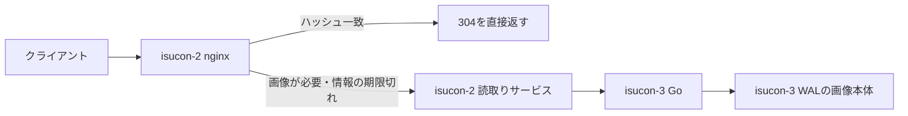

# Codex conversation

- Session: 01a11de8-6898-7183-823d-60edcca3a478

<!-- codex-hook-format: 7; tool results omitted -->

---

## USER

$isucon-agent ロールについては変更することでスコア改善する余地はないですか？

## ASSISTANT

isucon-agentスキルを使い、現在のホスト別ロールと最新の保存済みRUNを確認します。配置変更で減らせる負荷や通信と、移動先の余力を比較します。

## TOOL

```sh
pwd; rg --files -g 'AGENTS.md' -g 'Taskfile*.yml' -g 'run.json' -g '*sources*' -g '*roles*' -g 'SKILL.md' -g '*.md' docs tools/analysis .agents/skills/isucon-agent | head -100
```

## TOOL

```sh
cat .agents/skills/isucon-agent/SKILL.md; cat Taskfile.yml; cat Taskfile.contest.yml
```

## TOOL

```sh
git status --short; rg -n '^  (q|artifacts-run|analysis|runs)|role|ロール|isucon-[123]|CPU' docs/conversation/20261009*.md | head -100; ls -1 runs | tail -12; cat tools/analysis/sources.yaml; rg --files tools/analysis/schema; rg -n '^  q:|^  artifacts-run:' Taskfile.yml
```

## TOOL

```sh
sed -n '858,895p' Taskfile.yml; cat runs/20261009-084518/run.json; sed -n '1,190p' tools/analysis/schema/bottleneck.sql; rg -n 'CREATE|create|resource_demand|load_windows' tools/analysis/schema/semantic.sql | head -60; cat nginx/nginx.conf; cat nginx/sites-enabled/*; cat docs/official/cautionary_note.md
```

## TOOL

```sh
task --silent q -- "SELECT run_id,score,passed,commit,app_hosts,nginx_hosts,mysql_host FROM manifests ORDER BY run_id DESC LIMIT 4; DESCRIBE resource_demand; DESCRIBE http_traffic; DESCRIBE window_metrics;"
```

## TOOL

```sh
python3 - <<'PY'
import json
for r in ['20261009-084518','20261009-083417','20261009-082642']:
 d=json.load(open('runs/'+r+'/run.json'))
 print(r,{k:d.get(k) for k in ['phase','finalized_at','score','passed','missing','load_window','source']})
 print('artifact issues',[(a.get('name'),a.get('status')) for a in d.get('artifacts',[]) if a.get('status')!='ok'])
PY
cat nginx/nginx.conf; rg --files nginx/sites-enabled nginx/conf.d; cat tools/analysis/schema/access-log.sql | head -75; sed -n '340,460p' tools/analysis/schema/semantic.sql
```

## ASSISTANT

現行はisucon-1がDNS・MySQL・nginx、isucon-2がnginx、isucon-3がGoアプリです。最新RUNはまだ計測中なので、直前の確定RUNを基準にします。アプリへの振り分けを増やす案と、nginxをアプリと同居させて通信を短縮する案を比較しています。

## TOOL

```sh
task --silent artifacts-run RUN=runs/20261009-083417
```

## TOOL

```sh
task --silent q -- "SELECT host,resource_kind,service,round(demand_core_seconds,2) cpu_sec,round(capacity_core_seconds,2) capacity_sec,round(load_window_seconds,2) window_sec FROM resource_demand WHERE run_id='20261009-083417' ORDER BY host,resource_kind,service; SELECT host,samples,cpu_count,round(cpu_busy_peak_pct,2) busy_peak,cpu_busy_ge80_samples,run_queue_over_cpu_samples,round(cpu_pressure_some_avg10_mean,3) cpu_psi,round(iowait_mean_pct,2) iowait FROM host_saturation WHERE run_id='20261009-083417'; SELECT source,host,entity,metric,samples,round(mean_value,3) mean,round(max_value,3) peak,round(window_total,3) total FROM window_metrics WHERE run_id='20261009-083417' AND ((source='sql_pool' AND metric IN ('wait_count_per_sec','wait_duration_ms_per_sec','pool_utilization_pct')) OR (source='proc' AND (metric LIKE '%bytes_per_sec' OR metric LIKE '%memory%')) OR (source='disk' AND metric IN ('io_util_pct','avg_queue_size','write_await_ms'))) ORDER BY source,host,entity,metric;"
```

## TOOL

```sh
cat nginx/sites-enabled/isupipe.conf; cat nginx/conf.d/upstream.conf; sed -n '1,130p' tools/analysis/schema/proc.sql; rg -n 'sql.Open|Connect|ISUPIPE_MODE|localhost|LISTEN|start|writer' webapp/go/main.go webapp/go/post_store*.go | head -65; git log -5 --oneline
```

## TOOL

```sh
task --silent q -- "SELECT run_id,started_at,ended_at,duration_seconds,status,source FROM load_windows WHERE run_id='20261009-083417'; SELECT source,host,metric,round(mean_value,2) mean,round(max_value,2) peak FROM window_metrics WHERE run_id='20261009-083417' AND source='proc' AND (metric LIKE '%steal%' OR metric LIKE '%thrott%' OR metric LIKE '%mem_%' OR metric IN ('net_rx_bytes_per_sec','net_tx_bytes_per_sec')) ORDER BY host,metric; SELECT ingress_host,sum(requests) requests,round(sum(sum_body_bytes)/1e6,1) body_MB,round(sum(sum_time_sec)*1000/sum(requests),2) avg_ms FROM http_traffic_series WHERE run_id='20261009-083417' AND in_load_window GROUP BY ingress_host; SELECT ingress_host,upstream_addr,requests,round(response_time_avg_ms,3) response_ms,round(upstream_time_avg_ms,3) upstream_ms FROM upstream_cost_by_ingress WHERE run_id='20261009-083417' ORDER BY requests DESC LIMIT 10; SELECT function,round(flat_value,2) flat,round(cumulative_value,2) cum FROM pprof_functions WHERE run_id='20261009-083417' AND profile_type='go-cpu' AND sample_type='cpu' ORDER BY flat_value DESC LIMIT 12;"
```

## TOOL

```sh
sed -n '155,260p' webapp/go/main.go; rg -n 'unix|127.0.0.1|MYSQL|tunnel' webapp/go/database*.go tools/contest/deployments.yaml etc/systemd/system/*; head -2 runs/20261009-083417/isucon-3-proc-metrics.tsv; rg -n 'state|WAL|single|複数|shard' docs/solutions/user-id-sharding.md docs/solutions/wal-backed-in-memory-state.md | head -40; cat tools/contest/load-phase.yaml
```

## TOOL

```sh
task --silent q -- "SELECT ingress_host,sum(requests) requests,round(sum(sum_body_bytes)/1e6,1) body_MB,round(sum(response_time_sum_seconds)*1000/sum(requests),2) avg_ms FROM http_traffic_series WHERE run_id='20261009-083417' AND in_load_window GROUP BY ingress_host; SELECT ingress_host,upstream_addr,requests,round(response_time_avg_ms,3) response_ms,round(upstream_time_avg_ms,3) upstream_ms FROM upstream_cost_by_ingress WHERE run_id='20261009-083417' ORDER BY requests DESC LIMIT 10; SELECT function,round(flat_value,2) flat,round(cumulative_value,2) cum FROM pprof_functions WHERE run_id='20261009-083417' AND profile_type='go-cpu' AND sample_type='cpu' ORDER BY flat_value DESC LIMIT 10; SELECT host,entity,metric,round(mean_value,2) mean,round(max_value,2) peak FROM window_metrics WHERE run_id='20261009-083417' AND source='mysql' AND (metric LIKE '%queries%' OR metric LIKE '%questions%' OR metric LIKE '%threads%');"
```

## TOOL

```sh
rg -n 'func connectDB|DialConfig|ISUCON13_MYSQL|connection' webapp/go/*.go tools/contest/deployments.yaml | head -65; sed -n '1,110p' webapp/go/db.go; cat etc/systemd/system/isupipe-go.service; rg -n 'address|records|subdomain' webapp/go/dns_control.go | head -40; python3 - <<'PY'
import json
x=json.load(open('runs/20261009-084518/run.json'))
print({k:x.get(k) for k in ['phase','score','finalized_at']})
PY
```

## TOOL

```sh
sed -n '45,100p' webapp/go/main.go; sed -n '55,235p' webapp/go/user_handler.go; head -6 runs/20261009-083417/isucon-1-mysql-digest.tsv; cat mysql/mysql.conf.d/mysqld.cnf | tail -70; rg -n 'Listen|Start\(' webapp/go/main.go; sed -n '105,155p' webapp/go/dns_control.go; sed -n '1,130p' tools/analysis/schema/digest.sql
```

## TOOL

```sh
task --silent q -- "DESCRIBE queries; SELECT host,metric,round(mean_value,2) mean,round(max_value,2) peak FROM window_metrics WHERE run_id='20261009-083417' AND source='proc' AND metric IN ('net_rx_errors_per_sec','net_tx_errors_per_sec','net_rx_drops_per_sec','net_tx_drops_per_sec'); SELECT method,route,sum(requests) requests,round(sum(response_time_sum_seconds)*1000/sum(requests),2) avg_ms FROM http_traffic_series WHERE run_id='20261009-083417' AND in_load_window AND regexp_matches(route,'register|login|reservation|search|livecomment|reaction') GROUP BY method,route ORDER BY requests DESC LIMIT 12;"
```

## ASSISTANT

確定RUNでは、各ホストのCPU消費が60秒あたり約60〜64 core秒で、容量120 core秒に対して大きな偏りはありません。配置変更ではMySQLをGoアプリのホストへ移してSQL往復を短縮する案が有力です。nginxの同居は、移す入口によってアプリ側のCPU負荷が大きく増えるため、慎重に比較する必要があります。

## TOOL

```sh
python3 - <<'PY'
import json
x=json.load(open('runs/20261009-084518/run.json'))
print({k:x.get(k) for k in ['phase','score','passed','finalized_at','load_window']})
print('artifact issues',[(a.get('name'),a.get('status')) for a in x.get('artifacts',[]) if a.get('status')!='ok'])
PY
rg -n 'run_id|phase|score|missing' runs/20261009-084518/run.json | tail -12; sed -n '278,295p' webapp/go/main.go; cat docs/reservation-wal-gzip-latency.md | head -23
```

## TOOL

```sh
task --silent q -- "SELECT run_id,score,passed FROM manifests ORDER BY run_id DESC LIMIT 1;"
```

## TOOL

```sh
task --silent artifacts-run RUN=runs/20261009-084518
```

## TOOL

```sh
task --silent q -- "SELECT host,resource_kind,service,round(demand_core_seconds,2) cpu_sec,round(capacity_core_seconds,2) capacity_sec,round(load_window_seconds,2) window_sec FROM resource_demand WHERE run_id='20261009-084518' ORDER BY host,resource_kind,service; SELECT host,samples,round(cpu_busy_peak_pct,1) busy_peak,cpu_busy_ge80_samples,round(cpu_pressure_some_avg10_mean,2) cpu_psi FROM host_saturation WHERE run_id='20261009-084518'; SELECT host,metric,round(mean_value,2) mean,round(max_value,2) peak FROM window_metrics WHERE run_id='20261009-084518' AND ((source='sql_pool' AND metric IN ('pool_utilization_pct','wait_count_per_sec','wait_duration_ms_per_sec')) OR (source='proc' AND metric IN ('mem_available_bytes','net_rx_bytes_per_sec','net_tx_bytes_per_sec'))); SELECT method,route,sum(requests) requests,round(sum(response_time_sum_seconds)*1000/sum(requests),3) avg_ms FROM http_traffic_series WHERE run_id='20261009-084518' AND in_load_window AND regexp_matches(route,'register|login|reservation') GROUP BY method,route ORDER BY requests DESC LIMIT 5; SELECT query,count,round(sum_time_sec,3) sql_sec FROM queries WHERE run_id='20261009-084518' AND source='digest' AND (query LIKE '%users%' OR query LIKE '%themes%' OR query IN ('COMMIT','BEGIN','ROLLBACK')) ORDER BY count DESC LIMIT 10;"
```

## ASSISTANT (Worked for 1m 54s)

**余地はあります。まず検討するなら、MySQLをisucon-3へ移してGoアプリと同居させる案です。** ただし、配置変更だけで大幅に得点が伸びる根拠はまだありません。

調査中に確定した[最新RUN（736,156点）](/Users/mineo/src/github.com/EkeMinusYou/isucon13-03/runs/20261009-084518/run.json)では、成果物の欠損はなく、同じ負荷60秒のCPU消費は次のとおりでした。

| ホスト | 現在の役割 | CPU消費／容量 |
|---|---|---:|
| isucon-1 | DNS・MySQL・nginx・アイコン | 62.61／120 core秒 |
| isucon-2 | nginx・アイコン | 59.12／120 core秒 |
| isucon-3 | Goアプリ | 60.24／120 core秒 |

平均負荷はほぼ均等です。ただし、待ちが消えているわけではなく、isucon-1のCPU待ち指標は他の2台より高くなっています。

配置変更の候補は次の順です。

1. **MySQLをisucon-1からisucon-3へ移す**
   
   登録・ログイン・アイコン更新に残るSQLのホスト間往復を除去できます。MySQLの消費は6.85 core秒なので、単純に足すと移動先は約67／120 core秒で、余力があります。接続先・配置設定と既存のDB再作成経路が変更対象です。通常再起動後の取得と初期化を維持します。
   
   一方、予約・コメント・リアクションは既にWAL中心なので、主に視聴へ入る前の処理に効く案です。**比較的軽い変更ですが、得点効果は小さめと見ています。**

2. **配信者側のnginx入口をisucon-3へ移す**
   
   反復するAPIからnginx→Goのホスト間通信を除けるため、得点への作用は①より直接的です。ただし、isucon-1のnginxだけで30.91 core秒を使っており、同居先はアイコン処理も含めて約94／120 core秒になる概算です。通信短縮とCPU競合のどちらが勝つか未確定です。DNSの配信先とアイコン配置も変更対象になります。

3. **Goアプリを複数台に増やす**
   
   現行のメモリ状態とWALは単一アプリが管理しています。`APP_HOSTS`を増やすだけでは更新を共有できず、状態の分割・同期が必要です。現在のCPU需要からは、この追加実装を優先する根拠は弱いです。

**小さな変更から選ぶなら①、視聴中の応答時間を狙うなら②が比較候補です。** 得点増の幅は未確定で、同じ負荷窓の得点・視聴完了数・応答時間・CPU待ちで評価する必要があります。今回は調査のみで、設定変更やデプロイはしていません。

## USER

得点はレイテンシの向上で発生すると思われます。レイテンシを改善できそうな候補はありますか？

## ASSISTANT

得点につながる経路で、どの往復や待ちを短縮できるか確認します。登録・ログインと、視聴中に繰り返すAPIを分けて、ロール変更の候補を絞ります。

## TOOL

```sh
task --silent q -- "SELECT run_id,score,passed FROM manifests ORDER BY run_id DESC LIMIT 2; DESCRIBE user_transition_edges; DESCRIBE user_transition_scenarios; DESCRIBE upstreams_by_ingress; SELECT method,route,sum(requests) requests,round(sum(response_time_sum_seconds)*1000/sum(requests),3) avg_ms,round(sum(sum_body_bytes)/1e6,2) body_MB FROM http_traffic_series WHERE run_id='20261009-084518' AND in_load_window GROUP BY method,route ORDER BY sum(response_time_sum_seconds) DESC LIMIT 20;"
```

## TOOL

```sh
rg -n 'gap|interval|latency|elapsed|duration|view|視聴|投稿|時間' tools/analysis/schema/user-transitions.sql docs/conversation/20261009-072808*.md | tail -70; cat nginx/conf.d/icon-edge.conf; rg -n 'keepalive|dns|common|address' webapp/go/dns_control.go | tail -35; sed -n '1,125p' tools/analysis/schema/user-transitions.sql
```

## TOOL

### `exec`

```json
"const sql = `WITH ev AS (\nSELECT regexp_extract(filename,'access-(isucon-[0-9]+)',1) ingress, method,\nregexp_replace(regexp_replace(uri,'/api/livestream/[0-9]+','/api/livestream/:id'),'/api/user/[^/]+','/api/user/:name') route,\nstatus,response_time,try_cast(upstream_time AS DOUBLE) upstream_sec,body_bytes,\ntry_cast(msec AS DOUBLE)-response_time start_epoch,vhost,session_id\nFROM read_json('runs/20261009-084518/raw/access-*.log.zst',format='newline_delimited',filename=true,\ncolumns={msec:'VARCHAR',method:'VARCHAR',uri:'VARCHAR',status:'BIGINT',response_time:'DOUBLE',upstream_time:'VARCHAR',body_bytes:'BIGINT',vhost:'VARCHAR',session_id:'VARCHAR'},ignore_errors=true)\n), load_ev AS (\nSELECT e.* FROM ev e,load_windows w WHERE w.run_id='20261009-084518' AND start_epoch>=epoch(w.started_at) AND start_epoch<epoch(w.ended_at)\n)\nSELECT ingress,method,route,status,count(*) n,round(avg(response_time)*1000,3) avg_ms,\nround(quantile_cont(response_time,.5)*1000,3) p50_ms,round(quantile_cont(response_time,.95)*1000,3) p95_ms,\nround(avg(upstream_sec)*1000,3) upstream_ms,round(avg(body_bytes)) bytes\nFROM load_ev WHERE route LIKE '/api/%' GROUP BY ALL ORDER BY n DESC LIMIT 28;`;\nstore('latencyRawCte',sql.split(\"\\nSELECT ingress,method\")[0]);\nconst rs=await Promise.allSettled([\ntools.exec_command({cmd:\"task --silent q -- '\"+sql.replace(/'/g,\"'\\\\''\")+\"'\",\"max_output_tokens\":4500}),\ntools.exec_command({cmd:\"task --silent q -- \\\"SELECT from_method,from_route,to_method,to_route,transitions,overlap_transitions,round(start_gap_avg_ms,3) start_ms,round(idle_gap_avg_ms,3) idle_ms FROM user_transition_edges WHERE run_id='20261009-084518' ORDER BY transitions DESC LIMIT 16; SELECT DISTINCT scenario_rank,scenario_sessions,requests_per_session_avg,duration_p50_ms,signature FROM user_transition_scenarios WHERE run_id='20261009-084518' ORDER BY scenario_rank LIMIT 4;\\\"\",\"max_output_tokens\":2200}),\ntools.exec_command({cmd:\"sed -n '165,190p' docs/conversation/20261009-072808_01a11da1-6f6e-7421-8151-fe93e6a95f68.md; rg -n 'func getLivecommentsHandler|func getReactionsHandler|render|gzip|lock' webapp/go/livecomment_handler.go webapp/go/reaction_handler.go webapp/go/response_gzip.go; sed -n '1,115p' webapp/go/response_gzip.go; sed -n '1,95p' nginx/conf.d/icon-edge.conf\",\"max_output_tokens\":2400})\n]);rs.forEach(r=>text(r.status===\"fulfilled\"?r.value.output:r.reason));\n"
```

## ASSISTANT

視聴中のコメント・リアクションAPIは、isucon-1のnginxからisucon-3のGoへ転送されています。最新RUNの成功応答は、一覧GETが平均約0.54ms、リアクションPOSTが約0.47msでした。毎回のホスト間往復を除く案は、この反復経路に直接効く候補です。レイテンシを優先するなら、先ほどのMySQL同居よりこちらを先に比較する価値があります。

## TOOL

### `exec`

```json
"const sql=`SELECT date_diff('second',w.started_at,m.ts) AS offset_sec,m.host,m.value FROM metrics m JOIN load_windows w USING(run_id) WHERE m.run_id='20261009-084518' AND source='proc' AND metric='cpu_busy_pct' AND ts>=started_at AND ts<ended_at ORDER BY offset_sec LIMIT 6;\nWITH x AS(SELECT m.host,m.entity AS service,date_diff('second',w.started_at,m.ts) AS sec,m.value FROM metrics m JOIN load_windows w USING(run_id) WHERE m.run_id='20261009-084518' AND source='service' AND metric='cpu_pct' AND ts>=started_at AND ts<ended_at AND ((host='isucon-3' AND entity='isupipe-go.service') OR (host='isucon-1' AND entity IN ('nginx.service','isupipe-icons.service')))), y AS(SELECT sec,sum(value) cpu_pct,count(*) n FROM x GROUP BY sec) SELECT count(*) seconds,round(avg(cpu_pct),1) avg_cpu_pct,round(max(cpu_pct),1) peak_cpu_pct,count(*) FILTER(WHERE cpu_pct>200) over_2core_seconds FROM y WHERE n=3;`;\ntext((await tools.exec_command({cmd:\"task --silent q -- '\"+sql.replace(/'/g,\"'\\\\''\")+\"'\",\"max_output_tokens\":800})).output);\ntext((await tools.exec_command({cmd:\"rg -n '^  (APP_HOSTS|NGINX_HOSTS|DNS_HOSTS|MYSQL_HOST|MYSQL_HOSTS|ICON_READ_HOSTS|DNS_RECORD_ADDRESS|DNS_COMMON_HOST):' Taskfile.yml; rg -n 'names\\\\[|commonAddress|base.address|address\\\\[:\\\\]|ns1' webapp/go/dns*.go | head -30; git status --short\",\"max_output_tokens\":700})).output);\n"
```

## TOOL

```sh
sed -n '28,110p' webapp/go/dns_server.go; head -18 webapp/pdns/u.isucon.dev.zone; cat tools/contest/generated/dns-control.env; task --silent q -- "WITH x AS(SELECT m.host,m.entity AS service,date_diff('second',w.started_at,m.ts) AS sec,m.value FROM metrics m JOIN load_windows w USING(run_id) WHERE m.run_id='20261009-084518' AND source='service' AND metric='cpu_pct' AND m.ts>=w.started_at AND m.ts<w.ended_at AND ((host='isucon-3' AND entity='isupipe-go.service') OR (host='isucon-1' AND entity IN ('nginx.service','isupipe-icons.service')))), y AS(SELECT sec,sum(value) cpu_pct,count(*) n FROM x GROUP BY sec) SELECT count(*) AS sample_count,round(avg(cpu_pct),1) avg_cpu_pct,round(max(cpu_pct),1) peak_cpu_pct,count(*) FILTER(WHERE cpu_pct>200) over_2core_samples FROM y WHERE n=3;"
```

## TOOL

```sh
task --silent q -- "WITH x AS(SELECT m.host,m.entity AS service,date_diff('second',w.started_at,m.ts) AS sec,m.value FROM metrics m JOIN load_windows w USING(run_id) WHERE m.run_id='20261009-084518' AND m.source='service' AND m.metric='cpu_pct' AND m.ts>=w.started_at AND m.ts<w.ended_at AND ((m.host='isucon-3' AND m.entity='isupipe-go.service') OR (m.host='isucon-1' AND m.entity IN ('nginx.service','isupipe-icons.service')))), y AS(SELECT sec,sum(value) cpu_pct,count(*) n FROM x GROUP BY sec) SELECT count(*) AS sample_count,round(avg(cpu_pct),1) avg_cpu_pct,round(max(cpu_pct),1) peak_cpu_pct,count(*) FILTER(WHERE cpu_pct>200) over_2core_samples FROM y WHERE n=3;"
```

## TOOL

```sh
sed -n '233,257p' webapp/go/dns_server.go; sed -n '110,160p' webapp/go/response_gzip.go; sed -n '65,92p' webapp/go/livecomment_handler.go; sed -n '27,56p' webapp/go/reaction_handler.go
```

## ASSISTANT

全量同居には注意点が見つかりました。同じ1秒ごとのCPU消費をGo・移動対象のnginx・アイコンで合算すると、60秒中5秒で2コア分を超えます。まずは配信者のホスト名で入口をisucon-1とisucon-3へ固定振り分けし、一部の視聴で往復を除く案が妥当です。

## TOOL

### `exec`

```json
"const base=load('latencyRawCte');\nconst sql=base+`, seq AS (\nSELECT method,route,status,response_time,start_epoch,session_id,\nlead(method) OVER(PARTITION BY session_id ORDER BY start_epoch,start_epoch+response_time) next_method,\nlead(route) OVER(PARTITION BY session_id ORDER BY start_epoch,start_epoch+response_time) next_route,\nlead(start_epoch) OVER(PARTITION BY session_id ORDER BY start_epoch,start_epoch+response_time) next_start\nFROM load_ev WHERE session_id IS NOT NULL AND session_id<>''\n)\nSELECT method,route,next_method,next_route,count(*) n,\ncount(*) FILTER(WHERE next_start<start_epoch+response_time) overlaps,\nround(avg(next_start-start_epoch)*1000,3) start_gap_ms\nFROM seq WHERE route IN ('/api/livestream/:id/livecomment','/api/livestream/:id/reaction') AND next_route IN ('/api/livestream/:id/livecomment','/api/livestream/:id/reaction')\nGROUP BY ALL ORDER BY n DESC LIMIT 5;`;\ntext((await tools.exec_command({cmd:\"task --silent q -- '\"+sql.replace(/'/g,\"'\\\\''\")+\"'\",\"max_output_tokens\":1200})).output);\n"
```

## TOOL

### `exec`

```json
"const sql=load('latencyRawCte')+`, seq AS (\nSELECT method,route,response_time,start_epoch,session_id,\nlead(method) OVER(PARTITION BY session_id ORDER BY start_epoch,start_epoch+response_time) next_method,\nlead(route) OVER(PARTITION BY session_id ORDER BY start_epoch,start_epoch+response_time) next_route,\nlead(start_epoch) OVER(PARTITION BY session_id ORDER BY start_epoch,start_epoch+response_time) next_start\nFROM load_ev WHERE session_id IS NOT NULL AND session_id<>''\n)\nSELECT method,route,next_method,next_route,count(*) n,\ncount(*) FILTER(WHERE next_start<start_epoch+response_time) AS overlap_count,\nround(avg(next_start-start_epoch)*1000,3) start_gap_ms\nFROM seq WHERE route IN ('/api/livestream/:id/livecomment','/api/livestream/:id/reaction') AND next_route IN ('/api/livestream/:id/livecomment','/api/livestream/:id/reaction')\nGROUP BY ALL ORDER BY n DESC LIMIT 5;`;\ntext((await tools.exec_command({cmd:\"task --silent q -- '\"+sql.replace(/'/g,\"'\\\\''\")+\"'\",\"max_output_tokens\":1200})).output);\n"
```

## ASSISTANT (Worked for 2m 33s)

**あります。レイテンシを優先するなら、視聴APIのnginxをGoアプリと同居させる案を第一候補にします。** 前の回答は平均CPUの余力を重く見すぎました。見るべきなのは、投げ銭までの反復経路で減らせる往復です。

[最新RUN](/Users/mineo/src/github.com/EkeMinusYou/isucon13-03/runs/20261009-084518/run.json)の負荷60秒では、次の成功応答がすべて **isucon-1のnginx → isucon-3のGo** を通っています。

| 処理 | 件数 | 平均応答時間 |
|---|---:|---:|
| コメント一覧GET | 43,602 | 0.548ms |
| リアクション一覧GET | 43,595 | 0.537ms |
| リアクションPOST | 39,838 | 0.467ms |

同一セッションのログでも、これらの呼び出しはほぼ順番に進んでいます。そのため、**各応答の短縮が次の投稿を早める**方向に働くと考えられます。

**① 視聴入口の一部をisucon-3へ移す**

配信者のホスト名で入口を固定振り分けし、例えば半分をisucon-3へ向けます。

- isucon-1：DNS・MySQL・残りの視聴入口
- isucon-2：共通入口・アイコン
- isucon-3：Go・移動した視聴入口・必要なアイコン読取り

isucon-3へ来た視聴では、nginx→Goのホスト間往復を除けます。アプリは引き続き1プロセスなので、WALやメモリ状態の同期は増えません。追加作業はnginx・アイコン配置とDNSの振り分け対応です。`pipe`の共通入口とDNSサーバー自身のアドレスは維持します。

全量移動は優先しません。同じ1秒窓のGo・移動対象nginx・アイコンのCPU消費を単純合算すると、60秒中5秒で2コア分を超えました。一部同居から比較する方が、通信短縮をCPU待ちで相殺しにくいと判断します。

**② MySQLをisucon-3へ移す**

登録には`BEGIN → users INSERT → themes INSERT → COMMIT`、ログインにもSQL往復が残っています。同居でこれらを短縮し、視聴へ入るまでを早める候補です。ただし、視聴中の反復には①の方が直接効きます。

**推奨順は①→②です。** 表の約0.54msにはGoの処理も含まれるため、全部を削減できるわけではありません。削減幅は未測定ですが、①は得点経路に繰り返し効く仮説があります。比較時は得点に加え、投稿間隔・視聴完了数・応答時間・CPU待ちを同じ負荷窓で確認します。

## USER

|  |  |  |
|---|---:|---:|
| コメント一覧GET | 43,602 | 0.548ms |
| リアクション一覧GET | 43,595 | 0.537ms |
| リアクションPOST | 39,838 | 0.467ms |
これらについてisucon-3に全て移すという案ですか？

## ASSISTANT (Worked for 8s)

**提案は、その3種類のリクエストの一部を、isucon-3のnginxで直接受ける案です。** Goの処理自体は、現在もすべてisucon-3で行っています。

配信者のホスト名で固定振り分けします。例えば半分の配信者については、

`視聴者 → isucon-3のnginx → 同ホストのGo`

とし、その配信のコメントGET・リアクションGET・POSTをまとめて同居経路へ移します。残りは現在のisucon-1経由です。

全量を移す案も可能ですが、移動後のCPU需要を単純合算すると一部の時間帯で2コア分を超えるため、まず一部同居を推奨しています。

## USER

一部同居は複雑だし効果が限定的なので良い案とは思えません

## ASSISTANT (Worked for 25s)

その指摘は妥当です。一部同居はDNSの振り分けを複雑にし、通信短縮も一部に限られるため、提案を取り下げます。

**配置変更でレイテンシを狙うなら、配信者側の入口をすべてisucon-3へ移す案を比較候補にします。**

| ホスト | 変更後の役割 |
|---|---|
| isucon-1 | DNS・MySQL |
| isucon-2 | 共通入口のnginx・アイコン |
| isucon-3 | 配信者側のnginx・Go・アイコン |

これなら、対象のコメントGET・リアクションGET・POSTすべてでnginx→Goのホスト間往復を除けます。ホスト名による分割や状態同期は不要です。

先ほどのCPU合算は最大208.6%で、2コア分を超えたのは60秒中5秒でした。**これは全量同居を退けるには弱い根拠でした。** 同居後は通信費用も変わるため、実際にCPU待ちが増えてレイテンシが悪化するかは未確定です。

変更範囲はnginx・アイコンの配置とDNSの配信先です。共通入口はisucon-2、DNS自身のアドレスはisucon-1を維持します。この全量同居案なら、実装の追加負担を抑えつつ、視聴中の反復経路をまとめて短縮できます。

## USER

アイコンについては一つのサーバーにしなくても問題ないですか？

## ASSISTANT

現在のアイコン更新・読取りの仕組みを確認します。複数台に置いた場合に、更新の反映と再起動後の取得がどう保たれるかを見ます。

## TOOL

```sh
rg -n 'func |publish|replic|readURLs|readIPs|generation|reset|sync|POST|PUT|origin|failed|ready' webapp/go/icon*.go | head -130; rg --files webapp/go | rg 'icon'; cat etc/systemd/system/isupipe-icons.service; cat nginx/conf.d/icon-read.conf; rg -n 'icons|icon_read|icon-read|icon-state|icon-edge' tools/contest/deployments.yaml | head -70
```

## TOOL

```sh
rg --files docs | rg 'icon|アイコン'; rg -n 'icon|アイコン|猶予|反映' docs/official/isupipe.md docs/official/specification.md | head -45; rg -n 'publish|failed|origin|generation|cache|POST|body|hash' nginx/njs/icon.js | head -80; rg -n 'iconRead|icon.*publish|publish.*icon|replic|ISUPIPE_ICON' webapp/go/*.go | head -100
```

## TOOL

```sh
sed -n '1,92p' webapp/go/icon_read.go; sed -n '109,249p' webapp/go/icon_read.go; sed -n '250,328p' webapp/go/icon_read.go; sed -n '161,222p' webapp/go/icons.go; sed -n '100,145p' webapp/go/icon_edge.go; rg -n 'valid_until|dirty|expires|If-None|304|http.sock|icon_reader' tools/contest/nginx-icon-edge/* -g '*.[ch]' | head -60
```

## ASSISTANT (Worked for 35s)

**はい。現行の仕組みなら、アイコンの読取り側を複数台に置いて問題ありません。** 現在もisucon-1とisucon-2に置いています。

役割は次のように分かれています。

- **画像本体・更新の正本**：isucon-3のGoとWALで一元管理。
- **各nginx側**：ユーザーごとのハッシュを共有し、条件が一致すれば304を返す。
- **画像本体が必要な場合**：isucon-3から取得する。

更新通知と定期同期があり、ハッシュ情報の有効期限が切れると正本へ問い合わせます。古い情報だけで304を返し続けない仕組みです。[読取り実装](/Users/mineo/src/github.com/EkeMinusYou/isucon13-03/webapp/go/icon_read.go:173)

今回の案は、読取り側を「isucon-1・2」から「isucon-2・3」へ移すものです。台数も正本の数も増えません。配置変更後も、公式の**更新から2秒以内の反映**と再起動後の取得を確認します。

## USER

あ、オーバーヘッドにならないか、が気になっています

## ASSISTANT

複数台に置くことで同期・通知のオーバーヘッドは発生します。最新RUNで、各読取りサーバーが実際にアイコンGETを受けているかと、CPU消費を照合します。

## TOOL

### `exec`

```json
"const sql=load('latencyRawCte')+`\nSELECT ingress,status,count(*) AS requests,round(avg(response_time)*1000,3) avg_ms\nFROM load_ev WHERE route='/api/user/:name/icon' AND method='GET' GROUP BY ALL ORDER BY ingress,status;`;\ntext((await tools.exec_command({cmd:\"task --silent q -- '\"+sql.replace(/'/g,\"'\\\\''\")+\"'\",\"max_output_tokens\":750})).output);\ntext((await tools.exec_command({cmd:\"task --silent q -- \\\"SELECT host,service,round(demand_core_seconds,3) cpu_sec,round(capacity_core_seconds,3) capacity_sec FROM resource_demand WHERE run_id='20261009-084518' AND service='isupipe-icons.service';\\\"; rg --files tools/contest | rg 'icon.*\\\\.(c|h)$'; sed -n '195,245p' webapp/go/icon_read.go\",\"max_output_tokens\":1200})).output);\n"
```

## ASSISTANT (Worked for 50s)

**はい、オーバーヘッドになります。先ほどは正当性の面で答えていました。**

最新RUNの負荷60秒では、

- アイコンGETは全494,381件がisucon-2に来ていました。
- GETを受けていないisucon-1のアイコン読取りサービスも、**3.082 core秒**を消費していました。

各読取りサービスは100ms間隔で正本と同期し、nginxへハッシュ情報を公開します。また、アイコン更新APIは各読取りサービスへの通知を並行に送り、その完了を待ちます。余分な1台は、CPU・通信・更新時の待ちを増やします。[同期・通知処理](/Users/mineo/src/github.com/EkeMinusYou/isucon13-03/webapp/go/icon_read.go:250)

したがって、**今回の配置案ではアイコン読取りサービスはisucon-2だけに置く方が妥当です。** 画像本体と更新の正本はisucon-3に維持し、isucon-3へ直接アイコンGETが来た場合は同居するGoで処理します。

これなら、視聴APIのnginxとGoを同居させつつ、使われていない読取りサービスの同期負荷を持ち込まずに済みます。

## USER

では、そのここまで決定した方針で実装デプロイしてください

## ASSISTANT

配信者側のnginxをすべてisucon-3へ移し、アイコン読取りサービスはisucon-2だけにする構成を実装・デプロイします。共通入口はisucon-2、DNS・MySQLはisucon-1に維持します。計測停止と対象ホストを確認し、既存のTask経路で反映してAPIと永続性を確認します。

## TOOL

```sh
git status --short; rg --files -g AGENTS.md; cat .agents/skills/isucon-agent/SKILL.md; sed -n '1,130p' tools/contest/deployments.yaml; sed -n '290,377p' tools/contest/deployments.yaml; rg -n 'nginx|roles|gen:|deploy-all|deploy-app|check-network' Taskfile.yml | head -80; sed -n '1,180p' tools/contest/README.md
```

## TOOL

```sh
sed -n '580,675p' Taskfile.yml; sed -n '130,290p' tools/contest/deployments.yaml; rg -n 'deploy-dual|deploy-nginx-split|inspect-dns|gen-contest-routing|native-icon|config-check' Taskfile.contest.yml; sed -n '1,220p' tools/deployctl/deployments.yaml; sed -n '1,100p' webapp/go/dns_server.go; sed -n '230,270p' webapp/go/dns_server.go; sed -n '1,100p' webapp/go/dns_control_test.go; cat tools/template/paths.txt | tail -50
```

## TOOL

```sh
test ! -f raw/current-run-id; task --silent inspect-dns-batching-prereqs; task --silent ssh HOST=isucon-3 -- 'uname -sm; systemctl is-active isupipe-go nginx mysql isupipe-icons; sudo nginx -V 2>&1; ls -l /etc/nginx/tls/_.u.isucon.dev.crt /etc/nginx/tls/_.u.isucon.dev.key; curl --fail --silent http://127.0.0.1:6060/debug/post-wal'
```

## TOOL

```sh
sed -n '440,575p' Taskfile.contest.yml; sed -n '878,951p' Taskfile.contest.yml; sed -n '108,151p' webapp/go/dns_server.go; sed -n '965,996p' Taskfile.yml; rg -n 'config-check:' Taskfile.yml; rg -n 'post-wal|post-store|wal|icon.edge|icons-phase|cross-ingress|dns-address' tools/contest/smoke/main.go webapp/go/measurement.go | head -70; sed -n '1,130p' tools/contest/smoke/main.go; cat .gitignore | tail -45
```

## TOOL

### `write_stdin`

```javascript
tools.write_stdin({session_id:10292,chars:"","max_output_tokens":2000,"yield_time_ms":1000})
```

## TOOL

```sh
rg -n '^  ssh:|check-icon-read:|check-icon-edge:|inspect-fast-paths:|inspect-writer-data:' Taskfile.yml Taskfile.contest.yml; sed -n '930,945p' Taskfile.yml; sed -n '180,310p' Taskfile.contest.yml; sed -n '1027,1072p' Taskfile.yml; sed -n '1,125p' tools/deployctl/config.go; rg -n 'Command|script|CLI_ARGS|ssh:' Taskfile.yml | tail -15
```

## ASSISTANT

全3台でLinux/amd64と計測停止を確認できました。nginxはホスト別の設定を生成し、isucon-2では既存の高速な304応答を維持、isucon-3ではアイコンGETを同居Goへ流す形にします。DNSのNSアドレスも配信先と分け、isucon-1に固定します。

## TOOL

```sh
sed -n '947,960p' Taskfile.yml; rg -n 'native|ngx_http.*\.c|icon-edge' Taskfile.contest.yml | head -35; sed -n '1,120p' tools/setup/config-check.yaml; sed -n '327,360p' Taskfile.contest.yml; sed -n '600,642p' Taskfile.contest.yml; sed -n '1,90p' tools/deployctl/runner.go; rg -n 'upstream.*app|template|nginx' tools/contest/smoke/main.go | tail -35; cat AGENTS.md | head -15
```

## TOOL

```sh
ls -l nginx/modules-enabled nginx/conf.d; rg --files nginx | wc -l; sed -n '25,55p' tools/contest/nginx-njs/check.py; rg -n '^  (inspect-post-wal|deploy-plan|build-smoke)' Taskfile.contest.yml Taskfile.yml; sed -n '357,375p' Taskfile.contest.yml; sed -n '670,691p' Taskfile.yml; sed -n '40,78p' webapp/go/icon_read_test.go
```

## TOOL

```sh
sed -n '391,420p' Taskfile.contest.yml; sed -n '1,80p' tools/contest/nginx-njs/isupipe_icon_native.inc; sed -n '130,151p' tools/contest/smoke/main.go; rg -n 'ns1|crossIngress|checkCrossIngress' tools/contest/smoke/*.go; rg -n 'sudo|rsync|delete|dry-run' tools/deployctl/*.go | head -35; cat nginx/modules-enabled/80-mod-http-js.conf
```

## TOOL

```sh
sed -n '20,170p' tools/deployctl/plan.go; sed -n '700,743p' Taskfile.yml; rg -n 'cross' tools/contest/smoke/main.go; sed -n '143,175p' tools/contest/smoke/main.go; sed -n '1,100p' tools/contest/smoke/cross_ingress.go
```

## TOOL

### `apply_patch`

```javascript
tools.apply_patch("*** Begin Patch\n*** Update File: /Users/mineo/src/github.com/EkeMinusYou/isucon13-03/Taskfile.yml\n@@\n-  ICON_READ_HOSTS: isucon-1 isucon-2\n+  ICON_READ_HOSTS: isucon-2\n@@\n-  NGINX_HOSTS: isucon-1 isucon-2\n+  NGINX_HOSTS: isucon-3 isucon-2\n*** Update File: /Users/mineo/src/github.com/EkeMinusYou/isucon13-03/webapp/go/dns_server.go\n@@\n \tcommonAddress [4]byte\n+\tnsAddress     [4]byte\n@@\n \tcopy(b.address[:], ip)\n+\taddresses := make(map[string][4]byte)\n@@\n \t\t\t\tb.names[name] = true\n+\t\t\t\tif literal := net.ParseIP(f[4]).To4(); literal != nil {\n+\t\t\t\t\tvar value [4]byte\n+\t\t\t\t\tcopy(value[:], literal)\n+\t\t\t\t\taddresses[name] = value\n+\t\t\t\t}\n@@\n \tif statement != \"\" || !soaSeen || !nsSeen || !b.names[b.ns.NS.String()] {\n \t\treturn nil, fmt.Errorf(\"incomplete base DNS zone\")\n \t}\n+\tb.nsAddress = b.address\n+\tif address, ok := addresses[dnsCanonical(b.ns.NS.String())]; ok {\n+\t\tb.nsAddress = address\n+\t}\n@@\n \t\tif dnsCanonical(owner.String()) == \"pipe.\"+dnsSuffix {\n \t\t\taddress = d.base.commonAddress\n+\t\t} else if owner == d.base.ns.NS {\n+\t\t\taddress = d.base.nsAddress\n \t\t}\n*** Update File: /Users/mineo/src/github.com/EkeMinusYou/isucon13-03/webapp/go/dns_control_test.go\n@@\n \tstreamIP, commonIP := net.ParseIP(\"192.0.2.1\"), net.ParseIP(\"192.0.2.2\")\n+\tbase := strings.Replace(dnsTestBase, \"ns1 0 IN A <ISUCON_SUBDOMAIN_ADDRESS>\", \"ns1 0 IN A 192.0.2.3\", 1)\n \n-\td, err := newDNSControl([]byte(dnsTestBase), path, streamIP, commonIP)\n+\td, err := newDNSControl([]byte(base), path, streamIP, commonIP)\n@@\n-\t\t\t{\"ns1.\" + dnsSuffix, [4]byte{192, 0, 2, 1}},\n+\t\t\t{\"ns1.\" + dnsSuffix, [4]byte{192, 0, 2, 3}},\n@@\n-\t\tif r := dnsQuestion(t, d, dnsSuffix, dnsmessage.TypeNS); len(r.Additionals) != 1 || r.Additionals[0].Body.(*dnsmessage.AResource).A != [4]byte{192, 0, 2, 1} {\n-\t\t\tt.Fatal(\"NS glue moved to the common HTTP ingress\")\n+\t\tif r := dnsQuestion(t, d, dnsSuffix, dnsmessage.TypeNS); len(r.Additionals) != 1 || r.Additionals[0].Body.(*dnsmessage.AResource).A != [4]byte{192, 0, 2, 3} {\n+\t\t\tt.Fatal(\"NS glue moved away from the DNS server\")\n@@\n-\td, err = newDNSControl([]byte(dnsTestBase), path, streamIP, commonIP)\n+\td, err = newDNSControl([]byte(base), path, streamIP, commonIP)\n*** Update File: /Users/mineo/src/github.com/EkeMinusYou/isucon13-03/tools/contest/deployments.yaml\n@@\n-      - &ingress_nginx_config {label: nginx configuration, role: nginx, local: nginx/, remote: /etc/nginx/, excludes: [tls/, ngx_http_js_module.so], delete: true, validate: sudo nginx -t}\n+      - &ingress_nginx_config {label: host-specific nginx configuration, role: nginx, local: 'tools/contest/generated/nginx/{host}/', remote: /etc/nginx/, excludes: [tls/, ngx_http_js_module.so], delete: true, validate: sudo nginx -t}\n@@\n-      - label: stop nginx on the application host after DNS switches\n-        role: app\n+      - label: stop nginx outside its assigned hosts after DNS switches\n+        role: all\n@@\n-            *) sudo systemctl disable --now nginx; test \"$(sudo systemctl show nginx -p MainPID --value)\" = 0 ;;\n+            *) if sudo systemctl cat nginx >/dev/null 2>&1; then sudo systemctl disable --now nginx; fi; test \"$(sudo systemctl show nginx -p MainPID --value)\" = 0 ;;\n@@\n       ingress-dns: {needs: [ingress-nginx]}\n-      icon-reader-roles: {needs: [ingress-dns]}\n+      nginx-retire: {needs: [ingress-dns]}\n+      icon-reader-roles: {needs: [nginx-retire]}\n*** Update File: /Users/mineo/src/github.com/EkeMinusYou/isucon13-03/tools/setup/config-check.yaml\n@@\n-        local: nginx/\n+        local: 'tools/contest/generated/nginx/{host}/' # contest: generated per-host icon routing\n*** Update File: /Users/mineo/src/github.com/EkeMinusYou/isucon13-03/Taskfile.contest.yml\n@@\n   check-icon-edge:\n@@\n-      - for: { var: NGINX_HOSTS }\n+      - for: { var: ICON_READ_HOSTS }\n@@\n   deploy-dual-ingress:\n-    desc: 1・2号機のHTTPS入口とreader、3号機の通知先、1号機のDNSを反映する\n+    desc: ホスト別HTTPS入口・指定reader・Go通知先・DNS配信先を反映する\n@@\n-      - for: { var: NGINX_HOSTS }\n+      - for: { var: ICON_READ_HOSTS }\n         cmd: |\n           {{if eq (.ICON_EDGE_CHECK | default \"false\") \"true\"}}\n@@\n   gen-contest-routing:\n@@\n       - for: { var: DNS_HOSTS }\n@@\n-          cp webapp/pdns/u.isucon.dev.zone etc/hosts/{{.ITEM}}/dns/u.isucon.dev.zone\n+          sed 's/^ns1[[:space:]].*/ns1 0 IN A {{index .PUBLIC_IP .ITEM}}/' webapp/pdns/u.isucon.dev.zone > etc/hosts/{{.ITEM}}/dns/u.isucon.dev.zone\n+      - for: { var: NGINX_HOSTS }\n+        cmd: |\n+          mkdir -p tools/contest/generated/nginx/{{.ITEM}}\n+          rsync -a --delete --exclude=tls/ nginx/ tools/contest/generated/nginx/{{.ITEM}}/\n+          case ' {{.ICON_READ_HOSTS}} ' in\n+            *' {{.ITEM}} '*) ;;\n+            *)\n+              sed '/isupipe_icon_native icon_hashes icon_control;/c\\\n+              proxy_hide_header X-Measurement-Session-ID;\\\n+              proxy_set_header Host $host;\\\n+              proxy_http_version 1.1;\\\n+              proxy_set_header Connection \"\";\\\n+              proxy_pass http://app;' nginx/sites-enabled/isupipe.conf > tools/contest/generated/nginx/{{.ITEM}}/sites-enabled/isupipe.conf\n+              ;;\n+          esac\n*** End Patch")
```

## TOOL

```sh
gofmt -w webapp/go/dns_server.go webapp/go/dns_control_test.go; task --silent gen; git diff --stat; git diff -- Taskfile.contest.yml tools/contest/deployments.yaml tools/setup/config-check.yaml webapp/go/dns_server.go webapp/go/dns_control_test.go; rg -n 'isupipe_icon_native|proxy_pass' tools/contest/generated/nginx/isucon-3/sites-enabled/isupipe.conf tools/contest/generated/nginx/isucon-2/sites-enabled/isupipe.conf; rg -n '^ns1' etc/hosts/isucon-1/dns/u.isucon.dev.zone; task --list >/dev/null
```

## TOOL

```sh
git diff --stat; sed -n '21,36p' webapp/go/dns_control_test.go; sed -n '15,23p' webapp/go/dns_server.go; sed -n '68,84p' Taskfile.yml; rg -n 'nsAddress|addresses' webapp/go/dns_server.go; git status --short
```

## TOOL

### `apply_patch`

```javascript
tools.apply_patch("*** Begin Patch\n*** Update File: /Users/mineo/src/github.com/EkeMinusYou/isucon13-03/Taskfile.yml\n@@\n-  ICON_READ_HOSTS: isucon-1 isucon-2\n+  ICON_READ_HOSTS: isucon-2\n@@\n-  NGINX_HOSTS: isucon-1 isucon-2\n+  NGINX_HOSTS: isucon-3 isucon-2\n*** Update File: /Users/mineo/src/github.com/EkeMinusYou/isucon13-03/webapp/go/dns_server.go\n@@\n \tcommonAddress [4]byte\n+\tnsAddress     [4]byte\n@@\n \tcopy(b.address[:], ip)\n+\taddresses := make(map[string][4]byte)\n@@\n \t\t\t\tb.names[name] = true\n+\t\t\t\tif literal := net.ParseIP(f[4]).To4(); literal != nil {\n+\t\t\t\t\tvar value [4]byte\n+\t\t\t\t\tcopy(value[:], literal)\n+\t\t\t\t\taddresses[name] = value\n+\t\t\t\t}\n@@\n \tif statement != \"\" || !soaSeen || !nsSeen || !b.names[b.ns.NS.String()] {\n \t\treturn nil, fmt.Errorf(\"incomplete base DNS zone\")\n \t}\n+\tb.nsAddress = b.address\n+\tif address, ok := addresses[dnsCanonical(b.ns.NS.String())]; ok {\n+\t\tb.nsAddress = address\n+\t}\n@@\n \t\tif dnsCanonical(owner.String()) == \"pipe.\"+dnsSuffix {\n \t\t\taddress = d.base.commonAddress\n+\t\t} else if dnsCanonical(owner.String()) == dnsCanonical(d.base.ns.NS.String()) {\n+\t\t\taddress = d.base.nsAddress\n \t\t}\n*** Update File: /Users/mineo/src/github.com/EkeMinusYou/isucon13-03/webapp/go/dns_control_test.go\n@@\n \tstreamIP, commonIP := net.ParseIP(\"192.0.2.1\"), net.ParseIP(\"192.0.2.2\")\n-\td, err := newDNSControl([]byte(dnsTestBase), path, streamIP, commonIP)\n+\tbase := strings.Replace(dnsTestBase, \"ns1 0 IN A <ISUCON_SUBDOMAIN_ADDRESS>\", \"ns1 0 IN A 192.0.2.3\", 1)\n+\td, err := newDNSControl([]byte(base), path, streamIP, commonIP)\n@@\n-\t\t\t{\"ns1.\" + dnsSuffix, [4]byte{192, 0, 2, 1}},\n+\t\t\t{\"ns1.\" + dnsSuffix, [4]byte{192, 0, 2, 3}},\n@@\n-\t\tif r := dnsQuestion(t, d, dnsSuffix, dnsmessage.TypeNS); len(r.Additionals) != 1 || r.Additionals[0].Body.(*dnsmessage.AResource).A != [4]byte{192, 0, 2, 1} {\n-\t\t\tt.Fatal(\"NS glue moved to the common HTTP ingress\")\n+\t\tif r := dnsQuestion(t, d, dnsSuffix, dnsmessage.TypeNS); len(r.Additionals) != 1 || r.Additionals[0].Body.(*dnsmessage.AResource).A != [4]byte{192, 0, 2, 3} {\n+\t\t\tt.Fatal(\"NS glue moved away from the DNS server\")\n@@\n-\td, err = newDNSControl([]byte(dnsTestBase), path, streamIP, commonIP)\n+\td, err = newDNSControl([]byte(base), path, streamIP, commonIP)\n*** Update File: /Users/mineo/src/github.com/EkeMinusYou/isucon13-03/tools/contest/deployments.yaml\n@@\n-      - &ingress_nginx_config {label: nginx configuration, role: nginx, local: nginx/, remote: /etc/nginx/, excludes: [tls/, ngx_http_js_module.so], delete: true, validate: sudo nginx -t}\n+      - &ingress_nginx_config {label: host-specific nginx configuration, role: nginx, local: 'tools/contest/generated/nginx/{host}/', remote: /etc/nginx/, excludes: [tls/, ngx_http_js_module.so], delete: true, validate: sudo nginx -t}\n@@\n-      - label: stop nginx on the application host after DNS switches\n-        role: app\n+      - label: stop nginx outside its assigned hosts after DNS switches\n+        role: all\n@@\n-            *) sudo systemctl disable --now nginx; test \"$(sudo systemctl show nginx -p MainPID --value)\" = 0 ;;\n+            *) if sudo systemctl cat nginx >/dev/null 2>&1; then sudo systemctl disable --now nginx; fi; test \"$(sudo systemctl show nginx -p MainPID --value)\" = 0 ;;\n@@\n       ingress-dns: {needs: [ingress-nginx]}\n-      icon-reader-roles: {needs: [ingress-dns]}\n+      nginx-retire: {needs: [ingress-dns]}\n+      icon-reader-roles: {needs: [nginx-retire]}\n*** Update File: /Users/mineo/src/github.com/EkeMinusYou/isucon13-03/tools/setup/config-check.yaml\n@@\n-        local: nginx/\n+        local: 'tools/contest/generated/nginx/{host}/' # contest: generated per-host icon routing\n*** Update File: /Users/mineo/src/github.com/EkeMinusYou/isucon13-03/Taskfile.contest.yml\n@@\n   check-icon-edge:\n@@\n-      - for: { var: NGINX_HOSTS }\n+      - for: { var: ICON_READ_HOSTS }\n@@\n   deploy-dual-ingress:\n-    desc: 1・2号機のHTTPS入口とreader、3号機の通知先、1号機のDNSを反映する\n+    desc: ホスト別HTTPS入口・指定reader・Go通知先・DNS配信先を反映する\n@@\n-      - for: { var: NGINX_HOSTS }\n+      - for: { var: ICON_READ_HOSTS }\n         cmd: |\n           {{if eq (.ICON_EDGE_CHECK | default \"false\") \"true\"}}\n@@\n       - for: { var: DNS_HOSTS }\n         cmd: |\n           mkdir -p etc/hosts/{{.ITEM}}/dns\n           cp tools/contest/generated/dns-control.env etc/hosts/{{.ITEM}}/dns/isupipe-dns.env\n-          cp webapp/pdns/u.isucon.dev.zone etc/hosts/{{.ITEM}}/dns/u.isucon.dev.zone\n+          sed 's/^ns1[[:space:]].*/ns1 0 IN A {{index .PUBLIC_IP .ITEM}}/' webapp/pdns/u.isucon.dev.zone > etc/hosts/{{.ITEM}}/dns/u.isucon.dev.zone\n+      - for: { var: NGINX_HOSTS }\n+        cmd: |\n+          mkdir -p tools/contest/generated/nginx/{{.ITEM}}\n+          rsync -a --delete --exclude=tls/ nginx/ tools/contest/generated/nginx/{{.ITEM}}/\n+          case ' {{.ICON_READ_HOSTS}} ' in\n+            *' {{.ITEM}} '*) ;;\n+            *)\n+              sed '/isupipe_icon_native icon_hashes icon_control;/c\\\n+              proxy_hide_header X-Measurement-Session-ID;\\\n+              proxy_set_header Host $host;\\\n+              proxy_http_version 1.1;\\\n+              proxy_set_header Connection \"\";\\\n+              proxy_pass http://app;' nginx/sites-enabled/isupipe.conf > tools/contest/generated/nginx/{{.ITEM}}/sites-enabled/isupipe.conf\n+              ;;\n+          esac\n*** End Patch")
```

## TOOL

```sh
gofmt -w webapp/go/dns_server.go webapp/go/dns_control_test.go; task --silent gen; git diff --stat; rg -n 'isupipe_icon_native|proxy_pass' tools/contest/generated/nginx/isucon-3/sites-enabled/isupipe.conf tools/contest/generated/nginx/isucon-2/sites-enabled/isupipe.conf; rg -n '^ns1' etc/hosts/isucon-1/dns/u.isucon.dev.zone; task --list >/dev/null
```

## TOOL

### `apply_patch`

```javascript
tools.apply_patch("*** Begin Patch\n*** Update File: /Users/mineo/src/github.com/EkeMinusYou/isucon13-03/webapp/go/dns_server.go\n@@\n \tnsAddress     [4]byte\n+\tnsName        string\n@@\n \t\t\t\tb.ns = dnsmessage.NSResource{NS: dnsmessage.MustNewName(target)}\n+\t\t\t\tb.nsName = target\n@@\n-\tif address, ok := addresses[dnsCanonical(b.ns.NS.String())]; ok {\n+\tif address, ok := addresses[b.nsName]; ok {\n@@\n \taRecord := func(owner dnsmessage.Name) dnsmessage.Resource {\n \t\taddress := d.base.address\n-\t\tif dnsCanonical(owner.String()) == \"pipe.\"+dnsSuffix {\n+\t\tname := dnsCanonical(owner.String())\n+\t\tif name == \"pipe.\"+dnsSuffix {\n \t\t\taddress = d.base.commonAddress\n-\t\t} else if dnsCanonical(owner.String()) == dnsCanonical(d.base.ns.NS.String()) {\n+\t\t} else if name == d.base.nsName {\n \t\t\taddress = d.base.nsAddress\n*** Update File: /Users/mineo/src/github.com/EkeMinusYou/isucon13-03/.gitignore\n@@\n # Rebuildable state\n+/tools/contest/generated/nginx/\n runs/analysis.duckdb\n*** Delete File: /Users/mineo/src/github.com/EkeMinusYou/isucon13-03/etc/hosts/isucon-1/icon-read.env\n*** End Patch")
```

## TOOL

```sh
gofmt -w webapp/go/dns_server.go; task --silent config-check-dns; task --silent build
```

## TOOL

```sh
task --silent inspect-nginx-split-prereqs; task --silent inspect-fast-paths; task --silent deploy-dual-ingress-dry > .task/colocated-ingress-deploy-plan.log; rg -n 'isucon-[123]|needs=|restart|disable|systemctl reload' .task/colocated-ingress-deploy-plan.log | tail -50
```

## TOOL

### `write_stdin`

```javascript
tools.write_stdin({session_id:60831,chars:"","max_output_tokens":1500,"yield_time_ms":1000})
```

## TOOL

### `write_stdin`

```javascript
tools.write_stdin({session_id:57083,chars:"","max_output_tokens":2400,"yield_time_ms":1000})
```

## TOOL

```sh
git diff --check; git diff -- Taskfile.yml Taskfile.contest.yml webapp/go/dns_server.go webapp/go/dns_control_test.go tools/contest/deployments.yaml tools/setup/config-check.yaml; sed -n '1,95p' tools/contest/smoke/dual_ingress.go; rg -n 'func checkCrossIngress' tools/contest/smoke/*.go
```

## TOOL

```sh
rg -n 'func checkIcons|Username|test001|icon-smoke|statePath|stateFile|filename' tools/contest/smoke/icons.go; task --silent inspect-post-wal > .task/colocated-ingress-wal-before.txt; task --silent inspect-dns-registration-state > .task/colocated-ingress-dns-before.tsv; head -c 400 .task/colocated-ingress-wal-before.txt; task --silent build-icon-edge-module
```

## TOOL

```sh
python3 - <<'PY'
import json,pathlib
x,_=json.JSONDecoder().raw_decode(pathlib.Path('.task/colocated-ingress-wal-before.txt').read_text())
print(x.keys())
print(x.get('post_wal'))
PY
rg -n 'func checkIcons|icon-smoke|stateFile|test001' tools/contest/smoke/*.go | head -35; rg -n '^[[:space:]]*(phase :=|checkIcons|checkCross)' tools/contest/smoke/main.go; sed -n '1,80p' tools/contest/smoke/icon_persistence.go
```

## TOOL

### `apply_patch`

```javascript
tools.apply_patch("*** Begin Patch\n*** Update File: /Users/mineo/src/github.com/EkeMinusYou/isucon13-03/Taskfile.contest.yml\n@@\n   deploy-dual-ingress:\n@@\n       - task: gen\n       - task: build\n+      - mkdir -p .task\n+      - task --silent inspect-post-wal > .task/dual-ingress-wal-before.txt\n+      - task --silent inspect-dns-registration-state > .task/dual-ingress-dns-before.tsv\n       - '{{.DEPLOYCTL_DIR}}/deployctl apply icon-edge-module -config {{.DEPLOYCTL_CONFIG}} {{.DEPLOYCTL_COMMON}}'\n       - task: deploy-plan\n         vars: { PLAN: dual-ingress }\n+      - task --silent inspect-post-wal > .task/dual-ingress-wal-after.txt\n+      - task --silent inspect-dns-registration-state > .task/dual-ingress-dns-after.tsv\n+      - diff .task/dual-ingress-dns-before.tsv .task/dual-ingress-dns-after.tsv\n+      - |\n+        python3 - <<'PY'\n+        import json\n+        from pathlib import Path\n+        states = [json.JSONDecoder().raw_decode(Path(f'.task/dual-ingress-wal-{phase}.txt').read_text())[0]['post_wal'] for phase in ('before', 'after')]\n+        keys = ('generation', 'durable_seq', 'published_seq', 'wal_bytes', 'published_bytes', 'rows')\n+        assert all(states[0][key] == states[1][key] for key in keys), states\n+        assert all(not state['failed'] and state['pending_bytes'] == 0 for state in states), states\n+        print('WAL generation, sequences, bytes and rows survived deployment:', {key: states[1][key] for key in keys})\n+        PY\n       - task: check-role-split\n*** End Patch")
```

## TOOL

```sh
task --silent deploy-dual-ingress-dry > .task/colocated-ingress-deploy-plan.log; git diff --check; task --dry deploy-dual-ingress > .task/colocated-ingress-task-plan.log; rg -n 'dual-ingress-wal|apply-plan|inspect-post' .task/colocated-ingress-task-plan.log | head -16
```

## ASSISTANT

DNSのrace検証とLinux/amd64向けビルドが通りました。配布計画は、isucon-3のGo再起動とnginx起動、isucon-2の読取りサービス再起動とnginx reload、isucon-1のDNS再起動後に旧nginx・読取りサービス停止です。これからデプロイし、切替直後のWAL世代・件数・公開位置を確認します。

## TOOL

```sh
task --silent deploy-dual-ingress > .task/colocated-ingress-deploy.log 2>&1
```

## TOOL

```sh
tail -28 .task/colocated-ingress-deploy.log; git status --short; rg -n '50|1号機|2号機|isucon-[123]|ICON_READ|NGINX_HOST' docs/role-split.md | head -45; rg -n 'read|write|state|marker' tools/contest/smoke/registration.go | head -25; rg -n 'external|POST /api/initialize' docs/official/cautionary_note.md | tail -3
```

## TOOL

### `write_stdin`

```javascript
tools.write_stdin({session_id:22261,chars:"","max_output_tokens":800,"yield_time_ms":1000})
```

## TOOL

```sh
rg -n 'WAL generation|\[isucon|DNS|disabled|inactive|enabled|stop|failed|error' .task/colocated-ingress-deploy.log | tail -30; rg -n 'func checkRegistration|registration-|state|read|write|name :=' tools/contest/smoke/main.go | tail -40; sed -n '354,375p' tools/contest/smoke/main.go; sed -n '435,470p' tools/contest/smoke/main.go; task --silent check-app-deployment ICON_SMOKE_PHASE=write REGISTRATION_SMOKE_PHASE=write > .task/colocated-ingress-persistence-write.log 2>&1
```

## TOOL

```sh
tail -14 .task/colocated-ingress-persistence-write.log; git diff --check; task --silent inspect-post-wal > .task/colocated-ingress-persistence-before.txt; task --silent inspect-dns-registration-state > .task/colocated-ingress-registration-before.tsv; task --silent deploy-app > .task/colocated-ingress-restart-app.log 2>&1; task --silent deploy-dns > .task/colocated-ingress-restart-dns.log 2>&1
```

## ASSISTANT

切替が完了しました。配信者ドメインはisucon-3、共通ドメインはisucon-2へ向き、isucon-1のnginx・アイコン読取りサービスは停止済みです。WALとDNS登録の状態は切替前後で一致し、両入口のAPIとアイコンの2秒以内の反映も通りました。作成した確認用データを使い、再起動後の取得を確認します。

## TOOL

```sh
tail -6 .task/colocated-ingress-restart-app.log; tail -6 .task/colocated-ingress-restart-dns.log; task --silent inspect-post-wal > .task/colocated-ingress-persistence-after.txt; task --silent inspect-dns-registration-state > .task/colocated-ingress-registration-after.tsv; diff .task/colocated-ingress-registration-before.tsv .task/colocated-ingress-registration-after.tsv; python3 - <<'PY'
import json
from pathlib import Path
states=[json.JSONDecoder().raw_decode(Path(f'.task/colocated-ingress-persistence-{phase}.txt').read_text())[0]['post_wal'] for phase in ('before','after')]
keys=('generation','durable_seq','published_seq','wal_bytes','published_bytes','rows')
assert all(states[0][key]==states[1][key] for key in keys),states
assert all(not s['failed'] and s['pending_bytes']==0 for s in states),states
print({key:states[1][key] for key in keys})
PY
 task --silent check-app-deployment ICON_SMOKE_PHASE=read REGISTRATION_SMOKE_PHASE=read ICON_EDGE_CHECK=true > .task/colocated-ingress-persistence-read.log 2>&1; task --silent check-role-split > .task/colocated-ingress-roles.log 2>&1; task --silent check-icon-read > .task/colocated-ingress-reader.log 2>&1; task --silent check-icon-edge > .task/colocated-ingress-edge.log 2>&1
```

## TOOL

### `write_stdin`

```javascript
tools.write_stdin({session_id:60525,chars:"","max_output_tokens":1000,"yield_time_ms":1000})
```

## TOOL

```sh
tail -14 .task/colocated-ingress-persistence-read.log; cat .task/colocated-ingress-roles.log; cat .task/colocated-ingress-reader.log; cat .task/colocated-ingress-edge.log; git diff --check; git diff --stat; git status --short
```

## TOOL

### `apply_patch`

```javascript
tools.apply_patch("*** Begin Patch\n*** Update File: /Users/mineo/src/github.com/EkeMinusYou/isucon13-03/Taskfile.yml\n@@\n   CONFIG_CHECK_COMMAND: 'task config-check && task config-check-dns'\n+  CONFIG_CHECK_CONFIG: tools/contest/config-check.yaml\n@@\n-      - '{{.DEPLOYCTL_DIR}}/deployctl apply config-check -config tools/setup/config-check.yaml {{.DEPLOYCTL_COMMON}}'\n+      - '{{.DEPLOYCTL_DIR}}/deployctl apply config-check -config {{.CONFIG_CHECK_CONFIG}} {{.DEPLOYCTL_COMMON}}'\n*** Update File: /Users/mineo/src/github.com/EkeMinusYou/isucon13-03/tools/setup/config-check.yaml\n@@\n-        local: 'tools/contest/generated/nginx/{host}/' # contest: generated per-host icon routing\n+        local: nginx/\n*** Add File: /Users/mineo/src/github.com/EkeMinusYou/isucon13-03/tools/contest/config-check.yaml\n+# Validate the same per-host nginx assets used by deployment.\n+include: [../setup/config-check.yaml]\n+deployments:\n+  config-check:\n+    uploads:\n+      - label: host-specific nginx configuration\n+        role: nginx\n+        local: 'tools/contest/generated/nginx/{host}/'\n+        remote: /etc/nginx/\n+        excludes: [tls/, ngx_http_js_module.so]\n+        delete: true\n+        validate: sudo nginx -t\n+      - label: MySQL configuration\n+        role: mysql\n+        local: mysql/\n+        remote: /etc/mysql/\n+        excludes: [debian.cnf]\n+        delete: true\n+        validate: sudo mysqld --validate-config\n*** Update File: /Users/mineo/src/github.com/EkeMinusYou/isucon13-03/tools/contest/deployments.yaml\n@@\n           sudo systemctl is-active --quiet nginx\n           curl --fail --silent --show-error --max-time 10 --cacert /etc/nginx/tls/_.u.isucon.dev.crt --resolve pipe.u.isucon.dev:443:127.0.0.1 https://pipe.u.isucon.dev/api/tag >/dev/null\n+          case ',{var:icon_read_hosts},' in\n+            *',{host},'*) ;;\n+            *) exit 0 ;;\n+          esac\n           for attempt in $(seq 1 30); do\n*** Add File: /Users/mineo/src/github.com/EkeMinusYou/isucon13-03/docs/colocated-ingress.md\n+# 視聴入口とGoの同居・アイコン読取りの集約\n+\n+2026-10-09。ユーザーの実装・デプロイ指示により、既存の`task deploy-dual-ingress`で反映した。\n+\n+| ホスト | 役割 |\n+| --- | --- |\n+| isucon-1 | Go DNS・MySQL |\n+| isucon-2 | 共通入口のnginx・アイコンハッシュの読取りサービス |\n+| isucon-3 | 配信者側入口のnginx・Go・アイコン本体のWAL正本 |\n+\n+配信者ドメインはisucon-3へ、`pipe.u.isucon.dev`はisucon-2へ向ける。\n+視聴APIのnginxからGoへの転送は同じisucon-3内で完結する。Goの状態管理とWALは単一のまま。\n+アイコン読取りサービスはisucon-2だけに置き、isucon-3のアイコンGETは同居Goへ転送する。\n+isucon-1のnginx・アイコン読取りサービスを停止・無効化した。\n+\n+## 実装\n+\n+- `Taskfile.yml`の`NGINX_HOSTS`を`isucon-3 isucon-2`、`ICON_READ_HOSTS`を`isucon-2`へ変更。\n+- `task gen`で共通nginx設定からホスト別設定を生成する。isucon-2のネイティブ304処理を維持し、isucon-3のアイコンlocationはGoへ転送する。生成ディレクトリはgit管理対象外。\n+- deployとconfig-checkは同じホスト別nginx設定を使う。競技固有のconfig-check宣言は`tools/contest/`へ置いた。\n+- DNSの初期ゾーンでNSのAレコードをDNSホストの公開IPに固定し、Go DNSでNSのA応答とglueにその値を使う。共通入口・配信者入口・DNSホストを分離する。\n+- 新入口を起動してからDNSを切り替え、役割外のnginx・アイコン読取りサービスを停止する。\n+- アイコン更新の通知先もisucon-2だけに変更。余分な読取りサービスの定期同期・nginxへの公開を除いた。\n+\n+## 確認\n+\n+- 全3ホストのLinux/amd64と計測停止、両nginxホストの証明書、Goと読取りサービスのセッション署名鍵の一致を確認。\n+- `task config-check-dns`のrace検証が成功。共通入口、配信者入口、NSのA/glue、DNS登録の再起動後の復元を確認。\n+- ローカルでLinux/amd64へクロスコンパイルし、正規Task経路で配布。実nginxの構文検査と役割・接続先・DNS応答の確認が成功。\n+- 切替前後でDNS世代・serial・登録件数・ログサイズが一致。\n+- 切替前後でWAL世代`aae40269-ceae-424d-bd19-241e2a0b0bbb`、sequence `91969`、bytes `30568498`、rows `100470`が一致。failed=false、pending=0。\n+- 両HTTPS入口でログイン、認証API、検索・timelineのgzip、アイコンの内容・hash・ETag・条件付きGETが成功。両入口でのアイコン更新が2秒以内に反映された。\n+- 確認用のアイコン更新と利用者登録後、`task deploy-app`と`task deploy-dns`で通常再起動。再起動前後でWALのsequence `91972`、bytes `30590164`、rows `100470`と世代が一致し、DNS登録状態も一致。両入口からアイコン・利用者・登録サブドメインを取得できた。\n+- isucon-2のnginx直接304と、読取りサービス・共有辞書のfresh状態を確認。\n+\n+競技ベンチマーカーは実行していない。レイテンシと得点への効果は次のRUNで比較する。\n+ログは`.task/colocated-ingress-*.log`、`.task/dual-ingress-{wal,dns}-{before,after}.*`にある。\n*** End Patch")
```

## TOOL

```sh
git diff --check; task --list >/dev/null; task --silent gen; git diff --stat; git status --short; rg -n 'isupipe_icon_native|proxy_pass' tools/contest/generated/nginx/isucon-3/sites-enabled/isupipe.conf tools/contest/generated/nginx/isucon-2/sites-enabled/isupipe.conf; rg -n 'Failed|FAIL|Error|error|failed' .task/colocated-ingress-deploy.log .task/colocated-ingress-persistence-read.log .task/colocated-ingress-roles.log
```

## TOOL

```sh
task --silent config-check > .task/colocated-ingress-config-check.log 2>&1
```

## ASSISTANT (Worked for 8m 37s)

実装・デプロイが完了しました。

| ホスト | 現在の役割 |
|---|---|
| isucon-1 | DNS・MySQL |
| isucon-2 | 共通入口のnginx・アイコン読取り |
| isucon-3 | 配信者側のnginx・Go・画像本体の正本 |

視聴APIの転送はisucon-3内で完結します。isucon-1の旧nginx・アイコン読取りサービスは停止・無効化しました。

両入口のAPI、アイコン更新の2秒以内の反映、通常再起動後の取得を確認済みです。WALとDNS登録の状態も再起動前後で一致しました。

ベンチは実行していないため、レイテンシ・得点への効果は未計測です。[変更と検証の詳細](/Users/mineo/src/github.com/EkeMinusYou/isucon13-03/docs/colocated-ingress.md)

## USER

アイコンは、isucon-2と3に分かれていますが、どういう構造ですか？

## ASSISTANT (Worked for 23s)

**isucon-2は「変更がないか判定して304を返す担当」、isucon-3は「画像を保存・更新し、本体を返す担当」です。**

| | isucon-2 | isucon-3 |
|---|---|---|
| 保持するもの | ユーザー名→画像ハッシュの情報 | 画像本体を保存したWALと更新状態 |
| 主な処理 | nginxで条件付きGETを判定 | アップロード・画像本体の取得 |

読取りは次の流れです。



更新時は、isucon-3のGoが画像を保存し、isucon-2へ新しいハッシュを通知します。isucon-2には定期同期もあります。

この構造なら、繰り返される304応答はisucon-2だけで完結し、画像本体の保存・更新はisucon-3で一元管理できます。isucon-3へ直接アイコンGETが来た場合は、同居するGoが処理します。

## USER

ベンチ実行しました。効果でていますか？

## ASSISTANT

最新の確定RUNを変更前と比較します。得点に加え、同じ負荷窓の視聴APIの応答時間・投稿間隔・CPU待ちを確認し、同居による短縮が出ているか見ます。

## TOOL

```sh
git status --short; ls -1 runs | tail -7; task --silent q -- "SELECT run_id,score,passed,commit,app_hosts,nginx_hosts,mysql_host FROM manifests ORDER BY run_id DESC LIMIT 5; SELECT run_id,started_at,ended_at,duration_seconds,status FROM load_windows ORDER BY run_id DESC LIMIT 3;"
```

## TOOL

```sh
cat tools/analysis/sources.yaml | head -28; cat tools/contest/load-phase.yaml; rg -n 'create or replace view bench|score|successes|failures' tools/contest/analysis-schema/*.sql | head -40; tail -4 runs/scores.tsv
```

## TOOL

```sh
task --silent artifacts-run RUN=runs/20261009-091332; python3 - <<'PY'
import json
for run in ['20261009-084518','20261009-091332']:
 d=json.load(open('runs/'+run+'/run.json'))
 print(run,{k:d.get(k) for k in ['phase','score','passed','missing','finalized_at']})
 print('artifact issues',[(a.get('name'),a.get('status')) for a in d.get('artifacts',[]) if a.get('status')!='ok'])
PY
git diff --stat 90072e2 7cb22a7; rg -n '成功|失敗|スコア|チェック' runs/20261009-091332/bench.log | tail -15
```

## TOOL

```sh
task --silent q -- "SELECT run_id,host,resource_kind,service,round(demand_core_seconds,2) cpu_sec,round(capacity_core_seconds,2) capacity_sec FROM resource_demand WHERE run_id IN ('20261009-084518','20261009-091332') ORDER BY run_id,host,resource_kind,service; SELECT run_id,host,samples,round(cpu_busy_peak_pct,1) busy_peak,cpu_busy_ge80_samples,run_queue_over_cpu_samples,round(cpu_pressure_some_avg10_mean,2) cpu_psi,round(iowait_mean_pct,2) iowait FROM host_saturation WHERE run_id IN ('20261009-084518','20261009-091332') ORDER BY host,run_id; DESCRIBE bench_scenarios; DESCRIBE bench_score_routes;"
```

## TOOL

### `exec`

```json
"const cte=`WITH ev AS (\nSELECT regexp_extract(filename,'runs/([^/]+)/',1) run_id,\nregexp_extract(filename,'access-(isucon-[0-9]+)',1) ingress,method,\nregexp_replace(regexp_replace(uri,'/api/livestream/[0-9]+','/api/livestream/:id'),'/api/user/[^/]+','/api/user/:name') route,\nstatus,response_time,try_cast(upstream_time AS DOUBLE) upstream_sec,body_bytes,\ntry_cast(msec AS DOUBLE)-response_time start_epoch,try_cast(msec AS DOUBLE) end_epoch,vhost,session_id\nFROM read_json(['runs/20261009-084518/raw/access-*.log.zst','runs/20261009-091332/raw/access-*.log.zst'],format='newline_delimited',filename=true,\ncolumns={msec:'VARCHAR',method:'VARCHAR',uri:'VARCHAR',status:'BIGINT',response_time:'DOUBLE',upstream_time:'VARCHAR',body_bytes:'BIGINT',vhost:'VARCHAR',session_id:'VARCHAR'},ignore_errors=true)\n), load_ev AS (\nSELECT e.* FROM ev e JOIN load_windows w USING(run_id) WHERE start_epoch>=epoch(w.started_at) AND start_epoch<epoch(w.ended_at)\n)`;\nstore('roleBenchCTE',cte);\nconst sql=cte+` SELECT run_id,method,route,status,count(*) requests,\nround(avg(response_time)*1000,3) avg_ms,round(quantile_cont(response_time,.95)*1000,3) p95_ms,\nround(avg(upstream_sec)*1000,3) upstream_ms\nFROM load_ev WHERE route IN ('/api/livestream/:id/livecomment','/api/livestream/:id/reaction','/api/user/:name/icon','/api/register','/api/login','/api/icon','/api/livestream/reservation')\nGROUP BY ALL ORDER BY route,method,status,run_id;`;\nconst rs=await Promise.allSettled([\ntools.exec_command({cmd:\"task --silent q -- '\"+sql.replace(/'/g,\"'\\\\''\")+\"'\",\"max_output_tokens\":2300}),\ntools.exec_command({cmd:\"task --silent q -- \\\"SELECT run_id,scenario,successes,failures FROM bench_scenarios WHERE run_id IN ('20261009-084518','20261009-091332') ORDER BY scenario,run_id; SELECT run_id,route,points FROM bench_score_routes WHERE run_id IN ('20261009-084518','20261009-091332') ORDER BY route,run_id; SELECT run_id,host,metric,round(mean_value,2) mean,round(max_value,2) peak,round(window_total,2) total FROM window_metrics WHERE run_id IN ('20261009-084518','20261009-091332') AND ((source='proc' AND metric IN ('cpu_steal_pct','net_rx_bytes_per_sec','net_tx_bytes_per_sec')) OR (source='sql_pool' AND metric IN ('wait_count_per_sec','wait_duration_ms_per_sec'))) ORDER BY host,metric,run_id;\\\"\",\"max_output_tokens\":2300})\n]);rs.forEach(r=>text(r.status===\"fulfilled\"?r.value:r.reason));\n"
```

## ASSISTANT

今回は得点が736,156点から722,206点へ約1.9%下がり、対象の視聴APIも平均応答時間が悪化しています。isucon-3のCPU待ちも増えており、通信短縮より同居による競合が強く出た可能性があります。投稿間隔と視聴完了数を確認して、得点の変化と照合します。

## TOOL

### `exec`

```json
"const cte=load('roleBenchCTE');\nconst sql=cte+`, obs AS (\nSELECT *,sum(CASE WHEN method='POST' AND route='/api/livestream/:id/enter' AND status=200 THEN 1 ELSE 0 END) OVER(PARTITION BY run_id,session_id ORDER BY start_epoch,end_epoch ROWS UNBOUNDED PRECEDING) ep\nFROM ev WHERE session_id IS NOT NULL AND session_id<>''\n), visits AS (\nSELECT run_id,session_id,ep,min(start_epoch) FILTER(WHERE route='/api/livestream/:id/enter' AND method='POST' AND status=200) entered,\nmax(end_epoch) FILTER(WHERE route='/api/livestream/:id/exit' AND method='DELETE' AND status=200) exited,\ncount(*) FILTER(WHERE route='/api/livestream/:id/exit' AND method='DELETE' AND status=200) exits\nFROM obs WHERE ep>0 GROUP BY ALL\n), ve AS (\nSELECT o.*,v.entered,v.exited FROM obs o JOIN visits v USING(run_id,session_id,ep) JOIN load_windows w USING(run_id)\nWHERE exits=1 AND entered>=epoch(w.started_at) AND exited<=epoch(w.ended_at) AND start_epoch>=entered AND end_epoch<=exited\n), per_visit AS (\nSELECT run_id,session_id,ep,max(exited-entered)*1000 duration_ms,count(*) apis,\nsum(response_time)*1000 server_ms,count(*) FILTER(WHERE method='POST' AND route='/api/livestream/:id/livecomment') comments\nFROM ve GROUP BY ALL)\nSELECT run_id,count(*) completed_visits,round(avg(duration_ms),3) mean_ms,round(quantile_cont(duration_ms,.5),3) median_ms,round(avg(apis),2) apis,\nround(avg(server_ms),3) server_ms,round(avg(comments),3) comments FROM per_visit GROUP BY run_id ORDER BY run_id;\n`;\nstore('roleVisitCTE',sql.split('\\nSELECT run_id,count(*) completed')[0]);\nconst rs=await Promise.allSettled([\ntools.exec_command({cmd:\"task --silent q -- '\"+sql.replace(/'/g,\"'\\\\''\")+\"'\",\"max_output_tokens\":1200}),\ntools.exec_command({cmd:\"task --silent q -- \\\"WITH l AS (SELECT regexp_extract(filename,'runs/([^/]+)/',1) run_id,unnest(string_split(content,chr(10))) line FROM read_text(['runs/20261009-084518/bench.log','runs/20261009-091332/bench.log'])) SELECT run_id,regexp_extract(line,'\\\\\\\\[シナリオ ([^]]+)\\\\\\\\]',1) scenario,try_cast(regexp_extract(line,'\\\\\\\\] ([0-9]+) 回成功',1) AS BIGINT) successes,coalesce(try_cast(regexp_extract(line,', ([0-9]+) 回失敗',1) AS BIGINT),0) failures FROM l WHERE line LIKE '%[シナリオ %' ORDER BY scenario,run_id; SELECT run_id,host,metric,round(mean_value,2) mean,round(max_value,2) peak FROM window_metrics WHERE run_id IN ('20261009-084518','20261009-091332') AND source='proc' AND metric IN ('cpu_user_pct','cpu_system_pct','cpu_pressure_some_avg10','context_switches_per_sec') AND host='isucon-3' ORDER BY metric,run_id;\\\"\",\"max_output_tokens\":1500})\n]);rs.forEach(r=>text(r.status===\"fulfilled\"?r.value:r.reason));\n"
```

## TOOL

### `exec`

```json
"const cte=load('roleVisitCTE').replace(/\\bcomments\\b/g,'comment_count');\nstore('roleVisitCTE',cte);\nconst sql=cte+`\nSELECT run_id,count(*) completed_visits,round(avg(duration_ms),3) mean_ms,round(quantile_cont(duration_ms,.5),3) median_ms,round(avg(apis),2) apis,\nround(avg(server_ms),3) server_ms,round(avg(comment_count),3) comment_count FROM per_visit GROUP BY run_id ORDER BY run_id;`;\ntext(await tools.exec_command({cmd:\"task --silent q -- '\"+sql.replace(/'/g,\"'\\\\''\")+\"'\",\"max_output_tokens\":1200}));\nconst gapSQL=cte+`, gaps AS (\nSELECT *,start_epoch-lag(start_epoch) OVER(PARTITION BY run_id,session_id,ep ORDER BY start_epoch,end_epoch) gap\nFROM ve WHERE method='POST' AND route='/api/livestream/:id/livecomment'\n)\nSELECT run_id,count(gap) intervals,round(avg(gap)*1000,3) mean_ms,round(quantile_cont(gap,.5)*1000,3) median_ms,round(quantile_cont(gap,.95)*1000,3) p95_ms FROM gaps GROUP BY run_id ORDER BY run_id;`;\ntext(await tools.exec_command({cmd:\"task --silent q -- '\"+gapSQL.replace(/'/g,\"'\\\\''\")+\"'\",\"max_output_tokens\":1200}));\n"
```

## ASSISTANT (Worked for 2m 3s)

**今回は改善効果が出ていません。得点も、狙った視聴APIのレイテンシも悪化しています。**

[変更前RUN](/Users/mineo/src/github.com/EkeMinusYou/isucon13-03/runs/20261009-084518/run.json)と[変更後RUN](/Users/mineo/src/github.com/EkeMinusYou/isucon13-03/runs/20261009-091332/run.json)は、両方PASS・必須成果物の欠損なしです。同じ負荷60秒で比較しました。

| 指標 | 変更前 | 変更後 |
|---|---:|---:|
| 得点 | 736,156 | **722,206（−1.9%）** |
| コメントGET平均 | 0.548ms | 0.649ms |
| リアクションGET平均 | 0.537ms | 0.635ms |
| リアクションPOST平均 | 0.467ms | 0.543ms |
| 視聴中のコメント投稿間隔平均 | 12.479ms | 12.756ms |
| 視聴完了数 | 3,746 | 3,685 |

**同居によるCPU競合が、通信短縮の効果を上回った可能性が高いです。** isucon-3のCPU消費は容量120 core秒に対して60.24→93.89 core秒、CPU待ち指標（PSI平均）は4.63→23.80%へ増えました。CPU使用率80%以上の観測も0→26／60サンプルに増えています。

1回の比較なので得点差すべてを変更の影響とは断定できませんが、レイテンシと待ちも一緒に悪化しており、**全量同居を採用する根拠は得られませんでした。**

次は、アイコン読取りをisucon-2だけに保ち、配信者側nginxをisucon-1へ戻すのが妥当です。今回は分析のみで、配置は変更していません。

## USER

CPUのリソースを節約する方法は調査してくだし

## ASSISTANT

現行構成でCPUを使っている処理を、最新RUNのGo・nginxプロファイルと処理件数から調べます。isucon-3の視聴経路で減らせる仕事を優先し、得点につながるレイテンシへの作用も含めて提案します。

## TOOL

```sh
git status --short; task --silent q -- "SELECT run_id,score,passed,commit FROM manifests ORDER BY run_id DESC LIMIT 2; SELECT host,resource_kind,service,round(demand_core_seconds,2) cpu_sec,round(capacity_core_seconds,2) capacity_sec FROM resource_demand WHERE run_id='20261009-091332' ORDER BY host,resource_kind,service; SELECT profile_type,sample_type,value_unit,duration_seconds,total_value FROM pprof_metadata WHERE run_id='20261009-091332' ORDER BY profile_type,sample_type;"
```

## TOOL

```sh
rg --files tools/analysis/schema | head -18; rg -n 'nginx-oncpu|folded|pprof' tools/analysis/schema/fgprof.sql tools/analysis/queries/bottleneck-profile.sql; rg -n 'CPU|cache|圧縮|bcrypt|nginx|PGO' docs/reservation-wal-gzip-latency.md docs/conversation/20261009-072808*.md | tail -32; ls -l runs/20261009-091332/*nginx-oncpu* 2>/dev/null; rg --files webapp/go | rg 'response|auth|reference|post_store|stats|state|measurement'
```

## TOOL

```sh
task --silent q -- "SELECT function,round(flat_value,3) flat_cpu_s,round(cumulative_value,3) cpu_s FROM pprof_functions WHERE run_id='20261009-091332' AND profile_type='go-cpu' AND sample_type='cpu' ORDER BY flat_value DESC LIMIT 30; SELECT function,round(flat_value,3) flat_cpu_s,round(cumulative_value,3) cpu_s FROM pprof_functions WHERE run_id='20261009-091332' AND profile_type='go-cpu' AND sample_type='cpu' AND regexp_matches(function,'^main\\.|bcrypt\\.|gzip\\.|flate\\.|runtime.gc|runtime.malloc|json\\.') ORDER BY cumulative_value DESC LIMIT 35; SELECT artifact_name,artifact_status,quality_status FROM measurement_quality WHERE run_id='20261009-091332' AND regexp_matches(artifact_name,'nginx-oncpu|go-cpu|fgprof|service-metrics');"
```

## TOOL

```sh
cat nginx/nginx.conf | head -88; sed -n '60,175p' webapp/go/auth_session.go; sed -n '1,250p' webapp/go/response_json.go; sed -n '1,200p' webapp/go/list_response.go; sed -n '85,190p' webapp/go/livecomment_handler.go; sed -n '44,127p' webapp/go/reaction_handler.go; sed -n '70,94p' docs/official/isupipe.md; rg -n 'password|パスワード|bcrypt|暗号|ハッシュ' docs/official/*.md | head -30
```

## TOOL

```sh
pwd; git status --short; rg --files -g AGENTS.md -g SKILL.md -g '*pgo*' -g '*auth_session*' -g '*user_handler*' -g '*response*' -g '*post_store*' .agents webapp/go docs/solutions tools/analysis | head -80
```

## TOOL

```sh
cat .agents/skills/isucon-agent/SKILL.md; cat webapp/go/auth_session.go; sed -n '1,260p' webapp/go/user_handler.go
```

## TOOL

```sh
cat docs/solutions/pgo.md; rg -n 'pgo|CPU_PROFILE|profile|bcrypt|password|timeline|cache|gzip' Taskfile.yml webapp/go/post_store.go webapp/go/response_json.go docs/official/isupipe.md; ls -l webapp/go/default.pgo; task --silent q -- "DESCRIBE pprof_edges; DESCRIBE pprof_samples; DESCRIBE pprof_frames;"
```

## TOOL

```sh
sed -n '100,245p' webapp/go/post_store.go; sed -n '1,230p' webapp/go/livecomment_handler.go; sed -n '1,160p' webapp/go/reaction_handler.go; cat webapp/go/response_gzip.go; sed -n '1,190p' webapp/go/list_response.go
```

## TOOL

```sh
task --silent q -- "WITH s AS (SELECT * FROM pprof_samples WHERE run_id='20261009-091332' AND profile_type='go-cpu' AND sample_type='cpu'), f AS (SELECT sample_id, list(function ORDER BY depth) AS stack FROM pprof_frames WHERE run_id='20261009-091332' AND profile_type='go-cpu' AND sample_type='cpu' GROUP BY sample_id) SELECT CASE WHEN list_contains(stack, 'main.getLivecommentsHandler') THEN 'comments GET' WHEN list_contains(stack, 'main.getReactionsHandler') THEN 'reactions GET' WHEN list_contains(stack, 'main.postIconHandler') THEN 'icons POST' ELSE 'other' END AS handler, sum(value) AS cpu_seconds, sum(value) FILTER (WHERE list_contains(stack,'main.writeCompressedResponseJSON')) AS compressed_cpu_seconds FROM s JOIN f USING (sample_id) GROUP BY 1 ORDER BY 2 DESC; SELECT caller,callee,value FROM pprof_edges WHERE run_id='20261009-091332' AND profile_type='go-cpu' AND sample_type='cpu' AND (callee='internal/runtime/syscall.Syscall6' OR callee='main.decodeSession' OR callee='main.postIconHandler') ORDER BY value DESC;"
```

## ASSISTANT

コメント・リアクション一覧GETでは、JSONの行データを既にキャッシュしていますが、一覧全体のgzip圧縮は毎回行っています。最新のCPUプロファイルでは、この圧縮に8.96 CPU秒を使っており、有力な削減対象です。更新頻度と同じ内容の再取得回数を確認し、キャッシュが効くかを調べます。

## TOOL

```sh
rg -n 'postIconHandler|sha256|Decode|ReadAll|image|base64' webapp/go/icon_handler.go webapp/go/post_wal*.go webapp/go/icon*.go; sed -n '1,260p' webapp/go/icon_handler.go; sed -n '1,145p' webapp/go/post_store.go; rg -n 'comments =|reactions =|state.comments|state.reactions|rowsMu' webapp/go/post_*.go | head -90; cat nginx/nginx.conf; cat nginx/sites-available/isupipe.conf; rg -n 'access|rotate|capture|flush' tools/measurement/config/*.yaml tools/contest/*.yaml | head -70
```

## TOOL

```sh
task --silent q -- "SELECT function,cumulative_value,flat_value FROM pprof_functions WHERE run_id='20261009-091332' AND profile_type='go-cpu' AND sample_type='cpu' AND (function LIKE '%sha256%' OR function LIKE '%postIcon%' OR function LIKE '%syncIcon%' OR function LIKE '%syscall%' OR function LIKE '%Write%' OR function LIKE '%readRequest%') ORDER BY cumulative_value DESC LIMIT 30; DESCRIBE load_windows;"
```

## TOOL

```sh
task --silent q -- 
```

## TOOL

```sh
task --silent q -- 
```

## TOOL

```sh
cat webapp/go/response_gzip_bench_test.go; sed -n '155,260p' webapp/go/icons.go; sed -n '1,180p' webapp/go/icon_wal.go; rg -n 'gzip|圧縮|Huffman|bcrypt|認証|login|証明|キャッシュ' docs/conversation docs/reservation-wal-gzip-latency.md docs/solutions | head -100; rg --files nginx tools/measurement tools/contest | rg '(capture|collect|access|yaml$|sites)' | head -70
```

## TOOL

```sh
task --silent q -- "SELECT caller,callee,round(value,2) AS cpu FROM pprof_edges WHERE run_id='20261009-091332' AND profile_type='go-cpu' AND sample_type='cpu' AND (callee='internal/runtime/syscall/linux.Syscall6' OR callee='encoding/json.(*Decoder).Decode' OR callee='crypto/sha256.Sum256') ORDER BY cpu DESC; SELECT function, round(cumulative_value,2) AS cpu FROM pprof_functions WHERE run_id='20261009-091332' AND profile_type='go-cpu' AND sample_type='cpu' AND (function LIKE '%postStore)%' OR function LIKE '%record%') ORDER BY cpu DESC LIMIT 22;"
```

## TOOL

```sh
cat docs/reservation-wal-gzip-latency.md; sed -n '1,185p' nginx/sites-enabled/isupipe.conf; rg -n 'ConstantCompression|HuffmanOnly|BestSpeed|Stateless|level.*1|fastEnc' /Users/mineo/go/pkg/mod/github.com/klauspost/compress@v1.19.2/flate/deflate.go /Users/mineo/go/pkg/mod/github.com/klauspost/compress@v1.19.2/gzip/gzip.go; rg -n 'check-response-compression|compression-samples|response-compression|Go bench' Taskfile.contest.yml; rg -n 'secret =|secret :|SESSION|decodeSession' webapp/go/main.go webapp/go/initialize*.go; rg --files .task | rg '(compression|gzip)' | head -25
```

## TOOL

```sh
task --silent q -- "SELECT profile_type,sample_type,round(duration_seconds,3) AS duration_seconds,round(total_value,2) AS cpu_seconds FROM pprof_metadata WHERE run_id='20261009-091332' AND profile_type='go-cpu'; SELECT host,service,round(demand_core_seconds,2) AS cpu_seconds,round(capacity_core_seconds,2) AS capacity_seconds FROM resource_demand WHERE run_id='20261009-091332' ORDER BY host,service; SELECT * FROM measurement_quality WHERE run_id='20261009-091332' AND (source LIKE '%nginx%' OR source LIKE '%cpu%') LIMIT 12;"
```

## ASSISTANT

一覧の更新頻度が高く、更新間に繰り返し取得されたGETはログ上で約9%でした。一覧全体の圧縮結果キャッシュは、効果が限定的と見ています。

一方、ログイン時のbcrypt照合に5.18 CPU秒、アイコンPOSTのJSONデコードに2.52 CPU秒を使っています。登録時に確認済みのパスワードと、既に保存済みの画像を再利用できれば、繰り返す処理を減らせそうです。

## TOOL

```sh
task --silent q -- "SELECT metric,mean_value,min_value,max_value,window_total FROM window_metrics WHERE run_id='20261009-091332' AND (metric LIKE '%icon%' OR metric LIKE '%record%' OR metric LIKE '%sync%') ORDER BY source,metric; DESCRIBE measurement_quality; SELECT profile_type,count(*) AS profiles FROM pprof_metadata WHERE run_id='20261009-091332' GROUP BY 1;"
```

## TOOL

```sh
rg -n 'GOEXPERIMENT|GO_BUILD_ENV|TARGET_ARCH|TARGET_OS|secret\s*=' Taskfile.yml Taskfile.contest.yml webapp/go/main.go webapp/go; rg -n 'icon_reuses|icon_uploads|icon_bytes|generation' tools/analysis/sources.yaml tools/analysis/schema; rg -n 'read_json|read_ndjson|window_metrics|delta' tools/analysis/schema/window* tools/analysis/schema/*metric*; rg -n 'password|パスワード|bcrypt|ログイン' docs/official/isupipe.md docs/official/cautionary_note.md | head -35
```

## TOOL

```sh
rg --files tools/analysis/schema; sed -n '1,200p' tools/analysis/sources.yaml; task --silent q -- "SHOW TABLES;"
```

## TOOL

```sh
task --silent q -- "DESCRIBE metrics; SELECT artifact_name,artifact_status,quality_status,reason FROM measurement_quality WHERE run_id='20261009-091332' AND (artifact_name LIKE '%cpu%' OR artifact_name LIKE '%service%' OR artifact_name LIKE '%nginx%');"
```

## TOOL

```sh
nl -ba webapp/go/user_handler.go | sed -n '118,135p;220,245p'; nl -ba webapp/go/auth_session.go | sed -n '38,92p'; nl -ba webapp/go/response_gzip.go | sed -n '97,148p'; nl -ba webapp/go/icons.go | sed -n '161,190p'; nl -ba docs/official/isupipe.md | sed -n '87,97p'; rg -n '^  (ssh|remote|exec|inspect).*:' Taskfile.yml Taskfile.contest.yml | head -25
```

## TOOL

```sh
task --silent q -- "WITH deltas AS (SELECT metric,count(*) AS sample_count,round(epoch(max(ts))-epoch(min(ts)),3) AS span_seconds,arg_max(value,ts)-arg_min(value,ts) AS increase FROM metrics WHERE run_id='20261009-091332' AND metric IN ('icon_reuses_total','icon_uploads_total') GROUP BY metric) SELECT * FROM deltas; SELECT round(100.0 * max(increase) FILTER(WHERE metric='icon_reuses_total')/sum(increase),2) AS reused_image_pct FROM (SELECT metric,arg_max(value,ts)-arg_min(value,ts) AS increase FROM metrics WHERE run_id='20261009-091332' AND metric IN ('icon_reuses_total','icon_uploads_total') GROUP BY metric);"; git status --short
```

## ASSISTANT (Worked for 4m 55s)

候補はあります。**まずログインとセッション検証の重複処理を減らす案を優先します。** サーバー配置を変えず、isucon-3のGo内で実装できます。

最新RUN `20261009-091332`の調査結果です。表のCPU時間は、初期化・チェックを含む73.8秒のプロファイル内で消費した時間であり、そのまま削減見込みではありません。

| 優先 | 改善候補 | 対象のCPU時間 | 方法 |
|---|---|---:|---|
| 1 | ログインのbcrypt照合を再利用 | 5.18 CPU秒 | 登録時に確認したパスワードの照合情報を保持し、同じユーザー・保存ハッシュ・入力の場合に再計算を省く |
| 2 | 検証済みセッションのキャッシュ | 1.52 CPU秒 | 同じCookieの署名検証・デコード結果を再利用。期限切れは毎回確認する |
| 3 | 同じアイコン投稿のデコードを再利用 | 3.85 CPU秒 | 確認済みの受信JSONから画像ハッシュへの対応を保持し、JSON/base64デコードと画像ハッシュ計算を省く |

①は平文パスワードを保持せず、キャッシュ不一致時には通常のbcrypt照合へ戻します。保存するbcryptとコストは維持します。[公式要件](/Users/mineo/src/github.com/EkeMinusYou/isucon13-03/docs/official/isupipe.md:89)

③にも根拠があります。負荷中の59秒の採取区間では、**画像保存処理の96.8%が既存画像の再利用**でした。ただし、画像が同じでも受信JSONが同一とは限らず、キャッシュ照合用のハッシュ計算も増えるため、効果は事前比較が必要です。ユーザーごとの更新・永続化・通知は維持します。

gzipも8.96 CPU秒と大きいですが、一覧GETは更新間の再取得が約9%しかなく、圧縮結果キャッシュの効果は限定的です。圧縮を外すと転送量とTLS処理が増えるため、優先度を下げます。

**①②をまとめて改善する案が、効果と実装量のバランスで最もよいと考えます。** 次のRUNでは、処理件数当たりのCPU消費と一覧GET・投稿のレイテンシ、スコアを比較します。今回は調査のみで、変更・デプロイはしていません。

## USER

では、1、2について実装しデプロイまでしてください

## ASSISTANT

ログインの照合結果と検証済みセッションを再利用する処理を実装し、isucon-3へデプロイします。キャッシュ不一致時のbcrypt照合、セッションの期限確認、初期化時の失効を維持し、必要な検証と稼働確認を行います。

## TOOL

```sh
cat .agents/skills/isucon-agent/SKILL.md; git status --short; cat webapp/go/auth_session_test.go; sed -n '1,245p' webapp/go/main.go; rg -n 'initialize|currentReferences.Store|commitUser|check-app|pacing-local|inspect-.*prereq|check-request' webapp/go/reference*.go webapp/go/main.go Taskfile.contest.yml Taskfile.yml; rg --files -g AGENTS.md
```

## TOOL

```sh
cat webapp/go/bounded_cache.go; sed -n '160,210p' webapp/go/references.go; cat webapp/go/measurement.go; sed -n '260,285p;563,585p;814,905p' Taskfile.contest.yml; sed -n '274,295p;440,475p' Taskfile.yml; rg -n '^  app:|restart|APP_HOST|app:' tools/contest/deployments.yaml | head -40; sed -n '1,95p' webapp/go/app_improvements_test.go
```

## TOOL

```sh
cat webapp/go/app_lifecycle.go; sed -n '185,221p' webapp/go/user_handler.go; sed -n '145,168p' tools/contest/deployments.yaml; rg -n '^  deploy-app|^  deploy-plan|^  inspect-writer-data|SMOKE_ARGS|SMOKE_TOOL|RUN_STATE_FILE' Taskfile.yml Taskfile.contest.yml; rg --files webapp/go | rg '(improve|mysql)'
```

## TOOL

```sh
rg -n 'func applicationLifecycle|appLifecycle' webapp/go; sed -n '1,100p' webapp/go/improvements_test.go; sed -n '628,645p' Taskfile.contest.yml; sed -n '632,675p' Taskfile.yml; rg -n 'Register|register|Login|login|password' webapp/go/improvements_test.go | head -30; sed -n '1,150p' tools/contest/smoke/main.go
```

## ASSISTANT

キャッシュは既存の仕組みを使って容量を制限します。ログインではDBから読んだユーザーID・bcryptハッシュ・入力パスワードが一致した場合だけ照合を省きます。セッションは署名確認済みのCookieだけを再利用し、期限切れや署名鍵の変更を判定します。

## TOOL

### `apply_patch`

```javascript
tools.apply_patch("*** Begin Patch\n*** Add File: /Users/mineo/src/github.com/EkeMinusYou/isucon13-03/webapp/go/auth_cache.go\n+package main\n+\n+import (\n+\t\"crypto/hmac\"\n+\t\"crypto/sha256\"\n+\t\"sync/atomic\"\n+\n+\t\"golang.org/x/crypto/bcrypt\"\n+)\n+\n+const (\n+\tpasswordCacheBudget = 128 << 10 // Per shard; 2 MiB in total.\n+\tsessionCacheBudget  = 256 << 10 // Per shard; 4 MiB in total.\n+)\n+\n+type passwordCacheKey struct {\n+\tuserID int64\n+\thash   string\n+}\n+\n+type authenticationCache struct {\n+\tkey       string\n+\tpasswords [16]boundedCache[passwordCacheKey, [sha256.Size]byte]\n+\tsessions  [16]boundedCache[string, authSession]\n+}\n+\n+var currentAuthenticationCache atomic.Pointer[authenticationCache]\n+\n+func authenticationCaches() *authenticationCache {\n+\tfor {\n+\t\tprevious := currentAuthenticationCache.Load()\n+\t\tif previous != nil && previous.key == string(secret) {\n+\t\t\treturn previous\n+\t\t}\n+\t\tnext := &authenticationCache{key: string(secret)}\n+\t\tif currentAuthenticationCache.CompareAndSwap(previous, next) {\n+\t\t\treturn next\n+\t\t}\n+\t}\n+}\n+\n+func resetAuthenticationCaches() {\n+\tcurrentAuthenticationCache.Store(&authenticationCache{key: string(secret)})\n+}\n+\n+func (c *authenticationCache) passwordProof(password string) [sha256.Size]byte {\n+\tmac := hmac.New(sha256.New, []byte(c.key))\n+\t_, _ = mac.Write([]byte(\"isupipe-password-proof-v1:\"))\n+\t_, _ = mac.Write([]byte(password))\n+\tvar proof [sha256.Size]byte\n+\tmac.Sum(proof[:0])\n+\treturn proof\n+}\n+\n+// Call only after successful registration or bcrypt verification. The current\n+// database hash is part of the key; neither passwords nor failed proofs are kept.\n+func (c *authenticationCache) rememberPassword(userID int64, hash, password string) {\n+\tkey := passwordCacheKey{userID: userID, hash: hash}\n+\tc.passwords[uint64(userID)&15].put(key, c.passwordProof(password), 256+len(hash), passwordCacheBudget)\n+}\n+\n+func (c *authenticationCache) comparePassword(userID int64, hash, password string) error {\n+\tkey := passwordCacheKey{userID: userID, hash: hash}\n+\tproof := c.passwordProof(password)\n+\tif cached, ok := c.passwords[uint64(userID)&15].get(key); ok && hmac.Equal(cached[:], proof[:]) {\n+\t\treturn nil\n+\t}\n+\tif err := bcrypt.CompareHashAndPassword([]byte(hash), []byte(password)); err != nil {\n+\t\treturn err\n+\t}\n+\tc.passwords[uint64(userID)&15].put(key, proof, 256+len(hash), passwordCacheBudget)\n+\treturn nil\n+}\n+\n+func (c *authenticationCache) rememberSession(value string, session authSession) {\n+\tif session.UserID > 0 {\n+\t\tc.sessions[value[32]&15].put(value, session, 256+len(value)+len(session.ID), sessionCacheBudget)\n+\t}\n+}\n*** Update File: /Users/mineo/src/github.com/EkeMinusYou/isucon13-03/webapp/go/auth_session.go\n@@\n-\treturn base64.RawURLEncoding.EncodeToString(token[:]), authSession{UserID: userID, Expires: expires, ID: hex.EncodeToString(token[sessionPayloadSize:])}, nil\n+\tvalue := base64.RawURLEncoding.EncodeToString(token[:])\n+\tsession := authSession{UserID: userID, Expires: expires, ID: hex.EncodeToString(token[sessionPayloadSize:])}\n+\tauthenticationCaches().rememberSession(value, session)\n+\treturn value, session, nil\n@@\n func decodeSession(value string, now int64) (authSession, error) {\n-\tvar token [sessionPayloadSize + sha256.Size]byte\n-\tif len(value) != base64.RawURLEncoding.EncodedLen(len(token)) {\n+\tif len(value) != base64.RawURLEncoding.EncodedLen(sessionPayloadSize+sha256.Size) {\n \t\treturn authSession{}, errors.New(\"invalid session\")\n \t}\n+\tcache := authenticationCaches()\n+\tif session, ok := cache.sessions[value[32]&15].get(value); ok {\n+\t\tif now > session.Expires {\n+\t\t\treturn authSession{}, errors.New(\"session has expired or has invalid user\")\n+\t\t}\n+\t\treturn session, nil\n+\t}\n+\tsession, err := decodeSessionUncached(value, now)\n+\tif err == nil {\n+\t\tcache.rememberSession(value, session)\n+\t}\n+\treturn session, err\n+}\n+\n+func decodeSessionUncached(value string, now int64) (authSession, error) {\n+\tvar token [sessionPayloadSize + sha256.Size]byte\n@@\n \tn, err := base64.RawURLEncoding.Decode(token[:], []byte(value))\n*** Update File: /Users/mineo/src/github.com/EkeMinusYou/isucon13-03/webapp/go/user_handler.go\n@@\n \tif err := currentReferences.Load().commitUser(tx, user); err != nil {\n \t\treturn echo.NewHTTPError(http.StatusInternalServerError, \"failed to commit: \"+err.Error())\n \t}\n+\tauthenticationCaches().rememberPassword(userID, userModel.HashedPassword, req.Password)\n@@\n-\terr = bcrypt.CompareHashAndPassword([]byte(userModel.HashedPassword), []byte(req.Password))\n+\terr = authenticationCaches().comparePassword(userModel.ID, userModel.HashedPassword, req.Password)\n*** Update File: /Users/mineo/src/github.com/EkeMinusYou/isucon13-03/webapp/go/main.go\n@@\n \tappLifecycle.Lock()\n \tdefer appLifecycle.Unlock()\n+\tresetAuthenticationCaches()\n \tif writer := currentMutations.Swap(nil); writer != nil {\n*** Update File: /Users/mineo/src/github.com/EkeMinusYou/isucon13-03/Taskfile.contest.yml\n@@\n-  check-request-pacing-local:\n+  check-auth-caches-local:\n+    desc: パスワード照合・セッションキャッシュの認証境界をrace検証する\n+    cmds:\n+      - cd '{{.APP_DIR}}' && go test -race -v ./... -run 'Test(CompactSessionAuthentication|AuthenticationCaches)'\n+\n+  check-request-pacing-local:\n*** End Patch")
```

## TOOL

```sh
rg -n 't.Run|func Test' webapp/go/improvements_test.go; sed -n '100,185p' webapp/go/improvements_test.go; sed -n '140,165p' webapp/go/mutations.go; sed -n '945,962p' Taskfile.yml; task --silent inspect-dns-batching-prereqs > .task/auth-caches-prereqs.log 2>&1
```

## TOOL

```sh
rg -n 'func updateDNS|ISUPIPE_DNS_URL|dnsURL' webapp/go; sed -n '1,90p' webapp/go/dns_client.go; sed -n '283,300p' webapp/go/improvements_test.go; tail -8 .task/auth-caches-prereqs.log
```

## TOOL

### `write_stdin`

```javascript
tools.write_stdin({session_id:83521,chars:"",yield_time_ms:1000,max_output_tokens:1000})
```

## TOOL

```sh
sed -n '459,498p' webapp/go/dns_control.go
```

## TOOL

### `apply_patch`

```javascript
tools.apply_patch("*** Begin Patch\n*** Add File: /Users/mineo/src/github.com/EkeMinusYou/isucon13-03/webapp/go/auth_cache_test.go\n+package main\n+\n+import (\n+\t\"errors\"\n+\t\"strings\"\n+\t\"sync\"\n+\t\"testing\"\n+\t\"time\"\n+\n+\t\"golang.org/x/crypto/bcrypt\"\n+)\n+\n+func TestAuthenticationCachesPasswordBoundaries(t *testing.T) {\n+\tresetAuthenticationCaches()\n+\tt.Cleanup(resetAuthenticationCaches)\n+\tcache := authenticationCaches()\n+\tpassword := strings.Repeat(\"a\", 72)\n+\thash, err := bcrypt.GenerateFromPassword([]byte(password), bcryptDefaultCost)\n+\tif err != nil {\n+\t\tt.Fatal(err)\n+\t}\n+\tcache.rememberPassword(42, string(hash), password)\n+\tif err := cache.comparePassword(42, string(hash), password); err != nil {\n+\t\tt.Fatal(err)\n+\t}\n+\tif err := cache.comparePassword(42, string(hash), \"wrong\"); !errors.Is(err, bcrypt.ErrMismatchedHashAndPassword) {\n+\t\tt.Fatalf(\"wrong password accepted: %v\", err)\n+\t}\n+\tif err := cache.comparePassword(43, \"invalid hash\", password); err == nil {\n+\t\tt.Fatal(\"proof reused for another user or stored hash\")\n+\t}\n+\tchanged, err := bcrypt.GenerateFromPassword([]byte(\"changed\"), bcryptDefaultCost)\n+\tif err != nil {\n+\t\tt.Fatal(err)\n+\t}\n+\tif err := cache.comparePassword(42, string(changed), password); !errors.Is(err, bcrypt.ErrMismatchedHashAndPassword) {\n+\t\tt.Fatalf(\"stale password proof accepted: %v\", err)\n+\t}\n+\tif err := cache.comparePassword(42, string(changed), \"changed\"); err != nil {\n+\t\tt.Fatal(err)\n+\t}\n+\t// An exact-proof miss must preserve bcrypt's handling of long inputs.\n+\twant := bcrypt.CompareHashAndPassword(hash, []byte(password+\"extra\"))\n+\tgot := cache.comparePassword(42, string(hash), password+\"extra\")\n+\tif !errors.Is(got, want) {\n+\t\tt.Fatalf(\"bcrypt fallback differs: got=%v want=%v\", got, want)\n+\t}\n+\tresetAuthenticationCaches()\n+\tif authenticationCaches() == cache {\n+\t\tt.Fatal(\"initialization retained authentication caches\")\n+\t}\n+\tif err := authenticationCaches().comparePassword(42, string(hash), password); err != nil {\n+\t\tt.Fatalf(\"cold cache failed: %v\", err)\n+\t}\n+}\n+\n+func TestAuthenticationCachesSessionBoundaries(t *testing.T) {\n+\tresetAuthenticationCaches()\n+\tt.Cleanup(resetAuthenticationCaches)\n+\tnow := time.Now().Unix()\n+\tvalue, session, err := encodeSession(42, now+60)\n+\tif err != nil {\n+\t\tt.Fatal(err)\n+\t}\n+\tfor _, clear := range []bool{false, true} {\n+\t\tif clear {\n+\t\t\tresetAuthenticationCaches()\n+\t\t}\n+\t\tif got, err := decodeSession(value, now+60); err != nil || got != session {\n+\t\t\tt.Fatalf(\"expiry boundary, clear=%v: %v\", clear, err)\n+\t\t}\n+\t\tif _, err := decodeSession(value, now+61); err == nil {\n+\t\t\tt.Fatal(\"cached expired session accepted\")\n+\t\t}\n+\t\tbad := []byte(value)\n+\t\tif bad[60] == 'A' {\n+\t\t\tbad[60] = 'B'\n+\t\t} else {\n+\t\t\tbad[60] = 'A'\n+\t\t}\n+\t\tif _, err := decodeSession(string(bad), now); err == nil {\n+\t\t\tt.Fatal(\"modified cached token accepted\")\n+\t\t}\n+\t}\n+\tinvalid, _, err := encodeSession(0, now+60)\n+\tif err != nil {\n+\t\tt.Fatal(err)\n+\t}\n+\tif _, err := decodeSession(invalid, now); err == nil {\n+\t\tt.Fatal(\"invalid issued user accepted\")\n+\t}\n+}\n+\n+func TestAuthenticationCachesConcurrent(t *testing.T) {\n+\tresetAuthenticationCaches()\n+\tt.Cleanup(resetAuthenticationCaches)\n+\tcache := authenticationCaches()\n+\thash, err := bcrypt.GenerateFromPassword([]byte(\"password\"), bcryptDefaultCost)\n+\tif err != nil {\n+\t\tt.Fatal(err)\n+\t}\n+\tcache.rememberPassword(42, string(hash), \"password\")\n+\tnow := time.Now().Unix()\n+\tvalue, session, err := encodeSession(42, now+60)\n+\tif err != nil {\n+\t\tt.Fatal(err)\n+\t}\n+\tvar workers sync.WaitGroup\n+\tfor range 32 {\n+\t\tworkers.Go(func() {\n+\t\t\tfor range 50 {\n+\t\t\t\tcache.rememberPassword(42, string(hash), \"password\")\n+\t\t\t\tif err := cache.comparePassword(42, string(hash), \"password\"); err != nil {\n+\t\t\t\t\tt.Error(err)\n+\t\t\t\t}\n+\t\t\t\tif got, err := decodeSession(value, now); err != nil || got != session {\n+\t\t\t\t\tt.Errorf(\"concurrent session: %v\", err)\n+\t\t\t\t}\n+\t\t\t}\n+\t\t})\n+\t}\n+\tworkers.Wait()\n+}\n*** End Patch")
```

## TOOL

### `apply_patch`

```javascript
tools.apply_patch("*** Begin Patch\n*** Update File: /Users/mineo/src/github.com/EkeMinusYou/isucon13-03/webapp/go/auth_cache_test.go\n@@\n \tvar workers sync.WaitGroup\n \tfor range 32 {\n-\t\tworkers.Go(func() {\n+\t\tworkers.Add(1)\n+\t\tgo func() {\n+\t\t\tdefer workers.Done()\n@@\n-\t\t})\n+\t\t}()\n*** Update File: /Users/mineo/src/github.com/EkeMinusYou/isucon13-03/webapp/go/improvements_test.go\n@@\n \te.POST(\"/api/icon\", postIconHandler)\n+\tt.Run(\"authentication_caches\", func(t *testing.T) { checkAuthenticationCachesMySQL(t, db) })\n \tt.Run(\"response_batching\", func(t *testing.T) { checkResponseBatching(t, db, e, store) })\n*** Add File: /Users/mineo/src/github.com/EkeMinusYou/isucon13-03/webapp/go/auth_cache_mysql_test.go\n+package main\n+\n+import (\n+\t\"encoding/json\"\n+\t\"net/http\"\n+\t\"net/http/httptest\"\n+\t\"strings\"\n+\t\"testing\"\n+\n+\t\"github.com/jmoiron/sqlx\"\n+\t\"github.com/labstack/echo/v4\"\n+\t\"golang.org/x/crypto/bcrypt\"\n+)\n+\n+func checkAuthenticationCachesMySQL(t *testing.T, db *sqlx.DB) {\n+\tt.Helper()\n+\tresetAuthenticationCaches()\n+\tt.Cleanup(resetAuthenticationCaches)\n+\tdns := httptest.NewServer(http.HandlerFunc(func(w http.ResponseWriter, r *http.Request) {\n+\t\tw.Header().Set(\"Content-Type\", \"application/json\")\n+\t\t_, _ = w.Write([]byte(`{}`))\n+\t}))\n+\tdefer dns.Close()\n+\tt.Setenv(\"ISUPIPE_DNS_URL\", dns.URL)\n+\te := echo.New()\n+\te.Use(measurementSession)\n+\te.POST(\"/api/register\", registerHandler)\n+\te.POST(\"/api/login\", loginHandler)\n+\te.GET(\"/api/user/me\", getMeHandler)\n+\trequest := func(path, body string, status int) *httptest.ResponseRecorder {\n+\t\tt.Helper()\n+\t\trec := httptest.NewRecorder()\n+\t\te.ServeHTTP(rec, httptest.NewRequest(http.MethodPost, path, strings.NewReader(body)))\n+\t\tif rec.Code != status {\n+\t\t\tt.Fatalf(\"%s: status=%d want=%d\", path, rec.Code, status)\n+\t\t}\n+\t\treturn rec\n+\t}\n+\trequest(\"/api/register\", `{\"name\":\"auth-cache-user\",\"password\":\"original\",\"theme\":{\"dark_mode\":true}}`, http.StatusCreated)\n+\tvar user UserModel\n+\tif err := db.Get(&user, \"SELECT * FROM users WHERE name=?\", \"auth-cache-user\"); err != nil {\n+\t\tt.Fatal(err)\n+\t}\n+\tif cost, err := bcrypt.Cost([]byte(user.HashedPassword)); err != nil || cost != bcryptDefaultCost {\n+\t\tt.Fatal(\"registration changed bcrypt or its cost\")\n+\t}\n+\tcache := authenticationCaches()\n+\tkey := passwordCacheKey{userID: user.ID, hash: user.HashedPassword}\n+\tif proof, ok := cache.passwords[uint64(user.ID)&15].get(key); !ok || proof != cache.passwordProof(\"original\") {\n+\t\tt.Fatal(\"committed registration did not publish its password proof\")\n+\t}\n+\tlogin := func(password string, status int) *httptest.ResponseRecorder {\n+\t\tbody, err := json.Marshal(LoginRequest{Username: user.Name, Password: password})\n+\t\tif err != nil {\n+\t\t\tt.Fatal(err)\n+\t\t}\n+\t\treturn request(\"/api/login\", string(body), status)\n+\t}\n+\tlogin(\"wrong\", http.StatusUnauthorized)\n+\tlogin(\"original\", http.StatusOK)\n+\tloggedIn := login(\"original\", http.StatusOK)\n+\tcookies := loggedIn.Result().Cookies()\n+\tif len(cookies) != 1 || cookies[0].Name != defaultSessionIDKey {\n+\t\tt.Fatal(\"login did not issue the session cookie\")\n+\t}\n+\tfor range 2 {\n+\t\treq := httptest.NewRequest(http.MethodGet, \"/api/user/me\", nil)\n+\t\treq.AddCookie(cookies[0])\n+\t\trec := httptest.NewRecorder()\n+\t\te.ServeHTTP(rec, req)\n+\t\tvar me User\n+\t\tif err := json.Unmarshal(rec.Body.Bytes(), &me); err != nil || rec.Code != http.StatusOK || me.ID != user.ID || rec.Header().Get(\"X-Measurement-Session-ID\") == \"\" {\n+\t\t\tt.Fatal(\"cached authentication changed user or measurement identity\")\n+\t\t}\n+\t}\n+\tchanged, err := bcrypt.GenerateFromPassword([]byte(\"changed\"), bcryptDefaultCost)\n+\tif err != nil {\n+\t\tt.Fatal(err)\n+\t}\n+\tif _, err := db.Exec(\"UPDATE users SET password=? WHERE id=?\", string(changed), user.ID); err != nil {\n+\t\tt.Fatal(err)\n+\t}\n+\tlogin(\"original\", http.StatusUnauthorized)\n+\tlogin(\"changed\", http.StatusOK)\n+\tresetAuthenticationCaches()\n+\tlogin(\"changed\", http.StatusOK)\n+\tlogin(\"wrong\", http.StatusUnauthorized)\n+}\n*** Update File: /Users/mineo/src/github.com/EkeMinusYou/isucon13-03/Taskfile.contest.yml\n@@\n-              /tmp/isucon-app-improvements/app.test -test.v -test.run \"^TestImprovementsMySQL$\"\n+              /tmp/isucon-app-improvements/app.test -test.v -test.run \"{{.APP_IMPROVEMENTS_TEST_RUN | default \"^TestImprovementsMySQL$\"}}\"\n*** End Patch")
```

## TOOL

```sh
gofmt -w webapp/go/auth_cache.go webapp/go/auth_cache_test.go webapp/go/auth_cache_mysql_test.go webapp/go/auth_session.go webapp/go/user_handler.go webapp/go/main.go webapp/go/improvements_test.go; task check-auth-caches-local > .task/auth-caches-local.log 2>&1
```

## TOOL

### `write_stdin`

```javascript
tools.write_stdin({session_id:28241,chars:"",yield_time_ms:1000,max_output_tokens:1000})
```

## TOOL

```sh
tail -20 .task/auth-caches-local.log; git diff --stat; task --silent deploy-app-dry > .task/auth-caches-deploy-plan.log 2>&1
```

## TOOL

```sh
task check-app-improvements 'APP_IMPROVEMENTS_TEST_RUN=^TestImprovementsMySQL$/^authentication_caches$' > .task/auth-caches-mysql.log 2>&1
```

## TOOL

```sh
git diff -- Taskfile.contest.yml webapp/go/auth_session.go webapp/go/user_handler.go webapp/go/main.go; cat .task/auth-caches-deploy-plan.log; git status --short
```

## TOOL

### `apply_patch`

```javascript
tools.apply_patch("*** Begin Patch\n*** Update File: /Users/mineo/src/github.com/EkeMinusYou/isucon13-03/webapp/go/auth_cache.go\n@@\n \t\"crypto/hmac\"\n \t\"crypto/sha256\"\n+\t\"strings\"\n@@\n func (c *authenticationCache) rememberSession(value string, session authSession) {\n \tif session.UserID > 0 {\n-\t\tc.sessions[value[32]&15].put(value, session, 256+len(value)+len(session.ID), sessionCacheBudget)\n+\t\t// Cookie values may be slices of a much larger request header.\n+\t\tc.sessions[value[32]&15].put(strings.Clone(value), session, 256+len(value)+len(session.ID), sessionCacheBudget)\n \t}\n }\n*** End Patch")
```

## TOOL

### `write_stdin`

```javascript
tools.write_stdin({session_id:64697,chars:"",yield_time_ms:1000,max_output_tokens:1000})
```

## TOOL

```sh
tail -14 .task/auth-caches-mysql.log; sed -n '396,416p' Taskfile.contest.yml; rg -n 'post_wal|status|6060|metrics' tools/contest/smoke/main.go | tail -15; git diff --check
```

## ASSISTANT

誤ったパスワード、DB上のパスワード変更、Cookie改ざん、期限切れ、並行アクセスの検証が通りました。実MySQLの一時DBでも、登録直後の照合結果の再利用とログインを確認できています。デプロイ対象はisucon-3のGoアプリで、通常再起動を行います。

## TOOL

```sh
task check-auth-caches-local > .task/auth-caches-local.log 2>&1
```

## TOOL

```sh
task --silent inspect-post-wal > .task/auth-caches-wal-before.log; task --silent inspect-writer-data > .task/auth-caches-data-before.tsv
```

## TOOL

### `write_stdin`

```javascript
tools.write_stdin({session_id:8406,chars:"",yield_time_ms:1000,max_output_tokens:1000})
```

## TOOL

```sh
cat .task/auth-caches-wal-before.log; task --silent inspect-dns-batching-prereqs > .task/auth-caches-prereqs.log 2>&1; task deploy-app > .task/auth-caches-deploy.log 2>&1
```

## TOOL

```sh
tail -8 .task/auth-caches-prereqs.log; tail -8 .task/auth-caches-deploy.log; git diff --check
```

## TOOL

### `write_stdin`

```javascript
tools.write_stdin({session_id:84621,chars:"",yield_time_ms:1000,max_output_tokens:1000})
```

## TOOL

```sh
task check-app-deployment > .task/auth-caches-smoke.log 2>&1
```

## TOOL

```sh
task --silent inspect-post-wal > .task/auth-caches-wal-after.log; task --silent inspect-writer-data > .task/auth-caches-data-after.tsv; diff -u .task/auth-caches-data-before.tsv .task/auth-caches-data-after.tsv
```

## TOOL

```sh
python3 - <<'PY'
import json
from pathlib import Path
fields = ('generation', 'durable_seq', 'published_seq', 'wal_bytes', 'published_bytes', 'rows', 'records', 'pending_bytes', 'failed')
before = json.JSONDecoder().raw_decode(Path('.task/auth-caches-wal-before.log').read_text())[0]['post_wal']
after = json.JSONDecoder().raw_decode(Path('.task/auth-caches-wal-after.log').read_text())[0]['post_wal']
assert all(before[field] == after[field] for field in fields), {field:(before[field],after[field]) for field in fields if before[field] != after[field]}
print('WAL generation, positions, bytes, rows and health match across application restart.')
PY
 tail -8 .task/auth-caches-smoke.log; shasum -a 256 webapp/go/isupipe; git diff --check
```

## TOOL

```sh
rg -n 'records.Add|records.Store|publishedSeq.Store|durableSeq.Store' webapp/go/post_wal.go; python3 - <<'PY'
import json
from pathlib import Path
fields = ('generation', 'durable_seq', 'published_seq', 'wal_bytes', 'published_bytes', 'rows', 'pending_bytes', 'failed')
before = json.JSONDecoder().raw_decode(Path('.task/auth-caches-wal-before.log').read_text())[0]['post_wal']
after = json.JSONDecoder().raw_decode(Path('.task/auth-caches-wal-after.log').read_text())[0]['post_wal']
assert all(before[field] == after[field] for field in fields), {field:(before[field],after[field]) for field in fields if before[field] != after[field]}
print('WAL generation, positions, bytes, rows and health match across application restart.')
print({field: after[field] for field in fields})
PY
```

## ASSISTANT

isucon-3への配布と再起動が完了し、両nginx入口でログイン・認証APIの確認が通りました。再起動前後でDB件数とWALの世代・公開位置・保存量・行数も一致しています。CPU削減量とスコアへの効果は、次のベンチRUNで確認します。

## TOOL

### `apply_patch`

```javascript
tools.apply_patch("*** Begin Patch\n*** Update File: /Users/mineo/src/github.com/EkeMinusYou/isucon13-03/webapp/go/improvements_test.go\n@@\n-\tt.Run(\"authentication_caches\", func(t *testing.T) { checkAuthenticationCachesMySQL(t, db) })\n \tt.Run(\"response_batching\", func(t *testing.T) { checkResponseBatching(t, db, e, store) })\n@@\n \tt.Run(\"durable_posts\", func(t *testing.T) { checkDurablePosts(t, db, e, store) })\n+\tt.Run(\"authentication_caches\", func(t *testing.T) { checkAuthenticationCachesMySQL(t, db) })\n*** Add File: /Users/mineo/src/github.com/EkeMinusYou/isucon13-03/docs/auth-caches.md\n+# パスワード照合とセッション検証の再利用\n+\n+2026-10-09に、合意したCPU削減案①②をGoアプリへ実装し、`task deploy-app`でisucon-3へ反映した。\n+\n+- 登録のDB commit後に、ユーザーID・保存済みbcryptハッシュに対応するパスワードのHMAC照合情報を保持する。ログインでは現在のDB値を読み、入力の照合情報が一致した場合にbcryptの再計算を省く。不一致・キャッシュ未登録の場合は従来のbcrypt照合を行い、成功だけを保持する。平文パスワードを保持せず、DBに保存するbcryptとコストを変更しない。\n+- 発行済みまたは署名検証済みのCookieに対応する認証情報を保持する。取得ごとに期限を確認し、未登録Cookieは従来の署名検証へ進む。署名鍵の変更で両キャッシュを交換し、initializeの排他区間でも両キャッシュを空にする。Cookieの内容・有効期限・計測用session IDは従来と同じ。\n+- 既存のboundedCacheを16分割して使用する。保持量の予算はパスワード照合情報が合計2 MiB、セッションが合計4 MiB。満杯になったshardは破棄し、認証結果は従来処理から再構築する。Cookie文字列を複製し、大きなリクエストヘッダー全体の保持を防ぐ。\n+\n+nginx・DNS・DBの配置や設定は変更せず、Goアプリの通常再起動だけを行った。キャッシュは再起動時に消え、DBのbcryptと既存Cookieの署名から再構築する。\n+\n+## 確認結果\n+\n+- `task check-auth-caches-local`が成功。誤ったパスワード、保存ハッシュの変更、bcryptの長い入力の扱い、キャッシュの初期化、Cookie改ざん、期限境界、署名鍵変更、無効なuser ID、並行アクセスをrace検証した。\n+- `task check-app-improvements 'APP_IMPROVEMENTS_TEST_RUN=^TestImprovementsMySQL$/^authentication_caches$'`が成功。isucon-1の一時DBで登録直後の照合情報の公開、bcryptコスト、繰り返しログイン、認証API、パスワード変更後の拒否・成功、キャッシュを空にした後のログインを確認した。\n+- 全ホストのLinux/amd64と計測停止を確認し、ローカルでクロスコンパイルした。`task check-app-deployment`で稼働バイナリのSHA256一致、両nginx入口のログイン・認証API・JSON/gzip応答を確認した。\n+- 再起動前後でDB件数・tip合計とWALのgeneration、durable/published sequence、bytes、rowsが一致した。sequence=90352、bytes=30,241,569、rows=98,978、pending=0、failed=false。WALの実行中カウンターは再起動でリセットされるため、永続状態とは分けて確認した。\n+- 配布バイナリSHA256: `ba669aa739bab28be7719db28b6e5bae4c83e8d7cb1c8786d67ebf4d250d9e38`。\n+\n+ログは`.task/auth-caches-{local,mysql,prereqs,deploy-plan,deploy,smoke}.log`と、`.task/auth-caches-{wal,data}-{before,after}.*`にある。競技ベンチマーカーは実行していない。CPU削減量・レイテンシ・得点への効果は次のRUNで評価する。\n*** End Patch")
```

## TOOL

```sh
git diff --check; git status --short
```

## ASSISTANT (Worked for 5m 31s)

①②を実装し、isucon-3へデプロイしました。

- パスワード照合結果と検証済みセッションを再利用。
- bcrypt・期限確認・不一致時の通常検証を維持。
- race検証、実MySQL検証、両入口の認証API確認が成功。
- 再起動前後のDB・WAL保持を確認。

CPU削減量と得点への効果は次のベンチで確認できます。[実装・検証詳細](/Users/mineo/src/github.com/EkeMinusYou/isucon13-03/docs/auth-caches.md)

