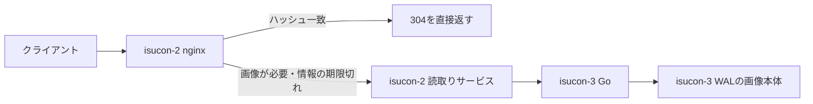

# Codex conversation

- Session: 01a11de8-6898-7183-823d-60edcca3a478

<!-- codex-hook-format: 7; tool results omitted -->

---

## USER

$isucon-agent ロールについては変更することでスコア改善する余地はないですか？

## ASSISTANT

isucon-agentスキルを使い、現在のホスト別ロールと最新の保存済みRUNを確認します。配置変更で減らせる負荷や通信と、移動先の余力を比較します。

## TOOL

```sh
pwd; rg --files -g 'AGENTS.md' -g 'Taskfile*.yml' -g 'run.json' -g '*sources*' -g '*roles*' -g 'SKILL.md' -g '*.md' docs tools/analysis .agents/skills/isucon-agent | head -100
```

## TOOL

```sh
cat .agents/skills/isucon-agent/SKILL.md; cat Taskfile.yml; cat Taskfile.contest.yml
```

## TOOL

```sh
git status --short; rg -n '^  (q|artifacts-run|analysis|runs)|role|ロール|isucon-[123]|CPU' docs/conversation/20261009*.md | head -100; ls -1 runs | tail -12; cat tools/analysis/sources.yaml; rg --files tools/analysis/schema; rg -n '^  q:|^  artifacts-run:' Taskfile.yml
```

## TOOL

```sh
sed -n '858,895p' Taskfile.yml; cat runs/20261009-084518/run.json; sed -n '1,190p' tools/analysis/schema/bottleneck.sql; rg -n 'CREATE|create|resource_demand|load_windows' tools/analysis/schema/semantic.sql | head -60; cat nginx/nginx.conf; cat nginx/sites-enabled/*; cat docs/official/cautionary_note.md
```

## TOOL

```sh
task --silent q -- "SELECT run_id,score,passed,commit,app_hosts,nginx_hosts,mysql_host FROM manifests ORDER BY run_id DESC LIMIT 4; DESCRIBE resource_demand; DESCRIBE http_traffic; DESCRIBE window_metrics;"
```

## TOOL

```sh
python3 - <<'PY'
import json
for r in ['20261009-084518','20261009-083417','20261009-082642']:
 d=json.load(open('runs/'+r+'/run.json'))
 print(r,{k:d.get(k) for k in ['phase','finalized_at','score','passed','missing','load_window','source']})
 print('artifact issues',[(a.get('name'),a.get('status')) for a in d.get('artifacts',[]) if a.get('status')!='ok'])
PY
cat nginx/nginx.conf; rg --files nginx/sites-enabled nginx/conf.d; cat tools/analysis/schema/access-log.sql | head -75; sed -n '340,460p' tools/analysis/schema/semantic.sql
```

## ASSISTANT

現行はisucon-1がDNS・MySQL・nginx、isucon-2がnginx、isucon-3がGoアプリです。最新RUNはまだ計測中なので、直前の確定RUNを基準にします。アプリへの振り分けを増やす案と、nginxをアプリと同居させて通信を短縮する案を比較しています。

## TOOL

```sh
task --silent artifacts-run RUN=runs/20261009-083417
```

## TOOL

```sh
task --silent q -- "SELECT host,resource_kind,service,round(demand_core_seconds,2) cpu_sec,round(capacity_core_seconds,2) capacity_sec,round(load_window_seconds,2) window_sec FROM resource_demand WHERE run_id='20261009-083417' ORDER BY host,resource_kind,service; SELECT host,samples,cpu_count,round(cpu_busy_peak_pct,2) busy_peak,cpu_busy_ge80_samples,run_queue_over_cpu_samples,round(cpu_pressure_some_avg10_mean,3) cpu_psi,round(iowait_mean_pct,2) iowait FROM host_saturation WHERE run_id='20261009-083417'; SELECT source,host,entity,metric,samples,round(mean_value,3) mean,round(max_value,3) peak,round(window_total,3) total FROM window_metrics WHERE run_id='20261009-083417' AND ((source='sql_pool' AND metric IN ('wait_count_per_sec','wait_duration_ms_per_sec','pool_utilization_pct')) OR (source='proc' AND (metric LIKE '%bytes_per_sec' OR metric LIKE '%memory%')) OR (source='disk' AND metric IN ('io_util_pct','avg_queue_size','write_await_ms'))) ORDER BY source,host,entity,metric;"
```

## TOOL

```sh
cat nginx/sites-enabled/isupipe.conf; cat nginx/conf.d/upstream.conf; sed -n '1,130p' tools/analysis/schema/proc.sql; rg -n 'sql.Open|Connect|ISUPIPE_MODE|localhost|LISTEN|start|writer' webapp/go/main.go webapp/go/post_store*.go | head -65; git log -5 --oneline
```

## TOOL

```sh
task --silent q -- "SELECT run_id,started_at,ended_at,duration_seconds,status,source FROM load_windows WHERE run_id='20261009-083417'; SELECT source,host,metric,round(mean_value,2) mean,round(max_value,2) peak FROM window_metrics WHERE run_id='20261009-083417' AND source='proc' AND (metric LIKE '%steal%' OR metric LIKE '%thrott%' OR metric LIKE '%mem_%' OR metric IN ('net_rx_bytes_per_sec','net_tx_bytes_per_sec')) ORDER BY host,metric; SELECT ingress_host,sum(requests) requests,round(sum(sum_body_bytes)/1e6,1) body_MB,round(sum(sum_time_sec)*1000/sum(requests),2) avg_ms FROM http_traffic_series WHERE run_id='20261009-083417' AND in_load_window GROUP BY ingress_host; SELECT ingress_host,upstream_addr,requests,round(response_time_avg_ms,3) response_ms,round(upstream_time_avg_ms,3) upstream_ms FROM upstream_cost_by_ingress WHERE run_id='20261009-083417' ORDER BY requests DESC LIMIT 10; SELECT function,round(flat_value,2) flat,round(cumulative_value,2) cum FROM pprof_functions WHERE run_id='20261009-083417' AND profile_type='go-cpu' AND sample_type='cpu' ORDER BY flat_value DESC LIMIT 12;"
```

## TOOL

```sh
sed -n '155,260p' webapp/go/main.go; rg -n 'unix|127.0.0.1|MYSQL|tunnel' webapp/go/database*.go tools/contest/deployments.yaml etc/systemd/system/*; head -2 runs/20261009-083417/isucon-3-proc-metrics.tsv; rg -n 'state|WAL|single|複数|shard' docs/solutions/user-id-sharding.md docs/solutions/wal-backed-in-memory-state.md | head -40; cat tools/contest/load-phase.yaml
```

## TOOL

```sh
task --silent q -- "SELECT ingress_host,sum(requests) requests,round(sum(sum_body_bytes)/1e6,1) body_MB,round(sum(response_time_sum_seconds)*1000/sum(requests),2) avg_ms FROM http_traffic_series WHERE run_id='20261009-083417' AND in_load_window GROUP BY ingress_host; SELECT ingress_host,upstream_addr,requests,round(response_time_avg_ms,3) response_ms,round(upstream_time_avg_ms,3) upstream_ms FROM upstream_cost_by_ingress WHERE run_id='20261009-083417' ORDER BY requests DESC LIMIT 10; SELECT function,round(flat_value,2) flat,round(cumulative_value,2) cum FROM pprof_functions WHERE run_id='20261009-083417' AND profile_type='go-cpu' AND sample_type='cpu' ORDER BY flat_value DESC LIMIT 10; SELECT host,entity,metric,round(mean_value,2) mean,round(max_value,2) peak FROM window_metrics WHERE run_id='20261009-083417' AND source='mysql' AND (metric LIKE '%queries%' OR metric LIKE '%questions%' OR metric LIKE '%threads%');"
```

## TOOL

```sh
rg -n 'func connectDB|DialConfig|ISUCON13_MYSQL|connection' webapp/go/*.go tools/contest/deployments.yaml | head -65; sed -n '1,110p' webapp/go/db.go; cat etc/systemd/system/isupipe-go.service; rg -n 'address|records|subdomain' webapp/go/dns_control.go | head -40; python3 - <<'PY'
import json
x=json.load(open('runs/20261009-084518/run.json'))
print({k:x.get(k) for k in ['phase','score','finalized_at']})
PY
```

## TOOL

```sh
sed -n '45,100p' webapp/go/main.go; sed -n '55,235p' webapp/go/user_handler.go; head -6 runs/20261009-083417/isucon-1-mysql-digest.tsv; cat mysql/mysql.conf.d/mysqld.cnf | tail -70; rg -n 'Listen|Start\(' webapp/go/main.go; sed -n '105,155p' webapp/go/dns_control.go; sed -n '1,130p' tools/analysis/schema/digest.sql
```

## TOOL

```sh
task --silent q -- "DESCRIBE queries; SELECT host,metric,round(mean_value,2) mean,round(max_value,2) peak FROM window_metrics WHERE run_id='20261009-083417' AND source='proc' AND metric IN ('net_rx_errors_per_sec','net_tx_errors_per_sec','net_rx_drops_per_sec','net_tx_drops_per_sec'); SELECT method,route,sum(requests) requests,round(sum(response_time_sum_seconds)*1000/sum(requests),2) avg_ms FROM http_traffic_series WHERE run_id='20261009-083417' AND in_load_window AND regexp_matches(route,'register|login|reservation|search|livecomment|reaction') GROUP BY method,route ORDER BY requests DESC LIMIT 12;"
```

## ASSISTANT

確定RUNでは、各ホストのCPU消費が60秒あたり約60〜64 core秒で、容量120 core秒に対して大きな偏りはありません。配置変更ではMySQLをGoアプリのホストへ移してSQL往復を短縮する案が有力です。nginxの同居は、移す入口によってアプリ側のCPU負荷が大きく増えるため、慎重に比較する必要があります。

## TOOL

```sh
python3 - <<'PY'
import json
x=json.load(open('runs/20261009-084518/run.json'))
print({k:x.get(k) for k in ['phase','score','passed','finalized_at','load_window']})
print('artifact issues',[(a.get('name'),a.get('status')) for a in x.get('artifacts',[]) if a.get('status')!='ok'])
PY
rg -n 'run_id|phase|score|missing' runs/20261009-084518/run.json | tail -12; sed -n '278,295p' webapp/go/main.go; cat docs/reservation-wal-gzip-latency.md | head -23
```

## TOOL

```sh
task --silent q -- "SELECT run_id,score,passed FROM manifests ORDER BY run_id DESC LIMIT 1;"
```

## TOOL

```sh
task --silent artifacts-run RUN=runs/20261009-084518
```

## TOOL

```sh
task --silent q -- "SELECT host,resource_kind,service,round(demand_core_seconds,2) cpu_sec,round(capacity_core_seconds,2) capacity_sec,round(load_window_seconds,2) window_sec FROM resource_demand WHERE run_id='20261009-084518' ORDER BY host,resource_kind,service; SELECT host,samples,round(cpu_busy_peak_pct,1) busy_peak,cpu_busy_ge80_samples,round(cpu_pressure_some_avg10_mean,2) cpu_psi FROM host_saturation WHERE run_id='20261009-084518'; SELECT host,metric,round(mean_value,2) mean,round(max_value,2) peak FROM window_metrics WHERE run_id='20261009-084518' AND ((source='sql_pool' AND metric IN ('pool_utilization_pct','wait_count_per_sec','wait_duration_ms_per_sec')) OR (source='proc' AND metric IN ('mem_available_bytes','net_rx_bytes_per_sec','net_tx_bytes_per_sec'))); SELECT method,route,sum(requests) requests,round(sum(response_time_sum_seconds)*1000/sum(requests),3) avg_ms FROM http_traffic_series WHERE run_id='20261009-084518' AND in_load_window AND regexp_matches(route,'register|login|reservation') GROUP BY method,route ORDER BY requests DESC LIMIT 5; SELECT query,count,round(sum_time_sec,3) sql_sec FROM queries WHERE run_id='20261009-084518' AND source='digest' AND (query LIKE '%users%' OR query LIKE '%themes%' OR query IN ('COMMIT','BEGIN','ROLLBACK')) ORDER BY count DESC LIMIT 10;"
```

## ASSISTANT (Worked for 1m 54s)

**余地はあります。まず検討するなら、MySQLをisucon-3へ移してGoアプリと同居させる案です。** ただし、配置変更だけで大幅に得点が伸びる根拠はまだありません。

調査中に確定した[最新RUN（736,156点）](/Users/mineo/src/github.com/EkeMinusYou/isucon13-03/runs/20261009-084518/run.json)では、成果物の欠損はなく、同じ負荷60秒のCPU消費は次のとおりでした。

| ホスト | 現在の役割 | CPU消費／容量 |
|---|---|---:|
| isucon-1 | DNS・MySQL・nginx・アイコン | 62.61／120 core秒 |
| isucon-2 | nginx・アイコン | 59.12／120 core秒 |
| isucon-3 | Goアプリ | 60.24／120 core秒 |

平均負荷はほぼ均等です。ただし、待ちが消えているわけではなく、isucon-1のCPU待ち指標は他の2台より高くなっています。

配置変更の候補は次の順です。

1. **MySQLをisucon-1からisucon-3へ移す**
   
   登録・ログイン・アイコン更新に残るSQLのホスト間往復を除去できます。MySQLの消費は6.85 core秒なので、単純に足すと移動先は約67／120 core秒で、余力があります。接続先・配置設定と既存のDB再作成経路が変更対象です。通常再起動後の取得と初期化を維持します。
   
   一方、予約・コメント・リアクションは既にWAL中心なので、主に視聴へ入る前の処理に効く案です。**比較的軽い変更ですが、得点効果は小さめと見ています。**

2. **配信者側のnginx入口をisucon-3へ移す**
   
   反復するAPIからnginx→Goのホスト間通信を除けるため、得点への作用は①より直接的です。ただし、isucon-1のnginxだけで30.91 core秒を使っており、同居先はアイコン処理も含めて約94／120 core秒になる概算です。通信短縮とCPU競合のどちらが勝つか未確定です。DNSの配信先とアイコン配置も変更対象になります。

3. **Goアプリを複数台に増やす**
   
   現行のメモリ状態とWALは単一アプリが管理しています。`APP_HOSTS`を増やすだけでは更新を共有できず、状態の分割・同期が必要です。現在のCPU需要からは、この追加実装を優先する根拠は弱いです。

**小さな変更から選ぶなら①、視聴中の応答時間を狙うなら②が比較候補です。** 得点増の幅は未確定で、同じ負荷窓の得点・視聴完了数・応答時間・CPU待ちで評価する必要があります。今回は調査のみで、設定変更やデプロイはしていません。

## USER

得点はレイテンシの向上で発生すると思われます。レイテンシを改善できそうな候補はありますか？

## ASSISTANT

得点につながる経路で、どの往復や待ちを短縮できるか確認します。登録・ログインと、視聴中に繰り返すAPIを分けて、ロール変更の候補を絞ります。

## TOOL

```sh
task --silent q -- "SELECT run_id,score,passed FROM manifests ORDER BY run_id DESC LIMIT 2; DESCRIBE user_transition_edges; DESCRIBE user_transition_scenarios; DESCRIBE upstreams_by_ingress; SELECT method,route,sum(requests) requests,round(sum(response_time_sum_seconds)*1000/sum(requests),3) avg_ms,round(sum(sum_body_bytes)/1e6,2) body_MB FROM http_traffic_series WHERE run_id='20261009-084518' AND in_load_window GROUP BY method,route ORDER BY sum(response_time_sum_seconds) DESC LIMIT 20;"
```

## TOOL

```sh
rg -n 'gap|interval|latency|elapsed|duration|view|視聴|投稿|時間' tools/analysis/schema/user-transitions.sql docs/conversation/20261009-072808*.md | tail -70; cat nginx/conf.d/icon-edge.conf; rg -n 'keepalive|dns|common|address' webapp/go/dns_control.go | tail -35; sed -n '1,125p' tools/analysis/schema/user-transitions.sql
```

## TOOL

### `exec`

```json
"const sql = `WITH ev AS (\nSELECT regexp_extract(filename,'access-(isucon-[0-9]+)',1) ingress, method,\nregexp_replace(regexp_replace(uri,'/api/livestream/[0-9]+','/api/livestream/:id'),'/api/user/[^/]+','/api/user/:name') route,\nstatus,response_time,try_cast(upstream_time AS DOUBLE) upstream_sec,body_bytes,\ntry_cast(msec AS DOUBLE)-response_time start_epoch,vhost,session_id\nFROM read_json('runs/20261009-084518/raw/access-*.log.zst',format='newline_delimited',filename=true,\ncolumns={msec:'VARCHAR',method:'VARCHAR',uri:'VARCHAR',status:'BIGINT',response_time:'DOUBLE',upstream_time:'VARCHAR',body_bytes:'BIGINT',vhost:'VARCHAR',session_id:'VARCHAR'},ignore_errors=true)\n), load_ev AS (\nSELECT e.* FROM ev e,load_windows w WHERE w.run_id='20261009-084518' AND start_epoch>=epoch(w.started_at) AND start_epoch<epoch(w.ended_at)\n)\nSELECT ingress,method,route,status,count(*) n,round(avg(response_time)*1000,3) avg_ms,\nround(quantile_cont(response_time,.5)*1000,3) p50_ms,round(quantile_cont(response_time,.95)*1000,3) p95_ms,\nround(avg(upstream_sec)*1000,3) upstream_ms,round(avg(body_bytes)) bytes\nFROM load_ev WHERE route LIKE '/api/%' GROUP BY ALL ORDER BY n DESC LIMIT 28;`;\nstore('latencyRawCte',sql.split(\"\\nSELECT ingress,method\")[0]);\nconst rs=await Promise.allSettled([\ntools.exec_command({cmd:\"task --silent q -- '\"+sql.replace(/'/g,\"'\\\\''\")+\"'\",\"max_output_tokens\":4500}),\ntools.exec_command({cmd:\"task --silent q -- \\\"SELECT from_method,from_route,to_method,to_route,transitions,overlap_transitions,round(start_gap_avg_ms,3) start_ms,round(idle_gap_avg_ms,3) idle_ms FROM user_transition_edges WHERE run_id='20261009-084518' ORDER BY transitions DESC LIMIT 16; SELECT DISTINCT scenario_rank,scenario_sessions,requests_per_session_avg,duration_p50_ms,signature FROM user_transition_scenarios WHERE run_id='20261009-084518' ORDER BY scenario_rank LIMIT 4;\\\"\",\"max_output_tokens\":2200}),\ntools.exec_command({cmd:\"sed -n '165,190p' docs/conversation/20261009-072808_01a11da1-6f6e-7421-8151-fe93e6a95f68.md; rg -n 'func getLivecommentsHandler|func getReactionsHandler|render|gzip|lock' webapp/go/livecomment_handler.go webapp/go/reaction_handler.go webapp/go/response_gzip.go; sed -n '1,115p' webapp/go/response_gzip.go; sed -n '1,95p' nginx/conf.d/icon-edge.conf\",\"max_output_tokens\":2400})\n]);rs.forEach(r=>text(r.status===\"fulfilled\"?r.value.output:r.reason));\n"
```

## ASSISTANT

視聴中のコメント・リアクションAPIは、isucon-1のnginxからisucon-3のGoへ転送されています。最新RUNの成功応答は、一覧GETが平均約0.54ms、リアクションPOSTが約0.47msでした。毎回のホスト間往復を除く案は、この反復経路に直接効く候補です。レイテンシを優先するなら、先ほどのMySQL同居よりこちらを先に比較する価値があります。

## TOOL

### `exec`

```json
"const sql=`SELECT date_diff('second',w.started_at,m.ts) AS offset_sec,m.host,m.value FROM metrics m JOIN load_windows w USING(run_id) WHERE m.run_id='20261009-084518' AND source='proc' AND metric='cpu_busy_pct' AND ts>=started_at AND ts<ended_at ORDER BY offset_sec LIMIT 6;\nWITH x AS(SELECT m.host,m.entity AS service,date_diff('second',w.started_at,m.ts) AS sec,m.value FROM metrics m JOIN load_windows w USING(run_id) WHERE m.run_id='20261009-084518' AND source='service' AND metric='cpu_pct' AND ts>=started_at AND ts<ended_at AND ((host='isucon-3' AND entity='isupipe-go.service') OR (host='isucon-1' AND entity IN ('nginx.service','isupipe-icons.service')))), y AS(SELECT sec,sum(value) cpu_pct,count(*) n FROM x GROUP BY sec) SELECT count(*) seconds,round(avg(cpu_pct),1) avg_cpu_pct,round(max(cpu_pct),1) peak_cpu_pct,count(*) FILTER(WHERE cpu_pct>200) over_2core_seconds FROM y WHERE n=3;`;\ntext((await tools.exec_command({cmd:\"task --silent q -- '\"+sql.replace(/'/g,\"'\\\\''\")+\"'\",\"max_output_tokens\":800})).output);\ntext((await tools.exec_command({cmd:\"rg -n '^  (APP_HOSTS|NGINX_HOSTS|DNS_HOSTS|MYSQL_HOST|MYSQL_HOSTS|ICON_READ_HOSTS|DNS_RECORD_ADDRESS|DNS_COMMON_HOST):' Taskfile.yml; rg -n 'names\\\\[|commonAddress|base.address|address\\\\[:\\\\]|ns1' webapp/go/dns*.go | head -30; git status --short\",\"max_output_tokens\":700})).output);\n"
```

## TOOL

```sh
sed -n '28,110p' webapp/go/dns_server.go; head -18 webapp/pdns/u.isucon.dev.zone; cat tools/contest/generated/dns-control.env; task --silent q -- "WITH x AS(SELECT m.host,m.entity AS service,date_diff('second',w.started_at,m.ts) AS sec,m.value FROM metrics m JOIN load_windows w USING(run_id) WHERE m.run_id='20261009-084518' AND source='service' AND metric='cpu_pct' AND m.ts>=w.started_at AND m.ts<w.ended_at AND ((host='isucon-3' AND entity='isupipe-go.service') OR (host='isucon-1' AND entity IN ('nginx.service','isupipe-icons.service')))), y AS(SELECT sec,sum(value) cpu_pct,count(*) n FROM x GROUP BY sec) SELECT count(*) AS sample_count,round(avg(cpu_pct),1) avg_cpu_pct,round(max(cpu_pct),1) peak_cpu_pct,count(*) FILTER(WHERE cpu_pct>200) over_2core_samples FROM y WHERE n=3;"
```

## TOOL

```sh
task --silent q -- "WITH x AS(SELECT m.host,m.entity AS service,date_diff('second',w.started_at,m.ts) AS sec,m.value FROM metrics m JOIN load_windows w USING(run_id) WHERE m.run_id='20261009-084518' AND m.source='service' AND m.metric='cpu_pct' AND m.ts>=w.started_at AND m.ts<w.ended_at AND ((m.host='isucon-3' AND m.entity='isupipe-go.service') OR (m.host='isucon-1' AND m.entity IN ('nginx.service','isupipe-icons.service')))), y AS(SELECT sec,sum(value) cpu_pct,count(*) n FROM x GROUP BY sec) SELECT count(*) AS sample_count,round(avg(cpu_pct),1) avg_cpu_pct,round(max(cpu_pct),1) peak_cpu_pct,count(*) FILTER(WHERE cpu_pct>200) over_2core_samples FROM y WHERE n=3;"
```

## TOOL

```sh
sed -n '233,257p' webapp/go/dns_server.go; sed -n '110,160p' webapp/go/response_gzip.go; sed -n '65,92p' webapp/go/livecomment_handler.go; sed -n '27,56p' webapp/go/reaction_handler.go
```

## ASSISTANT

全量同居には注意点が見つかりました。同じ1秒ごとのCPU消費をGo・移動対象のnginx・アイコンで合算すると、60秒中5秒で2コア分を超えます。まずは配信者のホスト名で入口をisucon-1とisucon-3へ固定振り分けし、一部の視聴で往復を除く案が妥当です。

## TOOL

### `exec`

```json
"const base=load('latencyRawCte');\nconst sql=base+`, seq AS (\nSELECT method,route,status,response_time,start_epoch,session_id,\nlead(method) OVER(PARTITION BY session_id ORDER BY start_epoch,start_epoch+response_time) next_method,\nlead(route) OVER(PARTITION BY session_id ORDER BY start_epoch,start_epoch+response_time) next_route,\nlead(start_epoch) OVER(PARTITION BY session_id ORDER BY start_epoch,start_epoch+response_time) next_start\nFROM load_ev WHERE session_id IS NOT NULL AND session_id<>''\n)\nSELECT method,route,next_method,next_route,count(*) n,\ncount(*) FILTER(WHERE next_start<start_epoch+response_time) overlaps,\nround(avg(next_start-start_epoch)*1000,3) start_gap_ms\nFROM seq WHERE route IN ('/api/livestream/:id/livecomment','/api/livestream/:id/reaction') AND next_route IN ('/api/livestream/:id/livecomment','/api/livestream/:id/reaction')\nGROUP BY ALL ORDER BY n DESC LIMIT 5;`;\ntext((await tools.exec_command({cmd:\"task --silent q -- '\"+sql.replace(/'/g,\"'\\\\''\")+\"'\",\"max_output_tokens\":1200})).output);\n"
```

## TOOL

### `exec`

```json
"const sql=load('latencyRawCte')+`, seq AS (\nSELECT method,route,response_time,start_epoch,session_id,\nlead(method) OVER(PARTITION BY session_id ORDER BY start_epoch,start_epoch+response_time) next_method,\nlead(route) OVER(PARTITION BY session_id ORDER BY start_epoch,start_epoch+response_time) next_route,\nlead(start_epoch) OVER(PARTITION BY session_id ORDER BY start_epoch,start_epoch+response_time) next_start\nFROM load_ev WHERE session_id IS NOT NULL AND session_id<>''\n)\nSELECT method,route,next_method,next_route,count(*) n,\ncount(*) FILTER(WHERE next_start<start_epoch+response_time) AS overlap_count,\nround(avg(next_start-start_epoch)*1000,3) start_gap_ms\nFROM seq WHERE route IN ('/api/livestream/:id/livecomment','/api/livestream/:id/reaction') AND next_route IN ('/api/livestream/:id/livecomment','/api/livestream/:id/reaction')\nGROUP BY ALL ORDER BY n DESC LIMIT 5;`;\ntext((await tools.exec_command({cmd:\"task --silent q -- '\"+sql.replace(/'/g,\"'\\\\''\")+\"'\",\"max_output_tokens\":1200})).output);\n"
```

## ASSISTANT (Worked for 2m 33s)

**あります。レイテンシを優先するなら、視聴APIのnginxをGoアプリと同居させる案を第一候補にします。** 前の回答は平均CPUの余力を重く見すぎました。見るべきなのは、投げ銭までの反復経路で減らせる往復です。

[最新RUN](/Users/mineo/src/github.com/EkeMinusYou/isucon13-03/runs/20261009-084518/run.json)の負荷60秒では、次の成功応答がすべて **isucon-1のnginx → isucon-3のGo** を通っています。

| 処理 | 件数 | 平均応答時間 |
|---|---:|---:|
| コメント一覧GET | 43,602 | 0.548ms |
| リアクション一覧GET | 43,595 | 0.537ms |
| リアクションPOST | 39,838 | 0.467ms |

同一セッションのログでも、これらの呼び出しはほぼ順番に進んでいます。そのため、**各応答の短縮が次の投稿を早める**方向に働くと考えられます。

**① 視聴入口の一部をisucon-3へ移す**

配信者のホスト名で入口を固定振り分けし、例えば半分をisucon-3へ向けます。

- isucon-1：DNS・MySQL・残りの視聴入口
- isucon-2：共通入口・アイコン
- isucon-3：Go・移動した視聴入口・必要なアイコン読取り

isucon-3へ来た視聴では、nginx→Goのホスト間往復を除けます。アプリは引き続き1プロセスなので、WALやメモリ状態の同期は増えません。追加作業はnginx・アイコン配置とDNSの振り分け対応です。`pipe`の共通入口とDNSサーバー自身のアドレスは維持します。

全量移動は優先しません。同じ1秒窓のGo・移動対象nginx・アイコンのCPU消費を単純合算すると、60秒中5秒で2コア分を超えました。一部同居から比較する方が、通信短縮をCPU待ちで相殺しにくいと判断します。

**② MySQLをisucon-3へ移す**

登録には`BEGIN → users INSERT → themes INSERT → COMMIT`、ログインにもSQL往復が残っています。同居でこれらを短縮し、視聴へ入るまでを早める候補です。ただし、視聴中の反復には①の方が直接効きます。

**推奨順は①→②です。** 表の約0.54msにはGoの処理も含まれるため、全部を削減できるわけではありません。削減幅は未測定ですが、①は得点経路に繰り返し効く仮説があります。比較時は得点に加え、投稿間隔・視聴完了数・応答時間・CPU待ちを同じ負荷窓で確認します。

## USER

|  |  |  |
|---|---:|---:|
| コメント一覧GET | 43,602 | 0.548ms |
| リアクション一覧GET | 43,595 | 0.537ms |
| リアクションPOST | 39,838 | 0.467ms |
これらについてisucon-3に全て移すという案ですか？

## ASSISTANT (Worked for 8s)

**提案は、その3種類のリクエストの一部を、isucon-3のnginxで直接受ける案です。** Goの処理自体は、現在もすべてisucon-3で行っています。

配信者のホスト名で固定振り分けします。例えば半分の配信者については、

`視聴者 → isucon-3のnginx → 同ホストのGo`

とし、その配信のコメントGET・リアクションGET・POSTをまとめて同居経路へ移します。残りは現在のisucon-1経由です。

全量を移す案も可能ですが、移動後のCPU需要を単純合算すると一部の時間帯で2コア分を超えるため、まず一部同居を推奨しています。

## USER

一部同居は複雑だし効果が限定的なので良い案とは思えません

## ASSISTANT (Worked for 25s)

その指摘は妥当です。一部同居はDNSの振り分けを複雑にし、通信短縮も一部に限られるため、提案を取り下げます。

**配置変更でレイテンシを狙うなら、配信者側の入口をすべてisucon-3へ移す案を比較候補にします。**

| ホスト | 変更後の役割 |
|---|---|
| isucon-1 | DNS・MySQL |
| isucon-2 | 共通入口のnginx・アイコン |
| isucon-3 | 配信者側のnginx・Go・アイコン |

これなら、対象のコメントGET・リアクションGET・POSTすべてでnginx→Goのホスト間往復を除けます。ホスト名による分割や状態同期は不要です。

先ほどのCPU合算は最大208.6%で、2コア分を超えたのは60秒中5秒でした。**これは全量同居を退けるには弱い根拠でした。** 同居後は通信費用も変わるため、実際にCPU待ちが増えてレイテンシが悪化するかは未確定です。

変更範囲はnginx・アイコンの配置とDNSの配信先です。共通入口はisucon-2、DNS自身のアドレスはisucon-1を維持します。この全量同居案なら、実装の追加負担を抑えつつ、視聴中の反復経路をまとめて短縮できます。

## USER

アイコンについては一つのサーバーにしなくても問題ないですか？

## ASSISTANT

現在のアイコン更新・読取りの仕組みを確認します。複数台に置いた場合に、更新の反映と再起動後の取得がどう保たれるかを見ます。

## TOOL

```sh
rg -n 'func |publish|replic|readURLs|readIPs|generation|reset|sync|POST|PUT|origin|failed|ready' webapp/go/icon*.go | head -130; rg --files webapp/go | rg 'icon'; cat etc/systemd/system/isupipe-icons.service; cat nginx/conf.d/icon-read.conf; rg -n 'icons|icon_read|icon-read|icon-state|icon-edge' tools/contest/deployments.yaml | head -70
```

## TOOL

```sh
rg --files docs | rg 'icon|アイコン'; rg -n 'icon|アイコン|猶予|反映' docs/official/isupipe.md docs/official/specification.md | head -45; rg -n 'publish|failed|origin|generation|cache|POST|body|hash' nginx/njs/icon.js | head -80; rg -n 'iconRead|icon.*publish|publish.*icon|replic|ISUPIPE_ICON' webapp/go/*.go | head -100
```

## TOOL

```sh
sed -n '1,92p' webapp/go/icon_read.go; sed -n '109,249p' webapp/go/icon_read.go; sed -n '250,328p' webapp/go/icon_read.go; sed -n '161,222p' webapp/go/icons.go; sed -n '100,145p' webapp/go/icon_edge.go; rg -n 'valid_until|dirty|expires|If-None|304|http.sock|icon_reader' tools/contest/nginx-icon-edge/* -g '*.[ch]' | head -60
```

## ASSISTANT (Worked for 35s)

**はい。現行の仕組みなら、アイコンの読取り側を複数台に置いて問題ありません。** 現在もisucon-1とisucon-2に置いています。

役割は次のように分かれています。

- **画像本体・更新の正本**：isucon-3のGoとWALで一元管理。
- **各nginx側**：ユーザーごとのハッシュを共有し、条件が一致すれば304を返す。
- **画像本体が必要な場合**：isucon-3から取得する。

更新通知と定期同期があり、ハッシュ情報の有効期限が切れると正本へ問い合わせます。古い情報だけで304を返し続けない仕組みです。[読取り実装](/Users/mineo/src/github.com/EkeMinusYou/isucon13-03/webapp/go/icon_read.go:173)

今回の案は、読取り側を「isucon-1・2」から「isucon-2・3」へ移すものです。台数も正本の数も増えません。配置変更後も、公式の**更新から2秒以内の反映**と再起動後の取得を確認します。

## USER

あ、オーバーヘッドにならないか、が気になっています

## ASSISTANT

複数台に置くことで同期・通知のオーバーヘッドは発生します。最新RUNで、各読取りサーバーが実際にアイコンGETを受けているかと、CPU消費を照合します。

## TOOL

### `exec`

```json
"const sql=load('latencyRawCte')+`\nSELECT ingress,status,count(*) AS requests,round(avg(response_time)*1000,3) avg_ms\nFROM load_ev WHERE route='/api/user/:name/icon' AND method='GET' GROUP BY ALL ORDER BY ingress,status;`;\ntext((await tools.exec_command({cmd:\"task --silent q -- '\"+sql.replace(/'/g,\"'\\\\''\")+\"'\",\"max_output_tokens\":750})).output);\ntext((await tools.exec_command({cmd:\"task --silent q -- \\\"SELECT host,service,round(demand_core_seconds,3) cpu_sec,round(capacity_core_seconds,3) capacity_sec FROM resource_demand WHERE run_id='20261009-084518' AND service='isupipe-icons.service';\\\"; rg --files tools/contest | rg 'icon.*\\\\.(c|h)$'; sed -n '195,245p' webapp/go/icon_read.go\",\"max_output_tokens\":1200})).output);\n"
```

## ASSISTANT (Worked for 50s)

**はい、オーバーヘッドになります。先ほどは正当性の面で答えていました。**

最新RUNの負荷60秒では、

- アイコンGETは全494,381件がisucon-2に来ていました。
- GETを受けていないisucon-1のアイコン読取りサービスも、**3.082 core秒**を消費していました。

各読取りサービスは100ms間隔で正本と同期し、nginxへハッシュ情報を公開します。また、アイコン更新APIは各読取りサービスへの通知を並行に送り、その完了を待ちます。余分な1台は、CPU・通信・更新時の待ちを増やします。[同期・通知処理](/Users/mineo/src/github.com/EkeMinusYou/isucon13-03/webapp/go/icon_read.go:250)

したがって、**今回の配置案ではアイコン読取りサービスはisucon-2だけに置く方が妥当です。** 画像本体と更新の正本はisucon-3に維持し、isucon-3へ直接アイコンGETが来た場合は同居するGoで処理します。

これなら、視聴APIのnginxとGoを同居させつつ、使われていない読取りサービスの同期負荷を持ち込まずに済みます。

## USER

では、そのここまで決定した方針で実装デプロイしてください

## ASSISTANT

配信者側のnginxをすべてisucon-3へ移し、アイコン読取りサービスはisucon-2だけにする構成を実装・デプロイします。共通入口はisucon-2、DNS・MySQLはisucon-1に維持します。計測停止と対象ホストを確認し、既存のTask経路で反映してAPIと永続性を確認します。

## TOOL

```sh
git status --short; rg --files -g AGENTS.md; cat .agents/skills/isucon-agent/SKILL.md; sed -n '1,130p' tools/contest/deployments.yaml; sed -n '290,377p' tools/contest/deployments.yaml; rg -n 'nginx|roles|gen:|deploy-all|deploy-app|check-network' Taskfile.yml | head -80; sed -n '1,180p' tools/contest/README.md
```

## TOOL

```sh
sed -n '580,675p' Taskfile.yml; sed -n '130,290p' tools/contest/deployments.yaml; rg -n 'deploy-dual|deploy-nginx-split|inspect-dns|gen-contest-routing|native-icon|config-check' Taskfile.contest.yml; sed -n '1,220p' tools/deployctl/deployments.yaml; sed -n '1,100p' webapp/go/dns_server.go; sed -n '230,270p' webapp/go/dns_server.go; sed -n '1,100p' webapp/go/dns_control_test.go; cat tools/template/paths.txt | tail -50
```

## TOOL

```sh
test ! -f raw/current-run-id; task --silent inspect-dns-batching-prereqs; task --silent ssh HOST=isucon-3 -- 'uname -sm; systemctl is-active isupipe-go nginx mysql isupipe-icons; sudo nginx -V 2>&1; ls -l /etc/nginx/tls/_.u.isucon.dev.crt /etc/nginx/tls/_.u.isucon.dev.key; curl --fail --silent http://127.0.0.1:6060/debug/post-wal'
```

## TOOL

```sh
sed -n '440,575p' Taskfile.contest.yml; sed -n '878,951p' Taskfile.contest.yml; sed -n '108,151p' webapp/go/dns_server.go; sed -n '965,996p' Taskfile.yml; rg -n 'config-check:' Taskfile.yml; rg -n 'post-wal|post-store|wal|icon.edge|icons-phase|cross-ingress|dns-address' tools/contest/smoke/main.go webapp/go/measurement.go | head -70; sed -n '1,130p' tools/contest/smoke/main.go; cat .gitignore | tail -45
```

## TOOL

### `write_stdin`

```javascript
tools.write_stdin({session_id:10292,chars:"","max_output_tokens":2000,"yield_time_ms":1000})
```

## TOOL

```sh
rg -n '^  ssh:|check-icon-read:|check-icon-edge:|inspect-fast-paths:|inspect-writer-data:' Taskfile.yml Taskfile.contest.yml; sed -n '930,945p' Taskfile.yml; sed -n '180,310p' Taskfile.contest.yml; sed -n '1027,1072p' Taskfile.yml; sed -n '1,125p' tools/deployctl/config.go; rg -n 'Command|script|CLI_ARGS|ssh:' Taskfile.yml | tail -15
```

## ASSISTANT

全3台でLinux/amd64と計測停止を確認できました。nginxはホスト別の設定を生成し、isucon-2では既存の高速な304応答を維持、isucon-3ではアイコンGETを同居Goへ流す形にします。DNSのNSアドレスも配信先と分け、isucon-1に固定します。

## TOOL

```sh
sed -n '947,960p' Taskfile.yml; rg -n 'native|ngx_http.*\.c|icon-edge' Taskfile.contest.yml | head -35; sed -n '1,120p' tools/setup/config-check.yaml; sed -n '327,360p' Taskfile.contest.yml; sed -n '600,642p' Taskfile.contest.yml; sed -n '1,90p' tools/deployctl/runner.go; rg -n 'upstream.*app|template|nginx' tools/contest/smoke/main.go | tail -35; cat AGENTS.md | head -15
```

## TOOL

```sh
ls -l nginx/modules-enabled nginx/conf.d; rg --files nginx | wc -l; sed -n '25,55p' tools/contest/nginx-njs/check.py; rg -n '^  (inspect-post-wal|deploy-plan|build-smoke)' Taskfile.contest.yml Taskfile.yml; sed -n '357,375p' Taskfile.contest.yml; sed -n '670,691p' Taskfile.yml; sed -n '40,78p' webapp/go/icon_read_test.go
```

## TOOL

```sh
sed -n '391,420p' Taskfile.contest.yml; sed -n '1,80p' tools/contest/nginx-njs/isupipe_icon_native.inc; sed -n '130,151p' tools/contest/smoke/main.go; rg -n 'ns1|crossIngress|checkCrossIngress' tools/contest/smoke/*.go; rg -n 'sudo|rsync|delete|dry-run' tools/deployctl/*.go | head -35; cat nginx/modules-enabled/80-mod-http-js.conf
```

## TOOL

```sh
sed -n '20,170p' tools/deployctl/plan.go; sed -n '700,743p' Taskfile.yml; rg -n 'cross' tools/contest/smoke/main.go; sed -n '143,175p' tools/contest/smoke/main.go; sed -n '1,100p' tools/contest/smoke/cross_ingress.go
```

## TOOL

### `apply_patch`

```javascript
tools.apply_patch("*** Begin Patch\n*** Update File: /Users/mineo/src/github.com/EkeMinusYou/isucon13-03/Taskfile.yml\n@@\n-  ICON_READ_HOSTS: isucon-1 isucon-2\n+  ICON_READ_HOSTS: isucon-2\n@@\n-  NGINX_HOSTS: isucon-1 isucon-2\n+  NGINX_HOSTS: isucon-3 isucon-2\n*** Update File: /Users/mineo/src/github.com/EkeMinusYou/isucon13-03/webapp/go/dns_server.go\n@@\n \tcommonAddress [4]byte\n+\tnsAddress     [4]byte\n@@\n \tcopy(b.address[:], ip)\n+\taddresses := make(map[string][4]byte)\n@@\n \t\t\t\tb.names[name] = true\n+\t\t\t\tif literal := net.ParseIP(f[4]).To4(); literal != nil {\n+\t\t\t\t\tvar value [4]byte\n+\t\t\t\t\tcopy(value[:], literal)\n+\t\t\t\t\taddresses[name] = value\n+\t\t\t\t}\n@@\n \tif statement != \"\" || !soaSeen || !nsSeen || !b.names[b.ns.NS.String()] {\n \t\treturn nil, fmt.Errorf(\"incomplete base DNS zone\")\n \t}\n+\tb.nsAddress = b.address\n+\tif address, ok := addresses[dnsCanonical(b.ns.NS.String())]; ok {\n+\t\tb.nsAddress = address\n+\t}\n@@\n \t\tif dnsCanonical(owner.String()) == \"pipe.\"+dnsSuffix {\n \t\t\taddress = d.base.commonAddress\n+\t\t} else if owner == d.base.ns.NS {\n+\t\t\taddress = d.base.nsAddress\n \t\t}\n*** Update File: /Users/mineo/src/github.com/EkeMinusYou/isucon13-03/webapp/go/dns_control_test.go\n@@\n \tstreamIP, commonIP := net.ParseIP(\"192.0.2.1\"), net.ParseIP(\"192.0.2.2\")\n+\tbase := strings.Replace(dnsTestBase, \"ns1 0 IN A <ISUCON_SUBDOMAIN_ADDRESS>\", \"ns1 0 IN A 192.0.2.3\", 1)\n \n-\td, err := newDNSControl([]byte(dnsTestBase), path, streamIP, commonIP)\n+\td, err := newDNSControl([]byte(base), path, streamIP, commonIP)\n@@\n-\t\t\t{\"ns1.\" + dnsSuffix, [4]byte{192, 0, 2, 1}},\n+\t\t\t{\"ns1.\" + dnsSuffix, [4]byte{192, 0, 2, 3}},\n@@\n-\t\tif r := dnsQuestion(t, d, dnsSuffix, dnsmessage.TypeNS); len(r.Additionals) != 1 || r.Additionals[0].Body.(*dnsmessage.AResource).A != [4]byte{192, 0, 2, 1} {\n-\t\t\tt.Fatal(\"NS glue moved to the common HTTP ingress\")\n+\t\tif r := dnsQuestion(t, d, dnsSuffix, dnsmessage.TypeNS); len(r.Additionals) != 1 || r.Additionals[0].Body.(*dnsmessage.AResource).A != [4]byte{192, 0, 2, 3} {\n+\t\t\tt.Fatal(\"NS glue moved away from the DNS server\")\n@@\n-\td, err = newDNSControl([]byte(dnsTestBase), path, streamIP, commonIP)\n+\td, err = newDNSControl([]byte(base), path, streamIP, commonIP)\n*** Update File: /Users/mineo/src/github.com/EkeMinusYou/isucon13-03/tools/contest/deployments.yaml\n@@\n-      - &ingress_nginx_config {label: nginx configuration, role: nginx, local: nginx/, remote: /etc/nginx/, excludes: [tls/, ngx_http_js_module.so], delete: true, validate: sudo nginx -t}\n+      - &ingress_nginx_config {label: host-specific nginx configuration, role: nginx, local: 'tools/contest/generated/nginx/{host}/', remote: /etc/nginx/, excludes: [tls/, ngx_http_js_module.so], delete: true, validate: sudo nginx -t}\n@@\n-      - label: stop nginx on the application host after DNS switches\n-        role: app\n+      - label: stop nginx outside its assigned hosts after DNS switches\n+        role: all\n@@\n-            *) sudo systemctl disable --now nginx; test \"$(sudo systemctl show nginx -p MainPID --value)\" = 0 ;;\n+            *) if sudo systemctl cat nginx >/dev/null 2>&1; then sudo systemctl disable --now nginx; fi; test \"$(sudo systemctl show nginx -p MainPID --value)\" = 0 ;;\n@@\n       ingress-dns: {needs: [ingress-nginx]}\n-      icon-reader-roles: {needs: [ingress-dns]}\n+      nginx-retire: {needs: [ingress-dns]}\n+      icon-reader-roles: {needs: [nginx-retire]}\n*** Update File: /Users/mineo/src/github.com/EkeMinusYou/isucon13-03/tools/setup/config-check.yaml\n@@\n-        local: nginx/\n+        local: 'tools/contest/generated/nginx/{host}/' # contest: generated per-host icon routing\n*** Update File: /Users/mineo/src/github.com/EkeMinusYou/isucon13-03/Taskfile.contest.yml\n@@\n   check-icon-edge:\n@@\n-      - for: { var: NGINX_HOSTS }\n+      - for: { var: ICON_READ_HOSTS }\n@@\n   deploy-dual-ingress:\n-    desc: 1・2号機のHTTPS入口とreader、3号機の通知先、1号機のDNSを反映する\n+    desc: ホスト別HTTPS入口・指定reader・Go通知先・DNS配信先を反映する\n@@\n-      - for: { var: NGINX_HOSTS }\n+      - for: { var: ICON_READ_HOSTS }\n         cmd: |\n           {{if eq (.ICON_EDGE_CHECK | default \"false\") \"true\"}}\n@@\n   gen-contest-routing:\n@@\n       - for: { var: DNS_HOSTS }\n@@\n-          cp webapp/pdns/u.isucon.dev.zone etc/hosts/{{.ITEM}}/dns/u.isucon.dev.zone\n+          sed 's/^ns1[[:space:]].*/ns1 0 IN A {{index .PUBLIC_IP .ITEM}}/' webapp/pdns/u.isucon.dev.zone > etc/hosts/{{.ITEM}}/dns/u.isucon.dev.zone\n+      - for: { var: NGINX_HOSTS }\n+        cmd: |\n+          mkdir -p tools/contest/generated/nginx/{{.ITEM}}\n+          rsync -a --delete --exclude=tls/ nginx/ tools/contest/generated/nginx/{{.ITEM}}/\n+          case ' {{.ICON_READ_HOSTS}} ' in\n+            *' {{.ITEM}} '*) ;;\n+            *)\n+              sed '/isupipe_icon_native icon_hashes icon_control;/c\\\n+              proxy_hide_header X-Measurement-Session-ID;\\\n+              proxy_set_header Host $host;\\\n+              proxy_http_version 1.1;\\\n+              proxy_set_header Connection \"\";\\\n+              proxy_pass http://app;' nginx/sites-enabled/isupipe.conf > tools/contest/generated/nginx/{{.ITEM}}/sites-enabled/isupipe.conf\n+              ;;\n+          esac\n*** End Patch")
```

## TOOL

```sh
gofmt -w webapp/go/dns_server.go webapp/go/dns_control_test.go; task --silent gen; git diff --stat; git diff -- Taskfile.contest.yml tools/contest/deployments.yaml tools/setup/config-check.yaml webapp/go/dns_server.go webapp/go/dns_control_test.go; rg -n 'isupipe_icon_native|proxy_pass' tools/contest/generated/nginx/isucon-3/sites-enabled/isupipe.conf tools/contest/generated/nginx/isucon-2/sites-enabled/isupipe.conf; rg -n '^ns1' etc/hosts/isucon-1/dns/u.isucon.dev.zone; task --list >/dev/null
```

## TOOL

```sh
git diff --stat; sed -n '21,36p' webapp/go/dns_control_test.go; sed -n '15,23p' webapp/go/dns_server.go; sed -n '68,84p' Taskfile.yml; rg -n 'nsAddress|addresses' webapp/go/dns_server.go; git status --short
```

## TOOL

### `apply_patch`

```javascript
tools.apply_patch("*** Begin Patch\n*** Update File: /Users/mineo/src/github.com/EkeMinusYou/isucon13-03/Taskfile.yml\n@@\n-  ICON_READ_HOSTS: isucon-1 isucon-2\n+  ICON_READ_HOSTS: isucon-2\n@@\n-  NGINX_HOSTS: isucon-1 isucon-2\n+  NGINX_HOSTS: isucon-3 isucon-2\n*** Update File: /Users/mineo/src/github.com/EkeMinusYou/isucon13-03/webapp/go/dns_server.go\n@@\n \tcommonAddress [4]byte\n+\tnsAddress     [4]byte\n@@\n \tcopy(b.address[:], ip)\n+\taddresses := make(map[string][4]byte)\n@@\n \t\t\t\tb.names[name] = true\n+\t\t\t\tif literal := net.ParseIP(f[4]).To4(); literal != nil {\n+\t\t\t\t\tvar value [4]byte\n+\t\t\t\t\tcopy(value[:], literal)\n+\t\t\t\t\taddresses[name] = value\n+\t\t\t\t}\n@@\n \tif statement != \"\" || !soaSeen || !nsSeen || !b.names[b.ns.NS.String()] {\n \t\treturn nil, fmt.Errorf(\"incomplete base DNS zone\")\n \t}\n+\tb.nsAddress = b.address\n+\tif address, ok := addresses[dnsCanonical(b.ns.NS.String())]; ok {\n+\t\tb.nsAddress = address\n+\t}\n@@\n \t\tif dnsCanonical(owner.String()) == \"pipe.\"+dnsSuffix {\n \t\t\taddress = d.base.commonAddress\n+\t\t} else if dnsCanonical(owner.String()) == dnsCanonical(d.base.ns.NS.String()) {\n+\t\t\taddress = d.base.nsAddress\n \t\t}\n*** Update File: /Users/mineo/src/github.com/EkeMinusYou/isucon13-03/webapp/go/dns_control_test.go\n@@\n \tstreamIP, commonIP := net.ParseIP(\"192.0.2.1\"), net.ParseIP(\"192.0.2.2\")\n-\td, err := newDNSControl([]byte(dnsTestBase), path, streamIP, commonIP)\n+\tbase := strings.Replace(dnsTestBase, \"ns1 0 IN A <ISUCON_SUBDOMAIN_ADDRESS>\", \"ns1 0 IN A 192.0.2.3\", 1)\n+\td, err := newDNSControl([]byte(base), path, streamIP, commonIP)\n@@\n-\t\t\t{\"ns1.\" + dnsSuffix, [4]byte{192, 0, 2, 1}},\n+\t\t\t{\"ns1.\" + dnsSuffix, [4]byte{192, 0, 2, 3}},\n@@\n-\t\tif r := dnsQuestion(t, d, dnsSuffix, dnsmessage.TypeNS); len(r.Additionals) != 1 || r.Additionals[0].Body.(*dnsmessage.AResource).A != [4]byte{192, 0, 2, 1} {\n-\t\t\tt.Fatal(\"NS glue moved to the common HTTP ingress\")\n+\t\tif r := dnsQuestion(t, d, dnsSuffix, dnsmessage.TypeNS); len(r.Additionals) != 1 || r.Additionals[0].Body.(*dnsmessage.AResource).A != [4]byte{192, 0, 2, 3} {\n+\t\t\tt.Fatal(\"NS glue moved away from the DNS server\")\n@@\n-\td, err = newDNSControl([]byte(dnsTestBase), path, streamIP, commonIP)\n+\td, err = newDNSControl([]byte(base), path, streamIP, commonIP)\n*** Update File: /Users/mineo/src/github.com/EkeMinusYou/isucon13-03/tools/contest/deployments.yaml\n@@\n-      - &ingress_nginx_config {label: nginx configuration, role: nginx, local: nginx/, remote: /etc/nginx/, excludes: [tls/, ngx_http_js_module.so], delete: true, validate: sudo nginx -t}\n+      - &ingress_nginx_config {label: host-specific nginx configuration, role: nginx, local: 'tools/contest/generated/nginx/{host}/', remote: /etc/nginx/, excludes: [tls/, ngx_http_js_module.so], delete: true, validate: sudo nginx -t}\n@@\n-      - label: stop nginx on the application host after DNS switches\n-        role: app\n+      - label: stop nginx outside its assigned hosts after DNS switches\n+        role: all\n@@\n-            *) sudo systemctl disable --now nginx; test \"$(sudo systemctl show nginx -p MainPID --value)\" = 0 ;;\n+            *) if sudo systemctl cat nginx >/dev/null 2>&1; then sudo systemctl disable --now nginx; fi; test \"$(sudo systemctl show nginx -p MainPID --value)\" = 0 ;;\n@@\n       ingress-dns: {needs: [ingress-nginx]}\n-      icon-reader-roles: {needs: [ingress-dns]}\n+      nginx-retire: {needs: [ingress-dns]}\n+      icon-reader-roles: {needs: [nginx-retire]}\n*** Update File: /Users/mineo/src/github.com/EkeMinusYou/isucon13-03/tools/setup/config-check.yaml\n@@\n-        local: nginx/\n+        local: 'tools/contest/generated/nginx/{host}/' # contest: generated per-host icon routing\n*** Update File: /Users/mineo/src/github.com/EkeMinusYou/isucon13-03/Taskfile.contest.yml\n@@\n   check-icon-edge:\n@@\n-      - for: { var: NGINX_HOSTS }\n+      - for: { var: ICON_READ_HOSTS }\n@@\n   deploy-dual-ingress:\n-    desc: 1・2号機のHTTPS入口とreader、3号機の通知先、1号機のDNSを反映する\n+    desc: ホスト別HTTPS入口・指定reader・Go通知先・DNS配信先を反映する\n@@\n-      - for: { var: NGINX_HOSTS }\n+      - for: { var: ICON_READ_HOSTS }\n         cmd: |\n           {{if eq (.ICON_EDGE_CHECK | default \"false\") \"true\"}}\n@@\n       - for: { var: DNS_HOSTS }\n         cmd: |\n           mkdir -p etc/hosts/{{.ITEM}}/dns\n           cp tools/contest/generated/dns-control.env etc/hosts/{{.ITEM}}/dns/isupipe-dns.env\n-          cp webapp/pdns/u.isucon.dev.zone etc/hosts/{{.ITEM}}/dns/u.isucon.dev.zone\n+          sed 's/^ns1[[:space:]].*/ns1 0 IN A {{index .PUBLIC_IP .ITEM}}/' webapp/pdns/u.isucon.dev.zone > etc/hosts/{{.ITEM}}/dns/u.isucon.dev.zone\n+      - for: { var: NGINX_HOSTS }\n+        cmd: |\n+          mkdir -p tools/contest/generated/nginx/{{.ITEM}}\n+          rsync -a --delete --exclude=tls/ nginx/ tools/contest/generated/nginx/{{.ITEM}}/\n+          case ' {{.ICON_READ_HOSTS}} ' in\n+            *' {{.ITEM}} '*) ;;\n+            *)\n+              sed '/isupipe_icon_native icon_hashes icon_control;/c\\\n+              proxy_hide_header X-Measurement-Session-ID;\\\n+              proxy_set_header Host $host;\\\n+              proxy_http_version 1.1;\\\n+              proxy_set_header Connection \"\";\\\n+              proxy_pass http://app;' nginx/sites-enabled/isupipe.conf > tools/contest/generated/nginx/{{.ITEM}}/sites-enabled/isupipe.conf\n+              ;;\n+          esac\n*** End Patch")
```

## TOOL

```sh
gofmt -w webapp/go/dns_server.go webapp/go/dns_control_test.go; task --silent gen; git diff --stat; rg -n 'isupipe_icon_native|proxy_pass' tools/contest/generated/nginx/isucon-3/sites-enabled/isupipe.conf tools/contest/generated/nginx/isucon-2/sites-enabled/isupipe.conf; rg -n '^ns1' etc/hosts/isucon-1/dns/u.isucon.dev.zone; task --list >/dev/null
```

## TOOL

### `apply_patch`

```javascript
tools.apply_patch("*** Begin Patch\n*** Update File: /Users/mineo/src/github.com/EkeMinusYou/isucon13-03/webapp/go/dns_server.go\n@@\n \tnsAddress     [4]byte\n+\tnsName        string\n@@\n \t\t\t\tb.ns = dnsmessage.NSResource{NS: dnsmessage.MustNewName(target)}\n+\t\t\t\tb.nsName = target\n@@\n-\tif address, ok := addresses[dnsCanonical(b.ns.NS.String())]; ok {\n+\tif address, ok := addresses[b.nsName]; ok {\n@@\n \taRecord := func(owner dnsmessage.Name) dnsmessage.Resource {\n \t\taddress := d.base.address\n-\t\tif dnsCanonical(owner.String()) == \"pipe.\"+dnsSuffix {\n+\t\tname := dnsCanonical(owner.String())\n+\t\tif name == \"pipe.\"+dnsSuffix {\n \t\t\taddress = d.base.commonAddress\n-\t\t} else if dnsCanonical(owner.String()) == dnsCanonical(d.base.ns.NS.String()) {\n+\t\t} else if name == d.base.nsName {\n \t\t\taddress = d.base.nsAddress\n*** Update File: /Users/mineo/src/github.com/EkeMinusYou/isucon13-03/.gitignore\n@@\n # Rebuildable state\n+/tools/contest/generated/nginx/\n runs/analysis.duckdb\n*** Delete File: /Users/mineo/src/github.com/EkeMinusYou/isucon13-03/etc/hosts/isucon-1/icon-read.env\n*** End Patch")
```

## TOOL

```sh
gofmt -w webapp/go/dns_server.go; task --silent config-check-dns; task --silent build
```

## TOOL

```sh
task --silent inspect-nginx-split-prereqs; task --silent inspect-fast-paths; task --silent deploy-dual-ingress-dry > .task/colocated-ingress-deploy-plan.log; rg -n 'isucon-[123]|needs=|restart|disable|systemctl reload' .task/colocated-ingress-deploy-plan.log | tail -50
```

## TOOL

### `write_stdin`

```javascript
tools.write_stdin({session_id:60831,chars:"","max_output_tokens":1500,"yield_time_ms":1000})
```

## TOOL

### `write_stdin`

```javascript
tools.write_stdin({session_id:57083,chars:"","max_output_tokens":2400,"yield_time_ms":1000})
```

## TOOL

```sh
git diff --check; git diff -- Taskfile.yml Taskfile.contest.yml webapp/go/dns_server.go webapp/go/dns_control_test.go tools/contest/deployments.yaml tools/setup/config-check.yaml; sed -n '1,95p' tools/contest/smoke/dual_ingress.go; rg -n 'func checkCrossIngress' tools/contest/smoke/*.go
```

## TOOL

```sh
rg -n 'func checkIcons|Username|test001|icon-smoke|statePath|stateFile|filename' tools/contest/smoke/icons.go; task --silent inspect-post-wal > .task/colocated-ingress-wal-before.txt; task --silent inspect-dns-registration-state > .task/colocated-ingress-dns-before.tsv; head -c 400 .task/colocated-ingress-wal-before.txt; task --silent build-icon-edge-module
```

## TOOL

```sh
python3 - <<'PY'
import json,pathlib
x,_=json.JSONDecoder().raw_decode(pathlib.Path('.task/colocated-ingress-wal-before.txt').read_text())
print(x.keys())
print(x.get('post_wal'))
PY
rg -n 'func checkIcons|icon-smoke|stateFile|test001' tools/contest/smoke/*.go | head -35; rg -n '^[[:space:]]*(phase :=|checkIcons|checkCross)' tools/contest/smoke/main.go; sed -n '1,80p' tools/contest/smoke/icon_persistence.go
```

## TOOL

### `apply_patch`

```javascript
tools.apply_patch("*** Begin Patch\n*** Update File: /Users/mineo/src/github.com/EkeMinusYou/isucon13-03/Taskfile.contest.yml\n@@\n   deploy-dual-ingress:\n@@\n       - task: gen\n       - task: build\n+      - mkdir -p .task\n+      - task --silent inspect-post-wal > .task/dual-ingress-wal-before.txt\n+      - task --silent inspect-dns-registration-state > .task/dual-ingress-dns-before.tsv\n       - '{{.DEPLOYCTL_DIR}}/deployctl apply icon-edge-module -config {{.DEPLOYCTL_CONFIG}} {{.DEPLOYCTL_COMMON}}'\n       - task: deploy-plan\n         vars: { PLAN: dual-ingress }\n+      - task --silent inspect-post-wal > .task/dual-ingress-wal-after.txt\n+      - task --silent inspect-dns-registration-state > .task/dual-ingress-dns-after.tsv\n+      - diff .task/dual-ingress-dns-before.tsv .task/dual-ingress-dns-after.tsv\n+      - |\n+        python3 - <<'PY'\n+        import json\n+        from pathlib import Path\n+        states = [json.JSONDecoder().raw_decode(Path(f'.task/dual-ingress-wal-{phase}.txt').read_text())[0]['post_wal'] for phase in ('before', 'after')]\n+        keys = ('generation', 'durable_seq', 'published_seq', 'wal_bytes', 'published_bytes', 'rows')\n+        assert all(states[0][key] == states[1][key] for key in keys), states\n+        assert all(not state['failed'] and state['pending_bytes'] == 0 for state in states), states\n+        print('WAL generation, sequences, bytes and rows survived deployment:', {key: states[1][key] for key in keys})\n+        PY\n       - task: check-role-split\n*** End Patch")
```

## TOOL

```sh
task --silent deploy-dual-ingress-dry > .task/colocated-ingress-deploy-plan.log; git diff --check; task --dry deploy-dual-ingress > .task/colocated-ingress-task-plan.log; rg -n 'dual-ingress-wal|apply-plan|inspect-post' .task/colocated-ingress-task-plan.log | head -16
```

## ASSISTANT

DNSのrace検証とLinux/amd64向けビルドが通りました。配布計画は、isucon-3のGo再起動とnginx起動、isucon-2の読取りサービス再起動とnginx reload、isucon-1のDNS再起動後に旧nginx・読取りサービス停止です。これからデプロイし、切替直後のWAL世代・件数・公開位置を確認します。

## TOOL

```sh
task --silent deploy-dual-ingress > .task/colocated-ingress-deploy.log 2>&1
```

## TOOL

```sh
tail -28 .task/colocated-ingress-deploy.log; git status --short; rg -n '50|1号機|2号機|isucon-[123]|ICON_READ|NGINX_HOST' docs/role-split.md | head -45; rg -n 'read|write|state|marker' tools/contest/smoke/registration.go | head -25; rg -n 'external|POST /api/initialize' docs/official/cautionary_note.md | tail -3
```

## TOOL

### `write_stdin`

```javascript
tools.write_stdin({session_id:22261,chars:"","max_output_tokens":800,"yield_time_ms":1000})
```

## TOOL

```sh
rg -n 'WAL generation|\[isucon|DNS|disabled|inactive|enabled|stop|failed|error' .task/colocated-ingress-deploy.log | tail -30; rg -n 'func checkRegistration|registration-|state|read|write|name :=' tools/contest/smoke/main.go | tail -40; sed -n '354,375p' tools/contest/smoke/main.go; sed -n '435,470p' tools/contest/smoke/main.go; task --silent check-app-deployment ICON_SMOKE_PHASE=write REGISTRATION_SMOKE_PHASE=write > .task/colocated-ingress-persistence-write.log 2>&1
```

## TOOL

```sh
tail -14 .task/colocated-ingress-persistence-write.log; git diff --check; task --silent inspect-post-wal > .task/colocated-ingress-persistence-before.txt; task --silent inspect-dns-registration-state > .task/colocated-ingress-registration-before.tsv; task --silent deploy-app > .task/colocated-ingress-restart-app.log 2>&1; task --silent deploy-dns > .task/colocated-ingress-restart-dns.log 2>&1
```

## ASSISTANT

切替が完了しました。配信者ドメインはisucon-3、共通ドメインはisucon-2へ向き、isucon-1のnginx・アイコン読取りサービスは停止済みです。WALとDNS登録の状態は切替前後で一致し、両入口のAPIとアイコンの2秒以内の反映も通りました。作成した確認用データを使い、再起動後の取得を確認します。

## TOOL

```sh
tail -6 .task/colocated-ingress-restart-app.log; tail -6 .task/colocated-ingress-restart-dns.log; task --silent inspect-post-wal > .task/colocated-ingress-persistence-after.txt; task --silent inspect-dns-registration-state > .task/colocated-ingress-registration-after.tsv; diff .task/colocated-ingress-registration-before.tsv .task/colocated-ingress-registration-after.tsv; python3 - <<'PY'
import json
from pathlib import Path
states=[json.JSONDecoder().raw_decode(Path(f'.task/colocated-ingress-persistence-{phase}.txt').read_text())[0]['post_wal'] for phase in ('before','after')]
keys=('generation','durable_seq','published_seq','wal_bytes','published_bytes','rows')
assert all(states[0][key]==states[1][key] for key in keys),states
assert all(not s['failed'] and s['pending_bytes']==0 for s in states),states
print({key:states[1][key] for key in keys})
PY
 task --silent check-app-deployment ICON_SMOKE_PHASE=read REGISTRATION_SMOKE_PHASE=read ICON_EDGE_CHECK=true > .task/colocated-ingress-persistence-read.log 2>&1; task --silent check-role-split > .task/colocated-ingress-roles.log 2>&1; task --silent check-icon-read > .task/colocated-ingress-reader.log 2>&1; task --silent check-icon-edge > .task/colocated-ingress-edge.log 2>&1
```

## TOOL

### `write_stdin`

```javascript
tools.write_stdin({session_id:60525,chars:"","max_output_tokens":1000,"yield_time_ms":1000})
```

## TOOL

```sh
tail -14 .task/colocated-ingress-persistence-read.log; cat .task/colocated-ingress-roles.log; cat .task/colocated-ingress-reader.log; cat .task/colocated-ingress-edge.log; git diff --check; git diff --stat; git status --short
```

## TOOL

### `apply_patch`

```javascript
tools.apply_patch("*** Begin Patch\n*** Update File: /Users/mineo/src/github.com/EkeMinusYou/isucon13-03/Taskfile.yml\n@@\n   CONFIG_CHECK_COMMAND: 'task config-check && task config-check-dns'\n+  CONFIG_CHECK_CONFIG: tools/contest/config-check.yaml\n@@\n-      - '{{.DEPLOYCTL_DIR}}/deployctl apply config-check -config tools/setup/config-check.yaml {{.DEPLOYCTL_COMMON}}'\n+      - '{{.DEPLOYCTL_DIR}}/deployctl apply config-check -config {{.CONFIG_CHECK_CONFIG}} {{.DEPLOYCTL_COMMON}}'\n*** Update File: /Users/mineo/src/github.com/EkeMinusYou/isucon13-03/tools/setup/config-check.yaml\n@@\n-        local: 'tools/contest/generated/nginx/{host}/' # contest: generated per-host icon routing\n+        local: nginx/\n*** Add File: /Users/mineo/src/github.com/EkeMinusYou/isucon13-03/tools/contest/config-check.yaml\n+# Validate the same per-host nginx assets used by deployment.\n+include: [../setup/config-check.yaml]\n+deployments:\n+  config-check:\n+    uploads:\n+      - label: host-specific nginx configuration\n+        role: nginx\n+        local: 'tools/contest/generated/nginx/{host}/'\n+        remote: /etc/nginx/\n+        excludes: [tls/, ngx_http_js_module.so]\n+        delete: true\n+        validate: sudo nginx -t\n+      - label: MySQL configuration\n+        role: mysql\n+        local: mysql/\n+        remote: /etc/mysql/\n+        excludes: [debian.cnf]\n+        delete: true\n+        validate: sudo mysqld --validate-config\n*** Update File: /Users/mineo/src/github.com/EkeMinusYou/isucon13-03/tools/contest/deployments.yaml\n@@\n           sudo systemctl is-active --quiet nginx\n           curl --fail --silent --show-error --max-time 10 --cacert /etc/nginx/tls/_.u.isucon.dev.crt --resolve pipe.u.isucon.dev:443:127.0.0.1 https://pipe.u.isucon.dev/api/tag >/dev/null\n+          case ',{var:icon_read_hosts},' in\n+            *',{host},'*) ;;\n+            *) exit 0 ;;\n+          esac\n           for attempt in $(seq 1 30); do\n*** Add File: /Users/mineo/src/github.com/EkeMinusYou/isucon13-03/docs/colocated-ingress.md\n+# 視聴入口とGoの同居・アイコン読取りの集約\n+\n+2026-10-09。ユーザーの実装・デプロイ指示により、既存の`task deploy-dual-ingress`で反映した。\n+\n+| ホスト | 役割 |\n+| --- | --- |\n+| isucon-1 | Go DNS・MySQL |\n+| isucon-2 | 共通入口のnginx・アイコンハッシュの読取りサービス |\n+| isucon-3 | 配信者側入口のnginx・Go・アイコン本体のWAL正本 |\n+\n+配信者ドメインはisucon-3へ、`pipe.u.isucon.dev`はisucon-2へ向ける。\n+視聴APIのnginxからGoへの転送は同じisucon-3内で完結する。Goの状態管理とWALは単一のまま。\n+アイコン読取りサービスはisucon-2だけに置き、isucon-3のアイコンGETは同居Goへ転送する。\n+isucon-1のnginx・アイコン読取りサービスを停止・無効化した。\n+\n+## 実装\n+\n+- `Taskfile.yml`の`NGINX_HOSTS`を`isucon-3 isucon-2`、`ICON_READ_HOSTS`を`isucon-2`へ変更。\n+- `task gen`で共通nginx設定からホスト別設定を生成する。isucon-2のネイティブ304処理を維持し、isucon-3のアイコンlocationはGoへ転送する。生成ディレクトリはgit管理対象外。\n+- deployとconfig-checkは同じホスト別nginx設定を使う。競技固有のconfig-check宣言は`tools/contest/`へ置いた。\n+- DNSの初期ゾーンでNSのAレコードをDNSホストの公開IPに固定し、Go DNSでNSのA応答とglueにその値を使う。共通入口・配信者入口・DNSホストを分離する。\n+- 新入口を起動してからDNSを切り替え、役割外のnginx・アイコン読取りサービスを停止する。\n+- アイコン更新の通知先もisucon-2だけに変更。余分な読取りサービスの定期同期・nginxへの公開を除いた。\n+\n+## 確認\n+\n+- 全3ホストのLinux/amd64と計測停止、両nginxホストの証明書、Goと読取りサービスのセッション署名鍵の一致を確認。\n+- `task config-check-dns`のrace検証が成功。共通入口、配信者入口、NSのA/glue、DNS登録の再起動後の復元を確認。\n+- ローカルでLinux/amd64へクロスコンパイルし、正規Task経路で配布。実nginxの構文検査と役割・接続先・DNS応答の確認が成功。\n+- 切替前後でDNS世代・serial・登録件数・ログサイズが一致。\n+- 切替前後でWAL世代`aae40269-ceae-424d-bd19-241e2a0b0bbb`、sequence `91969`、bytes `30568498`、rows `100470`が一致。failed=false、pending=0。\n+- 両HTTPS入口でログイン、認証API、検索・timelineのgzip、アイコンの内容・hash・ETag・条件付きGETが成功。両入口でのアイコン更新が2秒以内に反映された。\n+- 確認用のアイコン更新と利用者登録後、`task deploy-app`と`task deploy-dns`で通常再起動。再起動前後でWALのsequence `91972`、bytes `30590164`、rows `100470`と世代が一致し、DNS登録状態も一致。両入口からアイコン・利用者・登録サブドメインを取得できた。\n+- isucon-2のnginx直接304と、読取りサービス・共有辞書のfresh状態を確認。\n+\n+競技ベンチマーカーは実行していない。レイテンシと得点への効果は次のRUNで比較する。\n+ログは`.task/colocated-ingress-*.log`、`.task/dual-ingress-{wal,dns}-{before,after}.*`にある。\n*** End Patch")
```

## TOOL

```sh
git diff --check; task --list >/dev/null; task --silent gen; git diff --stat; git status --short; rg -n 'isupipe_icon_native|proxy_pass' tools/contest/generated/nginx/isucon-3/sites-enabled/isupipe.conf tools/contest/generated/nginx/isucon-2/sites-enabled/isupipe.conf; rg -n 'Failed|FAIL|Error|error|failed' .task/colocated-ingress-deploy.log .task/colocated-ingress-persistence-read.log .task/colocated-ingress-roles.log
```

## TOOL

```sh
task --silent config-check > .task/colocated-ingress-config-check.log 2>&1
```

## ASSISTANT (Worked for 8m 37s)

実装・デプロイが完了しました。

| ホスト | 現在の役割 |
|---|---|
| isucon-1 | DNS・MySQL |
| isucon-2 | 共通入口のnginx・アイコン読取り |
| isucon-3 | 配信者側のnginx・Go・画像本体の正本 |

視聴APIの転送はisucon-3内で完結します。isucon-1の旧nginx・アイコン読取りサービスは停止・無効化しました。

両入口のAPI、アイコン更新の2秒以内の反映、通常再起動後の取得を確認済みです。WALとDNS登録の状態も再起動前後で一致しました。

ベンチは実行していないため、レイテンシ・得点への効果は未計測です。[変更と検証の詳細](/Users/mineo/src/github.com/EkeMinusYou/isucon13-03/docs/colocated-ingress.md)

## USER

アイコンは、isucon-2と3に分かれていますが、どういう構造ですか？

## ASSISTANT (Worked for 23s)

**isucon-2は「変更がないか判定して304を返す担当」、isucon-3は「画像を保存・更新し、本体を返す担当」です。**

| | isucon-2 | isucon-3 |
|---|---|---|
| 保持するもの | ユーザー名→画像ハッシュの情報 | 画像本体を保存したWALと更新状態 |
| 主な処理 | nginxで条件付きGETを判定 | アップロード・画像本体の取得 |

読取りは次の流れです。



更新時は、isucon-3のGoが画像を保存し、isucon-2へ新しいハッシュを通知します。isucon-2には定期同期もあります。

この構造なら、繰り返される304応答はisucon-2だけで完結し、画像本体の保存・更新はisucon-3で一元管理できます。isucon-3へ直接アイコンGETが来た場合は、同居するGoが処理します。

