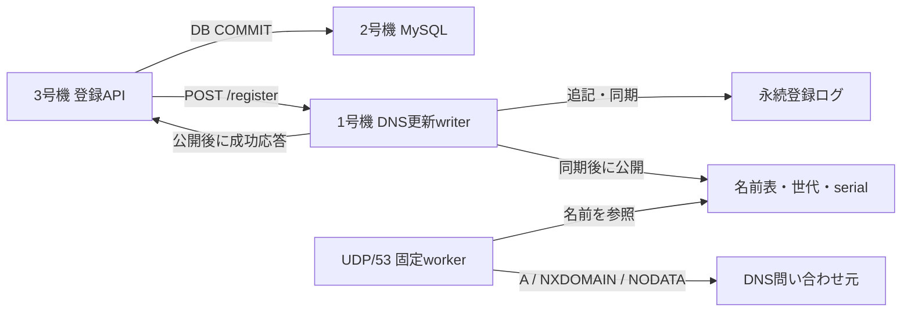

# 差分永続化とGo DNSの設計

2026-10-01。ユーザーと合意した設計。実装とデプロイを依頼され、この設計に沿って反映する。

## 判断の根拠

基準はfinalized RUN `20261001-171503`、315,736点、PASS。
負荷60.001秒の成果物に欠損・周期計測の品質不良はない。

| 同じ負荷区間の指標 | 値 |
|---|---:|
| 1号機のCPU需要／容量 | 95.89／120 core秒 |
| nginxのCPU需要 | 51.02 core秒 |
| PowerDNSのCPU需要 | 27.21 core秒 |
| DNS更新サービスのCPU需要 | 13.63 core秒 |
| 登録API完了件数・平均応答時間 | 1,838件・34.22ms |
| ゾーン再読込み | 1,860回 |
| DNS更新サービスのcgroup書込み量 | 164.95MB |

再読込みは登録とほぼ1対1。最初／最後の10秒で、再読込み340→278回、
DNS書込み21.20→32.09MB、登録平均29.60→39.56msとなった。
全ゾーンを毎回ソート・生成・同期・再読込みする仕事は、登録数とともに増える。
入口のCPU競合もあるため、応答時間の増加を全量ゾーン処理へ帰属させない。

180秒のfgprofでは登録62.20 goroutine秒のうちDNS更新49.15 goroutine秒。
初期化・終了後を含む値であり、負荷60秒のCPU core秒とは比較・加算しない。
読み取りSSHで確認したPowerDNS累積応答の約91%はNXDOMAINだった。
これはRUN窓の差分ではなく補助根拠。TTLだけではランダム名の仕事と登録更新は減らない。

## 構成と範囲

1号機の既存`isupipe-dns.service`にUDP/53の権威DNS応答を統合する。
同じGoバイナリの`ISUPIPE_MODE=dns-control`を利用する。
UDPはIPv4の`0.0.0.0:53`、更新HTTPは現在と同じ1号機のprivate IPの8053番を使う。
HTTPはloopback・1号機自身・3号機を送信元で制限する。private IPへの自己接続も許可する。
DNSのA応答はTaskfileの`DNS_RECORD_ADDRESS`（現行54.250.213.246）を使う。

UDP処理は名前表だけを参照し、DB・HTTP・ディスク・外部コマンドを呼ばない。
PowerDNSへの公開、SOA反映のポーリング、毎回のゾーン生成を削除する。
DBとDNSをまたぐトランザクションは追加しない。登録は現行と同じくMySQL COMMITの後にDNSを更新する。
DNS失敗時は登録APIを成功扱いしないが、COMMIT済みユーザーはDBに残る。

## 名前表と公開

起動時に公式初期ゾーン`webapp/pdns/u.isucon.dev.zone`からA・NS・SOAを読み込む。
取得済み資材はAが1,278件、NSが1件、SOAが1件。既存の名前・SOA各値を正本とする。
この資材の文法に限定したパーサーを使い、未対応の記述・不正な名前を黙って捨てず起動時に検出する。
全初期名を動的登録の有無から独立して維持し、resetで動的名だけを消す。

キーは末尾のrootを含むFQDNで、ASCIIの大文字だけを小文字化する。
ユーザー名中の`.`は現在と同じラベル区切り。空白・日本語などはDNSラベルの元バイトを保ち、
ゾーンファイル向けの`\\DDD`表現を名前表へ格納しない。IDNA変換・Unicodeの正規化は追加しない。
現在の`validDNSUser`の受理範囲とwire長・ラベル長を照合する。

名前表にはAを持つ名前と、子だけが存在する名前を区別して格納する。
たとえば`child.parent.u.isucon.dev`だけを登録した場合、`parent.u.isucon.dev`へのAはNODATAになる。
親を自動的にAへ変えず、名前が実在するという情報だけを追加する。

名前表・世代・SOA serialを1個のRWMutexで保護する。
UDP workerは応答に必要な値をRLock中に読み、ロックを解放してからpacketを作成・送信する。
writerは同期中にこのロックを保持せず、公開するときだけLockする。
登録ごとの全mapコピーを行わない。resetでは初期名だけの新しい表へ交換する。

## 登録と世代

更新writerは1本。HTTPの受付キュー128件、1回最大32件とする。
最初の要求を受けたら既に届いた要求を集め、人工的な2ms待ちは入れない。
resetを通常登録と同じbatchへ混ぜず、キューの順に境界を作る。

1. 世代・名前・容量を検査し、同じbatchと公開済み表の重複を除く。
2. 新しい名前のログレコードをまとめて追記する。
3. ファイルを同期する。
4. 同期成功した名前・祖先の存在情報・serialを1回のLockで公開する。
5. 対応するHTTP要求へ成功を返す。

重複登録は現在の世代の公開済み名だけなら追記・同期をせず成功する。
ログ同期前には新しい名前をDNS応答に使わない。
受理後のクライアント切断で他の要求や公開を取り消さない。
同期完了後にHTTP応答を失った場合は、再起動後も登録が残ることがある。

`/register`・`/reset`・`/generation`のJSON契約（`epoch`・`serial`・`error`）を維持する。
`/generation`は公開済み状態の読取りで、登録writerの収集待ちを通さない。
reset完了後、旧epochの登録を拒否する。epochはheaderで永続化する64bit値とする。
既存headerからのresetはepochを1増やす。最初の作成では暗号学的乱数の非0値を使い、
DB再作成後の過去epochとの衝突を避ける。桁あふれでは現在値と異なる新しい非0値を採番する。

## 保存形式と復元

保存先は`/var/lib/isupipe/dns/registrations.wal`の1ファイル。
可変長のJSON・ゾーン再生成を避け、32-byte headerと288-byte固定長レコードにする。
整数はlittle-endian、CRCはCRC32C。形式versionはmagicに含める。

| headerのフィールド | bytes |
|---|---:|
| magic `ISUDNS01` | 8 |
| epoch | 8 |
| 基準SOA serial | 4 |
| レコードサイズ（288） | 4 |
| 予約領域（0） | 4 |
| 前28 bytesのCRC | 4 |

| 登録レコードのフィールド | bytes |
|---|---:|
| sequence（1からの連番） | 8 |
| FQDNの長さ | 2 |
| 正規化したFQDNと0埋め領域 | 254 |
| 予約領域（0） | 20 |
| 前284 bytesのCRC | 4 |

SOA serialは基準serial＋公開済みsequenceの下位32bitで決定する。
同一batchで複数名を公開するときは、最後のsequenceまで同時に公開する。
ログにはIPを格納せず、起動時のTaskfile由来のアドレスを全A応答へ適用する。

通常更新は追記と`File.Sync`を1回行う。初回は約31更新/秒であり、
投稿WALの約600件/秒とは異なるため、事前確保・追記と同期の並行化を追加しない。
最新RUNの1,838登録ならレコードの論理量は約529KB。
cgroupで測った165MBの物理書込みと直接比率を取らず、変更後も同じcgroup指標で評価する。

復元はheader・全レコードのCRC、予約領域、名前、連番、重複、上限を検査する。
EOFの不完全な最終レコード（288 bytes未満）だけを切り詰め、ファイルを同期してから公開する。
完全長レコードのCRC不一致・連番不整合・途中の破損は末尾でも成功扱いせず、起動を失敗させる。
同期済みの完全なレコードはHTTP応答の有無によらず復元する。
通常の再起動ではログの削除・空の初期状態への置換を行わない。

## resetと未初期化状態

resetはwriterを通し、それより前に受理した登録を完了させてから行う。
新しいepoch・基準serialだけのheaderを一時ファイルへ書き、ファイル同期、rename、
ディレクトリ同期の完了後に、初期名だけの表と新しいファイルへ交換して応答する。
負荷中の登録ではrename・ディレクトリ同期を行わない。
これにより公式初期化ごとにログを小さくし、通常運転での圧縮処理を不要にする。

renameや同期の結果が不明なまま旧ファイルへ追記を続けない。
書込み・同期・resetの失敗では以後の登録を503、DNSをSERVFAILにし、状態を確認済みとして扱わない。
明示的な`/reset`が新headerの永続化・公開まで成功した場合に受付を再開できる。
通常の再起動で破損を検出した場合は、公式再初期化を伴う`task db-recreate`で再作成する。

ログがない起動は未初期化状態とし、UDPはSERVFAIL、`/register`と`/generation`は503にする。
`/reset`とprivateな`/status`だけを使用できる。
既存のGoアプリは起動時に`/generation`を読むため、初回`db-recreate`ではDNSのstart後に
同じ`/reset`を呼び、headerを作成してから3号機アプリを起動する。
その後の正式な`POST /api/initialize`も通常どおりresetする。
bootstrap用の別実装・移行スクリプトは作らない。

## DNS応答

既存の`golang.org/x/net/dns/dnsmessage`でpacketを解析・生成する。
固定2 workerが1個のUDP socketを共有し、workerごとに受信・送信bufferを持つ。
packetごとのgoroutineや未知名のキャッシュを作らず、水責めで名前表が増えないようにする。
受信は4096 bytesまで、応答はEDNSなし512 bytes、EDNSあり最大1232 bytesに制限する。
`ReadMsgUDPAddrPort`の切詰めflagを検査し、範囲を超える受信packetを切り詰めた内容で解釈しない。

| 問合せ | 応答 |
|---|---|
| 初期名・同期公開済み登録名のA | NOERROR、設定されたIPv4のAだけをAnswerに返す |
| ゾーン頂点のNS / SOA | 公式初期データを基にNS / 現在serialのSOAを返す |
| 既知名のAAAAなど、存在しないRR type | NOERROR・空Answer、AuthorityにSOA（NODATA） |
| 子だけ存在する名前のA | NODATA |
| ゾーン内の未知名 | NXDOMAIN、AuthorityにSOA |
| ゾーン外 | REFUSED、再帰は行わない |
| ANY | 実在するRRsetを返す。未知名はNXDOMAIN |
| QUERY以外のopcode | NOTIMP |
| 不正packet・Question数が1以外 | 応答可能なheaderがあればFORMERR。短いheaderや応答packetは破棄 |

IDとRDを引き継ぎ、QR=1、ゾーン内応答はAA=1、RA=0、AD=0とする。
IN以外のclassはREFUSED。EDNS version 0を処理し、未知optionは無視、未対応versionはBADVERS。
応答が許容長を超える場合はRR単位で省略し、TCと件数を正しく設定する。
TCP fallbackは公式ベンチが利用しないため、UDPに実装を絞る。

既知AのTTLを300秒とする。負荷中のアドレスが固定であること、
ベンチ側キャッシュがベンチ終了までという公式要件を利用する。
負の応答のSOA RRのTTLは0秒にし、未知名の否定キャッシュが新規登録の公開を遅らせないようにする。
SOAのrefresh/retry/expire/minimumの値は公式資材を維持する。
未知名へのA、ワイルドカード、登録公開前の先行応答は追加しない。

## 容量と故障時

初期値は動的名10万件、名前表の総entry数20万件、モデル予算64MiB、ログ32MiB。
予算はキーとentryの保守的な概算で、GoプロセスのRSS上限ではない。
名前と祖先を追加した後の増分を同期前に確認し、上限超過は登録を503にする。
保存済み名を容量確保のために削除しない。復元時も同じ上限を検査する。
最新RUNの登録約1,900件から十分な余裕があり、負荷でRSS・entry数を確認する。

起動時は初期資材・ログを検査し、UDPとHTTPをbindして処理loopを起動してからsystemdへREADYを送る。
未初期化は`/status`のready=falseで区別する。READY通知はlistenerが利用可能という意味に限定する。
UDPまたはHTTPの致命的エラーではプロセスを終了し、既存のRestart設定で再起動する。
サービス停止ではHTTP受付を閉じ、受理済みwriterを完了してログを閉じる。
永続性は停止時のdrainだけに依存しない。

## ファイル・サービス・Taskfile

Goの主な変更は`dns_control.go`、追加は`dns_journal.go`・`dns_server.go`と対応テスト。
現在の全ゾーン生成・再読込み関数と旧保存形式のテストを置換する。
投稿WALやアプリのDBスキーマを変更せず、共通WALフレームへの抽象化も行わない。

`isupipe-dns.service`を更新し、既存pdnsユーザー・StateDirectoryを使う。
UDP/53用にCAP_NET_BIND_SERVICEを与える。
初期ゾーンと環境ファイルの配布先は`/etc/isupipe-dns/`へ整理する。
不要になったPowerDNSの設定・drop-in・配布・検査処理を削除し、pdns.serviceをdisable/stopする。
PowerDNSとGo DNSを並行稼働する切替フラグは追加しない。

Taskfileの正本からDNSホスト・IP・公開アドレスを生成する。
`PDNS_HOSTS` / `PDNS_IP`を`DNS_HOSTS` / `DNS_IP`へ改名し、コンテスト値区画に置く。
既存アプリ用の`ISUCON13_POWERDNS_SUBDOMAIN_ADDRESS`は接続契約として利用する。
`MANAGED_SERVICES`からpdnsを外し、isupipe-dnsのcgroup計測を継続する。
競技固有の生成・配布・check・roles・db-recreateの調整は`Taskfile.contest.yml`と
`tools/contest/deployments.yaml`に置き、汎用Taskfileのgraphを競技固有にしない。

初回導入は既存`task db-recreate`を利用する。
計測停止後、更新資材を配布し、アプリと旧DNSを停止、DNSログを再作成対象にする。
DB再作成、Go DNS起動とreset、アプリ起動、公式initialize、既存公開APIチェックの順とする。
旧ゾーンから動的登録を移す互換処理は作らない。
DNS実装の配置は1号機だが、この既存初回経路は2号機DB・アイコン、3号機Goにも作用し、
競技データを初期化する。nginx設定の変更は不要。
初回以降のDNS単体deployは永続ログを保持して1号機だけを再起動する。
Goは実ホストのOS/Archを確認し、ローカルでLinux/amd64へbuildする。

## 必要な確認と評価

実装後の確認は次の確定境界に絞る。

1. 初期名・新規名のA、未知名のNXDOMAIN、既知名のAAAAと子だけ存在する名前のNODATA、NS/SOA。
   DNS名の大小文字・既存受理範囲、圧縮・EDNS・packet長も必要な代表ケースで確認する。
2. 同期を保留した新規名がDNSへ出ず、HTTP成功直後には取得できること。
   同一batchの重複、reset前後の世代、切断、読取りとのraceを確認する。
3. 再起動で登録・epoch・serialが復元されること。不完全末尾だけの復旧、CRC破損・連番不整合の拒否、
   write/sync/rename失敗時に成功しないこと。SIGKILL後の復元で停止時drainへの依存を除く。
4. 既存smokeの登録直後DNS・サブドメインHTTPS、DNS再起動後の再取得、公式initialize後の消去。
   初回bootstrapから`task db-recreate`が完了し、42秒制限を守ること。

localhostの一時ログ・一時UDP portによるrace testと、明示的deploy指示後の既存smokeを使う。
汎用DNSの網羅試験や、ベンチ・profileの自動実行は行わない。

privateな`/status`にはready/failed/epoch/serial、動的名数・entry数・ログbytes、
更新件数・同期回数/時間、DNS問合せ/A/NXDOMAIN/NODATA/送信失敗の累積数を出す。
読取り用の競技タスクから確認できるようにし、requestごとのログは出さない。
負荷窓の開始・終了に一致する差分がない累積カウンタは、RUN窓の値として扱わず補助資料にする。
初回比較は既存のproc/service metrics、access log、bench.log、DuckDBの同じ負荷窓を使う。
新しい周期collector・DuckDB基盤の改修を実装の前提にしない。

仮説目標は負荷窓の登録平均10ms以下、DNS関連CPUが基準40.84 core秒から十分に減ること。
前後で1号機CPU・CPU pressure・DNS cgroup書込み・登録件数と時間、
投稿件数・視聴完了数・スコア・DNS失敗を比較する。
処理量が増えた場合はCPU総量だけを成功条件にせず、同じ負荷窓の登録成功件数・HTTP処理量も併せて評価する。
新Go DNSの問い合わせコストとfsync実測、TLS/HTTPへの律速移動、TTLによる問い合わせ減は未確定。
登録時間の短縮率を得点の改善率には換算しない。

## 実装・デプロイ結果

ユーザーから実装とデプロイの明示指示を受け、2026-10-01に反映した。
Go DNSと差分ログを1号機、同一Goバイナリのアプリを3号機、アイコン読取りを2号機へ配布した。
全ホストのLinux/amd64と計測停止を確認し、ローカルでクロスコンパイルした。
PowerDNSは全3ホストでdisabled/inactive、Go DNSは1号機だけでenabled/active。

- `task config-check-dns`と`task check-fast-paths`のローカルrace testに成功。
- `task check-dns-linux`で実Linuxの同期前非公開、I/O失敗、末尾切詰め、CRC破損拒否、
  resetのキュー境界、切断後の処理継続、capacity、SIGKILL後復元、UDP応答を確認した。
- deployctlのテスト、`task setup-preflight`、DB再作成とDNS単体配布のdry-runに成功。
  配布許可パスは既存の競技固有`/etc/powerdns/`を`/etc/isupipe-dns/`へ置換した。
- 初回は`task db-recreate`でDBとDNSを再作成し、公式initializeは11.608秒で完了した。
- `task check-app-deployment ICON_SMOKE_PHASE=write REGISTRATION_SMOKE_PHASE=write`で
  登録直後のDNS・ログイン・サブドメインHTTPS、アイコン更新と認証APIを確認した。
- `task deploy-dns`でDNSだけを再起動し、epoch・serial・動的名数・entry数・ログサイズが一致した。
  登録1件のログはヘッダー32 bytes＋レコード288 bytes＝320 bytes。
  readのsmokeでDNS・サブドメインHTTPS・アイコンを再取得できた。
- `task check-role-split`でサービスの役割、Go/nginx/MySQLの疎通、DNS応答、実行バイナリを確認した。
  アプリ・DNS・アイコンのバイナリSHA-256は
  `32464a8756d83240a5ebf2a6b5547814084e4f22616ee82e2fced00302df3be4`。
- 最後に`task deploy-dns-initialize`を実行し、公式initializeは11.590秒で完了。
  `task check-dns-reset`で登録したsmoke名のNXDOMAIN、動的名0件・初期名1,278件・ログ32 bytesを確認した。
  最終epochは3461585519535726702、serialは1790850106。
  初期化後の認証APIとアイコン読取り（fresh、1,000ユーザー）も正常。

初回配布から再起動・初期化確認までの手順は`task deploy-go-dns`にまとめた。
通常のDNS単体配布は`task deploy-dns`で1号機だけを対象にし、登録ログを保持する。
`task deploy-dns-initialize`は競技DB・DNS・アイコンを公式初期状態へ戻す操作である。
操作ログは`.task/go-dns-*.log`、再起動前後と最終状態は`.task/go-dns-{before,after,final}.tsv`。
OSの再起動とベンチは実施していない。負荷時の性能・スコア効果は次のユーザー実行RUNで評価する。
