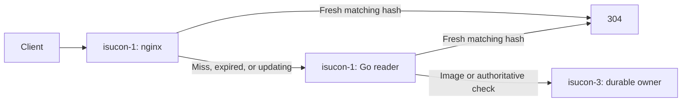

# nginx直接304とローカルicon readerの詳細設計

2026-10-01。実装・デプロイ済み。実機smokeと構成検査は完了。負荷時の効果は次のユーザー実行ベンチで評価する。

## 目的と根拠

`20261001-211406`の得点負荷60秒における`GET /api/user/:username/icon`を対象とする。
既存DuckDBの`load_windows`とraw access logを結合し、リクエスト開始時刻で区間を切った。

| 応答 | 件数 | 平均 | p99 | 累計request time |
| --- | ---: | ---: | ---: | ---: |
| 304 | 188,967 | 0.5151ms | 3ms | 97.342秒 |
| 200 | 199 | 1.5879ms | 4ms | 0.316秒 |

304は99.895%。全件が1号機nginxから2号機の`172.31.37.38:8054`へ転送されている。
変更前のGoはメモリ上のhashで304を判定し、304ではDB・画像ファイルを読んでいなかった。
したがって、主要な削減対象はホスト間通信と、nginxからGoへのHTTP転送処理である。
97.342秒は並列要求の合計であり、シナリオの経過時間や得点倍率へ直接換算しない。

負荷60秒のCPUは1号機85.086/120 core秒、2号機icon readerは17.812 core秒。
判定を1号機へ集めるため、nginxのCPU増減も得点と同じ時間窓で評価する。
iconがシナリオの直列待ちをどれだけ占めるか、得点への効果量は未確定。

## 確定する配置と処理経路

| ホスト | 担当 |
| --- | --- |
| isucon-1 | nginxのhash判定・直接304、icon reader Go、hash同期・公開 |
| isucon-2 | MySQL。既存icon readerは移転後に停止・disable |
| isucon-3 | iconの永続画像とMySQL metadata、画像200、更新通知、差分snapshot |

1号機のGoは1つのプロセスで2つのlistenerを持つ。

- nginxからのAPI要求: `/run/isupipe-icons/http.sock`。
- 3号機からの更新通知と内部status: `172.31.40.191:8054`。

systemdの`RuntimeDirectory=isupipe-icons`でsocket directoryを作る。
API socketはnginx workerが接続できる権限にする。内部更新APIはTCP listenerでのみ受け付け、
現行のorigin IP制限を維持する。nginxの公開listenerは`/_internal/`を遮断する。

nginxからGoへのupstreamはUnix socketをprimaryとし、3号機を既存同様のbackupとする。
Goから画像本体を取得するときは既存ReverseProxyとkeepaliveを使用する。



| 要求・状態 | 経路 |
| --- | --- |
| GET、通常の単一ETagが一致、hash公開が有効 | nginxがETag付き・bodyなしの304 |
| nginxのhash不足・公開期限切れ・更新中 | ローカルGoへ転送。Go側も有効なhashがある場合だけ304 |
| hash不一致、条件ヘッダなし | ローカルGoから3号機へ転送し、正本で応答 |
| 弱いETag・複数ETagなど | 既存Goへ渡し、既存のETag解釈を利用 |
| 未知ユーザー | 3号機が404を決定 |
| GET以外 | Goへ渡し、既存のmethod handlingを維持 |
| ローカルGo接続不能 | nginxのupstream backupで3号機へ転送 |

nginxの判定失敗をHTTP 500にせず、通常のローカルGo経路へ渡す。
正本側のエラーをキャッシュで隠さない。

## nginxモジュールの導入

導入前に実ホストを`task ssh HOST=isucon-1`経由で読取り確認した。

- nginxはUbuntu版`1.18.0-6ubuntu14.4`、`--with-compat`付き。
- `ngx_http_js_module.so`は未導入。
- 現在のAPT indexでは`libnginx-mod-http-js`の候補を取得できなかった。
- ローカルDockerは稼働中で、daemonはLinux/aarch64。

nginx本体の更新を必須にせず、nginx 1.18.0のsourceと`--with-compat`を使った
**njs 0.8.9のHTTP dynamic module**をローカルDockerの`--platform linux/amd64`でビルドする。
sourceと取得checksumを固定し、成果物は`ngx_http_js_module.so`のみを配布する。
Goとcollectorは従来通りLinux/amd64へローカルクロスコンパイルする。

ローカルUbuntu nginx 1.18.0でmodule loadと`nginx -t`に成功した。
実ホストの`1.18.0-6ubuntu14.4`でも独立設定・配布設定の両方で読込みに成功した。
njsの`ngx.error_log_path`だけ、nginx 1.18の`ngx_cycle->log->file->name`を参照する
互換patchを適用した。nginx本体は更新していない。
配置は`/etc/nginx/ngx_http_js_module.so`。設定rsyncではこの成果物を削除対象から除外する。

njsの共有辞書は0.8.0以降で利用でき、0.8.9のsourceにも該当directiveがある。
`js_content`で判定し、条件が成立しない場合は`r.internalRedirect('@icon_reader')`で
通常のproxy処理へ渡す。画像本体をJSで取り込んで転送しない。

参照: [共有辞書の公式仕様](https://nginx.org/en/docs/http/ngx_http_js_module.html#js_shared_dict_zone)、
[dynamic moduleの公式ビルド手順](https://nginx.org/en/docs/njs/install.html)、
[njs 0.8.9のHTTP module source](https://github.com/nginx/njs/blob/0.8.9/nginx/ngx_http_js_module.c)。

## 正本、同期と有効期限

永続画像・users.icon_hash・icons metadataの正本は現行のまま3号機とMySQLに置く。
アップロードではfileとdirectoryの同期保存、DB COMMIT、メモリhash公開、通知の順序を維持する。
nginx/readerのhashは永続化しない。

3号機→1号機Goは既存のepoch/revision付きsnapshotを100ms間隔で取得する。
取得開始時刻を`t0`とし、成功snapshotの期限を`t0 + 750ms`とする。
既に期限を過ぎた応答は、hashを受け取れても新しい有効な公開として扱わない。
通知は差分を早く反映するために使い、通知を受け取っただけでは期限を更新しない。

1号機Go→nginxにも同じ期限を渡す。
Goとnginxは同じホストの時刻で判定し、Goで求めた期限をUnix millisecondsで渡す。
nginxへの送信・ACK・retry・heartbeatを起点に期限を延ばさない。
変更なしsnapshotが正常に取得できた場合のみ、その取得開始時刻から期限を更新できる。

100msごとの正常同期では更新の反映が早く、通知欠落・同期停止時でも、
最後に取得したsnapshotから750msで古いhashによる304を停止する。
これはメタデータの使用期限の上限であり、停止中のworkerやネットワークを含む
応答完了時間全体を750msと保証するものではない。
公式の更新反映2秒以内は、画像本体・APIのicon_hashと合わせて実HTTPで確認する。

## Goからnginxへの公開

nginxは以下の2つの共有辞書を持つ。workerごとのJS objectを正本にしない。

| 辞書 | 初期容量 | 内容 |
| --- | ---: | --- |
| icon_hashes | 8MiB | 正規化ユーザー名→64文字hash |
| icon_control | 64KiB | 公開marker、epoch/revision、公開cursor、writer lock、公開状態 |

自動evictionとdisk persistenceは使わない。容量不足を検出した場合は直接304を停止し、
Go経路へ渡す。初期化後と最大ユーザー数で容量を確認する。

ユーザー名の正規化は現行Goと同じ末尾ASCII space除去とする。
通常の単一ETagは引用符を含めて一致判定する。
特殊なURI・ETagはGoへ渡し、無条件GETに304を返さない。

Goに専用publisher goroutineを1つ置く。refreshと通知handlerはメモリ状態を更新し、
publisherへ変更を知らせる。元のAPI要求からnginxのACKは待たない。
publisherは変更通知で即時に起き、送信中に溜まった差分をまとめる。
変更なしsnapshotの期限更新も同じpublisherを通す。公開を100msの固定待ちにはしない。

公開APIは1号機nginxの`127.0.0.1:8055`だけで受け付ける。
GET statusとPOST publishを用意し、外部・3号機からの直接書込みは受け付けない。
bodyの上限は4MiBとし、publish JSONを検証してから共有辞書を変更する。
`client_body_buffer_size`も4MiBにする。njsの`r.requestText`ではdiskへ退避されたbodyを
読めないため、full snapshotをメモリ内に保持する。

公開要求のfields:

| field | 意味 |
| --- | --- |
| base_publish_id | 書込み前に期待するnginxのcursor。空文字は完全に空の初回のみ |
| publish_id | 論理的な公開ごとに新しいUUID。同一IDの二重適用は拒否・既反映扱い |
| mode | full / delta / invalidate |
| epoch | 3号機のicon generation |
| base_revision / revision | 差分の開始・終端revision |
| valid_until_ms | 3号機への取得開始から決めた期限 |
| changes | 正規化済みname/hashの差分。fullの場合は全件 |

statusはcursorとepoch/revision、clean/dirty、lock、残容量を返す。
GoはACKを確認した公開位置から差分を作る。
ACK消失時はstatusを読み、現在の公開位置を取得する。送信IDが既反映なら
その位置から次の差分を作り、最新Go状態と元のsnapshot期限を使う。
cursorの競合・世代変更・dirty状態では、現在のGo状態を取り直してfullを公開する。
古いpayloadのbaseだけを差し替えて再送しない。
同じpublish_idが既に反映済みなら再適用せず成功済みと判断する。
古いretryが新しいcursorの後に届いた場合は拒否する。

### 書込みの原子性

共有辞書の単一操作だけでは、複数nameとmetadataをまとめて原子的には変えられない。
次の手順を固定する。

1. `icon_control.add`でwriter lockを取得する。競合時は変更せず409。
2. base cursor、epoch/revision、Goが渡した期限を検証する。
3. 公開markerを削除し、controlをdirtyにする。ここから新しい直接304を停止する。
4. fullならhash辞書をclearして全件反映、deltaなら差分を反映する。
5. 全件成功後にcursorとcontrolを確定する。
6. 最後に新しい`publish_id:valid_until_ms`のmarkerを1回のsetで公開する。
7. lockをfinallyで解放する。

変更なしの期限更新にも新しいpublish_idを使い、古いmarkerを再利用しない。
期限切れのfull/deltaは公開しない。invalidateはmarkerを消し、full要求の状態へ進める。
途中失敗時はmarkerを戻さずdirtyのままとし、次のfull成功までGoを使う。

writer lockには時間経過による自動解除を付けない。
停止していたwriterが再開して新writerと競合することを防ぐためである。
worker死亡でlockが残った場合、既存markerは削除済み、または750ms以内に期限切れとなり、
readerはGo経路へ渡る。lock回収だけの専用復旧機構は追加しない。
nginx再起動時には共有辞書を空にして再同期する。

### 読取りの原子性

nginx handlerは次の順序で読む。

```text
before = read active marker
hash = read hash for normalized username
after = read active marker
if before is absent or before != after or deadline has passed:
    use local Go
else if method is GET and ordinary single ETag matches hash:
    return 304 with ETag and no body
else:
    use local Go
```

公開markerを前後で比較することで、途中のclearや差分書込みを読み込んでも304を返さない。
UUIDを再利用しないため、公開markerが一度消えて同じ値に戻る問題も避ける。
readerが最終確認した直後に更新が始まる競合は、通常の更新反映期間内として扱う。

## 通知欠落・順序逆転・初期化・再起動

| 状態 | 動作 |
| --- | --- |
| 通知が連続revision | Goへ反映してpublisherを起こす。元のsnapshot期限を維持 |
| 通知のrevisionに欠落 | Goの期限を無効化、nginxへのinvalidateをenqueue。差分取得で補完してfull公開 |
| 古い通知・重複通知 | hashを巻き戻さない |
| snapshot取得中に通知・invalidate | 現行invalidation counterで古い取得結果を採用しない |
| nginx公開中に別通知 | publisherが次の差分を送信。期限を延ばさず750msの上限を維持 |
| 取得・公開に失敗 | heartbeatによる延命なし。期限切れ後は正本へ |
| Go再起動 | 空のメモリから取得。nginx cursorを確認してfull公開 |
| nginx restart | 空の共有辞書から開始。Goがfull公開 |
| nginx reload | 共有辞書を引継ぐ場合も同じ期限・cursor判定。old/new workerを並行して検証 |
| 3号機再起動 | 新epochのsnapshotでfullを公開し、古いnameを除去 |

公式initializeでは現行のappLifecycleによる排他と`invalidateIconReplica`を維持する。
通知先を1号機へ変更し、Goは同期中応答の無効化とnginxのinvalidateを行う。
初期化中のsnapshotは既存applicationLifecycleで待機し、成功完了後の新epochを取得する。
長く待ったsnapshotは取得開始からの期限が切れているため公開せず、改めて取得する。
initializeが排他lockを持ったまま外部Goのsnapshot取得完了を待つ処理は追加しない。
初期化完了直後に共有辞書が未構築でも、APIは正本への転送で正しく応答する。

## 計測ログを維持する

直接304にはupstreamがないため、既存`$upstream_http_x_measurement_session_id`だけでは
iconのsession_idが失われる。Cookieそのものをログへ出さず、既存Cookieの末尾32byteの
署名部分をhex化して、現行authSession.IDと一致する計測値をnginx変数へ入れる。
形式不正・期限切れは空とする。この抽出を認証や権限判定には使用しない。
不正Cookieの署名検証はこの公開GETの計測処理では行わず、認証APIは従来通りGoで検証する。

nginxログのsession_idはupstream値があればそれを優先し、直接304の場合にnginx変数を使う。
計測IDを外部HTTP headerへ出さない。Cookieや署名鍵を成果物・module・JSへ埋め込まない。
直接304はicon GET・status=304・upstream_addrが`-`または空という既存ログ列で区別できる。
per-requestの共有counterや新collectorは追加せず、既存ログ・CPU・DuckDBで評価する。

## 変更対象と配布手順

| 対象 | 変更 |
| --- | --- |
| Taskfile.yml contest区画 | ICON_READ_HOSTSをisucon-1へ変更。socket/control接続値を追加 |
| Taskfile.contest.yml | module build/checkと組合せdeployタスク。routing/topology生成の変更 |
| tools/contest/nginx-njs/ | pinned source/checksum、Linux/amd64 module用Containerfile |
| nginx/ | njs load設定・JS・共有辞書・loopback control listener・icon location・session_id変数 |
| webapp/go/icon_read.go・icon_edge.go | 2 listener、publisher、既存同期期限をnginxへ引継ぐ処理 |
| etc/systemd/system/isupipe-icons.service | RuntimeDirectoryとsocket設定 |
| tools/contest/deployments.yaml | module配布、icon reader移転、旧配置の停止を含むgraph |
| tools/contest/smoke/ | 直接304、更新、初期化、再起動後の確認 |

upstream生成物は手編集せず`task gen`を使用する。
役割の停止処理にもicon readerを加え、通常deployとdb-recreateのgraphでも新配置を維持する。
不要となる2号機reader経路を併存させない。

配布入口は`task deploy-icon-edge`。
計測停止とLinux/amd64を確認し、ローカルbuild/checkを済ませてから次の順で反映する。

1. 1号機へmoduleを配布し、実nginxでABI/リンクを確認する。
2. Taskfileの新topologyを生成・配布し、1号機Goと3号機通知先を反映する。
3. Goのメタデータ同期・Unix socket応答を確認する。
4. 1号機nginxへ設定とJSを配布し、`nginx -t`の後reloadする。
5. Goの初回full公開とnginx直接304を確認し、2号機readerを停止・disableする。
6. 更新・初期化・再起動のsmokeを完了する。
7. 共通Goバイナリを使う1号機DNSにも同じbuildを配布し、全ホストのroleを確認する。

新しいTaskfileの役割値で、移転直後に旧readerを誤ってactiveと判断しないよう、
新Goの起動・nginxの経路切替・旧Go停止の順序を競技固有graphに明記する。

## 必要な確認と採否

ローカルでmoduleを読み込んだnginxを2 workerで起動し、以下を確認する。

- 通常ETag一致の304、条件なし・不一致の200、未知ユーザー404、特殊ETagの既存処理。
- full/deltaの公開中、容量不足、失敗・ACK消失、古いbase、epoch変更で誤った304が出ない。
- 同期停止・通知欠落時に期限を延長せず、旧ETagへの200と最新画像が2秒以内に反映される。
- socket経由のGo、Go停止時の3号機backup、nginx reload時の複数workerの整合性。
- 正常Cookieのsession_idが従来と一致し、公開応答に計測headerが出ない。

Goは既存race testにpublisherの期限・revision・dirty状態でのfull再構築のケースを加えた。
実ホストsmokeは画像・hash・ETag・NGINXの直接応答を確認し、reader/nginx/app再起動と
公式initialize後の同名ユーザーで古い世代が残らないことを確認する。
GET中心の変更なので、無関係なDB設定・WAL・画像永続化の再設計は行わない。

次のユーザー実行RUNは最新RUNを基準に、得点負荷60秒で次を比較する。

1. PASS、画像更新要件、5xx。
2. 直接304の件数・割合、平均・p95・p99、Go/3号機へ渡った件数。
3. 通常viewer成功数、コメント・リアクションの処理量、最終スコア。
4. 1号機CPU/core秒・peak・CPU PSI、nginxとreader CPU、2・3号機の増減。

通常時の304平均0.515msを0.2ms以下へ下げることを評価目標とする。
これは見積りを保証する値ではない。njs VM生成・共有辞書のlock・ログ処理のコストが増えるため、
module導入だけで高速化したと判断しない。iconが速くても通常viewer・得点が伸びなければ、
得点を制約する経路という仮説は再評価する。ベンチマーカーはユーザーが実行する。


## 実装・反映結果

- `task check-icon-unit`: Goの全race test成功。
- `task check-icon-edge-local`: 2 workerの実nginxとLinux Goで6項目の連携検証成功。
  直接304、特殊ETag、計測ID、ACK再送・古いcursor拒否、容量不足時の閉鎖、
  通知欠落と期限切れ、更新画像、reload/restart、reader停止時の正本backup、世代切替を確認。
- 実機のwrite smoke: icon更新後の画像・API hash・ETag・条件付きGET・内部API遮断を確認。
  access logでupstreamなしの直接304と、既存Cookieから求めたsession_idの一致を確認。
- 1号機reader/nginxと3号機appを再起動した後も、更新画像と直接304のread smoke成功。
- 公式initializeは11.678秒で成功。初期画像・hashの一致と直接304を再確認。
- 初期化後、nginxのhash辞書は1,000ユーザー、残容量8,134,656 bytes、fresh・clean・unlocked。
  Go readerも同じepochの1,000ユーザーを保持。負荷後の最大ユーザー数・容量は次RUNで確認する。
- 2号機の旧readerは停止・disable済み。app/nginx/MySQLのrole、DB接続、DNS正当性の検査成功。

`deploy-icon-edge`の最初の実行では、icon関連の反映・smoke・初期化は成功し、
最後のDNSバイナリ一致検査で停止した。DNSは同じGoソースから別プロセスとして起動するため、
`task deploy-dns`で同じbuildへ揃え、`task check-role-split`を再実行して成功した。
この手順は`deploy-icon-edge`にも追加済み。再初期化だけのための再実行は行っていない。

| 成果物 | SHA256 |
| --- | --- |
| Go app / icon reader / DNS | `f14d5119c873e180bbf895ee3456bdff968b686b9f4bbd9831e0180e4595574e` |
| njs HTTP module | `319577b04f9c9585657ca6374634dec5d2f800a68c9fe0349257c24a3ca3f469` |

ローカル・反映ログは`.task/icon-edge-{unit,local,deploy,state,dns-deploy,roles}.log`。
ベンチマーカーは実行していない。直接304が機能することは確認済みだが、
負荷中のレイテンシ・CPUと得点の改善は未評価。
