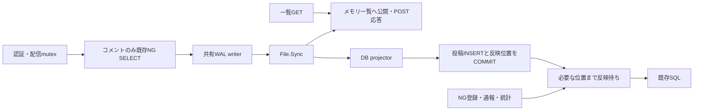

# コメント・リアクションの永続ログとメモリ一覧

2026-10-01。提案①の詳細設計と実装結果。ユーザーの実装・デプロイ指示に基づき、3号機のGoアプリと2号機のDBスキーマへ反映済み。

## 採用する範囲

3号機の単一Goプロセスを、コメント・リアクションの唯一の書込み元とする。
この2種類の投稿だけを、ローカルWALの同期保存後に成功応答する方式へ変更する。
一覧はメモリから返し、MySQLへのINSERTは別の処理でまとめる。

NG判定のSELECTはMySQLに残す。モデレーション、通報、入退室、統計、paymentも既存のSQLを使う。
ユーザー・配信・アイコン・タグは既存の参照モデルを使う。予約の受付方針はこの変更に含めない。

追加する常駐処理はWAL writerとDB projectorの2本。配信ごとの同期はmutex相当の1枠チャネルで行い、取得待ちのキャンセルを可能にする。以下ではこれを配信mutexと呼ぶ。
各配信にgoroutineやキューを作らず、汎用actor、独自のUnicode照合、ランキングの増分管理、
複数アプリへのowner移管、チェックポイント、WALローテーション、旧実装への切替機構は作らない。

## 根拠と効果の限界

比較基準はfinalized RUN `20261001-001258`、187,981点、PASS。
負荷60秒の生アクセスログをDuckDBで開始時刻へ戻して集計した結果は次のとおり。

| 処理 | 成功件数 | 平均 | p95 | 全応答の延べ時間 |
|---|---:|---:|---:|---:|
| コメント投稿 | 11,527 | 12.02ms | 20ms | 138.54秒 |
| リアクション投稿 | 10,185 | 11.62ms | 20ms | 118.33秒 |
| NG登録 | 3,653 | 12.32ms | 20ms | 45.02秒 |

同じ負荷窓のDB接続取得待ちは延べ0.266秒。
負荷外を含むSQL digestでは、コメントINSERTは平均1.230行、リアクションINSERTは1.212行。
180秒のfgprofではwriterからCOMMITへの待ちが延べ76.23秒だった。
後者2つは負荷60秒の費用へ換算しない。ロック詳細の欠損もロック待ち0として扱わない。

RUN全体のセッション遷移では、コメントPOST→リアクションGETが10,187回、
リアクションPOST→コメントGETが9,234回あり、重なりは0回だった。
一覧取得のたびにDB反映を待つ案では、投稿から次のGETへ待ちを移す可能性が高い。
このため、頻繁な2種類の一覧はメモリから返す。

この設計でもローカルFile.Sync、NG確認のSELECT、セッション処理、JSON生成は残る。
NG登録はDB反映を待つため、投稿短縮分の一部がNG登録へ移る可能性がある。
得点やリクエスト処理能力が何倍になるかは未確定。

## データと唯一の書込み元

| データ | 負荷中の読取り | 成功応答の保存条件 | 書込み元 |
|---|---|---|---|
| コメント・リアクション | 一覧はメモリ、統計は反映済みDB | WALのFile.Sync完了 | 投稿はWAL、DB INSERTはprojectorのみ |
| NGワード・コメント削除 | 既存のMySQL SQL | DB COMMIT完了、メモリ削除完了 | モデレーション |
| 通報のスナップショット | 既存のMySQL SQL | DB COMMIT完了 | 通報 |
| 入退室 | 既存のMySQL SQL | DB COMMIT完了 | 入退室 |

コメント削除をWALへ記録する必要はない。
モデレーションの前に、その配信の投稿をDBへ反映するので、削除対象の投稿はDBの反映済み位置より前にある。
再起動時に反映済み投稿を再INSERTしないことが、この省略の条件となる。

## 最小の構成

- `postStore`: 配信ID→状態。各状態はmutex、コメント・リアクションのモデル配列、最後の投稿sequenceを持つ。
- `postWAL`: 投稿要求の受付、ID・sequenceの採番、フレーム追記、File.Syncを行う1本のgoroutine。
- `postProjector`: 同期済みフレームを順にDBへ反映する1本のgoroutineと、`FlushThrough(seq)`。

モデルだけを保持し、入れ子のユーザー・配信・アイコンを含むJSON応答は保存しない。
既存の`fillLivecommentResponses`、`fillReactionResponses`で組み立て、最新のicon_hashを反映する。

起動・初期化時に全コメント・リアクションを一括ロードする。
リクエスト時のキャッシュミスによる全履歴ロードやLRU退避は行わない。
新規予約はDB COMMIT後、参照の公開前に空の状態を登録する。

一覧は`created_at DESC`で並ぶ配列からlimit件をコピーし、mutexを解放してから応答を組み立てる。
同じ秒の行はID降順をタイブレークにする。現在のSQLは同秒の順序を指定していないため、
必要な確認は一覧のcreated_at順・limit・空配列・投稿の可視性に絞る。
limitの省略、0、負値、整数でない値については現行の応答を維持する。
投稿時刻は現在と同じくハンドラで決めるので、配列の挿入位置は時刻とIDで求める。

## 投稿の処理順

1. 現行の認証、入力解析、ユーザー・配信の参照確認を行う。
2. 文字列がMySQLのVARCHAR(255)へ保存可能か確認する。超過時は現行と同じ500を返す。
3. 全体の受付枠を取得し、該当配信のmutexを取得する。取得はrequest contextで中断できるようにする。
4. コメントは現行と同じNG判定SELECTを実行する。`utf8mb4_general_ci`、LIKE、ワイルドカード、エスケープを維持する。
5. 通過したモデルをWAL writerへ渡す。writerがIDとsequenceを割り当てる。
6. writerは複数配信の投稿を同じフレームへまとめ、追記してFile.Syncする。
7. 同期完了したモデルをメモリ配列へ追加し、配信の最終sequenceを更新する。
8. mutexと受付枠を解放し、応答を返す。

リアクションは手順4のSQLが不要。
コメントに残るSQLはNG確認1回であり、BEGIN、INSERT、SAVEPOINT、COMMITは投稿経路から外れる。
NGワード有無のキャッシュは追加しない。

配信mutexは検証からメモリへの公開まで保持する。同じ配信の次の操作はその後に進む。
別配信は独立して検証でき、共通のWAL writerで同期保存だけをまとめる。
mutex取得順を操作順とし、同時に到着したHTTP要求の開始時刻順までは保証しない。
GETも同じmutexで配列をコピーし、WAL同期前の投稿は公開しない。

WALへ渡す前のキャンセルは書き込まない。
writerへ渡した後は、クライアント切断でも確定結果を待ち、メモリ反映まで終えてmutexを解放する。
受理後のrequest contextをWAL同期やprojectorの中断に使わない。
APIに冪等キーがないため、HTTP要求の自動再実行は追加しない。

## WALと採番

保存先は3号機の`/var/lib/isupipe/wal/<generation>.wal`。
deploy対象のソースディレクトリ外に置き、サービスユーザーが書き込む。
稼働中の世代について1ファイルを保持し、通常運転中は削除・切詰め・ローテーションしない。
再起動で新しい世代は作らない。

ファイル先頭に形式versionと世代UUIDを置く。
続く各フレームはpayload長、CRC32C、JSON payloadから成り、payloadに連続したsequenceと投稿モデルを持つ。
操作はコメント追加とリアクション追加の2種類だけ。作成済みのID・本文・tip・時刻を保存し、復元時に再採番しない。
JSONとCRCはGo標準ライブラリを使う。独自バイナリcodecは作らない。

writerは1フレーム分を書き切ってFile.Syncし、そのフレームの全要求を完了させる。
Sync中に追加追記する二重バッファは作らず、新しい要求は有界キューへ入れる。
ファイル作成時はヘッダとファイルを同期し、親ディレクトリも同期する。

コメント・リアクションのIDカウンタは別々に持つ。
起動時はDBの最大ID、AUTO_INCREMENTの次値、保持しているWAL全体の最大IDから次値を決める。
反映済み・削除済みのWALレコードも採番の確認には使う。
欠番は許容し、以降の負荷中のINSERTは明示IDを指定する。

## DB反映と反映済み位置

追加するテーブルは固定1行の`post_wal_state`のみ。

| 列 | 意味 |
|---|---|
| id | 固定値1、PRIMARY KEY |
| generation | 稼働中の世代UUID |
| ready | 初期化と世代の公開が完了しているか |
| applied_seq | この世代でDBへCOMMIT済みの連続した末尾sequence |

projectorは同期済みフレームを順に読み、まとめて1トランザクションで反映する。
コメントとリアクションをテーブルごとの複数行INSERTにし、同じトランザクションで`applied_seq`を更新する。
フレーム途中で反映済み位置を進めず、末尾sequenceだけを記録する。
新規投稿はimmutableな追加行なので、upsert、削除ログ、キーごとの投影位置、差分のcoalesceは不要。

`FlushThrough(seq)`は、該当sequenceまでDB COMMITが終わるのを待つ。
必要な位置が反映済みなら即座に返し、未反映なら定期反映の待ち時間を切り上げてprojectorを起こす。
projectorは配信mutexを取得しない。モデレーションがmutexを保持して反映を待っても循環待ちを作らない。

DB COMMITの結果が不明な場合は新しい接続で世代と`applied_seq`を読む。
対象フレームまで進んでいれば再INSERTせず完了扱いにする。
未反映または状態確認に失敗した場合はengineをエラー状態にし、再起動時に未反映分から復元する。
通常運転に汎用リトライ機構は加えない。

## 既存SQLを読む境界

| API | 追加する処理 |
|---|---|
| コメント・リアクションGET | メモリ配列から返す。DB反映待ちは不要 |
| モデレーションPOST | 配信mutex内で、その配信の最終sequenceまで反映を待つ |
| 通報POST | 既存のコメントID参照の前に、同期済みWALの末尾まで反映を待つ |
| 配信・ユーザー統計、payment | DBトランザクション開始前に、同期済みWALの末尾まで反映を待つ |
| NG一覧、通報一覧、入退室 | 既存のDB処理。これらのデータは非同期化しない |

統計は全配信のランキングを読むため、配信単位ではなく全体の反映位置を使う。
入口で取得した同期済み末尾までを待つので、応答済みの投稿を取りこぼさない。
その後に開始した投稿は、従来の並行リクエストと同様に読取りsnapshotへ含まれる場合と含まれない場合がある。

### モデレーション

配信mutexを取得して、その配信の投稿反映を待つ。
既存のトランザクションに、全NGワードの述語で削除対象のコメントIDを取得するSELECTを追加する。
NGワードINSERT、対象IDの取得、既存のDELETEを同じトランザクションで実行する。
DB COMMIT成功後、取得したIDだけをメモリ配列から除去して応答する。
Go側でLIKEを再実装せず、文字列・tipを持つコメント全件を再ロードすることもしない。

同じ配信の新規投稿はmutexで止まるため、対象ID取得と削除の間に新しい行が入り込まない。
COMMIT結果が不明な場合は新しい投稿を進めずengineをエラー状態にする。
成功した削除は再起動時のDBロードで復元される。

### 通報・入退室

同じ配信の更新は同じmutexを使い、現在の順序を維持する。
通報は現行のコメントID参照と本文スナップショット保存を維持する。
APIの配信IDとコメントの所属配信IDが一致しない入力も、今回独自に制約を変えず既存SQLで扱うため、
通報の前は全体の同期済み末尾まで反映する。
通報一覧は保存済みのスナップショットを読み、コメント削除後も参照切れを起こさない。
入退室は既存のINSERT/DELETEを同期実行し、同一ユーザーの重複入室・退室の扱いも維持する。

## 再起動と初期化

### 再起動

1. DBの世代、ready、反映済みsequenceを読む。
2. 対応するWALの世代、version、CRC、sequenceの連続性を検査する。
3. 不完全な最終フレームだけを切り詰めて同期する。完全なフレームのCRC不一致や途中の破損はエラーにする。
4. `applied_seq`より後の完全なフレームをDBへ反映する。
5. DBからコメント・リアクションと既存参照をロードし、投稿と読取りを受け付ける。

DBの反映済み位置が検証済みWALの末尾を超える場合や、readyな世代のWALがない場合は受け付けを開始しない。
Sync完了後に応答が失われた投稿も復元する。同期前にクラッシュしたフレームが完全に残っていれば、
未応答の投稿として復元されることがある。HTTP応答が失われた操作の確定結果が不明なのは現行と同じ。
正常終了時のdrainだけに永続性を依存させない。

### POST /api/initialize

全アプリ処理と初期化を共通のlifecycleロックで分離する。
初期化は受付を閉じ、受理済み投稿とprojectorを停止・回収してから、DBのreadyをfalseへCOMMITする。
その後、既存の`init.sh`で競技データを戻す。`post_wal_state`は`init.sql`のTRUNCATE対象に加えない。

新しい世代UUIDと空WALを作成・同期し、初期データと参照をロードする。
DBの世代・`applied_seq=0`・ready=trueをCOMMITしてからengineを公開し、`lang=golang`を返す。
旧世代のWALは、この完了後に削除する。途中失敗では新世代を公開しない。

ready=falseの再起動では、通常APIを503にしてinitializeだけを受け付ける。
初期化途中のDBから通常の参照をロードしてサービス開始しない。
`task db-recreate`で作成するスキーマの初期行もready=falseにし、残っている旧WALを再生しない。
既存のDB再作成と公式初期化で世代を切り替え、別のリセットスクリプトは作らない。
公式の42秒制限には、初期データのロードも含めて収める。

## 初期値と容量制御

値は初回実装の仮置きとし、次のユーザー実行RUNで実効値を確認する。

| 項目 | 初期値 |
|---|---:|
| 更新の全体受付枠 | 256件 |
| WAL収集待ち／フレーム最大件数 | 1ms／64件 |
| フレームpayload上限 | 1MiB |
| 定期DB反映／1トランザクション最大件数 | 10ms／256件、フレーム境界で区切る |
| DB未反映WALの上限 | 16MiB |
| 世代内WALの上限 | 512MiB |
| メモリの行数上限 | コメント・リアクション合計50万件 |
| モデル配列と文字列の容量予算 | 256MiB |

モデル容量の予算は1行あたり256バイトと文字列のバイト数、配信状態あたり512バイトで追跡する。
256バイトにはモデル本体と配列の余剰capacityの余裕を含め、削除時は配列を詰め直して容量も解放する。
これはアプリ全体のRSS上限ではなく、map、GC、応答コピーを含む実使用量は既存のproc/profileで確認する。
上限の予約はWAL受理前に行い、成功応答後に保存先がなくなる状態を作らない。
WAL容量、未反映量、モデル容量の上限に達したら新規投稿を503にする。
同期経路への切替や古い行の勝手な削除は行わない。
未反映量だけが上限に達した場合は、projectorが追いつけば受付を再開する。

WALの追記・Sync失敗、projectorの失敗、モデレーションのCOMMIT結果不明では、
対象の配信更新を止めて失敗を返す。DBの古い値で代替することはしない。
成功応答済みのWALは保持し、復元で収束させる。
復元までメモリ一覧とFlushが必要なAPIも503にし、確定結果が不明な削除を古い一覧で隠さない。

## 変更ファイルとホスト

実装時の追加ファイルは`webapp/go/post_store.go`、`post_wal.go`、`post_projector.go`を基本にする。
既存の`mutations.go`・`mutation_barriers.go`は投稿とDB操作の共通入口として整理し、
旧4本FIFO、旧投稿INSERT処理、不要になったテスト専用処理を削除する。
2方式を設定フラグで併存させない。

コメント・リアクションのPOST/GET、モデレーション・通報・入退室の入口、
統計・paymentのトランザクション開始前、mainの起動・初期化、予約の参照公開点を変更する。
既存の認証、参照モデル、レスポンス組立、統計SQLは再利用する。
現在のinitializeには失敗時にもwriterを作り直すdeferがあるため、これをreadyによる公開へ置き換える。

`webapp/sql/initdb.d/10_schema.sql`に固定1行の管理テーブルを追加する。
WALディレクトリ作成は既存の競技側deploy定義へ加える。
確認・配布の入口は既存Taskfileを使い、追加が必要なタスクだけ`Taskfile.contest.yml`へ置く。

実装・配布対象は3号機のGoと永続ディレクトリ、2号機の競技DBスキーマ。
3号機へ配布される公式初期化資産も更新対象となる。
nginx/DNSの設定変更やアプリホスト追加は不要。
初回のスキーマ適用・初期化は計測停止後の既存`task db-recreate`経路を想定する。
今回は設計後に実装・デプロイの指示を受け、上記の経路で反映した。

## 必要な検証と評価

検証はこの変更で新しく生じる確定境界に絞る。

1. 同期前の投稿が一覧へ出ず、成功POST直後のGETでID・本文・時刻・最新icon_hashが一致すること。
2. 投稿→NG登録→投稿、通報→削除→通報が現行の結果になること。既存の照合・ワイルドカード検証を再利用する。
3. DB反映前の投稿を含む統計・paymentがFlush後に正しく、削除後のtip・最大tip・通報も正しいこと。
4. Sync失敗、DB COMMIT結果不明、プロセス停止を確定境界で起こし、IDの重複・投稿の消失・削除行の復活がないこと。
5. 不完全な最終フレームの復旧、初期化途中の停止と再初期化、DB再作成後の世代切替を一時DBと一時WALで確認すること。

ローカルrace testと既存の実MySQL一時DB確認を使う。
Goは実ホストで確認したLinux/amd64へクロスコンパイルする。
共有競技DBの初期化・サービス操作は明示的なデプロイ指示後に行う。ベンチはユーザーが実行する。

次の比較では同じ負荷60秒の得点、投稿成功件数、投稿・一覧・NG登録の平均/p95、
全ホストCPU core秒と容量、DB待ちを確認する。
WALについて同期した件数・Sync回数・Sync延べ時間、同期済みsequence・DB反映済みsequence、
未反映バイト数・最大容量を既存の計測出力へ最小限追加し、別の計測基盤は作らない。
投稿平均6ms以下・p95 10ms以下を仮説目標とするが、一覧やNG登録へ待ちが移って
得点が下がれば有効とは判断しない。予約枠の配分改善とは同時に混ぜず、このまとまりを比較する。

## 判断が必要な点

この最小構成は、NGのSELECTと低頻度APIのDB反映待ちを残す代わりに、
WALの操作を2種類、追加テーブルを1個、追加常駐処理を2本に絞る。
主な未確定点は、3号機のFile.Sync実測、NG登録による反映待ちの増加、メモリとJSON生成の増減。
独自WALの復元・初期化世代管理は、永続性の要件上省けない。
次のユーザー実行RUNで、実効値と得点への寄与を判断する。

## 実装・デプロイ結果

`task deploy-wal-posts`が成功。2号機で競技DBを再作成し、3号機で公式初期化を実行した。
初期化のactivationは8.194秒で完了し、42秒の制限内だった。
稼働バイナリのSHA-256はローカルのLinux/amd64ビルドと一致した。

- ローカル`go test -race ./...`が成功。
- `task check-app-improvements`の実MySQL一時DBテストが成功。同期前の非公開、Sync失敗、複数配信のまとめ保存、NG照合・削除・通報・統計、DB投影の原子性、COMMIT応答喪失、未投影WALの復元、不完全な末尾の切詰め、未完了初期化からの世代切替を確認した。
- HTTPS経由の認証API確認と投稿のwrite/read smokeが成功。3号機のGoアプリを再起動し、コメント・リアクションのID・内容・関連情報を確認した。
- 再起動前後のDB件数とtip総額は一致。コメント・リアクション各1,002行、tip総額7。
- 再起動前後とも同じWAL世代を維持し、`durable_seq=applied_seq=2`、`pending_bytes=0`、`failed=false`を確認した。
- ホストの役割とDNS動作の確認が成功。

今回のsmokeによる2件の投稿は性能評価用の負荷ではない。デプロイ作業ではベンチマーカーを実行していない。その後、ユーザーが実行したRUNの比較結果は[wal-posts-result.md](wal-posts-result.md)に記録した。
SQL pool APIの既存JSONへ`post_wal`を追加したが、既存collectorは`pools`のみをTSVへ保存するため、RUN成果物へWAL指標を残す対応が漏れている。同期回数・時間、反映位置、容量の時系列を評価するには収集側の対応が必要。
配布ログは`.task/wal-posts-deploy.log`、実MySQLテストログは`.task/wal-posts-mysql.log`に保存した。
